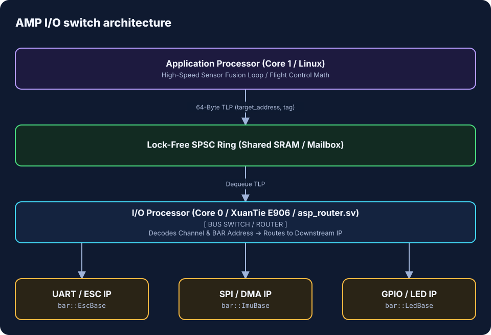
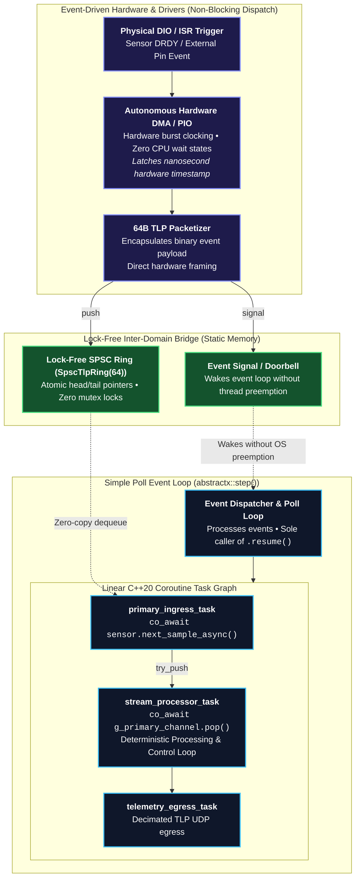
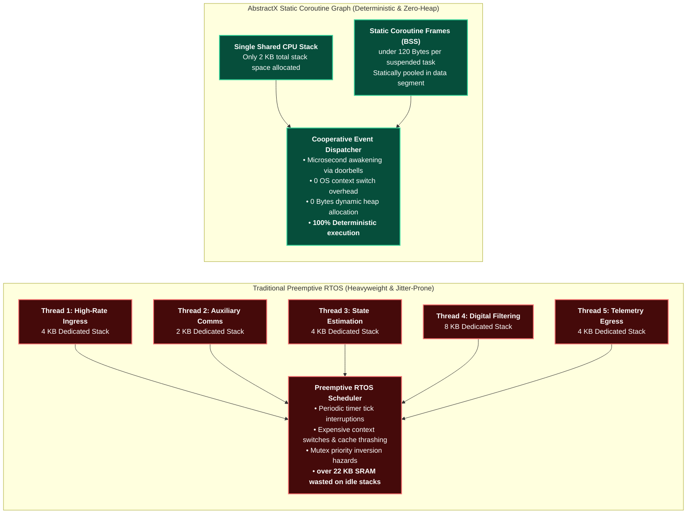
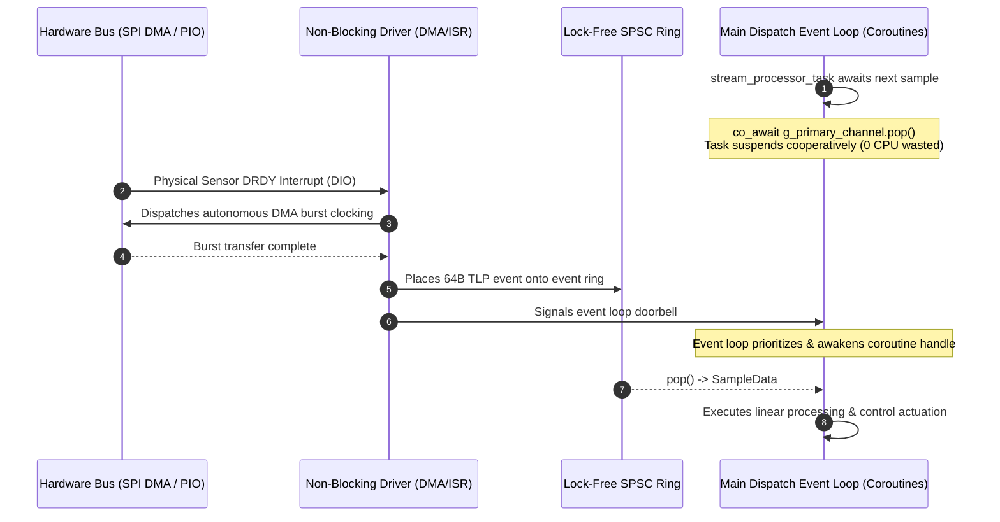

# AbstractX: Complete Architecture & Deep-Dive Specification

> **The Architectural Deep Dive: Hardware-Software Co-Design, C++20 Coroutines, Synthesizable SystemVerilog FPGA Fabrics, and Closed-Loop AI SpecTrace.**

---

## Table of Contents
1. [The Vision: Emulating a High-Speed Bus Fabric on Embedded Silicon](#1-the-vision-emulating-a-high-speed-bus-fabric-on-embedded-silicon)
2. [Architectural Principles: Limiting Memory & Maximizing Speed](#2-architectural-principles-limiting-memory--maximizing-speed)
3. [The "Middle Ground": Defeating Vendor SDK & RTOS Bloat](#3-the-middle-ground-defeating-vendor-sdk--rtos-bloat)
4. [The Zephyr Developer's Rosetta Stone](#4-the-zephyr-developers-rosetta-stone)
5. [Asymmetric Multiprocessing (AMP) & The I/O Switch Architecture](#5-asymmetric-multiprocessing-amp--the-io-switch-architecture)
6. [Why Traditional RTOSes Miss Distributed Multi-Processor I/O](#6-why-traditional-rtoses-miss-distributed-multi-processor-io)
7. [Polymorphic I/O: From C++ Coroutines to SystemVerilog RTL](#7-polymorphic-io-from-c-coroutines-to-systemverilog-rtl)
8. [Unified Design Pattern: Hardware-Software Co-Design](#8-unified-design-pattern-hardware-software-co-design)
9. [C++20 Coroutines & The Static Task Graph](#9-c20-coroutines--the-static-task-graph)
10. [The Primary-Paced Channel Pattern for Multi-Rate Fusion](#10-the-primary-paced-channel-pattern-for-multi-rate-fusion)
11. [Cross-Platform Silicon Scaling & Execution Matrix](#11-cross-platform-silicon-scaling--execution-matrix)
12. [C++ Framework Driver Architecture & Low-Level Silicon Bring-Up](#12-c-framework-driver-architecture--low-level-silicon-bring-up)
13. [FPGA Switch Fabric, PIO & 64-Byte TLP Integration](#13-fpga-switch-fabric-pio--64-byte-tlp-integration)
14. [Telemetry, Dynamic Barectf CTF 1.8 & AbstractX Studio](#14-telemetry-dynamic-barectf-ctf-18--abstractx-studio)
15. [100% Specification-to-Code Traceability & SpecTrace](#15-100-specification-to-code-traceability--spectrace)
16. [Repository Architecture & Directory Map](#16-repository-architecture--directory-map)
17. [Comprehensive Build, Simulation & Verification Guide](#17-comprehensive-build-simulation--verification-guide)

---

## 1. The Vision: Emulating a High-Speed Bus Fabric on Embedded Silicon

AbstractX is built around a single, game-changing architectural concept: **What if your entire embedded system behaved like a massive packet-switched bus topology with switches, endpoints, and transaction packets?**

In high-performance computing, CPUs do not wire point-to-point bespoke GPIOs or poll blocking hardware buses; they communicate across a **packet-switched fabric** using standardized **Transaction Layer Packets (TLPs)** routed through **Switches** to dedicated IP endpoints.

AbstractX brings this exact data-center computing model to microcontrollers, coprocessors, and FPGAs:
* **The Fabric**: Standardized 64-byte TLPs flowing across lock-free SPSC/MPSC rings (in shared SRAM, over SPI, or through FPGA AXI-Stream crossbars).
* **The Switch**: The I/O Processor (RP2350 Core 0, XuanTie E906 RISC-V, or FPGA `asp_router.sv`) acts as the **Switch**, decoding virtual BAR addresses and channel tags to forward transactions directly to downstream IP blocks (UART, DMA, SPI, GPIO/LED).
* **The Endpoints**: Hardware peripherals (IMU Auto-DMA, ESC controllers, LEDs) appear as clean endpoints on a virtual bus.
* **Split Transactions**: Application loops never wait for slow physical hardware clocking; they fire non-blocking posted writes (`MemWrite`) or await tagged completions (`CplD`).

---

## 2. Architectural Principles: Limiting Memory & Maximizing Speed

Traditional embedded architectures often rely on a Real-Time Operating System (RTOS) and spawn separate threads for every sensor and I/O bus. While an RTOS is a powerful, proven tool, the "thread-per-bus" approach inherently requires dedicating 2–4 KB of SRAM per task and consumes hundreds of clock cycles for every OS context switch.

AbstractX achieves extreme concurrency differently by introducing the **Coroutine-Native HAL**. Inspired by high-performance server paradigms (like Boost.Asio or epoll), it brings event-driven deterministic scheduling to bare-metal. By replacing OS threads with C++20 compiler-generated state machines, AbstractX achieves two fundamental hardware goals:
1. **Limit Memory Usage**: A suspended coroutine frame consumes less than 120 bytes of static memory (in `.bss`), running the entire system on a single shared 2 KB stack. It enforces **0 bytes of dynamic heap allocation**.
2. **Maximize Processor Speed**: By removing OS preemption, a context switch becomes a direct 15-cycle function pointer jump. Because the CPU never spins in blocking `while(busy)` loops, 100% of the processor's clock cycles are dedicated to useful work (like AHRS matrix math), extracting maximum theoretical throughput from the silicon.

---

## 3. The "Middle Ground": Defeating Vendor SDK & RTOS Bloat

Modern RTOSes (like **Zephyr**) attempt to fix thread bloat using event-driven "Workqueues". However, this forces developers into a painful compromise: write unreadable callback spaghetti to save memory, or spawn heavy threads to get readable, linear code. Furthermore, vendor-provided RTOS environments (like the **Allwinner SDK for the E906 RISC-V core**) often introduce massive binary footprints that suffocate tight silicon.

AbstractX occupies the perfect **"Middle Ground"**: It provides the extreme, ultra-low memory footprint of raw bare-metal callbacks, but delivers the linear, highly-concurrent readability of a modern RTOS thread. AbstractX can run entirely bare-metal to replace a bloated vendor SDK, or it can drop smoothly inside a *single* Zephyr/FreeRTOS thread to handle ultra-high-speed sensor fusion without exhausting the system's memory budget.

---

## 4. The Zephyr Developer's Rosetta Stone

If you are coming from **Zephyr RTOS**, the concepts in AbstractX map directly to the tools you already know—elevated with modern C++20 language features and hardware synthesis:

| Zephyr Concept | AbstractX Equivalent | Key Difference & Advantage |
| :--- | :--- | :--- |
| **Workqueue (`k_work_q`)** | **`abstractx::step()` Event Loop** | Single cooperative loop; runs the entire system on a shared 2 KB stack with zero heap allocation. |
| **Work Item (`k_work`) & Callback** | **C++20 Coroutine (`Task<T>`)** | **No callback spaghetti**: instead of breaking algorithms into `void (*handler)(struct k_work*)`, C++20 `co_await` preserves local state and reads as a sequential, linear function. |
| **Message Queue (`k_msgq`)** | **Lock-Free Ring (`AsyncQueue`, `SpscTlpRing`)** | Single-Producer Single-Consumer static lock-free circular ring; zero mutexes, zero kernel critical sections, ISR/DMA-safe. |
| **Zephyr Bus (`zbus`)** | **64-Byte TLP + Switch Fabric** | `zbus` is a pure **software-in-RAM** pub/sub bus passing C structs. AbstractX's **TLP** is a **hardware-synthesizable, PCIe-style data plane** (20B header, 40B payload, 4B CRC32) routable across FPGA crossbars, shared SRAM, and DMA. |
| **Thread Sleep (`k_sleep`)** | **Async Yield (`co_await timer.sleep()`)** | Never blocks the CPU or yields thread context; simply registers a timestamp deadline and returns execution to the event loop. |

### Does Zephyr Have a TLP-like Structure?
**No.** While Zephyr provides `zbus` for intra-MCU pub/sub messaging and `net_buf` for network packets, these are **pure software abstractions** bound to the local processor's memory space. 

In contrast, the AbstractX **64-byte TLP (Transaction Layer Packet)** is a **unified hardware-software bus routing data plane**:
* **Bus Switch Architecture on the I/O Processor**: The I/O Processor (whether Core 0 on RP2350, XuanTie E906 RISC-V, or an FPGA crossbar) functions as an **on-silicon Bus Switch / Root Complex**. The Application Processor does not invoke ad-hoc RPCs or poke physical peripheral registers; it emits standard bus TLPs. The I/O Processor inspects the routing header (`channel`, `target_address`, `tag`) and **forwards the transaction directly to the actual hardware IP block** (UART IP, SPI DMA engine, I2C core, GPIO/LED controller).
* **Virtual BAR Address Map**: Just like PCIe endpoints behind a bus switch, peripherals occupy a standardized virtual BAR address map (`bar::LedBase`, `bar::SerialBase`, `bar::ImuBase`, `bar::EscBase`).
* **Synthesizable in Hardware**: The exact same 64-byte routing logic synthesizes into an FPGA AXI-Stream switch fabric (`rtl/asp_router.sv`) with nanosecond hardware timestamps, split-transaction completions (`CplD`), and hardware CRC32.
* **Silicon-Agnostic Wire Framing**: Moves across cores via zero-copy shared SRAM rings, over physical SPI/UART busses, or directly into high-speed DMA burst engines without any CPU serialization or software `memcpy`.

---

## 5. Asymmetric Multiprocessing (AMP) & The I/O Switch Architecture

For extreme performance, AbstractX completely decouples application math (AHRS / Flight Control) from hardware peripheral manipulation using **Asymmetric Multiprocessing (AMP)** communicating over lock-free **SPSC Rings** and **64-byte TLPs**:
* **The App Processor (Core 1 / Linux)**: Runs linear high-speed estimation and flight control algorithms. When it needs to interact with hardware (e.g. transmit an ESC serial command, read a sensor register, or toggle an LED), it constructs a 64-byte TLP and pushes it into the ring.
* **The I/O Processor (Core 0 / RISC-V / FPGA)**: Acts as the **Bus Switch / Master**. It consumes TLPs from the ring, decodes the target endpoint from the virtual BAR map or channel ID, and routes the transaction directly onto the destination IP core (UART, SPI DMA, GPIO). If a read is requested, it routes a completion TLP (`CplD`) back to the App Processor.



---

## 6. Why Traditional RTOSes Miss Distributed Multi-Processor I/O

Modern SoCs are inherently asymmetric (e.g. Raspberry Pi Pico 2 dual-core RP2350, ESP32-P4 dual RISC-V, Allwinner Radxa Cubie A5E Linux + XuanTie E906 RISC-V, or Zynq ARM + FPGA). Yet traditional RTOSes were conceived for a **single monolithic CPU executing local driver APIs**.

When developers need to run I/O on a secondary processor in Zephyr:
1. **The Zephyr Approach (The RPC Trap)**:
   * Zephyr requires running an independent kernel instance on each core.
   * To interact with hardware on Core 0 from Core 1, Zephyr relies on **OpenAMP / RPMsg**.
   * The developer must invent a custom serialization layer, write manual endpoint message handlers, and bridge byte buffers into driver API calls (`uart_tx`, `gpio_pin_set`).
   * **Result**: Massive memory footprint (two full RTOS kernel stacks), heavy serialization overhead, and fragmented, brittle application glue code.

2. **The AbstractX Approach (The Distributed Bus Fabric)**:
   * AbstractX recognizes that **I/O should not be bound to the application CPU**.
   * Because the entire interconnect is an emulated **Bus Fabric with a Virtual BAR Map**, the Application Processor has **zero knowledge of where the physical peripheral pins live**.
   * Whether an ESC UART or IMU SPI peripheral is on-chip, routed to Core 0, running on an external RISC-V coprocessor, or synthesized into an FPGA crossbar:
     * The App Processor simply emits a 64-byte `MemWrite` or `MemRead` TLP to `bar::EscBase` or `bar::ImuBase`.
     * The **I/O Processor acts as the Bus Switch**: it drains the ring, decodes the BAR address, and forward-dispatches the transaction directly into the destination hardware IP.
   * **Result**: Zero serialization code, zero RPC boilerplate, zero dual-OS memory bloat, and total silicon portability.

---

## 7. Polymorphic I/O: From C++ Coroutines to SystemVerilog RTL

Because the boundary between the App Processor and the I/O Processor is a standardized 64-byte TLP lock-free ring, the I/O layer is completely **Polymorphic**. You can scale your architecture seamlessly:
1. **Tier 1 (MCU C++ Coroutines)**: The I/O Processor runs C++20 coroutines on a secondary microcontroller core (e.g., Pico 2 Core 0 or ESP32-P4 Core 0), dispatching to chip peripherals.
2. **Tier 2 (FPGA SystemVerilog)**: The exact same I/O design pattern drops into Silicon on an FPGA (e.g., Zynq 7000, Gowin). The C++ I/O coroutines are replaced by the hardware crossbar switch fabric (`asp_router.sv`) and hardware state machines.

To the Application Processor, a C++ coroutine I/O switch and a SystemVerilog hardware crossbar look identical. Both are formally verified by the **SpecTrace AI Anti-Drift Engine** to guarantee 100% architectural compliance.

---

## 8. Unified Design Pattern: Hardware-Software Co-Design

In AbstractX, **hardware and software share the exact same asynchronous, non-blocking execution model**:

```mermaid
flowchart LR
    subgraph HW["FPGA / HARDWARE SWITCH FABRIC"]
        direction TB
        H1["<b>Autonomous AXI-Stream Router</b><br/><code>rtl/asp_router.sv</code><br/>Non-blocking crossbar packet routing"]
        H2["<b>Auto-DMA Burst Engines</b><br/><code>rtl/asp_imu_auto_dma.sv</code><br/>Autonomous SPI burst clocking & DRDY latching"]
        H3["<b>Split-Transaction Handshakes</b><br/><code>tvalid</code> / <code>tready</code> hardware credit flow"]
        H4["<b>64-Byte TLP Packetization</b><br/>Hardware nanosecond timestamps & CRC32"]
        H1 --- H2 --- H3 --- H4
    end

    subgraph PLANE["THE UNIFIED ABSTRACTX DATA PLANE<br/><b>64-Byte Transaction Layer Packets (TLP)</b>"]
        direction TB
        P_HDR["<b>20-Byte TLP Header</b><br/>Type • Flags • Tag • Channel • Target Addr • 64-bit ns Timestamp"]
        P_PAYLOAD["<b>40-Byte Binary CTF 1.8 Event Payload</b><br/>Zero-copy barectf binary frame"]
        P_CRC["<b>4-Byte IEEE 802.3 CRC32</b><br/>End-to-end hardware integrity validation"]
        P_HDR --> P_PAYLOAD --> P_CRC
    end

    subgraph SW["PROCESSOR / FIRMWARE DOMAIN"]
        direction TB
        S1["<b>C++20 Stackless Coroutines</b><br/><code>include/asp_coro.hpp</code><br/>Linear sequential task graphs"]
        S2["<b>Async Lock-Free Channels</b><br/><code>AsyncQueue(T, N)</code> & <code>SpscTlpRing(64)</code><br/>Bounded static circular buffers"]
        S3["<b>Non-Blocking Suspension</b><br/><code>co_await</code> cooperative yield without thread sleep"]
        S4["<b>Deterministic Zero-Heap Model</b><br/>0 Bytes dynamic allocation • 2 KB shared stack"]
        S1 --- S2 --- S3 --- S4
    end

    H4 <-->|Hardware AXI-Stream Bus| P_HDR
    P_CRC <-->|Lock-Free Ring Buffers| S1

    classDef hwStyle fill:#1e1b4b,stroke:#818cf8,stroke-width:2px,color:#ffffff;
    classDef planeStyle fill:#312e81,stroke:#c084fc,stroke-width:2px,color:#ffffff;
    classDef swStyle fill:#0f172a,stroke:#38bdf8,stroke-width:2px,color:#ffffff;

    class H1,H2,H3,H4 hwStyle;
    class P_HDR,P_PAYLOAD,P_CRC planeStyle;
    class S1,S2,S3,S4 swStyle;
```





---

## 9. C++20 Coroutines & The Static Task Graph

### Why Coroutines Replace Preemptive RTOS Threads





### Linear Code vs Callback Spaghetti

```cpp
// Legacy Asynchronous Callback Pattern (Brittle, Fragmented & Unreadable)
void on_sensor_init_complete(bool status) {
    if (!status) { handle_error(); return; }
    sensor_start_calibration(&on_cal_complete); // Jump to callback 2
}
void on_cal_complete(int cal_val) {
    sensor_configure_registers(cal_val, &on_cfg_complete); // Jump to callback 3
}
void on_cfg_complete() {
    dma_start_read(&on_dma_complete); // Jump to callback 4
}
```

In AbstractX, C++20 coroutines collapse this entire fragmented mess into a single readable straight line:

```cpp
// AbstractX C++20 Coroutine (100% Linear, Readable & Deterministic)
Task<void> sensor_lifecycle_task(hal::ISpi& spi, hal::ITimer& timer) {
    // 1. Linearly configure hardware registers without blocking
    co_await sensor.write_reg_async(REG_PWR_MGMT, 0x01);
    co_await timer.sleep_async(5_ms);
    
    // 2. Linearly calibrate and await completion
    int cal = co_await sensor.calibrate_async();
    co_await sensor.write_reg_async(REG_OFFSET, cal);

    // 3. Continuously stream samples with zero CPU spinloops
    while (true) {
        Sample sample = co_await sensor.read_sample_async();
        process(sample);
    }
}
```

### Structured Parallel Concurrency (`when_all`)
```cpp
// Boot SPI, I2C, and UART peripherals simultaneously; await all in parallel
auto [spi_ok, i2c_ok, uart_ok] = co_await coro::when_all(
    imu_driver.init_async(),
    mag_driver.init_async(),
    gps_driver.init_async()
);
```

---

## 10. The Primary-Paced Channel Pattern for Multi-Rate Fusion

Heterogeneous physical data sources operate at vastly differing hardware sample rates:
* **Primary High-Rate Stream**: 1 kHz – 8 kHz (SPI DMA / PIO) → The high-speed **Physical Clock Pacer**
* **Auxiliary Medium-Rate Stream**: 50 Hz – 100 Hz (I2C / CAN) → Periodic auxiliary telemetry / reference
* **Low-Rate Configuration / Navigation Stream**: 5 Hz – 10 Hz (UART) → Low-frequency updates

AbstractX eliminates the legacy nightmare of modulus tick counters (`if (++tick % 80 == 0)`), fragmented callback state machines, and spinlocks by introducing the **Primary-Paced Channel Pattern**:

```cpp
// 100% Linear, Deterministic Multi-Rate Stream Processing (0 Bytes Dynamic Heap)
Task<void> stream_processor_task(hal::ITimer& timer, StateEstimator& estimator) {
    while (true) {
        // 1. Asynchronously await next high-rate packet (Physical Clock Pacer)
        PrimarySample sample = co_await g_primary_channel.pop();
        estimator.update_primary(sample, dt);

        // 2. Non-blockingly drain whatever auxiliary stream packets arrived
        AuxSample aux;
        while (g_aux_channel.try_pop(aux)) {
            estimator.update_aux(aux);
        }

        NavSample nav;
        while (g_nav_channel.try_pop(nav)) {
            estimator.update_nav(nav);
        }

        // 3. Emit 64-byte TLP into telemetry stream
        g_telemetry_ring.push(StateEstimator::to_tlp(estimator.state()));
    }
}
```

---

## 11. Cross-Platform Silicon Scaling & Execution Matrix

AbstractX applications are written against the universal `abstractx::` API and compile identically with **zero application-level `#ifdef` directives** across multiple silicon topologies:

| Metric | [Raspberry Pi Pico 2 W](docs/tier3_targets/bsp/PICO2W_DUAL_CORE_ARCHITECTURE.md) | [Espressif ESP32-P4](docs/tier3_targets/hardware/ESP32P4_WAVESHARE_WIFI6_AND_ERRATA_SPEC.md) | [Radxa Cubie A5E (Pure Silicon)](docs/tier3_targets/bsp/E906_COPROCESSOR_ARCHITECTURE.md) | [Radxa Cubie A5E + FPGA](docs/tier3_targets/hardware/TANG9K_PINOUT.md) | [AMD Zynq / Gowin Tang](docs/tier3_targets/hardware/TANG9K_PINOUT.md) |
| :--- | :--- | :--- | :--- | :--- | :--- |
| **Silicon Architecture** | Dual ARM Cortex-M33 @ 150 MHz | Dual RISC-V @ 400 MHz | Quad AArch64 A55 + RISC-V E906 (No FPGA) | Quad AArch64 A55 + E906 + FPGA Fabric | Dual ARM Cortex-A9 + FPGA Fabric |
| **Floating-Point Engine** | Hardware single-precision FPU | Hardware single/double FPU | Hardware ARM NEON FPU | Hardware ARM NEON FPU + FPGA DSPs | Hardware VFPv3 FPU + FPGA DSPs |
| **Tier 1 I/O Engine** | Core 0 (PIO DMA + CYW43) | Core 0 (GDMA + Wi-Fi 6) | XuanTie E906 (On-Chip SPI1, TWI1, UART3 DMA) | FPGA Logic (`asp_imu_auto_dma.sv` + AXI) | FPGA Logic (`asp_imu_auto_dma.sv`) |
| **Tier 2 Coroutine Engine** | Core 1 (Coroutine Dispatcher) | Core 1 (Coroutine Dispatcher) | Core 0 (Linux PREEMPT_RT Thread) | Core 0 (Linux Userspace / E906) | Core 0 (Linux Userspace / RTOS) |
| **Inter-Domain Bridge** | Hardware SIO FIFO Doorbell | Hardware IPC Mailbox | Shared SRAM A3/C + `sun6i-msgbox` | AXI-Stream TLP Descriptors & DMA | AXI-Stream DMA Descriptor Rings |
| **FPGA Requirement** | None (0 LUTs) | None (0 LUTs) | **None (Pure SoC Silicon, 0 LUTs)** | **Gowin / AMD FPGA (~9k–85k LUTs)** | Gowin / AMD FPGA (~9k–85k LUTs) |
| **Static Memory Footprint** | `< 1 KB` SRAM (Estimator + Rings) | `< 1 KB` SRAM (Estimator + Rings) | `< 1 KB` SRAM (Estimator + Rings) | `< 1 KB` SRAM (Estimator + Rings) | `< 1 KB` SRAM (Estimator + Rings) |
| **Loop Step Latency** | **4.2 µs** | **1.8 µs** | **0.8 µs** | **0.4 µs** (Hardware Offloaded) | **0.4 µs** (Hardware Offloaded) |

> 📖 **Radxa Cubie A5E & XuanTie E906 Technical Deep-Dives**:
> * **Companion Hardware & Linux Driver Repository**: [`https://github.com/tcmichals/cubie-a5e`](https://github.com/tcmichals/cubie-a5e) — Kernel buildroot setup, device tree overlays (`cubie-a5e-flight-stack-e906.dtso`), and Linux driver bring-up.
> * **Hackster.io 5-Part Heterogeneous RISC-V Series**:
>   - [Part 1: Unlocking the XuanTie RISC-V Core on Allwinner T527](https://www.hackster.io/MichalsTC/unlocking-the-xuantie-risc-v-core-on-allwinner-t527-part-1-976063) (Architecture, memory layout, and clock trees)
>   - [Part 2: Bringing Up Heterogeneous RISC-V on Allwinner SoCs](https://www.hackster.io/MichalsTC/bringing-up-heterogeneous-risc-v-on-allwinner-socs-part-2-53deb8) (Remoteproc and resource tables)
>   - [Part 3: Bare-Metal Firmware, IPC & Coroutines Intro](https://github.com/tcmichals/cubie-a5e/blob/main/docs/articles/part3_baremetal_firmware_ipc_and_coroutines_intro.md) (Hardware message box and VirtIO RPMsg)
>   - [Part 4: Bare-Metal C++ Coroutines vs FreeRTOS](https://github.com/tcmichals/cubie-a5e/blob/main/docs/articles/part4_deep_dive_baremetal_cpp_coroutines.md) ([Local Benchmark](docs/articles/baremetal-vs-freertos-e906/README.md))
>   - [Part 5: Python on Both Processors](docs/articles/micropython-on-e906/README.md) (MicroPython on E906 & Studio timeline)
>   - [U-Boot Device Tree Overlays & `config.txt`](https://github.com/tcmichals/cubie-a5e/blob/main/docs/articles/devicetreeOverlay.md) (Peripheral pinmuxing and DMAC reservation)

---

## 12. C++ Framework Driver Architecture & Low-Level Silicon Bring-Up

AbstractX enforces a strict boundary between universal asynchronous framework drivers and target silicon peripherals. Drivers operate exclusively via split transactions returning C++20 coroutine tasks, guaranteeing zero CPU busy-waiting, zero dynamic allocations, and zero blocking HAL calls.

### 12.1 The Split-Transaction Coroutine HAL & Polymorphic Decoupling
* **Universal HAL Interfaces (`include/abstractx/hal/`)**:
  - `ISpi`: Asynchronous SPI transfer interface (`write_reg_async`, `read_reg_async`, `transfer_async`).
  - `II2c`: Asynchronous I2C burst interface (`write_async`, `read_async`, `write_read_async`).
  - `IUart`: Non-blocking packet and byte-stream ingestion interface with driver-owned rings.
  - `ITimer`: Hardware timestamping and cooperative sleep deadlines (`sleep_async`, `get_ticks`).
  - `IIoProcessor`: Declarative target hardware channel routing and bus master dispatcher.
* **Zero Synchronous Bus I/O Mandate (Rule 4)**:
  - All synchronous blocking transfer methods (`transfer_sync`, `transfer_byte`, `delay_ms`, `while(busy)`) are strictly eliminated.
  - Drivers yield execution cooperatively via `co_await dev.init_async()`, `co_await dev.read_reg_async()`, and `co_await dev.next_sample_async()`.
* **Core Framework vs Application Library Boundary (`applib/`) (Rules 13 & 14)**:
  - AbstractX Core (`include/abstractx/sensor/`) delivers strictly abstract polymorphic interfaces: `IImuDriver`, `IMagDriver`, and `IGpsDriver`.
  - Concrete chip drivers (ICM-42688-P, QMC5883L, U-Blox GPS) reside exclusively in `applib/` and link as `abstractx_applib`.
  - Application algorithms consume sensors via pure polymorphic references (`IImuDriver&`), allowing seamless sensor failover and SITL mocking with zero application `#ifdef`s.

### 12.2 RP2350 Pico 2 W Driver Hardening: Full Asyncio & Zero-Overhead Interrupts (`[SPEC-PICO-HAL-01]`)
During low-level driver audits on the Raspberry Pi Pico 2 W (RP2350 dual Cortex-M33), three critical architectural defects were discovered and resolved:
1. **Double-Start Defect Elimination**:
   - *Problem*: The HAL base-class contract mandates that calling `set_hardware_idle_from_isr()` automatically pops and starts the next queued request in the SPSC ring. Earlier implementations in `hal_spi.cpp` (`on_dma_complete_from_isr`), `hal_i2c.cpp` (`on_irq_from_isr`), and `abstractx_pico.hpp` (`PicoTimer` alarm callback) performed a redundant second pop:
     ```cpp
     // Legacy Bug: Double pop overwrote active_req_ and dropped completions!
     push_completion_from_isr(active_req_, result);
     set_hardware_idle_from_isr(); // Already pops & starts next request
     if (pop_next_request_from_isr(next_req)) { start_hardware_transfer_from_isr(next_req); } // OVERWRITE!
     ```
   - *Fix*: Removed the redundant second pop. Calling `push_completion_from_isr()` followed by `set_hardware_idle_from_isr()` ensures strict 1:1 request-completion parity across all buses.
2. **Dynamic SPI Mode Formatting**:
   - `PicoSpi::init` programs CPOL and CPHA directly from `SpiConfig::mode` (fixing broken ICM-42688-P Mode0 operation which previously failed due to hardcoded Mode3 CPOL1/CPHA1).
   - Validates that `lsb_first` is false: the ARM PrimeCell PL022 SPI controller shifts MSB first only (`spi_set_format` asserts `SPI_MSB_FIRST`), so requests for LSB-first are rejected at initialization.
3. **Non-Blocking Interrupt-Driven `PicoI2c` State Machine**:
   - Replaced a previous stub with a fully interrupt-driven hardware state machine based on the Synopsys DesignWare `DW_apb_i2c` IP.
   - The `I2C0_IRQ` handler queues `IC_DATA_CMD` words (tx bytes, then reads; generates repeated start `RESTART` on first read after a write, and `STOP` on the final byte).
   - Enforces an in-flight read limit of at most 16 words (matching hardware RX FIFO depth) to prevent FIFO overflow during high-speed sensor bursts.
   - Completes cleanly on `STOP_DET` (`I2cStatus::Ok`) or `TX_ABRT` (decoding `7B_ADDR_NOACK` to `NackAddress`, `TXDATA_NOACK` to `NackData`, and arbitration loss to `BusError`) with zero CPU busy-waiting.

### 12.3 XuanTie Coprocessor (E906/E902) High-Speed Circular DMA Serial & Bus Synchronization (`[SPEC-E906-HAL-01..03]`)
On the Allwinner T527 heterogeneous architecture (quad Cortex-A55 Linux + XuanTie E906 RISC-V coprocessor), real-time UART and SPI traffic are offloaded entirely to hardware DMA:
1. **Circular UART3 DMA RX Ring (`[SPEC-E906-HAL-02]`)**:
   - *Problem*: Polling or byte-by-byte interrupt receive costs ~0.5 µs per byte (~5% CPU load at 1 Mbit/s, >25% at 5 Mbit/s) and risks hardware FIFO overrun during MicroPython garbage collection sweeps (5–15 ms).
   - *Architecture*: 16 receive buffers of 64 bytes each (1,024-byte circular ring) allocated in SRAM Space 1 (`.sram_c`). Linked as a circular DMA descriptor chain (LLI 15 links back to LLI 0) mapped to Sunxi DMAC channel 8, triggered by UART3 RX DRQ (port 17).
   - *Headroom*: The 1,024 B ring provides **88.8 ms of overrun headroom** at 115,200 baud, guaranteeing zero dropped bytes even under heavy host load.
2. **APB/AHB Clock Domain Crossing Synchronization (`DmaLli::para = 0x40`)**:
   - When streaming at high baud rates across asynchronous bus clocks, the DMAC peripheral read acknowledge could cause duplicate byte reads. Setting descriptor parameter `DmaLli::para = 0x40` inserts hardware handshake wait states, ensuring exact 1:1 byte transfer fidelity.
3. **Memory Bus Pipeline Synchronization**:
   - The destination write pointer is synchronized with the Allwinner MBUS commit pipeline in `uart3_dma_sync()`, eliminating stale FIFO slice reads on partial LLI transitions.
4. **Sunxi DMAC Channel Allocation & TrustZone Firewall Bypass (`[SPEC-E906-HAL-01]`)**:
   - The Sunxi DMAC controller reserves channels 9 and 10 for OP-TEE TrustZone / HiFi4 DSP hardware firewalls. The AbstractX DMA allocator skips channels 9 and 10 to prevent bus exceptions, routing completion interrupts directly to CLIC line 88.
5. **Threshold Balancing (FIFO vs DMA)**:
   - Payload $\le$ 64 bytes: Uses direct FIFO programmed I/O (latency overhead of setting up DMA descriptors exceeds transfer time).
   - Payload $>$ 64 bytes: Dispatches autonomous dual-channel Linked-List Item (LLI) DMA burst clocking with zero CPU wait states.

---

## 13. FPGA Switch Fabric, PIO & 64-Byte TLP Integration

In AbstractX, **the FPGA is really just all hardware drivers**. Rather than burning CPU cycles executing software driver routines, autonomous synthesizable SystemVerilog cores act as pure hardware drivers on Wishbone / AXI-Stream buses:
* **[`rtl/asp_top.sv`](rtl/asp_top.sv)**: Top-level switch fabric wrapper interconnecting Wishbone / AXI-Stream buses.
* **[`rtl/asp_router.sv`](rtl/asp_router.sv)**: Full-crossbar AXI-Stream router switching packets based on 64B TLP channel tags.
* **[`rtl/pio/src/rtl/asp_pio_tile.sv`](rtl/pio/src/rtl/asp_pio_tile.sv) (pio2 submodule)**: **Autonomous Programmable I/O Tile** with 4 concurrent state machines running RP2040/RP2350 ISA microcode. Delivers **0.0% CPU overhead** for 8 kHz IMU sampling with single-cycle 512-bit TLP auto-DMA, saving **~45% FPGA logic** (~940 LUTs / ~700 FFs vs separate hardwired cores).
* **[`rtl/imu/asp_imu_auto_dma.sv`](rtl/imu/asp_imu_auto_dma.sv)**: Dedicated hardware Auto-DMA driver core latching DIO pin triggers (IMU DRDY) and clocking SPI bursts without CPU intervention.
* **[`rtl/motor/asp_dshot_core.sv`](rtl/motor/asp_dshot_core.sv)**: 4-Channel hardware DShot actuator driver with bidirectional telemetry & PWM generation.
* **[`rtl/serial/asp_uart_core.sv`](rtl/serial/asp_uart_core.sv)**: High-speed full-duplex UART core for GPS and RC receiver telemetry.

```text
0                   1                   2                   3
 0 1 2 3 4 5 6 7 8 9 0 1 2 3 4 5 6 7 8 9 0 1 2 3 4 5 6 7 8 9 0 1
+-+-+-+-+-+-+-+-+-+-+-+-+-+-+-+-+-+-+-+-+-+-+-+-+-+-+-+-+-+-+-+-+
|  Type (1B)    |  Flags (1B)   |   Tag (1B)    | Channel (1B)  |  Header (20B)
+-+-+-+-+-+-+-+-+-+-+-+-+-+-+-+-+-+-+-+-+-+-+-+-+-+-+-+-+-+-+-+-+
|                    Target Address (32-bit)                    |
+-+-+-+-+-+-+-+-+-+-+-+-+-+-+-+-+-+-+-+-+-+-+-+-+-+-+-+-+-+-+-+-+
|       Length DW (16-bit)      |      Sequence ID (16-bit)     |
+-+-+-+-+-+-+-+-+-+-+-+-+-+-+-+-+-+-+-+-+-+-+-+-+-+-+-+-+-+-+-+-+
|                    Timestamp Low (32-bit ns)                  |
+-+-+-+-+-+-+-+-+-+-+-+-+-+-+-+-+-+-+-+-+-+-+-+-+-+-+-+-+-+-+-+-+
|                    Timestamp High (32-bit ns)                 |
+-+-+-+-+-+-+-+-+-+-+-+-+-+-+-+-+-+-+-+-+-+-+-+-+-+-+-+-+-+-+-+-+
|                                                               |
|             Payload (40 Bytes CTF 1.8 Binary Event)           |  Payload (40B)
|                                                               |
+-+-+-+-+-+-+-+-+-+-+-+-+-+-+-+-+-+-+-+-+-+-+-+-+-+-+-+-+-+-+-+-+
|                       IEEE 802.3 CRC32                        |  CRC (4B)
+-+-+-+-+-+-+-+-+-+-+-+-+-+-+-+-+-+-+-+-+-+-+-+-+-+-+-+-+-+-+-+-+
```

---

## 14. Telemetry, Dynamic Barectf CTF 1.8 & AbstractX Studio

Real-time embedded loops must **never perform string formatting or blocking socket operations**. Instead, AbstractX adopts the **Common Trace Format (CTF 1.8) via Barectf** as the universal binary telemetry format across both silicon and software, rendered at 120 FPS in **AbstractX Studio** via `imgui-bundle`.

### Dynamic YAML/JSON Trace Schema
The telemetry format is completely self-describing via [`trace/barectf_config.yaml`](trace/barectf_config.yaml) and [`apps/gps_imu_app/trace_schema.json`](apps/gps_imu_app/trace_schema.json). Every field specifies:
* Primitive binary types (`uint32`, `int16`, `int32`, `uint8`)
* Scaling multipliers (e.g. `0.01` for centidegrees → degrees, `1e-7` for coordinates)
* Physical engineering units (`deg`, `m`, `m/s`, `g`, `deg/s`, `us`)
* UI widget bindings (`artificial_horizon`, `altimeter`, `compass`, `oscilloscope`, `throttle_bar`)

### AbstractX Studio Observability Framework
Implemented in Python using `imgui-bundle` (`Dear ImGui` + `ImPlot` + GLFW/OpenGL):
* **Platform Topology**: Live graph of discovered processor cores, hardware coprocessors, clock frequencies, and lock-free queue saturation.
* **Dual-Plane Execution Timeline**: Correlating hardware driver latency (Plane 1) against cooperative coroutine tasks (Plane 2), with interactive one-click jumping to exact C++ source locations (`__FILE__` : `__LINE__`).
* **Multi-Core Utilization**: Real-time breakdown of CPU/SPU cores, host process load, and mailbox doorbell latency.
* **Continuous Memory Observability**: Real-time SRAM and Flash footprint gauges powered by MemBrowse.
* **Dynamic CTF / TLP Inspector**: Byte-level inspection of 64-byte binary frames and decoded fields.
* **Interactive CLI Console & Hardware REPL**: Live target console (`abstractx> `) and MicroPython REPL (`>>> `) with register peek/poke, real-time command macros (`ps`, `ping`, `tasks`, `peek MTIME`), and Pop-to-Canvas movable window support.

---

## 15. 100% Specification-to-Code Traceability & SpecTrace

AbstractX treats Markdown specifications as the absolute **Single Source of Truth (SSOT)**:
1. **Authoritative Specification (`[SPEC-*]`)**: Requirements define architecture before code is written.
2. **AI Prompts & Workspace Invariants (`AGENTS.md`)**: Automatically loaded by AI coding assistants on every turn.
3. **In-Code Implementation Traceability (`@impl`)**: Code tags tie directly to specification requirements.
4. **Automated Verification (`tools/audit_specs.py`)**: CI gate proving 100% specification-to-code parity.
5. **SpecTrace Closed Loop**: When bugs or defects occur, the mistake is cataloged in `engineering_log.md`, classified, and fed back into the specification *first* so AI agents never repeat the same error.

For comprehensive details on the SpecTrace methodology, read [`docs/SPECTRACE.md`](docs/SPECTRACE.md) and [`docs/SPECTRACE_GUIDE.md`](docs/SPECTRACE_GUIDE.md).

---

## 16. Repository Architecture & Directory Map

```text
AbstractX/
├── AGENTS.md                         # Non-negotiable AI agent invariants & architecture rules
├── AbstractX.md                      # Comprehensive architecture deep-dive & specification
├── applib/                           # Reusable concrete peripheral drivers (C++ & Python)
│   ├── include/applib/drivers/       # Concrete chip implementations (ICM-42688-P, QMC5883L, U-Blox GPS)
│   └── python/drivers/               # Python counterparts for rapid prototyping & testing
├── apps/                             # Hardware-agnostic C++20 applications
│   ├── gps_imu_app/                  # Reference multi-rate sensor fusion & control application
│   ├── serial_loopback_app/          # Bus loopback & dual-core verification
│   └── e906_repl_app/                # E906 Coprocessor Scripting Application (isolated DSP SRAM heap)
├── include/abstractx/                # Freestanding C++20 core framework (0 heap allocations)
│   ├── abstractx.hpp                 # Master runtime API (init, spawn, step, run)
│   ├── coro.hpp                      # C++20 stackless coroutine task primitives
│   ├── sensor/                       # Pure polymorphic sensor abstractions (IImuDriver, IMagDriver, IGpsDriver)
│   ├── hal/                          # Universal split-transaction asynchronous HAL interfaces
│   └── trace/                        # CTF 1.8 binary telemetry & Barectf logging
├── targets/                          # Concrete silicon target BSPs and I/O processors
│   ├── pico2w_rp2350/                # Raspberry Pi Pico 2 W (Dual Cortex-M33 / Core 0 PIO DMA)
│   ├── linux/                        # Linux Host / SITL / Radxa Cubie A5E (POSIX epoll reactor)
│   ├── allwinner_e906/               # XuanTie E906 RISC-V coprocessor BSP & shared SRAM
│   └── esp32p4/                      # ESP32-P4 dual-core RISC-V BSP
├── rtl/                              # Synthesizable SystemVerilog FPGA switch fabric
│   ├── asp_top.sv                    # Top-level switch fabric wrapper
│   ├── asp_router.sv                 # AXI-Stream packet router
│   ├── pio/asp_pio_tile.sv           # Quad-SM Autonomous PIO tile (RP2040 ISA)
│   ├── imu/asp_imu_auto_dma.sv       # Hardware IMU Auto-DMA core
│   └── motor/asp_dshot_core.sv       # 4-Channel hardware DShot motor core
├── tools/                            # Developer tooling, schema compilers & auditors
│   ├── spectrace.py                  # SpecTrace master CLI (round-tripping & review)
│   ├── audit_specs.py                # Specification-to-code traceability auditor
│   ├── audit_boundaries.py           # Core framework architectural purity gate
│   ├── audit_interfaces.py           # Polymorphic driver compliance auditor
│   ├── check_queue_concurrency.py    # Queue concurrency & naming invariant checker
│   └── visualizer/                   # Observability Studio & dynamic CTF schema loader
└── tests/                            # Test suite (CppUTest, Cocotb, pytest)
```

---

## 17. Comprehensive Build, Simulation & Verification Guide

### 0. Clone with Submodules
```bash
git clone --recursive https://github.com/tcmichals/AbstractX.git
cd AbstractX
```

### 1. Set Up Python Virtual Environment
```bash
./tools/setup_venv.sh
source .venv/bin/activate
```

### 2. Build Host SITL Application & Test Suite
```bash
cmake -B build_host -DCMAKE_BUILD_TYPE=Release
cmake --build build_host -j
```

### 3. Run the Verification Suite
```bash
ctest --test-dir build_host --output-on-failure
```

### 4. Run SpecTrace, Boundary & Concurrency Audits
```bash
# 1. Spec-to-code traceability
python3 tools/audit_specs.py

# 2. Architectural boundary audit (core framework purity)
python3 tools/audit_boundaries.py

# 3. Polymorphic driver & interface compliance audit
python3 tools/audit_interfaces.py

# 4. Queue concurrency & naming invariant audit
python3 tools/check_queue_concurrency.py
```

### 5. Launch AbstractX Studio
```bash
# Terminal 1: Run the reference flight application
./build_host/apps/gps_imu_app/gps_imu_app

# Terminal 2: Launch Studio (listening on UDP port 9870)
python3 tools/visualizer/abstractx_studio.py --port 9870

# Or launch in standalone simulation mode without hardware
python3 tools/visualizer/abstractx_studio.py --sim
```
