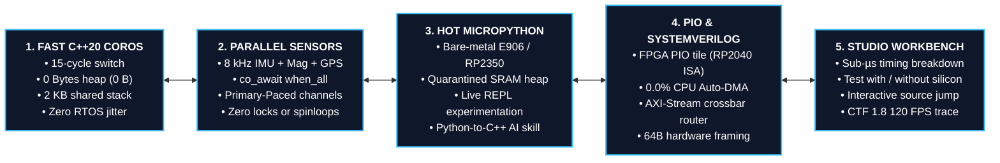

# AbstractX: The High-Speed Agentic Framework for Hardware-Software Co-Design

<p align="center">
  
</p>

<p align="center">
  <strong>Fast C++20 Coroutines • Zero Dynamic Heap • Parallel Sensor Ingestion • Hot MicroPython • Autonomous PIO &amp; SystemVerilog • Studio Observability</strong>
</p>

<p align="center">
  <a href="#-quickstart-in-30-seconds"></a>
  <a href="AbstractX.md"></a>
  <a href="docs/SPECTRACE_GUIDE.md"></a>
  <a href="LICENSE"></a>
</p>

---

## ⚡ What Developers & AI Love About AbstractX

Traditional embedded systems force a painful compromise: bloat your memory with **20+ KB of preemptive RTOS thread stacks and mutexes**, or drown in **unreadable callback spaghetti and volatile flags**.

**AbstractX gives you the holy grail**:
* **Sub-microsecond, 15-cycle context switches** with C++20 stackless coroutines.
* **0 Bytes dynamic heap (`0 B`)** on a single shared 2 KB stack.
* **Parallel in-flight sensor ingestion** (8 kHz IMU, 100 Hz Mag, 10 Hz GPS) without a single lock or spinloop.
* **Hot bare-metal MicroPython** for instant live experiments (`>>>`) on silicon coprocessors.
* **Autonomous FPGA PIO & SystemVerilog** hardware engines delivering **0.0% CPU overhead**.
* **AbstractX Studio GUI** to profile exact sub-microsecond timing and test applications with or without hardware.

> 📖 **Want the exhaustive technical deep dives, bus switch design, or Zephyr comparison?**  
> Read [**AbstractX.md**](AbstractX.md) and [**docs/ARCHITECTURE_AND_EXTENSIBILITY.md**](docs/ARCHITECTURE_AND_EXTENSIBILITY.md).

---

## 🚀 The 5 Superpowers of AbstractX



---

### 1. ⚡ Fast C++20 with Zero Heap Memory
* **15-Cycle Function Jump**: Suspends and resumes tasks cooperatively via compiler-generated state machines. No register spilling, no OS tick preemption, no cache thrashing.
* **Zero Dynamic Heap (`0 B`)**: Enforces 100% freestanding C++20. Statically pools coroutine frames in `.bss` (under 120 bytes per task).
* **Single Shared 2 KB Stack**: Runs the entire multi-task flight application on one shared CPU stack—saving over 20 KB of SRAM compared to FreeRTOS or Zephyr.

```cpp
// 100% Linear, Zero-Allocation C++20 Coroutine Task
Task<void> imu_acquisition_task(hal::ISpi& spi, hal::ITimer& timer) {
    co_await imu.configure_async();
    while (true) {
        // Suspends cooperatively until physical DRDY interrupt triggers
        ImuSample sample = co_await imu.next_sample_async();
        g_imu_channel.push(sample);
    }
}
```

---

### 2. 🛰️ Parallel In-Flight Sensor Readings (Lock-Free & Jitter-Free)
* **Parallel Bus Initialization (`when_all`)**: Boot SPI, I2C, and UART peripherals concurrently without threading overhead:
  ```cpp
  auto [imu_ok, mag_ok, gps_ok] = co_await coro::when_all(
      imu.init_async(),
      mag.init_async(),
      gps.init_async()
  );
  ```
* **Primary-Paced Coroutine Channel Pattern**: Eliminates ugly tick prescalers (`if (++cnt % 80 == 0)`) and race conditions. The highest-rate sensor (8 kHz IMU) acts as the physical clock pacer; lower-rate sensors (50 Hz Mag, 10 Hz GPS) are drained non-blockingly:
  ```cpp
  Task<void> fusion_loop(StateEstimator& estimator) {
      while (true) {
          // 1. Await primary 8 kHz pacer
          ImuSample imu = co_await g_imu_channel.pop();
          estimator.predict(imu);

          // 2. Non-blockingly drain auxiliary packets arrived in between
          MagSample mag;
          while (g_mag_channel.try_pop(mag)) { estimator.update_mag(mag); }

          GpsFix gps;
          while (g_gps_channel.try_pop(gps)) { estimator.update_gps(gps); }
      }
  }
  ```

---

### 3. 🔥 Hot Bare-Metal MicroPython for Rapid Experiments & PoC
* **Experiment First, Compile Later**: Bring up new sensor ICs, inspect registers, and test filtering math in MicroPython before committing to C++.
* **Bare-Metal Silicon REPL**: Run interactive MicroPython directly on coprocessors like the **XuanTie E906 RISC-V** (Radxa Cubie A5E) and **RP2350** (Pico 2 W).
* **Quarantined SRAM Heaps**: MicroPython runs inside an isolated, strictly bounded SRAM partition—it can never corrupt or fragment the deterministic C++20 real-time flight loops.
* **Direct Native DMA Bindings**: Python scripts trigger hardware DMA burst transfers directly over shared memory rings.
* **Autonomous Python-to-C++ AI Skill**: Once your algorithm is proven in Python, the `.agents/skills/micropython-to-cpp/` skill autonomously synthesizes it into deterministic, freestanding C++20 coroutines.

---

### 4. 🧩 Autonomous PIO & Synthesizable SystemVerilog
* **Autonomous PIO Tile (`rtl/pio/asp_pio_tile.sv`)**: Quad-state-machine hardware tile executing RP2040/RP2350 ISA microcode directly on FPGA fabric. Delivers **0.0% CPU overhead** for 8 kHz IMU sampling with single-cycle 512-bit auto-DMA, saving **~45% FPGA logic** (~940 LUTs / ~700 FFs vs separate hardwired cores).
* **Synthesizable SystemVerilog Hardware Fabric (`rtl/`)**:
  - `asp_top.sv`: Top-level Wishbone / AXI-Stream fabric wrapper.
  - `asp_router.sv`: Full-crossbar packet switch with credit-based flow control (`tvalid`/`tready`).
  - `asp_imu_auto_dma.sv`: Autonomous hardware SPI burst clocking on physical DRDY triggers.
  - `asp_dshot_core.sv`: 4-channel bidirectional DShot motor controller with hardware telemetry.
  - `asp_uart_core.sv`: High-speed full-duplex UART core with hardware FIFO.
* **Nanosecond Hardware Timestamps**: Physical DIO edge triggers latch 64-bit nanosecond hardware timestamps directly into packet headers for end-to-end timing verification.

---

### 5. 📊 AbstractX Studio: Test Apps & Profile Exact Timing
* **Test With or Without Hardware**: Launch Studio in simulation mode (`--sim`) to test application logic, sensor failover, and telemetry streaming on your laptop without physical silicon connected.
* **Sub-Microsecond Timing & Latency Profiling**: Dual-Plane execution timeline directly correlates hardware DMA/ISR latency against coroutine task execution.
* **Interactive Source Code Jumping**: Click any task or event in the timeline to jump directly to the exact C++ source file and line (`__FILE__ : __LINE__`).
* **Dynamic 120 FPS Telemetry**: Dynamic decoding via Common Trace Format (CTF 1.8 / Barectf) with zero hardcoded offsets. Includes 3D attitude perspective wireframe, Primary Flight Display (PFD) artificial horizon, and 8 kHz oscilloscope.

```bash
# Launch AbstractX Studio connected to live telemetry stream
python3 tools/visualizer/abstractx_studio.py --port 9870

# Or launch in standalone simulation mode to test your app instantly
python3 tools/visualizer/abstractx_studio.py --sim
```

---

## 🌐 Polymorphic Silicon Scaling

Write your application once against `abstractx::` and deploy it across microcontrollers, coprocessors, and FPGAs with **zero `#ifdef` directives**:

| Silicon Target | Architecture | I/O Engine | Latency | Memory Overhead |
| :--- | :--- | :--- | :--- | :--- |
| **Raspberry Pi Pico 2 W** | Dual ARM Cortex-M33 @ 150 MHz | Core 0 PIO DMA + CYW43 Wi-Fi | **4.2 µs** | `< 1 KB` SRAM |
| **Radxa Cubie A5E** | Quad Cortex-A55 + XuanTie E906 | E906 On-Chip DMA + Shared SRAM | **0.8 µs** | `< 1 KB` SRAM |
| **Espressif ESP32-P4** | Dual RISC-V @ 400 MHz | Core 0 GDMA + Wi-Fi 6 | **1.8 µs** | `< 1 KB` SRAM |
| **QMTech Zynq / Gowin** | ARM Host + FPGA Fabric | SystemVerilog PIO & Auto-DMA | **0.4 µs** | Hardware Offloaded |
| **Desktop SITL** | Native Linux x86_64 / AArch64 | POSIX epoll Software Reactor | **0.5 µs** | Desktop Process |

---

## ⚡ Quickstart in 30 Seconds

### 1. Clone & Set Up Environment
```bash
git clone --recursive https://github.com/tcmichals/AbstractX.git
cd AbstractX

# Set up Python virtual environment for tooling & visualizer
./tools/setup_venv.sh
source .venv/bin/activate
```

### 2. Build & Run Tests
```bash
# Configure & compile host SITL build
cmake -B build_host -DCMAKE_BUILD_TYPE=Release
cmake --build build_host -j

# Run verification suite (100% pass rate)
ctest --test-dir build_host --output-on-failure
```

### 3. Verify SpecTrace & Architectural Boundaries
```bash
# Verify 100% specification-to-code traceability
python3 tools/audit_specs.py

# Verify core framework purity (no concrete drivers in core)
python3 tools/audit_boundaries.py

# Verify queue concurrency contracts ([SPEC-TLP-03])
python3 tools/check_queue_concurrency.py
```

### 4. Test Application & Launch Studio
```bash
# Terminal 1: Run the reference flight application
./build_host/apps/gps_imu_app/gps_imu_app

# Terminal 2: Launch AbstractX Studio to inspect timing & waveforms
python3 tools/visualizer/abstractx_studio.py --port 9870
```

---

## 📁 Repository Directory Map

```text
AbstractX/
├── AGENTS.md                  # Non-negotiable AI agent rules & invariants
├── AbstractX.md               # Master technical specification & architectural deep-dive
├── applib/                    # Reusable concrete peripheral drivers (C++ & Python)
│   ├── include/applib/drivers # ICM-42688-P, QMC5883L, U-Blox GPS
│   └── python/drivers/        # Python counterparts for rapid prototyping
├── apps/                      # Hardware-agnostic applications (e.g. gps_imu_app)
├── include/abstractx/         # Core framework headers (coro, dispatcher, HAL interfaces)
├── targets/                   # Silicon BSPs (Pico 2 W, Cubie A5E E906, ESP32-P4, Linux)
├── rtl/                       # Synthesizable SystemVerilog FPGA switch fabric & PIO tile
├── tools/                     # Developer tooling, auditors, and AbstractX Studio
└── docs/                      # Aerospace-grade specifications and guides
```

---

## 📚 Technical Deep Dives & Handbooks

* [**AbstractX.md**](AbstractX.md) — Comprehensive architectural manual, bus switch design, and Zephyr Rosetta Stone.
* [**docs/ARCHITECTURE_AND_EXTENSIBILITY.md**](docs/ARCHITECTURE_AND_EXTENSIBILITY.md) — Polymorphic driver inheritance and extensible system design.
* [**docs/SPECTRACE_GUIDE.md**](docs/SPECTRACE_GUIDE.md) — The SpecTrace development cycle and closed-loop AI learning.
* [**rtl/README.md**](rtl/README.md) — Synthesizable SystemVerilog FPGA switch fabric guide.
* [**rtl/pio/README.md**](rtl/pio/README.md) — Autonomous Programmable I/O (ASP-PIO) tile developer guide.

---

<p align="center">
  Licensed under <strong>GPLv3</strong> (Commercial licensing available).<br/>
  Designed by Tim Michals &amp; built for agentic AI co-design.
</p>
