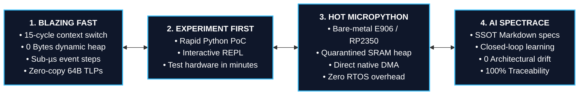

# AbstractX: The High-Speed Agentic Framework for Hardware-Software Co-Design

<p align="center">
  
</p>

<p align="center">
  <strong>C++20 Coroutines • Zero Dynamic Heap • HOT MicroPython • Closed-Loop SpecTrace</strong>
</p>

<p align="center">
  <a href="#-quickstart-in-30-seconds"></a>
  <a href="AbstractX.md"></a>
  <a href="docs/SPECTRACE_GUIDE.md"></a>
  <a href="LICENSE"></a>
</p>

---

## ⚡ What is AbstractX?

**AbstractX** is an AI-native embedded framework engineered for **extreme speed**, **zero architectural drift**, and **rapid hardware-software co-design**.

By pairing **C++20 stackless coroutines** with **on-silicon PCIe-style Transaction Layer Packets (TLPs)**, **freestanding MicroPython**, and an autonomous **AI closed-loop learning gate (SpecTrace)**, AbstractX eliminates the thread bloat, memory fragmentation, and AI hallucinations that plague traditional embedded firmware.

> 📖 **Looking for the deep architectural essays, Zephyr comparison, or PCIe switch specs?**  
> Check out [**AbstractX.md**](AbstractX.md) and [**docs/ARCHITECTURE_AND_EXTENSIBILITY.md**](docs/ARCHITECTURE_AND_EXTENSIBILITY.md).

---

## 🚀 The 4 Pillars of AbstractX



### 1. ⚡ BLAZING FAST: Sub-Microsecond C++20 Coroutines
* **15-Cycle Context Switches**: Replaces heavy preemptive RTOS threads with compiler-generated stackless state machines. No thread stack bloat, no cache thrashing.
* **0 Bytes Dynamic Heap (`0 B`)**: 100% freestanding C++20. All coroutine frames, SPSC queues, and memory buffers are statically allocated in `.bss` at compile time.
* **Shared 2 KB Stack**: Runs the entire application on a single shared 2 KB stack.
* **64-Byte Zero-Copy TLPs**: Point-to-point and crossbar communication via hardware-synthesizable 64-byte packets.

### 2. 🐍 Rapid Prototyping: Python for Experiments & PoC
* **Experiment First, Compile Later**: Bring up unfamiliar sensors, test register maps, and tune filtering algorithms in Python before writing a single line of C++.
* **Interactive Silicon REPL**: Direct register peek/poke and live interactive experimentation via the AbstractX Studio CLI console.
* **Unified Sensor Contracts**: Python drivers in `applib/python/` mirror C++ interfaces 1:1.

### 3. 🔥 HOT / Fast MicroPython on Embedded Silicon
* **Bare-Metal Coprocessor Scripting**: Run high-speed MicroPython directly on coprocessors like the **XuanTie E906 RISC-V** (Radxa Cubie A5E) and **RP2350** (Raspberry Pi Pico 2 W).
* **Quarantined SRAM Heaps**: MicroPython runs inside an isolated, bounded SRAM window—never contaminating the deterministic C++20 real-time flight loops.
* **Direct Native DMA Bindings**: MicroPython scripts trigger native on-chip DMA burst transactions directly over shared SRAM rings.

### 4. 🔄 Autonomous Python-to-C++ Translation (`micropython-to-cpp`)
* **AI-Powered Code Synthesis**: Once your sensor driver or algorithm is validated in Python, the specialized `.agents/skills/micropython-to-cpp/` skill autonomously transforms the async Python code into deterministic, freestanding C++20 coroutines.
* **Zero Boilerplate**: Translates async iterators into awaitable drivers adhering to `IImuDriver`, `IMagDriver`, and `IGpsDriver` abstractions.

### 5. 🛡️ SpecTrace: Closed-Loop AI Learning Gate
* **Markdown is the Single Source of Truth (SSOT)**: Requirements (`[SPEC-*]`) live in Markdown before any code is generated.
* **100% Grand Traceability**: Every C++ class and RTL module carries `// @impl [SPEC-*]` tags, verified by automated CI gates (`tools/audit_specs.py`).
* **Closed-Loop Feedback**: When a test fails or silicon errata is discovered, AI agents log the lesson into `engineering_log.md` and evolve the specification *first*—preventing recurring bugs permanently.

---

## 🌐 Polymorphic Silicon: One Codebase, Any Chip

Write your application once against `abstractx::` and deploy it across microcontrollers, coprocessors, and FPGAs with **zero `#ifdef` directives**:

```text
┌────────────────────────────────────────────────────────────────────────┐
│               Universal C++20 Application (e.g. apps/gps_imu_app)       │
└───────────────────────────────────┬────────────────────────────────────┘
                                    │
       ┌────────────────────────────┼────────────────────────────┐
       ▼                            ▼                            ▼
┌──────────────┐             ┌──────────────┐             ┌──────────────┐
│ Pico 2 W     │             │ Radxa Cubie  │             │ ESP32-P4     │
│ (RP2350)     │             │ A5E (E906)   │             │ (RV32 Dual)  │
│ Dual Cortex  │             │ Linux + RISCV│             │ 400 MHz FPU  │
└──────────────┘             └──────────────┘             └──────────────┘
       │                            │                            │
       └────────────────────────────┼────────────────────────────┘
                                    │
       ┌────────────────────────────┴────────────────────────────┐
       ▼                                                         ▼
┌──────────────────────────────┐          ┌──────────────────────────────┐
│ QMTech Zynq-7020 / Gowin     │          │ Desktop SITL (Linux)         │
│ FPGA Hardware Switch Fabric  │          │ POSIX epoll Software Reactor │
└──────────────────────────────┘          └──────────────────────────────┘
```

| Silicon Target | Architecture | I/O Engine | Latency |
| :--- | :--- | :--- | :--- |
| **Raspberry Pi Pico 2 W** | Dual ARM Cortex-M33 @ 150 MHz | Core 0 PIO DMA + Wi-Fi | **4.2 µs** |
| **Radxa Cubie A5E** | Quad Cortex-A55 + XuanTie E906 | E906 On-Chip DMA + SRAM | **0.8 µs** |
| **Espressif ESP32-P4** | Dual RISC-V @ 400 MHz | Core 0 GDMA + Wi-Fi 6 | **1.8 µs** |
| **QMTech Zynq / Gowin** | ARM Host + FPGA Fabric | SystemVerilog Auto-DMA | **0.4 µs** |
| **Desktop SITL** | Native Linux x86_64 / AArch64 | POSIX epoll Reactor | **0.5 µs** |

---

## 🖥️ AbstractX Studio: Real-Time Observability

AbstractX includes **AbstractX Studio**, a GPU-accelerated desktop engineering workbench built with `imgui-bundle` (Dear ImGui + ImPlot):

* **Coroutine Inspector**: Live status of all suspended/active C++20 coroutine tasks.
* **Dual-Plane Gantt Timeline**: Hardware DMA & ISR latency correlated directly with coroutine task execution. Interactive click-to-source jumping (`__FILE__ : __LINE__`).
* **TLP Bus Debugger**: Byte-level sniffing of 64-byte transaction packets.
* **Interactive CLI & MicroPython REPL**: Live target control, register peek/poke, and telemetry inspection.
* **Extensible Floating Visualizers**: Pluggable 3D attitude wireframe, artificial horizon (PFD), and 8 kHz oscilloscope.

```bash
# Launch AbstractX Studio (listening on UDP telemetry stream)
python3 tools/visualizer/abstractx_studio.py --port 9870

# Or launch in standalone simulation mode without hardware
python3 tools/visualizer/abstractx_studio.py --sim
```

---

## ⚡ Quickstart in 30 Seconds

### 1. Clone & Set Up Environment
```bash
git clone --recursive https://github.com/tcmichals/AbstractX.git
cd AbstractX

# Set up Python virtual environment for tools & visualizer
./tools/setup_venv.sh
source .venv/bin/activate
```

### 2. Build & Verify
```bash
# Configure & compile host SITL build
cmake -B build_host -DCMAKE_BUILD_TYPE=Release
cmake --build build_host -j

# Run the full test suite (100% pass rate)
ctest --test-dir build_host --output-on-failure
```

### 3. Verify SpecTrace & Architectural Boundaries
```bash
# Verify 100% specification-to-code traceability
python3 tools/audit_specs.py

# Verify core framework purity (no concrete drivers in core)
python3 tools/audit_boundaries.py

# Verify queue concurrency contracts ([SPEC-TLP-03])
python3 tools/check_queue_concurrency.py
```

### 4. Run the Reference Application & Studio
```bash
# In terminal 1: run the reference flight application
./build_host/apps/gps_imu_app/gps_imu_app

# In terminal 2: launch the visualizer workbench
python3 tools/visualizer/abstractx_studio.py --port 9870
```

---

## 📁 Repository Structure

```text
AbstractX/
├── AGENTS.md                  # Non-negotiable AI agent rules & invariants
├── AbstractX.md               # Complete architectural deep dive & specifications
├── applib/                    # Reusable concrete peripheral drivers (C++ & Python)
│   ├── include/applib/drivers # ICM-42688-P, QMC5883L, U-Blox GPS
│   └── python/drivers/        # Python counterparts for rapid prototyping
├── apps/                      # Hardware-agnostic applications (e.g. gps_imu_app)
├── include/abstractx/         # Core framework headers (coro, dispatcher, HAL interfaces)
├── targets/                   # Silicon BSPs (Pico 2 W, Cubie A5E E906, ESP32-P4, Linux)
├── rtl/                       # Synthesizable SystemVerilog FPGA switch fabric & PIO
├── tools/                     # Developer tooling, auditors, and AbstractX Studio
└── docs/                      # Aerospace-grade specifications and guides
```

---

## 📚 Learn More

* [**AbstractX.md**](AbstractX.md) — Exhaustive technical deep-dive, PCIe fabric vision, and Zephyr Rosetta Stone.
* [**docs/ARCHITECTURE_AND_EXTENSIBILITY.md**](docs/ARCHITECTURE_AND_EXTENSIBILITY.md) — Polymorphic driver inheritance and extensible system design.
* [**docs/SPECTRACE_GUIDE.md**](docs/SPECTRACE_GUIDE.md) — The SpecTrace development cycle and closed-loop learning.
* [**rtl/README.md**](rtl/README.md) — Synthesizable SystemVerilog FPGA switch fabric guide.

---

<p align="center">
  Licensed under <strong>GPLv3</strong> (Commercial licensing available).<br/>
  Designed by Tim Michals &amp; built for agentic AI co-design.
</p>
