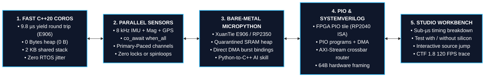

# AbstractX: The High-Speed Agentic Framework for Hardware-Software Co-Design

<p align="center">
  
</p>

<p align="center">
  <strong>Fast C++20 Coroutines • Zero Dynamic Heap • Parallel Sensor Ingestion • Bare-Metal MicroPython • Autonomous PIO &amp; SystemVerilog • Studio Observability</strong>
</p>

<p align="center">
  <a href="#-quickstart-in-30-seconds"></a>
  <a href="#-proven-on-real-silicon-empirical-benchmarks"></a>
  <a href="AbstractX.md"></a>
  <a href="docs/SPECTRACE_GUIDE.md"></a>
  <a href="LICENSE"></a>
</p>

---

## 🎯 What AbstractX Is: Accelerators Run the Buses, Linux Sees Results

Linux is fast at many things, but not at driving sensors: `spidev`, `i2c-dev` and per-sample GPIO
interrupts add system calls, scheduling delay and jitter to every read. AbstractX takes Linux off
the sensor buses entirely ([`[SPEC-ARCH-14]`](docs/DESIGN_SPECIFICATION.md)):

* **An I/O accelerator owns every bus.** A processor or fabric dedicated to I/O runs SPI, I2C,
  UART, DShot and PWM with DMA, started by the sensor's own trigger (data-ready edge, timer).
* **The fast loop runs where the samples land.** An 8 kHz IMU is read and fused on the
  accelerator side; nothing waits on a bus.
* **Everything else sees results.** Linux (or the other MCU core) gets fused state, telemetry and
  trace through rings in shared memory (RPMsg, UIO rings, SIO FIFOs), in blocks, never per sample.
  No custom kernel driver.
* **The FPGA is 100% PIO.** On FPGA targets the accelerator is the [pio2](https://github.com/tcmichals/pio2)
  tile running RP2040/RP2350 PIO programs (DShot, serial, PWM decode, NeoPixel, SPI sensors) with
  its own DMA; no other peripheral IP.


**Status (2026-10-30)**: the E906 path is built and measured on the Cubie A5E (DRDY edge -> DMA
started ~6 µs, edge -> consumer coroutine ~31 µs average, 10,000 samples at 1 kHz,
`docs/verification/evidence/e906_imu_drdy_baremetal.json`). The Pico 2 W core split, the
ESP32-P4 back end and the pio2 Zynq / Tang paths are specified, not built (`TODO.md`).

---

## ⚡ Core Technical Capabilities & Invariants

Traditional embedded systems force an undesirable trade-off: allocate **20+ KB of preemptive RTOS thread stacks and mutexes**, or write **unreadable callback state machines with volatile flags**.

AbstractX replaces both approaches with a unified event-driven coroutine architecture:
* **Stackless C++20 coroutines** instead of thread stacks: a full yield round trip through the event loop measured **9.80 µs (1,961 cycles)** on the E906 at 200 MHz with AbstractX alone, no RTOS (Part 4).
* **0 Bytes dynamic heap (`0 B`)** on a single shared 2 KB stack.
* **Parallel in-flight sensor ingestion** (8 kHz IMU, 100 Hz Mag, 10 Hz GPS) without locks or spinloops.
* **Bare-metal MicroPython with native DMA** for interactive hardware REPL and rapid bring-up on coprocessors.
* **FPGA I/O that is 100% PIO** (pio2): bus work runs in PIO programs with DMA, not on a CPU.
* **AbstractX Studio GUI** to profile exact sub-microsecond timing and test applications with or without hardware.

> 📖 **Looking for the exhaustive technical deep dives, bus switch design, or Zephyr comparison?**  
> Read [**AbstractX.md**](AbstractX.md) and [**docs/ARCHITECTURE_AND_EXTENSIBILITY.md**](docs/ARCHITECTURE_AND_EXTENSIBILITY.md).

---

## 🏛️ Architecture Invariants & Core Subsystems



---

### 1. ⚡ Fast C++20 with Zero Heap Memory
* **Cooperative resume**: tasks suspend and resume through compiler-generated state machines; a resume is an indirect call from the dispatcher, with no OS tick and no per-task stack. A full yield round trip through the event loop is **9.80 µs** on the E906 with AbstractX alone (the `resume()` call itself is not measured).
* **Zero Dynamic Heap (`0 B`)**: Enforces 100% freestanding C++20. Statically pools coroutine frames in `.bss` (under 120 bytes per task).
* **Single Shared 2 KB Stack**: Runs the entire multi-task flight application on one shared CPU stack—saving over 20 KB of SRAM compared to FreeRTOS or Zephyr.

```cpp
// 100% Linear, Zero-Allocation C++20 Coroutine Task
Task<void> imu_acquisition_task(hal::ISpi& spi, hal::ITimer& timer) {
    co_await imu.configure_async();
    while (true) {
        // Suspends cooperatively until physical DRDY interrupt triggers
        ImuSample sample = co_await imu.next_sample_async();
        g_imu_channel.push(sample);
    }
}
```

---

### 2. 🛰️ Parallel In-Flight Sensor Readings (Lock-Free & Jitter-Free)
* **Parallel Bus Initialization (`when_all`)**: Boot SPI, I2C, and UART peripherals concurrently without threading overhead:
  ```cpp
  auto [imu_ok, mag_ok, gps_ok] = co_await coro::when_all(
      imu.init_async(),
      mag.init_async(),
      gps.init_async()
  );
  ```
* **Primary-Paced Coroutine Channel Pattern**: Eliminates ugly tick prescalers (`if (++cnt % 80 == 0)`) and race conditions. The highest-rate sensor (8 kHz IMU) acts as the physical clock pacer; lower-rate sensors (50 Hz Mag, 10 Hz GPS) are drained non-blockingly:
  ```cpp
  Task<void> fusion_loop(StateEstimator& estimator) {
      while (true) {
          // 1. Await primary 8 kHz pacer
          ImuSample imu = co_await g_imu_channel.pop();
          estimator.predict(imu);

          // 2. Non-blockingly drain auxiliary packets arrived in between
          MagSample mag;
          while (g_mag_channel.try_pop(mag)) { estimator.update_mag(mag); }

          GpsFix gps;
          while (g_gps_channel.try_pop(gps)) { estimator.update_gps(gps); }
      }
  }
  ```

---

### 3. 🐍 Bare-Metal MicroPython with Native DMA for Rapid Prototyping
* **Experiment First, Compile Later**: Bring up new sensor ICs, inspect registers, and test filtering math in MicroPython before committing to C++.
* **Bare-Metal Silicon REPL**: Run interactive MicroPython directly on coprocessors like the **XuanTie E906 RISC-V** (Radxa Cubie A5E) and **RP2350** (Pico 2 W).
* **Quarantined SRAM Heaps**: MicroPython runs inside an isolated, strictly bounded SRAM partition—it can never corrupt or fragment the deterministic C++20 real-time flight loops.
* **Direct Native DMA Bindings**: Python scripts trigger hardware DMA burst transfers directly over shared memory rings.
* **Autonomous Python-to-C++ AI Skill**: Once your algorithm is proven in Python, the `.agents/skills/micropython-to-cpp/` skill autonomously synthesizes it into deterministic, freestanding C++20 coroutines.

---

### 4. 🧩 The FPGA Is 100% PIO
* **pio2 (`rtl/pio`, submodule [pio2](https://github.com/tcmichals/pio2))**: a four-state-machine tile
  running the RP2040/RP2350 PIO instruction set in FPGA fabric, plus its own register bus, DMA
  engine, rings and trace. Every FPGA peripheral is a PIO program: bidirectional DShot and ESC
  serial passthrough (in `rtl/pio/src/programs/`), UART, RC PWM decoding, NeoPixel and SPI sensors.
* **On a Zynq** the A9 reaches pio2 through `generic-uio` only: registers over GP0, streams in DDR
  rings written by pio2's own DMA over HP0, one interrupt. No vendor DMA IP, no kernel driver
  ([`[SPEC-ZYNQ-07]`](hw/zynq7000/qmtech_zynq7020/SPECIFICATION.md)).
* **Being retired**: the earlier fixed-function cores in `rtl/` (`asp_dshot_core`, `asp_uart_core`,
  `asp_imu_auto_dma`, `asp_neopixel_core`, `asp_pwm_decoder`, `asp_axi_dma`) are still in the current
  tops until the PIO programs replace them (`TODO.md`).
* **Nanosecond Hardware Timestamps**: Physical DIO edge triggers latch 64-bit nanosecond hardware timestamps directly into packet headers for end-to-end timing verification.

---

### 5. 📊 AbstractX Studio: Hardware-Accurate Timing & Latency Profiling

<p align="center">
  <video src="https://raw.githubusercontent.com/tcmichals/AbstractX/main/docs/articles/micropython-on-e906/assets/studio-live.mp4" controls="controls" width="100%"></video>
</p>

<p align="center">
  <a href="https://raw.githubusercontent.com/tcmichals/AbstractX/main/docs/articles/micropython-on-e906/assets/studio-live.mp4">
    
  </a>
  <br/>
  <em>▶️ Live timing capture from XuanTie E906 (video: <a href="docs/articles/micropython-on-e906/assets/studio-live.mp4"><code>docs/articles/micropython-on-e906/assets/studio-live.mp4</code></a>). Synchronized horizontal swimlanes on a 200 MHz CPU cycle clock showing idle <code>wfi</code> sleep, coroutine task execution windows, and microsecond-accurate interrupt tick lines.</em>
</p>

<p align="center">
  
  
  <br/>
  
  
</p>

* **Synchronized CPU Cycle Clock Swimlanes**: Displays execution windows on a shared cycle clock (200 MHz on E906, 150 MHz on RP2350). Correlate hardware DMA burst completions directly with coroutine resumption.
* **Sub-Microsecond Interrupt Inspection**: Inspect individual physical interrupt lines (Timer, UART3 RX, TWI1 Compass, SPI DMA) as precise tick marks unfolding over a 100 ms sliding window.
* **Interactive Click-to-Source**: Click any task or event in the timeline to jump directly to the exact C++ source file and line (`__FILE__ : __LINE__`).
* **Live System CLI & Diagnostics**: Inspect system state (`ps`, `drivers`, `irq_stats`, `mem`) over VirtIO RPMsg concurrently with active high-rate sensor streaming.
* **Test in Simulation**: Launch Studio in simulation mode (`--sim`) to test application logic, sensor failovers, and CTF 1.8 decoding without physical hardware.
* 📖 **Read the Full Observability Deep Dives**:
  * [**MicroPython on XuanTie E906: Studio Timeline & Profiler Case Study**](docs/articles/micropython-on-e906/README.md#7-firmware-observability-with-abstractx-studio)
  * [**Embedded Firmware Observability with Pure GitHub & MemBrowse**](docs/articles/GITHUB_NATIVE_EMBEDDED_OBSERVABILITY.md)

```bash
# Launch AbstractX Studio connected to live telemetry stream
python3 tools/visualizer/abstractx_studio.py --port 9870

# Or launch in standalone simulation mode to test your app instantly
python3 tools/visualizer/abstractx_studio.py --sim
```

---

## 📈 Measured on Real Silicon

Only the **Radxa Cubie A5E** (XuanTie E906 @ 200 MHz) has board evidence so far. Pico 2 W, ESP32-P4
and Zynq numbers will appear here when they are measured. Evidence:
[`e906_bench_abstractx_stallfix_20261031.json`](docs/verification/evidence/e906_bench_abstractx_stallfix_20261031.json),
[`e906_bench_freertos_stallfix_20261031.json`](docs/verification/evidence/e906_bench_freertos_stallfix_20261031.json),
[`e906_imu_drdy_baremetal.json`](docs/verification/evidence/e906_imu_drdy_baremetal.json);
write-ups in [Part 4](docs/articles/abstractx-vs-freertos-e906/README.md) and
[Part 6](docs/articles/sensor-placement-t527/README.md).

| Metric (E906, 200 MHz) | AbstractX alone | AbstractX on FreeRTOS |
| :--- | :--- | :--- |
| Yield round trip through the event loop (avg) | 2,040 cycles (10.20 µs) | 2,044 cycles (10.22 µs) |
| Soft-IRQ handler (avg) | 235 cycles (1.18 µs) | 253 cycles (1.27 µs) |
| Interrupt -> waiting coroutine runs (avg) | 2,847 cycles (14.2 µs) | 2,998 cycles (15.0 µs) |
| RPMsg echo, 496-byte messages | 2.97 MB/s, max 370 µs | 2.92 MB/s, max 382 µs |
| Static RAM (`.data` + `.bss`) | 25,984 B | 37,672 B |
| Coroutine frame pool high water | 448 B | 448 B |
| IMU DRDY edge -> DMA started (avg, 10,000 samples) | ~5.9 µs | not measured |
| IMU DRDY edge -> consumer coroutine (avg) | ~31 µs | not measured |
| Dynamic heap | zero-heap rule; `e906_repl_app` still links `_malloc_r` (open, `TODO.md`) | same |

AbstractX also runs inside a FreeRTOS task with the same coroutines and drivers. On its own it
takes the interrupt-to-coroutine path in ~150 fewer cycles and needs 11.7 KB less static RAM,
which is why it is the setup for offload processors like the E906. The RPMsg echo, mostly Linux time,
is the same within noise. The ~1 s echo stall was fixed on 2026-10-31 (`engineering_log.md`). Runs
measured 2026-10-31; the idle-only CPU load of either setup is not measured yet.

> 🔬 **Reproduce on Hardware**:
> ```bash
> # Run automated benchmark suite directly on Radxa Cubie A5E:
> ssh root@192.168.3.3 "python3 /root/abstractx_board_bench/bench_e906_runtime.py --json abstractx.json"
> ```

---

## 🌐 Polymorphic Silicon Scaling

Write your application once against `abstractx::` and deploy it across microcontrollers, coprocessors, and FPGAs with **zero `#ifdef` directives**:

| Silicon Target | Architecture | I/O accelerator (owns the buses) | Results to | Status |
| :--- | :--- | :--- | :--- | :--- |
| **Raspberry Pi Pico 2 W** | Dual Cortex-M33 @ 150 MHz | Core 0 + PIO + DMA | Core 1 coroutines | core split specified, Core 1 not launched yet |
| [**Radxa Cubie A5E**](https://github.com/tcmichals/cubie-a5e) | Cortex-A55 + XuanTie E906 | E906 + DMA | Linux over RPMsg | built; DRDY edge -> DMA ~6 µs measured |
| **Espressif ESP32-P4** | Dual RISC-V @ 400 MHz | one core + GDMA | the other core | stub, no back end yet |
| **QMTech Zynq-7020** | Cortex-A9 + FPGA | pio2 (100% PIO) + RT A9 core | Linux over UIO rings | specified, not built |
| **Tang Nano 9K / 20K** | FPGA, external host | pio2 over Dual-SPI link | Pico or E906 host | specified, not built |
| **Desktop SITL** | Linux x86_64 / AArch64 | simulated buses, epoll reactor | same process | runs the host test suite |

---

## ⚡ Quickstart in 30 Seconds

### 1. Clone & Set Up Environment

AbstractX uses four git submodules. Do **not** use `git clone --recursive`: it also pulls
MicroPython's ~40 nested submodules (CMSIS, lwIP, vendor SDKs), none of which AbstractX builds.

| Submodule | Needed for |
| :--- | :--- |
| `third_party/etl` | every build (host and firmware); configure stops without it |
| `third_party/micropython` | `e906_repl_app` (E906 MicroPython firmware) |
| `third_party/FreeRTOS-Kernel` | `e906_freertos_app` (skipped with a warning when missing) |
| `rtl/pio` ([pio2](https://github.com/tcmichals/pio2)) | RTL, cocotb and FPGA builds; has its own submodules |

```bash
git clone https://github.com/tcmichals/AbstractX.git
cd AbstractX
git submodule update --init                    # the four submodules above, not their children
git submodule update --init --recursive rtl/pio  # pio2 and its verilog-axi / verilog-axis

# Set up Python virtual environment for tooling & visualizer
./tools/setup_venv.sh
source .venv/bin/activate
```

**Pulling updates** (the submodule pins move with `main`; work happens on more than one PC):
```bash
git pull
git submodule update --init
git submodule update --init --recursive rtl/pio
git submodule status   # a leading '-' = not initialised, '+' = not at the pinned commit
```

If `git submodule update` reports `not our ref`, the pinned submodule commit was never pushed:
push it from the PC that made it (`git -C <submodule> push`) before anyone else pulls.

Cross-compilers are found in `~/.tools/` (newest `xpack-*-gcc-*`), or set
`RISCV_TOOLCHAIN_PREFIX` / `ARM_TOOLCHAIN_PREFIX` ([SPEC-BUILD-01]).

### 2. Build & Run Tests
```bash
# Host SITL build and tests
cmake -S . -B build_host -DABSTRACTX_TARGET=host
cmake --build build_host -j
ctest --test-dir build_host --output-on-failure

# Same suite under ASan/UBSan and TSan (required before committing core changes, AGENTS.md §10)
cmake -S . -B build_asan -DABSTRACTX_TARGET=host \
      -DCMAKE_CXX_FLAGS="-fsanitize=address,undefined -fno-sanitize-recover=all -fno-omit-frame-pointer" \
      -DCMAKE_EXE_LINKER_FLAGS="-fsanitize=address,undefined"
cmake --build build_asan -j && ctest --test-dir build_asan
cmake -S . -B build_tsan -DABSTRACTX_TARGET=host -DCMAKE_CXX_FLAGS="-fsanitize=thread -O1 -g" \
      -DCMAKE_EXE_LINKER_FLAGS="-fsanitize=thread"
cmake --build build_tsan -j && setarch -R ctest --test-dir build_tsan   # setarch -R: TSan on kernel 7.x

# E906 firmware (RISC-V cross build)
cmake --preset e906 && cmake --build build_e906 -j --target e906_repl_app
```

### 3. Verify SpecTrace & Architectural Boundaries
```bash
# Verify 100% specification-to-code traceability
python3 tools/audit_specs.py

# Verify core framework purity (no concrete drivers in core)
python3 tools/audit_boundaries.py

# Verify queue concurrency contracts ([SPEC-TLP-03])
python3 tools/check_queue_concurrency.py
```

### 4. Test Application & Launch Studio
```bash
# Terminal 1: Run the reference flight application
./build_host/apps/gps_imu_app/gps_imu_app

# Terminal 2: Launch AbstractX Studio to inspect timing & waveforms
python3 tools/visualizer/abstractx_studio.py --port 9870
```

---

## 📁 Repository Directory Map

```text
AbstractX/
├── AGENTS.md                  # Non-negotiable AI agent rules & invariants
├── AbstractX.md               # Master technical specification & architectural deep-dive
├── applib/                    # Reusable concrete peripheral drivers (C++ & Python)
│   ├── include/applib/drivers # ICM-42688-P, QMC5883L, U-Blox GPS
│   └── python/drivers/        # Python counterparts for rapid prototyping
├── apps/                      # Hardware-agnostic applications (e.g. gps_imu_app)
├── include/abstractx/         # Core framework headers (coro, dispatcher, HAL interfaces)
├── targets/                   # Silicon BSPs (Pico 2 W, Cubie A5E E906, ESP32-P4, Linux)
├── rtl/                       # Synthesizable SystemVerilog FPGA switch fabric & PIO tile
├── tools/                     # Developer tooling, auditors, and AbstractX Studio
└── docs/                      # Aerospace-grade specifications and guides
```

---

## 📖 Published Technical Articles & Deep Dives

Explore the comprehensive engineering series detailing silicon bring-up, coroutine concurrency, and hardware verification:

* **Heterogeneous Architecture & The XuanTie RISC-V Coprocessor (Hackster.io Series)**:
  * [**Part 1: Unlocking the XuanTie RISC-V Core on Allwinner T527**](https://www.hackster.io/MichalsTC/unlocking-the-xuantie-risc-v-core-on-allwinner-t527-part-1-976063) (Hackster.io) — Heterogeneous architecture, memory layout, clock trees, and XuanTie E906 boot.
  * [**Part 2: Bringing Up Heterogeneous RISC-V on Allwinner SoCs**](https://www.hackster.io/MichalsTC/bringing-up-heterogeneous-risc-v-on-allwinner-socs-part-2-53deb8) (Hackster.io) — Linux `remoteproc`, firmware ELF loading, resource tables, and lifecycle management.
  * [**Part 3: Bare-Metal Firmware, IPC & Coroutines Intro**](https://github.com/tcmichals/cubie-a5e/blob/main/docs/articles/part3_baremetal_firmware_ipc_and_coroutines_intro.md) — Hardware message box (`sun6i-msgbox`), VirtIO RPMsg zero-copy endpoints, and mailbox doorbells.
  * [**Part 4: AbstractX vs FreeRTOS on the XuanTie E906**](docs/articles/abstractx-vs-freertos-e906/README.md) ([GitHub Deep-Dive](https://github.com/tcmichals/cubie-a5e/blob/main/docs/articles/part4_deep_dive_baremetal_cpp_coroutines.md)) — Like-for-like empirical comparison of context switch overhead, idle ticks, and VirtIO RPMsg throughput on real hardware.
  * [**Part 5: Experiment First, Compile Later: Python on Both Processors**](docs/articles/micropython-on-e906/README.md) — Bare-metal MicroPython on XuanTie E906, shared SRAM memory map, VirtIO RPMsg streams, and Studio timing timeline.
  * [**Device Tree Overlays: U-Boot & `config.txt` Integration**](https://github.com/tcmichals/cubie-a5e/blob/main/docs/articles/devicetreeOverlay.md) — Dynamic pinmuxing, peripheral arbitration between Linux and E906, and Sunxi DMAC channel reservations.
  * [**Companion Repository: `tcmichals/cubie-a5e`**](https://github.com/tcmichals/cubie-a5e) — Reference repository for Radxa Cubie A5E Linux driver development, kernel buildroot setups, device tree overlays, and E906 coprocessor demo firmware.
* **Coroutine Concurrency & Zero-Heap Determinism**:
  * [**Jumpstarting Heterogeneous Silicon: From Python `asyncio` to Freestanding C++20**](docs/articles/INTRO_ABSTRACTX_HETEROGENEOUS_DEVELOPMENT.md) — Architectural pattern for heterogeneous multi-core SoCs, split-transaction drivers, and memory-mapped virtual BARs.
  * [**Straight-Line Async: Sub-Microsecond C++20 Coroutines on Raspberry Pi Pico 2 W**](docs/articles/gps-compass-straight-line-async/README.md) — 8 kHz IMU, GPS, and compass streaming on RP2350 dual Cortex-M33 with zero RTOS stacks.
* **FPGA Hardware Switch Fabrics & RTL Acceleration**:
  * [**Polymorphic Silicon: C++ to SystemVerilog FPGA Switch Fabric (QMTech Zynq-7020)**](docs/articles/PCIE_AXI_STREAMING_ARCHITECTURAL_LESSONS.md) — Offloading the C++ I/O processor into SystemVerilog AXI-Stream crossbars and auto-DMA.
  * [**Scalable X-Fabric: From 4K FPGA Logic to Multi-Core Silicon**](docs/articles/SCALABLE_X_FABRIC_4K_TO_BIG.md) — Scalable crossbar switch fabrics, Wishbone/AXI routing, and PIO tiles.
* **Agentic Co-Design & Observability**:
  * [**Deterministic HW/SW Co-Design: Structuring Knowledge Bases for Agentic AI**](docs/articles/AGENTIC_AI_AND_RAG_COMPARISON.md) — Why traditional LLM RAG fails on firmware concurrency and how closed-loop SpecTrace eliminates hallucinations.
  * [**Embedded Firmware Observability with Pure GitHub & MemBrowse**](docs/articles/GITHUB_NATIVE_EMBEDDED_OBSERVABILITY.md) — Static RAM/Flash budget tracking, dynamic CTF 1.8 schemas, and PR gates without cloud lock-in.

---

## 📚 Technical Architecture Specifications & Handbooks

* [**AbstractX.md**](AbstractX.md) — Master architecture specification: bus switch topology, Zephyr Rosetta Stone, AMP memory mapping, sequence diagrams, and directory map.
* [**docs/ARCHITECTURE_AND_EXTENSIBILITY.md**](docs/ARCHITECTURE_AND_EXTENSIBILITY.md) — Polymorphic driver inheritance, `applib/` boundary contracts, and interface design.
* [**docs/SPECTRACE_GUIDE.md**](docs/SPECTRACE_GUIDE.md) — Aerospace-grade SpecTrace development loop and closed-loop AI learning gate.
* [**rtl/README.md**](rtl/README.md) — Synthesizable SystemVerilog FPGA switch fabric architecture.
* [**rtl/pio/README.md**](rtl/pio/README.md) — PIO tile (pio2 submodule): spec, programs, tests and the visual debugger.

---

<p align="center">
  Licensed under <strong>GPLv3</strong> (Commercial licensing available).<br/>
  Designed by Tim Michals &amp; built for agentic AI co-design.
</p>
