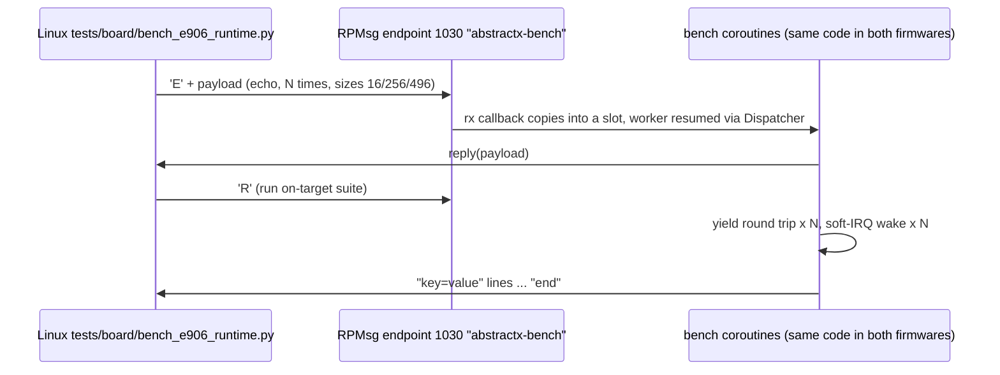
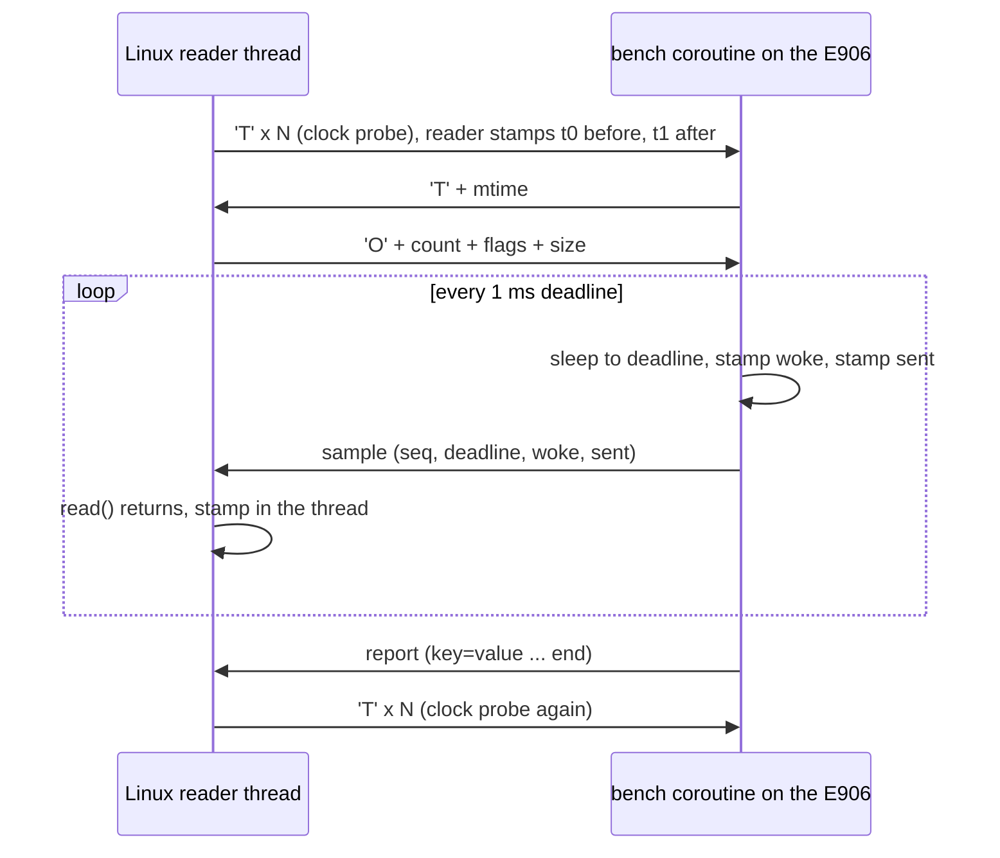

# E906 Runtime Benchmark: Bare Metal + AbstractX vs FreeRTOS + AbstractX

Single source of truth for the shared benchmark module `apps/e906_bench/` and the bare-metal
benchmark firmware `apps/e906_bench_app/`. The same benchmark source is compiled into
`e906_bench_app` (bare metal, `abstractx::run()`) and `e906_freertos_app`
([`SPEC-E906-RTOS-*`](../e906_freertos_app/SPECIFICATION.md)), so differences come from
the runtime, not the test. Tags: `[SPEC-E906-BENCH-*]`.

---

### `[SPEC-E906-BENCH-01]` One Benchmark, Two Runtimes
* **Requirement**: `apps/e906_bench/bench.{hpp,cpp}` is compiled unchanged into both
  `e906_bench_app` and `e906_freertos_app`. Runtime differences are reached only through the
  hooks `abx_bench_platform_name()`, `abx_bench_soft_irq_enable()` and
  `abx_bench_idle_stats()` (weak defaults in the bench: `"baremetal"`, not supported, not
  instrumented).
* **Requirement**: `e906_bench_app` is plain AbstractX: `abstractx::init()`,
  `abstractx::run(bench_main())`, interrupt-driven RPMsg (`co_await rpmsg.async_receive()`),
  no `poll()` calls in application code.
* **Verified by**: `e906-build-layout`, `memory-footprint`
* **Implementation Target**: `apps/e906_bench/bench.cpp`, `apps/e906_bench_app/src/main.cpp`, `apps/e906_bench_app/CMakeLists.txt`

### `[SPEC-E906-BENCH-02]` Metrics and Units
* **Requirement**: times are taken from `mcycle` (core clock, 200 MHz: 24,000,410 `mtime`
  ticks at 24 MHz over a 1 s `mcycle`-timed sleep, measured 2026-10-21) and reported as raw
  cycles; the host converts to ns. The on-target suite reports:
  * `yield_cycles_{min,avg,max}`: one `co_await yield_to_dispatcher()` round trip, i.e. one
    full loop pass of the runtime (bare metal: `step()` in `run()`; FreeRTOS: `step()` in the
    `abstractx` task), N = 10000.
  * `softirq_isr_cycles_{min,avg,max}` and `softirq_wake_cycles_{min,avg,max}`: trigger to
    ISR entry and trigger to coroutine resume for `[SPEC-E906-BENCH-03]`, N = 1000, or
    `softirq=unsupported` / `softirq=no-interrupt`.
  * `idle_wakes`, `idle_cycles`, `window_cycles` when the runtime is instrumented, else
    `idle=not-instrumented`.
  * `dropped_resumes`, `coro_pool_high_water`, `rx_msgs`, `rx_dropped`.
* **Requirement**: the host measures RPMsg echo round trip (min/median/p99/max, µs) and
  throughput (bytes/s) for payloads of 16, 256 and 496 bytes. Code and RAM size come from the
  ELF (`size`, `tools/analyze_elf_size.sh`), not from the target.
* **Requirement**: no number enters a document unless the run that produced it is quoted.
* **Verified by**: `e906-board-selftest`, `host-tests` (`tests/test_e906_bench_local.py`)
* **Implementation Target**: `apps/e906_bench/bench.cpp`, `tests/board/bench_e906_runtime.py`

### `[SPEC-E906-BENCH-03]` Software Interrupt Wake Path
* **Requirement**: the bench triggers the CLINT machine software interrupt (`msip` at
  `0xE0000000`, CLIC line 3) and measures until the waiting coroutine is resumed. The ISR
  `abx_bench_soft_isr()` clears `msip`, records `mcycle` and posts the handle to
  `IsrDispatcher`; it never resumes. The runtime glue must route line 3 to it and enable the
  line (`abx_bench_soft_irq_enable()` returns true).
* **Requirement (same path on every runtime, 2026-10-31)**: every runtime reaches
  `abx_bench_soft_isr()` and `fc_msgbox_doorbell_isr()` through the target's CLIC dispatcher
  (`hal::irq::dispatch(line)` / `riscv_trap_dispatcher`), with the same per-line accounting and
  timeline span ([SPEC-E906-IRQ-05], [SPEC-TRACE-10]). A runtime that calls the ISR directly
  skips that work and the comparison measures the instrumentation, not the runtime (until
  2026-10-31 FreeRTOS did: soft ISR 175 vs 223 cycles).
* **Requirement**: before the timed loop the bench probes once: trigger, then yield up to
  1000 times waiting for the ISR flag. If it never arrives it clears `msip`, reports
  `softirq=no-interrupt` and does not run the timed loop (no hang, no register spin).
* **Verified by**: `e906-board-selftest`
* **Implementation Target**: `apps/e906_bench/bench.cpp`

### `[SPEC-E906-BENCH-04]` RPMsg Protocol
* **Requirement**: endpoint 1030, service name `abstractx-bench`, announced when the virtio
  driver is ready (retried after each RPMsg wake). Requests (first byte):
  `E` echo the whole payload unchanged; `R` run the on-target suite and reply with
  `key=value\n` lines (each message at most 496 bytes) ending with `end\n`;
  `I` reply `platform=<name>\n`. Received payloads are copied once into one of 4 static
  496-byte slots; a full slot ring drops and counts (`rx_dropped`).
* **Verified by**: `e906-board-selftest`, `host-tests` (`tests/test_e906_bench_local.py`)
* **Implementation Target**: `apps/e906_bench/bench.cpp`, `tests/board/bench_e906_runtime.py`

### `[SPEC-E906-BENCH-06]` Cyclic Timer Wake (`C`), the E906 Equivalent of `cyclictest`
* **Why**: to compare the E906 with Linux on the same event and metric. Linux is measured with
  `cyclictest` (a SCHED_FIFO thread wakes at an absolute 1 ms deadline; the number is how late it
  woke). The soft-IRQ wake ([SPEC-E906-BENCH-03]) is a different event, so it cannot be compared
  with `cyclictest` directly.
* **Requirement**: `C` [+ `uint32` little-endian count, default 60000, at most 600000] runs one
  coroutine that, `count` times, advances an absolute deadline by 1 ms (24,000 ticks of the 24 MHz
  `hal::Timer`), sleeps with `Timer::sleep_ticks_async(deadline - now)` and, when resumed, records
  `late = get_ticks() - deadline` (0 if early). Same loop in both firmwares (shared `bench.cpp`).
* **Requirement**: no per-sample storage: min / sum / max on the fly plus a 1 µs-bucket histogram
  of 0-499 µs (500 x `uint32`) and an over-range count, for percentiles. A deadline already in the
  past when the loop gets there counts in `missed` and is not slept on.
* **Report** (`key=value`, ends with `end`): `cyc_count`, `cyc_period_us` (1000), `cyc_late_ns_min`,
  `cyc_late_ns_avg`, `cyc_late_ns_max`, `cyc_late_us_p99`, `cyc_late_us_p999` (bucket upper edge),
  `cyc_over_500us`, `cyc_missed`.
* **Requirement (fair: one job per comparator)**: the profiler sample shares the core timer
  comparator with coroutine deadlines on bare metal and cannot run under FreeRTOS (the kernel owns
  it), so `C` stops the profiler for the run and restores it after; byte 5 bit 0 = keep it on
  (`cyc_source=abstractx_profiler_on`), to show its cost. Moving the profiler to its own MCU timer
  (MCU Timers 0..5, `CLK_MCU_TIMER0..5`) is TODO: register base and interrupt line not yet known.
* **Requirement (native FreeRTOS, `F`)**: `F` [+ `uint32` count] runs the same 1 ms loop as a plain
  FreeRTOS task (highest priority, `vTaskDelayUntil(&last, 1)`), measuring lateness against the
  tick that woke it (`ullNextTime - uxTimerIncrementsForOneTick` of the RISC-V port, read after
  the wake), with the same statistics and report keys plus `cyc_source=freertos_task`. The
  firmware without FreeRTOS reports `cyc_source=unsupported`. Hooks: `abx_bench_native_cyclic_start`
  / `abx_bench_native_cyclic_poll` (weak in `bench.cpp`). A wake later than one tick is
  under-reported (the next tick has already advanced `ullNextTime`); `cyc_over_tick` counts
  wakes later than 900 µs.
* **Verified by**: board bench (`bench_e906_runtime.py --cyclic` / `--native-cyclic`), `e906-build-layout`
* **Implementation Target**: `apps/e906_bench/bench.cpp`, `apps/e906_bench/bench.hpp`, `apps/e906_freertos_app/src/main.cpp`, `apps/e906_repl_app/tests/board/bench_e906_runtime.py`

### `[SPEC-E906-BENCH-07]` One Way: E906 Event to Data in a Linux Thread (`T`, `O`)
* **Why**: `C` stops when the E906 coroutine runs and the echo is a round trip started by a Python
  program, so nothing measures how long a Linux program waits for an E906 event. This run gives that
  number, with the Linux reader as the same thread types as the `cyclictest` rows, so the two line up.

* **Requirement (clock probe, `T`)**: `T` replies `'T'` + `uint64` little-endian `hal::Timer::get_ticks()`
  (`mtime`, 24 MHz), stamped immediately before the reply.
* **Requirement (the clock is proved, not assumed)**: the manual suggests `mtime` and `CNTVCT_EL0` may be
  one counter (the RISC-V block lists `TIMESTAMP` and `GRAYEN`; the A55 takes a 64-bit count from an
  external system counter; `T527_User_Manual_V0.94` §2.2, §2.3), but no readback has shown it. Each probe
  gives `t0 <= e - d <= t1` for the offset `d` (E906 ticks minus Linux ticks), so `N` probes (default 2000)
  bound it: `lo = max(e - t1)`, `hi = min(e - t0)`.
  * `lo > hi`: the clocks are not a fixed offset apart. `clock.kind=inconsistent`, the run stops, exit 1.
  * `lo <= 0 <= hi`: `clock.kind=shared`, `d = 0`.
  * otherwise `clock.kind=calibrated`, `d = (lo + hi) / 2`.
  * The probe runs again after the run. `clock.uncertainty_ns` is the largest distance from `d` to any
    bound of either probe, in every case, and every article number carries it. A `shared` verdict
    from the first probe that the second contradicts is an error.
* **Requirement (run, `O`)**: `O` + `uint32` count (default 60000, at most 600000) + `uint8` flags (bit 0 =
  keep the profiler on, as `C`) + `uint16` size (32-496, default 32), all little-endian. Same 1 ms absolute
  deadline loop and profiler rule as `C` ([SPEC-E906-BENCH-06]). After each wake it sends one sample through
  `rpmsg.reply()`, the path the echo uses: 32-byte header, little-endian: tag `0x01` (not text, so a report
  message cannot be mistaken for a sample), 3 pad bytes, `uint32 seq`, `uint64 deadline`, `uint64 woke`,
  `uint64 sent` (`mtime`, `sent` stamped immediately before the reply), then padding up to `size`.
* **Report** (`key=value`, ends with `end`, sent 10 ms after the last sample so the reader has drained):
  `platform`, `ow_count`, `ow_sent`, `ow_tx_fail` (reply refused), `ow_missed` (deadline already past),
  `ow_late_ns_{min,avg,max}` (deadline to wake), `ow_send_cycles_{min,avg,max}` (the `reply()` call),
  `dropped_resumes`, `end`. `ow_sent + ow_tx_fail + ow_missed` equals the count.
* **Requirement (C reader)**: `tests/board/e906_oneway_reader.c` runs in one thread with a blocking
  `read()` on `/dev/rpmsgN` and reads `CNTVCT_EL0` right after it returns. `--rt`: `SCHED_FIFO` 95 and
  `mlockall`, as `cyclictest -m -p 95 -a 2`; without it `SCHED_OTHER`, nice 0. Pinned to CPU 2 either way. No
  per-sample storage: min / sum / max and 1 us buckets of 0-19,999 us. It never hangs: an alarm ends a
  run that stalled, with `error` set.
* **Requirement (Python reader)**: `bench_e906_runtime.py --oneway N --reader python` runs the same steps and
  reports the same keys, to show what the language costs. Python cannot read `CNTVCT_EL0`, so it uses
  `CLOCK_MONOTONIC_RAW` plus the difference `e906_oneway_reader --clock-pair` measured just before.
* **Report (reader)**: `sent_to_read` (`sent` to the stamp after `read()`, the RPMsg send plus Linux) and
  `event_to_read` (`deadline` to the same stamp, the number to compare with `cyclictest`), each with
  `n`, `min_ns`, `avg_ns`, `max_ns`, `p50_us`, `p99_us`, `p999_us` (bucket upper edge), `over_20ms`; plus
  `clock`, `sched`, `cpu`, `received`, `lost` (`ow_sent - received`), `out_of_order`, `negative` (a
  time below `-uncertainty`, which cannot happen on a correct clock), the firmware report, and `setup`
  (governor, frequency, RT kernel flag, `/proc/cmdline`).
* **Requirement (exit)**: 0 only if the report arrived, nothing was lost, reordered or negative, the counts add
  up and `dropped_resumes` is 0. A failed run still writes its JSON: a load that loses samples is a result.
* **Verified by**: `host-tests` (`tests/test_e906_oneway_local.py`: both readers against a fake firmware,
  including the failure cases), `e906-build-layout`, `memory-footprint`, board run (`bench_e906_runtime.py --oneway`)
* **Implementation Target**: `apps/e906_bench/bench.cpp`, `apps/e906_repl_app/tests/board/e906_oneway_reader.c`, `apps/e906_repl_app/tests/board/bench_e906_runtime.py`

### `[SPEC-E906-BENCH-08]` One Command for Every Part 4 Row
* **Why**: the Part 4 numbers came from hand-typed commands, carry 1970 timestamps, and did not record the
  Linux setup, so a re-run could not be compared row by row.
* **Requirement**: `tools/run_e906_bench_suite.py` runs every row from the build PC: it checks the board is
  the A5E, refuses to start (exit 2) if `remoteproc0` or the ELFs or reader are missing, sets the board clock,
  copies the tools and firmware, and loads each firmware through remoteproc before its rows.
* **Rows**, each idle and under the article's `stress-ng` load, `--runs` times:
  * AbstractX alone and FreeRTOS (`WAIT`): `bench` (echo + `R`), `cyclic`, `oneway` with the C and Python
    readers, each `fifo95` and `other`;
  * FreeRTOS (`WAIT`) only: `native_cyclic` (`F`);
  * FreeRTOS (`XTIMER`, `TICK_HOOK`): `cyclic`;
  * Linux: `cyclictest` with `-p 95` and without `-p`, with `-h 20000`, reported as `n`, `min_us`, `avg_us`,
    `max_us`, `p50_us`, `p99_us`, `p999_us` (bucket upper edge, as [SPEC-E906-BENCH-07]), `overflows`.
* **Requirement (evidence)**: one directory per run under `docs/verification/evidence/<YYYY-MM>/`, with a JSON
  per row and a `manifest.json`: commit, dirty flag, SHA-256 of each ELF, kernel version, `stress-ng`
  command, and each row's exit code. A failed row does not stop the run and is never left out; the
  exit code is 1 if any row failed. `--record` adds a `source: board` ledger record.
* **Verified by**: `host-tests` (`tests/test_run_e906_bench_suite.py`), board run
* **Implementation Target**: `tools/run_e906_bench_suite.py`

### `[SPEC-E906-BENCH-05]` IMU DRDY Auto-DMA Run (`A`)
* **Why**: the sensor comparison (bare metal, FreeRTOS, MicroPython, Linux) is paced by the IMU's
  own data-ready edge, so every runtime does the same work at the same rate and the time from
  the edge to the data can be measured.
* **Requirement**: `A` [+ `uint32` little-endian sample count, default 2000, at most 100000]
  initialises the ICM-42688-P through `Icm42688p::init_async()` at 1 kHz on SPI1 CS0 at 10 MHz
  ([SPEC-IMU-01]), configures one `IoEngine` auto channel (GPIO edge on PI8 = 264, rising;
  command `0x9D`, 14 data bytes; [SPEC-E906-HAL-05]), and collects the samples from the ingress
  ring in a coroutine woken by `on_rx_pushed` through `IsrDispatcher`. The engine is stopped
  (pin disarmed) before the report.
* **Requirement**: no hang. If the first sample does not arrive within 500 ms, or the run takes
  longer than `count` ms + 1000 ms, a timer coroutine wakes the collector and the report says
  `imu_timeout=1`. A failed IMU init reports `imu_init=failed` and runs nothing.
* **Report** (`key=value`, ends with `end`):
  * `imu_init`, `samples`, `imu_timeout`;
  * `edges` (`hal::gpio_irq::edges`, this run), `overruns` (`IoEngine::auto_overruns`, this run),
    `busy_drops`, `dma_ok`, `dma_failed`, `ingress_dropped`, `seq_gaps` (samples whose edge came more
    than 1.5 periods after the previous one);
  * `period_ns_{min,avg,max}`: between consecutive sample timestamps (the measured ODR);
  * `edge_to_dma_cycles_{min,avg,max}`, `dma_cycles_{min,avg,max}` ([SPEC-E906-HAL-05]);
  * `edge_to_wake_ns_{min,avg,max}`: sample timestamp -> collector resumed (`hal::Timer::get_time_ns()`);
  * `last_raw`: the 14 data bytes of the last sample as hex (temperature, accel XYZ, gyro XYZ);
  * `dropped_resumes`, `coro_pool_high_water`.
* **Verified by**: `e906-board-selftest`, `e906-build-layout`
* **Implementation Target**: `apps/e906_bench/bench.cpp`, `tests/board/bench_e906_runtime.py`
