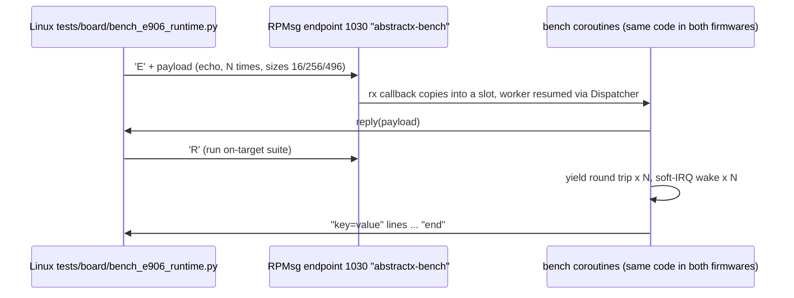

# E906 Runtime Benchmark: Bare Metal + AbstractX vs FreeRTOS + AbstractX

Single source of truth for the shared benchmark module `apps/e906_bench/` and the bare-metal
benchmark firmware `apps/e906_bench_app/`. The same benchmark source is compiled into
`e906_bench_app` (bare metal, `abstractx::run()`) and `e906_freertos_app`
([`SPEC-E906-RTOS-*`](../e906_freertos_app/SPECIFICATION.md)), so differences come from
the runtime, not the test. Tags: `[SPEC-E906-BENCH-*]`.

---

### `[SPEC-E906-BENCH-01]` One Benchmark, Two Runtimes
* **Requirement**: `apps/e906_bench/bench.{hpp,cpp}` is compiled unchanged into both
  `e906_bench_app` and `e906_freertos_app`. Runtime differences are reached only through the
  hooks `abx_bench_platform_name()`, `abx_bench_soft_irq_enable()` and
  `abx_bench_idle_stats()` (weak defaults in the bench: `"baremetal"`, not supported, not
  instrumented).
* **Requirement**: `e906_bench_app` is plain AbstractX: `abstractx::init()`,
  `abstractx::run(bench_main())`, interrupt-driven RPMsg (`co_await rpmsg.async_receive()`),
  no `poll()` calls in application code.
* **Verified by**: `e906-build-layout`, `memory-footprint`
* **Implementation Target**: `apps/e906_bench/bench.cpp`, `apps/e906_bench_app/src/main.cpp`, `apps/e906_bench_app/CMakeLists.txt`

### `[SPEC-E906-BENCH-02]` Metrics and Units
* **Requirement**: times are taken from `mcycle` (core clock, 200 MHz: 24,000,410 `mtime`
  ticks at 24 MHz over a 1 s `mcycle`-timed sleep, measured 2026-10-21) and reported as raw
  cycles; the host converts to ns. The on-target suite reports:
  * `yield_cycles_{min,avg,max}`: one `co_await yield_to_dispatcher()` round trip, i.e. one
    full loop pass of the runtime (bare metal: `step()` in `run()`; FreeRTOS: `step()` in the
    `abstractx` task), N = 10000.
  * `softirq_isr_cycles_{min,avg,max}` and `softirq_wake_cycles_{min,avg,max}`: trigger to
    ISR entry and trigger to coroutine resume for `[SPEC-E906-BENCH-03]`, N = 1000, or
    `softirq=unsupported` / `softirq=no-interrupt`.
  * `idle_wakes`, `idle_cycles`, `window_cycles` when the runtime is instrumented, else
    `idle=not-instrumented`.
  * `dropped_resumes`, `coro_pool_high_water`, `rx_msgs`, `rx_dropped`.
* **Requirement**: the host measures RPMsg echo round trip (min/median/p99/max, µs) and
  throughput (bytes/s) for payloads of 16, 256 and 496 bytes. Code and RAM size come from the
  ELF (`size`, `tools/analyze_elf_size.sh`), not from the target.
* **Requirement**: no number enters a document unless the run that produced it is quoted.
* **Verified by**: `e906-board-selftest`, `host-tests` (`tests/test_e906_bench_local.py`)
* **Implementation Target**: `apps/e906_bench/bench.cpp`, `tests/board/bench_e906_runtime.py`

### `[SPEC-E906-BENCH-03]` Software Interrupt Wake Path
* **Requirement**: the bench triggers the CLINT machine software interrupt (`msip` at
  `0xE0000000`, CLIC line 3) and measures until the waiting coroutine is resumed. The ISR
  `abx_bench_soft_isr()` clears `msip`, records `mcycle` and posts the handle to
  `IsrDispatcher`; it never resumes. The runtime glue must route line 3 to it and enable the
  line (`abx_bench_soft_irq_enable()` returns true).
* **Requirement**: before the timed loop the bench probes once: trigger, then yield up to
  1000 times waiting for the ISR flag. If it never arrives it clears `msip`, reports
  `softirq=no-interrupt` and does not run the timed loop (no hang, no register spin).
* **Verified by**: `e906-board-selftest`
* **Implementation Target**: `apps/e906_bench/bench.cpp`

### `[SPEC-E906-BENCH-04]` RPMsg Protocol
* **Requirement**: endpoint 1030, service name `abstractx-bench`, announced when the virtio
  driver is ready (retried after each RPMsg wake). Requests (first byte):
  `E` echo the whole payload unchanged; `R` run the on-target suite and reply with
  `key=value\n` lines (each message at most 496 bytes) ending with `end\n`;
  `I` reply `platform=<name>\n`. Received payloads are copied once into one of 4 static
  496-byte slots; a full slot ring drops and counts (`rx_dropped`).
* **Verified by**: `e906-board-selftest`, `host-tests` (`tests/test_e906_bench_local.py`)
* **Implementation Target**: `apps/e906_bench/bench.cpp`, `tests/board/bench_e906_runtime.py`
