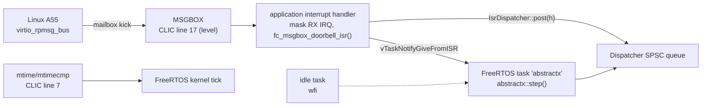

# AbstractX on FreeRTOS: XuanTie E906 Application Specification

This document is the single source of truth for `apps/e906_freertos_app/`: AbstractX
(dispatcher, coroutines, RPMsg, trace) running as one task under FreeRTOS on the
Allwinner T527/A527 XuanTie E906. It exists to answer one question with measurements:
when is bare metal + AbstractX the better choice, and when is FreeRTOS + AbstractX?
The shared benchmark is specified in [`apps/e906_bench/SPECIFICATION.md`](../e906_bench/SPECIFICATION.md);
the write-up is [`docs/articles/linux-vs-freertos-vs-abstractx/README.md`](../../docs/articles/linux-vs-freertos-vs-abstractx/README.md).

Each requirement has a tag `[SPEC-E906-RTOS-*]`; code carries `// @impl [SPEC-E906-RTOS-*]`.

---

### `[SPEC-E906-RTOS-01]` Kernel Source and Build Target
* **Requirement**: the kernel is FreeRTOS-Kernel V11.1.0 (`third_party/FreeRTOS-Kernel`,
  git submodule, unmodified, MIT). The RISC-V port is the kernel's
  `portable/GCC/RISC-V/port.c` plus a project copy `apps/e906_freertos_app/portASM_e906.S`
  whose only change masks the E906 extra `mcause` bits (see RTOS-03).
* **Requirement**: CMake target `e906_freertos_app` is built only when
  `ABSTRACTX_TARGET` is `e906` or `allwinner_e906`, links `abstractx_core` and
  `abstractx_target_e906`, uses `E906_LDSCRIPT`, and runs `abstractx_e906_check_layout`.
* **Rationale**: same kernel and port as `cubie-a5e/firmware/riscv-firmware/apps/testFreeRTOS`,
  which passed 2000/2000 interrupt-driven RPMsg pings on silicon (2026-10-20 sweep).
* **Verified by**: `e906-build-layout`, `memory-footprint`
* **Implementation Target**: `apps/e906_freertos_app/CMakeLists.txt`, `apps/e906_freertos_app/portASM_e906.S`

### `[SPEC-E906-RTOS-02]` Static Allocation Only
* **Requirement**: `configSUPPORT_DYNAMIC_ALLOCATION 0`, `configSUPPORT_STATIC_ALLOCATION 1`,
  `configKERNEL_PROVIDED_STATIC_MEMORY 1`; no `heap_*.c` is compiled. Tasks are created with
  `xTaskCreateStatic`. The linked ELF has no `malloc`, `pvPortMalloc` or `vPortFree`.
  Known gap (not from this app): newlib `free`/`_malloc_r` are linked into every E906 ELF
  through a sized `operator delete` reference in `libabstractx_core` (`runtime.cpp`); see
  `engineering_log.md` 2026-10-21. Nothing calls them; the fix belongs in the core.
* **Rationale**: AGENTS §2 zero heap. FreeRTOS objects are static like every AbstractX pool.
* **Verified by**: `memory-footprint`
* **Implementation Target**: `apps/e906_freertos_app/FreeRTOSConfig.h`

### `[SPEC-E906-RTOS-03]` Timer, Trap Vector and CLIC on the E906
* **Requirement**: tick source is the CLINT timer: `mtime` at `0xE000BFF8`, `mtimecmp` at
  `0xE0004000`, counting at 24 MHz (`configCPU_CLOCK_HZ = 24000000`, measured against
  `mcycle`); `configTICK_RATE_HZ = 1000`.
* **Requirement**: `mtvec = freertos_risc_v_trap_handler | 3` (CLIC mode, non-vectored);
  the handler is aligned to at least 64 bytes. Interrupt lines are enabled by writing 1 to
  byte +1 of the CLIC control word at `0xE0801000 + 4 * line`. `mie` alone is ignored in
  CLIC mode.
* **Requirement**: the trap handler keeps only `mcause & 0x80000FFF`: the E906 mirrors
  MPP/MPIE/MPIL into `mcause`, so an `ecall` otherwise reads `0x3800000b` and the timer
  never matches `0x80000007`.
* **Requirement**: lines used: 7 machine timer (kernel tick), 17 message box
  (`RISCV_MSGBOX_RISCV`), 3 machine software interrupt (benchmark only,
  `[SPEC-E906-BENCH-03]`), 88 DMA and the GPIO group lines armed through `hal::gpio_irq`
  (100 for the IMU DRDY on PI8, `[SPEC-E906-IRQ-07]`). Interrupts are masked from the end of `abstractx::init()` until
  the scheduler starts.
* **Requirement (one owner of `mtimecmp`, 2026-10-31)**: the kernel owns the comparator.
  `main()` calls `hal::Timer::use_external_tick()` before `abstractx::init()`; from then on
  `hal::Timer` never writes `mtimecmp`. Sleep resolution is one tick (1 ms). The profiler sample
  timer and `Timer::arm_wake` are not available under FreeRTOS.
* **Requirement (how AbstractX timers are served, 2026-11-04)**: chosen at build time with the
  CMake cache option `ABX_FREERTOS_TIMER` (`[SPEC-ARCH-15]`: the host drives AbstractX):
  * `WAIT` (default): no timer object and no hook. The AbstractX task waits in
    `ulTaskNotifyTake` with a timeout of `ceil((Timer::next_deadline_ticks() - now) / ticks per
    kernel tick)` (`portMAX_DELAY` when no sleep is pending). `configUSE_TICK_HOOK = 0`,
    `configUSE_TIMERS = 0`.
  * `XTIMER`: one static one-shot FreeRTOS software timer. After `step()`, the AbstractX task
    re-arms it with `xTimerChangePeriod(..., 0)` when the next deadline changed or the timer is not
    active, and stops it when no sleep is pending; a failed command is counted
    (`timer_cmd_failures`), never ignored. The callback (timer service task,
    `configTIMER_TASK_PRIORITY = configMAX_PRIORITIES - 1`) only calls `xTaskNotifyGive`.
    `configUSE_TIMERS = 1`, `configUSE_TICK_HOOK = 0`.
  * `TICK_HOOK` (opt-in fallback): `vApplicationTickHook` calls `hal::Timer::tick_from_isr()` and
    notifies the task when it posted a waiter. Use only when the application gives AbstractX its
    tick hook.
  In `WAIT` and `XTIMER` the AbstractX task calls `hal::Timer::service_due()` (task context,
  interrupts masked) before `step()`: due waiters are found by `now >= deadline`, so an early,
  late or coalesced wake never loses or double-runs a sleep; an early wake just waits again.
* **Rationale (2026-11-04)**: `vApplicationTickHook` is one global symbol that belongs to the
  application, and the hook walked the AbstractX timer list in interrupt context on every tick.
  A timeout or a kernel software timer is the documented FreeRTOS way to wait for time. Cost was
  not the reason (servicing a 1 kHz timer is negligible).
* **Rationale (2026-10-31)**: `hal::Timer::reprogram()` wrote the same `mtimecmp` as the kernel
  tick, so AbstractX overwrote the tick deadline, and no AbstractX timer interrupt ever ran:
  coroutine sleeps never woke (`C` cyclic bench returned no report).
* **Verified by**: `e906-disassembly-check`, `e906-board-selftest`, board bench (`bench_e906_runtime.py --cyclic` on `e906_freertos_app` completes)
* **Implementation Target**: `apps/e906_freertos_app/src/main.cpp`, `apps/e906_freertos_app/FreeRTOSConfig.h`, `apps/e906_freertos_app/CMakeLists.txt`, `targets/allwinner_e906/src/timer.cpp`

### `[SPEC-E906-RTOS-04]` Message Box Interrupt Feeds the AbstractX Dispatcher
* **Requirement**: the message box line is level triggered and stays asserted while the
  channel 1 FIFO holds words. The handler masks the channel 1 RX interrupt
  (`MsgBox::enable_rx_irq(Channel1, false)`), runs `fc_msgbox_doorbell_isr()` through
  `hal::irq::dispatch(line)` (which posts the waiting RPMsg coroutine to `IsrDispatcher`;
  same accounting as bare metal, [SPEC-E906-BENCH-03]), and wakes the AbstractX task with
  `vTaskNotifyGiveFromISR` + `portYIELD_FROM_ISR`. The RPMsg awaiter re-enables the RX
  interrupt when it next suspends. The handler never calls `.resume()`.
* **Requirement**: the bench soft line (3) is attached with `hal::irq::attach` like on bare metal and, like
  every other line, goes to the target's CLIC dispatcher,
  `hal::irq::dispatch(line)` (the same table and per-line accounting the bare-metal trap
  handler uses, `[SPEC-E906-IRQ-01]`, `[SPEC-E906-IRQ-05]`): line 88 runs `fc_dma_isr()` and
  lines with handlers attached by `hal::irq::attach` (the PI8 edge, `[SPEC-E906-HAL-05]`) run
  those. If it handled the line, the handler wakes the AbstractX task as above, because a DMA
  completion may have posted the consumer to `IsrDispatcher`. The FreeRTOS app never keeps
  its own copy of a driver's interrupt handling.
* **Requirement**: an unexpected line (one `hal::irq::dispatch` does not own) is counted and
  disabled in the CLIC, so a level line cannot storm.
* **Why**: until 2026-10-30 lines 88 and 100 counted as unexpected and were switched off, so the
  bench `A` (DRDY auto-DMA) could not run on FreeRTOS.
* **Verified by**: `e906-build-layout`, `e906-disassembly-check`, `e906-board-selftest`
* **Implementation Target**: `apps/e906_freertos_app/src/main.cpp`, `targets/allwinner_e906/src/irq_dispatcher.cpp`

### `[SPEC-E906-RTOS-05]` AbstractX Runs in One Task
* **Requirement**: exactly one FreeRTOS task (`abstractx`, highest application priority)
  calls AbstractX APIs. It loops: `hal::Timer::service_due()` (not in `TICK_HOOK` mode),
  `abstractx::step()`; if `Dispatcher::has_pending_resumes()` is false, block in
  `ulTaskNotifyTake` with the timeout `[SPEC-E906-RTOS-03]` gives for the selected mode. ISRs only post to
  `IsrDispatcher` and notify this task. No other task touches the dispatcher, RPMsg or the
  tracer.
* **Requirement**: the idle task sleeps in `wfi` (idle hook) and counts wake-ups and idle
  cycles for `[SPEC-E906-BENCH-02]`.
* **Rationale**: keeps the AbstractX single-consumer contract (AGENTS §3: one context calls
  `.resume()`), so the same coroutine code runs on bare metal and on FreeRTOS.
* **Verified by**: `e906-board-selftest`
* **Implementation Target**: `apps/e906_freertos_app/src/main.cpp`

### `[SPEC-E906-RTOS-06]` Floating Point Context
* **Requirement**: the V11.1.0 RISC-V port does not save FP registers. Only the `abstractx`
  task may execute FP instructions; ISRs and other tasks must not. The application
  interrupt handler and the benchmark ISR are integer-only.
* **Verified by**: `e906-disassembly-check`
* **Implementation Target**: `apps/e906_freertos_app/src/main.cpp`

### `[SPEC-E906-RTOS-07]` BareCTF / Studio Timeline Trace Integration
* **Requirement**: FreeRTOS task switches are instrumented via `traceTASK_SWITCHED_IN` and
  `traceTASK_SWITCHED_OUT` hooks to emit cycle-accurate timeline spans using
  `abstractx::events::span(...)` over VirtIO RPMsg endpoint 1025 (`abstractx-trace`, CTF Stream 5).
  AbstractX Studio renders FreeRTOS task execution periods, context switch latencies, and
  kernel tick interruptions on the Timeline tab.
* **Verified by**: `e906-board-selftest`, `host-tests`
* **Implementation Target**: `apps/e906_freertos_app/FreeRTOSConfig.h`, `apps/e906_freertos_app/src/main.cpp`

### `[SPEC-E906-RTOS-08]` FreeRTOS Driver Wrapper Pattern
* **Requirement**: FreeRTOS tasks interacting with hardware peripherals MUST use synchronous
  blocking wrapper adapters around AbstractX event-driven HAL drivers (`ISpi`, `IUart`, `II2c`).
  The wrapper submits the transfer to the driver and suspends the calling FreeRTOS task via
  `ulTaskNotifyTake(pdTRUE, timeout_ticks)`. The driver ISR completion callback invokes
  `vTaskNotifyGiveFromISR()` to wake the task. The underlying hardware registers and DMA
  management remain strictly inside the AbstractX HAL without duplication.
* **Verified by**: `host-tests`, `e906-build-layout`
* **Implementation Target**: `apps/e906_freertos_app/include/freertos_driver_wrapper.hpp`

