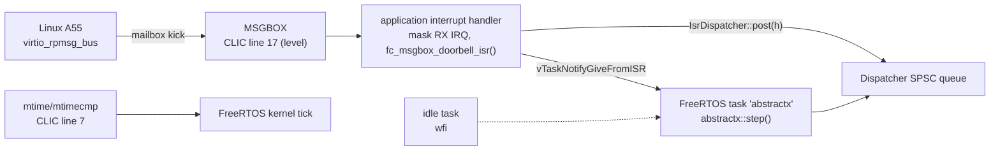

# AbstractX on FreeRTOS: XuanTie E906 Application Specification

This document is the single source of truth for `apps/e906_freertos_app/`: AbstractX
(dispatcher, coroutines, RPMsg, trace) running as one task under FreeRTOS on the
Allwinner T527/A527 XuanTie E906. It exists to answer one question with measurements:
when is bare metal + AbstractX the better choice, and when is FreeRTOS + AbstractX?
The shared benchmark is specified in [`apps/e906_bench/SPECIFICATION.md`](../e906_bench/SPECIFICATION.md);
the write-up is [`docs/articles/BAREMETAL_VS_FREERTOS_E906.md`](../../docs/articles/BAREMETAL_VS_FREERTOS_E906.md).

Each requirement has a tag `[SPEC-E906-RTOS-*]`; code carries `// @impl [SPEC-E906-RTOS-*]`.

---

### `[SPEC-E906-RTOS-01]` Kernel Source and Build Target
* **Requirement**: the kernel is FreeRTOS-Kernel V11.1.0 (`third_party/FreeRTOS-Kernel`,
  git submodule, unmodified, MIT). The RISC-V port is the kernel's
  `portable/GCC/RISC-V/port.c` plus a project copy `apps/e906_freertos_app/portASM_e906.S`
  whose only change masks the E906 extra `mcause` bits (see RTOS-03).
* **Requirement**: CMake target `e906_freertos_app` is built only when
  `ABSTRACTX_TARGET` is `e906` or `allwinner_e906`, links `abstractx_core` and
  `abstractx_target_e906`, uses `E906_LDSCRIPT`, and runs `abstractx_e906_check_layout`.
* **Rationale**: same kernel and port as `cubie-a5e/firmware/riscv-firmware/apps/testFreeRTOS`,
  which passed 2000/2000 interrupt-driven RPMsg pings on silicon (2026-10-20 sweep).
* **Verified by**: `e906-build-layout`, `memory-footprint`
* **Implementation Target**: `apps/e906_freertos_app/CMakeLists.txt`, `apps/e906_freertos_app/portASM_e906.S`

### `[SPEC-E906-RTOS-02]` Static Allocation Only
* **Requirement**: `configSUPPORT_DYNAMIC_ALLOCATION 0`, `configSUPPORT_STATIC_ALLOCATION 1`,
  `configKERNEL_PROVIDED_STATIC_MEMORY 1`; no `heap_*.c` is compiled. Tasks are created with
  `xTaskCreateStatic`. The linked ELF has no `malloc`, `pvPortMalloc` or `vPortFree`.
  Known gap (not from this app): newlib `free`/`_malloc_r` are linked into every E906 ELF
  through a sized `operator delete` reference in `libabstractx_core` (`runtime.cpp`); see
  `engineering_log.md` 2026-10-21. Nothing calls them; the fix belongs in the core.
* **Rationale**: AGENTS §2 zero heap. FreeRTOS objects are static like every AbstractX pool.
* **Verified by**: `memory-footprint`
* **Implementation Target**: `apps/e906_freertos_app/FreeRTOSConfig.h`

### `[SPEC-E906-RTOS-03]` Timer, Trap Vector and CLIC on the E906
* **Requirement**: tick source is the CLINT timer: `mtime` at `0xE000BFF8`, `mtimecmp` at
  `0xE0004000`, counting at 24 MHz (`configCPU_CLOCK_HZ = 24000000`, measured against
  `mcycle`); `configTICK_RATE_HZ = 1000`.
* **Requirement**: `mtvec = freertos_risc_v_trap_handler | 3` (CLIC mode, non-vectored);
  the handler is aligned to at least 64 bytes. Interrupt lines are enabled by writing 1 to
  byte +1 of the CLIC control word at `0xE0801000 + 4 * line`. `mie` alone is ignored in
  CLIC mode.
* **Requirement**: the trap handler keeps only `mcause & 0x80000FFF`: the E906 mirrors
  MPP/MPIE/MPIL into `mcause`, so an `ecall` otherwise reads `0x3800000b` and the timer
  never matches `0x80000007`.
* **Requirement**: lines used: 7 machine timer (kernel tick), 17 message box
  (`RISCV_MSGBOX_RISCV`), 3 machine software interrupt (benchmark only,
  `[SPEC-E906-BENCH-03]`). Interrupts are masked from the end of `abstractx::init()` until
  the scheduler starts.
* **Verified by**: `e906-disassembly-check`, `e906-board-selftest`
* **Implementation Target**: `apps/e906_freertos_app/src/main.cpp`, `apps/e906_freertos_app/FreeRTOSConfig.h`

### `[SPEC-E906-RTOS-04]` Message Box Interrupt Feeds the AbstractX Dispatcher
* **Requirement**: the message box line is level triggered and stays asserted while the
  channel 1 FIFO holds words. The handler masks the channel 1 RX interrupt
  (`MsgBox::enable_rx_irq(Channel1, false)`), calls `fc_msgbox_doorbell_isr()` (which posts
  the waiting RPMsg coroutine to `IsrDispatcher`), and wakes the AbstractX task with
  `vTaskNotifyGiveFromISR` + `portYIELD_FROM_ISR`. The RPMsg awaiter re-enables the RX
  interrupt when it next suspends. The handler never calls `.resume()`.
* **Requirement**: an unexpected line is counted and disabled in the CLIC, so a level line
  cannot storm.
* **Verified by**: `e906-board-selftest`
* **Implementation Target**: `apps/e906_freertos_app/src/main.cpp`

### `[SPEC-E906-RTOS-05]` AbstractX Runs in One Task
* **Requirement**: exactly one FreeRTOS task (`abstractx`, highest application priority)
  calls AbstractX APIs. It loops: `abstractx::step()`; if `Dispatcher::has_pending_resumes()`
  is false, block in `ulTaskNotifyTake(pdTRUE, portMAX_DELAY)`. ISRs only post to
  `IsrDispatcher` and notify this task. No other task touches the dispatcher, RPMsg or the
  tracer.
* **Requirement**: the idle task sleeps in `wfi` (idle hook) and counts wake-ups and idle
  cycles for `[SPEC-E906-BENCH-02]`.
* **Rationale**: keeps the AbstractX single-consumer contract (AGENTS §3: one context calls
  `.resume()`), so the same coroutine code runs on bare metal and on FreeRTOS.
* **Verified by**: `e906-board-selftest`
* **Implementation Target**: `apps/e906_freertos_app/src/main.cpp`

### `[SPEC-E906-RTOS-06]` Floating Point Context
* **Requirement**: the V11.1.0 RISC-V port does not save FP registers. Only the `abstractx`
  task may execute FP instructions; ISRs and other tasks must not. The application
  interrupt handler and the benchmark ISR are integer-only.
* **Verified by**: `e906-disassembly-check`
* **Implementation Target**: `apps/e906_freertos_app/src/main.cpp`
