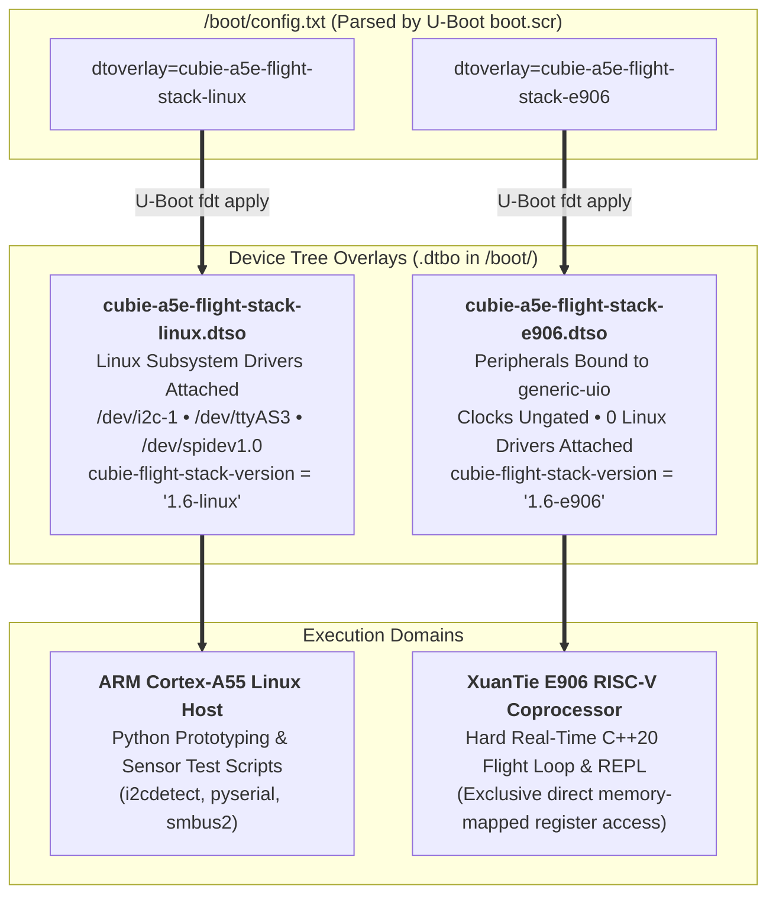
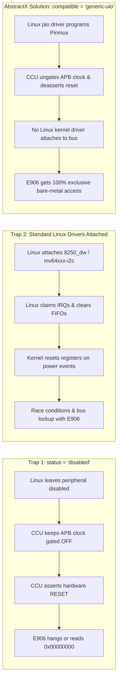
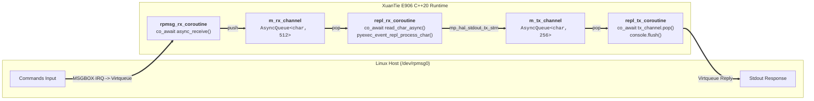
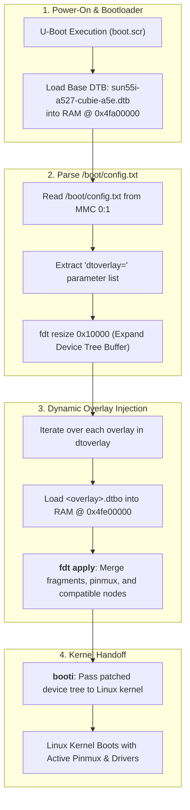
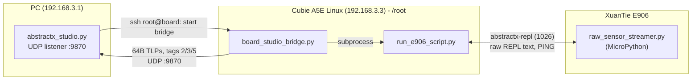

# AbstractX XuanTie E906 MicroPython REPL Application

This directory contains the interactive hardware scripting, diagnostic, and bring-up environment for the **Radxa Cubie A5E (Allwinner A527 / T527)** XuanTie E906 RISC-V coprocessor.

It embeds the upstream MicroPython bytecode runtime inside a freestanding C++20 coroutine task with zero MCU heap allocations, enabling interactive hardware probing (`abstractx.peek`, `abstractx.poke`) and rapid driver staging alongside hard real-time flight loops.

---

## 1. Physical 40-Pin Header & Peripheral Wiring (NEO-M8N GPS + Compass)

When wiring a standard drone GPS & Electronic Compass puck (such as the u-blox NEO-M8N with QMC5883L/HMC5883L compass) to the Radxa Cubie A5E 40-pin expansion header, use the following pin assignments (verified against Radxa Cubie A5E Schematic v1.2):

```mermaid
flowchart TD
    subgraph CUBIE["Radxa Cubie A5E 40-Pin Header"]
        P2["Pin 2: 5V Power (5V_VCC)"]
        P3["Pin 3: I2C1-SDA (PB5 / TWI1)"]
        P5["Pin 5: I2C1-SCL (PB4 / TWI1)"]
        P6["Pin 6: Ground (GND)"]
        P8["Pin 8: UART0-TX (PB9 - Linux Debug Console)"]
        P10["Pin 10: UART0-RX (PB10 - Linux Debug Console)"]
        P16["Pin 16: UART3-TX (PI11 - GPS Serial RX)"]
        P31["Pin 31: UART3-RX (PI12 - GPS Serial TX)"]
    end

    subgraph GPS_PUCK["u-blox NEO-M8N GPS + Compass Puck (Built-in Pull-Ups)"]
        VCC["VCC (5V Power)"]
        GND["GND (Ground)"]
        SDA["I2C SDA (Integrated 2.2kΩ-4.7kΩ Pull-Up)"]
        SCL["I2C SCL (Integrated 2.2kΩ-4.7kΩ Pull-Up)"]
        TX["GPS TX (Streaming Output)"]
        RX["GPS RX (Configuration Input)"]
    end

    P2 ===>|5V Power| VCC
    P6 ===>|Ground| GND
    P3 <===>|I2C Data| SDA
    P5 ===>|I2C Clock| SCL
    P16 ===>|Serial Commands (SoC TX -> GPS RX)| RX
    P31 <===|NMEA / UBX (GPS TX -> SoC RX)| TX
```

### Physical 40-Pin Header Socket Diagram & Wire Colors

```text
               [ TOP OF 40-PIN HEADER ]
                      
  (ODD ROW)                                (EVEN ROW)
  ======================================================
  Pin 1: 3.3V Power         [ 1 ] [ 2 ]    Pin 2: 5V Power      <-- 🔴 RED WIRE (5V Power)
  Pin 3: I2C1-SDA (PB5)     [ 3 ] [ 4 ]    Pin 4: 5V Power
       ↳ 🔵 BLUE WIRE       [ 5 ] [ 6 ]    Pin 6: Ground (GND)  <-- ⚫ BLACK WIRE (Ground)
  Pin 5: I2C1-SCL (PB4)     [ 7 ] [ 8 ]    Pin 8: Console TX    (White - Host minicom /dev/ttyS0)
       ↳ 🟠 ORANGE WIRE     [ 9 ] [ 10]    Pin 10: Console RX   (Gray  - Host minicom /dev/ttyS0)
  Pin 11: GPIO / PWM (PI9)  [ 11] [ 12]    Pin 12: SPI1-CS0 (PI2)
  Pin 13: GPIO / PWM (PI10) [ 13] [ 14]    Pin 14: Ground
  Pin 15: S-UART0-TX (PL12) [ 15] [ 16]    Pin 16: UART3-TX (PI11) <-- 🟡 YELLOW WIRE (GPS RX)
  Pin 17: 3.3V Power        [ 17] [ 18]    Pin 18: GPIO (PI14)
  Pin 19: SPI1-MOSI (PB13)  [ 19] [ 20]    Pin 20: Ground
  Pin 21: SPI1-MISO (PB14)  [ 21] [ 22]    Pin 22: FPGA Frame Ready ISR (PL13)
  Pin 23: SPI1-CLK (PB12)   [ 23] [ 24]    Pin 24: SPI1-CS0 (PB11)
  Pin 25: Ground            [ 25] [ 26]    Pin 26: UART4-TX (PI0)
  Pin 27: I2C2-SDA (PI16)   [ 27] [ 28]    Pin 28: I2C2-SCK (PI15)
  Pin 29: IMU DRDY (PI8)    [ 29] [ 30]    Pin 30: Ground
  Pin 31: UART3-RX (PI12)   [ 31] [ 32]    Pin 32: UART4-RX (PI1)
       ↳ 🟢 GREEN WIRE
  ======================================================
```

### Complete Pin & Color Reference Table

| Header Pin | SoC Net / Function | Target Peripheral | Wire Color | Puck Function & Connection Rule |
|---|---|---|---|---|
| **Pin 2** (or Pin 4) | `5V_VCC` | Power Supply | **Red** | **5V Power Input** for GPS and Compass |
| **Pin 6** (or Pin 14) | `GND` | Ground Reference | **Black** | **System Ground** |
| **Pin 3** | `PB5 / TWI1-SDA` | **I2C1 Data** | **Blue** | **I2C SDA** (Compass `0x0D`/`0x1E` & u-blox DDC `0x42`) |
| **Pin 5** | `PB4 / TWI1-SCL` | **I2C1 Clock** | **Orange** | **I2C SCL** (Compass & u-blox DDC) |
| *Pin 8* | *PB9 / UART0-TX* | *Debug Terminal* | *White* | *Linux Host Serial Debug Console (115200: /dev/ttyS0)* |
| *Pin 10* | *PB10 / UART0-RX* | *Debug Terminal* | *Gray* | *Linux Host Serial Debug Console (115200: /dev/ttyS0)* |
| **Pin 16** | `PI11 / UART3-TX` | **UART3 Transmit** | **Yellow** | **GPS RX** (SoC Transmit $\rightarrow$ GPS Puck Receive) |
| **Pin 31** | `PI12 / UART3-RX` | **UART3 Receive** | **Green** | **GPS TX** (GPS Puck Transmit $\rightarrow$ SoC Receive) |
| **Pin 24, 23, 19, 21** | `PB11-PB14 / SPI1` | **Dual-SPI / Single-SPI** | — | Hardware FPGA X-Fabric / High-Speed Sensor bus |
| **Pin 29** | `PI8 / PI-EINT8` | **IMU DRDY** | — | Dedicated Hardware Edge-Trigger Interrupt Line |

> [!IMPORTANT]
> **I2C Pull-Up Resistors Hardware Verification**:
> * Radxa Cubie A5E Schematic v1.2 Sheet 19 proves that Pins 3 & 5 (`PB5`/`PB4`) have **no on-board pull-up resistors**.
> * **Standard GPS pucks** (e.g. u-blox NEO-M8N with integrated QMC/HMC compass) already incorporate internal 2.2kΩ–4.7kΩ pull-up resistors on their SDA/SCL lines to 3.3V. When plugged in, the bus is automatically pulled up.
> * If using raw breakout boards without pull-ups, external 2.2kΩ–4.7kΩ pull-ups to 3.3V (Pin 1 or Pin 17) are mandatory.

> [!IMPORTANT]
> **Serial Crossover Rule**:
> * **Pin 16 (UART3-TX)** MUST connect to the GPS puck **RX (Yellow)**.
> * **Pin 31 (UART3-RX)** MUST connect to the GPS puck **TX (Green)**.
> * Connecting TX to TX will result in silence and prevent NMEA streaming.
> * Note: Radxa Cubie A5E schematic sheet 5 proves `PB0`/`PB1` (UART2) are No-Connect on the PCB; Pins 11 & 13 connect to `PI9`/`PI10` (no UART hardware). UART3 on Pins 16 & 31 is the hardware navigation port.

---

## 2. Dual Device Tree Overlay Architecture (`apps/e906_repl_app/`)

The Radxa Cubie A5E (Allwinner A527 / T527) is an **Asymmetric Multiprocessing (AMP)** SoC combining an octa-core ARM Cortex-A55 application processor running Linux with a XuanTie E906 32-bit RISC-V real-time coprocessor. Both execution domains share the exact same physical silicon pins (the 40-pin header) and internal APB peripheral blocks (UART3, I2C1, SPI1).

Peripheral ownership and pin multiplexing are orchestrated through **Device Tree Overlays (`.dtso`)** applied by U-Boot at boot time:



---

### 2.1 Why Device Trees are Crucial on AMP Silicon

On Allwinner SoCs, the **Clock Control Unit (CCU)** and **Power Management IC (PMIC)** are under Linux kernel power management. Without careful Device Tree engineering, two severe failure modes arise when attempting to run bare-metal firmware on the XuanTie E906:



#### The `generic-uio` Architectural Invariant
In `cubie-a5e-flight-stack-e906.dtso`, the peripheral nodes (`&uart3`, `&i2c1`, `&spi1`) are configured with:
```dts
compatible = "generic-uio";
status = "okay";
```
**What this achieves**:
1. **Clock Ungating & Reset Release**: The Linux CCU recognizes the node as active (`status = "okay"`), automatically powers on the bus, un-gates the APB peripheral clock, and de-asserts the hardware reset signal.
2. **Pin Multiplexing**: The Linux `pio` pinctrl driver configures the physical ball/pad routing so the header pins connect to the internal peripheral hardware blocks.
3. **Zero Driver Contention**: Because `compatible = "generic-uio"` does not match any Linux subsystem driver (`8250_dw`, `mv64xxx-i2c`, or `spi-sun6i`), the kernel loads no driver, registers no interrupts, and leaves all hardware FIFOs and registers untouched.
4. **Exclusive E906 Access**: The XuanTie E906 coprocessor can freely perform high-speed, zero-jitter register reads and writes at:
   - `0x02500C00`: **UART3** (GPS streaming & configuration)
   - `0x02502400`: **TWI1 / I2C1** (Compass & Barometer)
   - `0x04026000`: **SPI1** (High-speed IMU & FPGA crossbar fabric)

---

### 2.2 Profile Comparison Matrix

| Feature / Subsystem | Profile 1: Linux Host (`-linux`) | Profile 2: XuanTie E906 (`-e906`) |
|---|---|---|
| **DTS Overlay File** | `cubie-a5e-flight-stack-linux.dtso` | `cubie-a5e-flight-stack-e906.dtso` |
| **`/boot/config.txt` Setting** | `dtoverlay=cubie-a5e-flight-stack-linux` | `dtoverlay=cubie-a5e-flight-stack-e906` |
| **Version Node (`/proc/device-tree/`)** | `cubie-flight-stack-version = "1.6-linux"` | `cubie-flight-stack-version = "1.6-e906"` |
| **I2C1 (Pins 3 & 5: PB5/PB4)** | Attached to `mv64xxx-i2c` (`/dev/i2c-1`) | Bound to `generic-uio` (E906 register `0x02502400`) |
| **UART3 (Pins 16 & 31: PI11/PI12)** | Attached to `8250_dw` (`/dev/ttyAS3`, `/dev/ttyS3`) | Bound to `generic-uio` (E906 register `0x02500C00`) |
| **SPI1 (Pins 24, 23, 19, 21: PB11-14)**| Attached to `spi-sun6i` (`/dev/spidev1.0`) | Bound to `generic-uio` (E906 register `0x04026000`) |
| **UART0 Console (Pins 8 & 10: PB9/PB10)**| Retained for Linux Console (`/dev/ttyS0`) | Retained for Linux Console (`/dev/ttyS0`) |
| **RemoteProc Subsystem** | Disabled (`status = "disabled"`) | Enabled (`allwinner,sun55i-a523-rproc`) |
| **XuanTie E906 Execution** | Core in reset / offline | Boots `/lib/firmware/riscv-firmware.elf` |
| **Host Communication Endpoint** | N/A | `/dev/rpmsg0` (MicroPython REPL & Telemetry) |
| **Primary Use Case** | Python prototyping, sensor bring-up, wiring validation | Hard real-time C++20 flight loop & MicroPython REPL |

---

### 2.3 Kernel Pinctrl Rules & Hardware Invariants

#### 1. Mandatory `allwinner,pinmux = <mux_index>`
In Allwinner A523/A527 platforms, the kernel pinctrl driver (`drivers/pinctrl/sunxi/pinctrl-sunxi-dt.c`) enforces a strict rule: every pin group defined inside a dynamic DT overlay **must contain an explicit numeric property `allwinner,pinmux = <val>;`**. Standard upstream generic properties like `function = "..."` without the numeric index are rejected with `invalid mux value`, leaving the pins `UNCLAIMED`:
```dts
i2c1_pb_pins: i2c1-pb-pins {
    pins = "PB4", "PB5";
    function = "i2c1";
    allwinner,pinmux = <2>;   /* Required by pinctrl-sunxi-dt.c */
};

uart3_pi_pins: uart3-pi-pins {
    pins = "PI11", "PI12";
    function = "uart3";
    allwinner,pinmux = <2>;   /* Required by pinctrl-sunxi-dt.c */
};
```

#### 2. Disabling Internal I2C Pull-Up Resistors (`bias-pull-up` Omission)
Radxa Cubie A5E Schematic v1.2 Sheet 19 proves that Pins 3 & 5 (`PB5`/`PB4`) have no onboard pull-ups. Standard drone GPS/compass pucks (such as the u-blox NEO-M8N) already include physical 2.2kΩ–4.7kΩ pull-up resistors to 3.3V on their SDA/SCL lines. Consequently:
- `bias-pull-up;` is **intentionally omitted** from `i2c1_pb_pins` in both overlays.
- Enabling internal SoC weak pull-ups alongside the puck's physical pull-ups creates parallel resistance distortion that degrades signal edges and can cause I2C bus lockup.

---

### 2.4 RemoteProc & Memory Carveout Architecture

In `cubie-a5e-flight-stack-e906.dtso`, the `&rproc` node attaches to the Linux kernel remoteproc subsystem with reserved physical memory carveouts:

```text
+-----------------------+ 0x48200000
| Firmware DRAM Pool    | (1 MB @ 0x48100000 - rproc_dram)
+-----------------------+ 0x48100000
| VirtIO VRings & DMA   | (1 MB @ 0x48000000 - rproc_vdev shared-dma-pool)
+-----------------------+ 0x48000000
           ...
+-----------------------+ 0x072C0000 (E906 view: 0x3FFFFFFF)
| MCU SRAM Space 0      | (256 KB @ 0x07280000 - riscvsram0)
| Text + Data + BSS     | (E906 view: 0x3FFC0000 - Zero-Heap Executable)
+-----------------------+ 0x07280000 (E906 view: 0x3FFC0000)
```

1. **Dedicated MCU SRAM Space 0 (`0x07280000`, 256 KB)**:
   - Linux physical address: `0x07280000`–`0x072BFFFF`.
   - XuanTie E906 local memory bus: `0x3FFC0000`–`0x3FFFFFFF`.
   - Marked `no-map;` so Linux kernel memory management never touches it.
   - Houses the entire freestanding C++20 flight loop binary (`e906_repl_app.elf`).
2. **VirtIO VRing DMA Pool (`0x48000000`, 1 MB)**:
   - Houses the VirtIO ring descriptors and message buffers for inter-core communication.
3. **Hardware Mailbox (`&msgbox`)**:
   - Enables the Allwinner hardware message box channels (`allwinner,sun55i-msgbox`) for bi-directional IRQ doorbells between the ARM Cortex-A55 host and XuanTie E906 coprocessor.


---

## 3. Multi-Board Portability: Radxa Cubie A5E & Radxa Cubie A7A

AbstractX is designed for seamless portability across both Allwinner single-board computers. Both boards follow the standard **Radxa 40-Pin GPIO expansion header layout**, allowing the exact same physical sensor wiring and Python test scripts to work transparently:

| Feature | Radxa Cubie A5E | Radxa Cubie A7A |
|---|---|---|
| **SoC Silicon** | Allwinner A527 / T527 (`sun55iw3`) | Allwinner A733 (`sun60iw2`) |
| **Application CPU** | 8× Arm Cortex-A55 @ 1.8 GHz | 2× Cortex-A76 + 6× Cortex-A55 |
| **Real-Time Co-Processor** | XuanTie E906 RISC-V @ 200 MHz | XuanTie E902 / E906 RISC-V @ 200 MHz |
| **Header Pinout Standard** | Radxa 40-Pin Expansion Standard | Radxa 40-Pin Expansion Standard |
| **I2C Bus (Pins 3 & 5)** | `PB5/PB4` (TWI1, `/dev/i2c-1`) | Expansion TWI (`/dev/i2c-1`) |
| **Host Debug Console** | UART0 on Pins 8 & 10 (`/dev/ttyS0` @ 115200) | UART0 on Pins 8 & 10 (`/dev/ttyS0` @ 115200) |
| **Navigation Serial Port** | UART3 on Pins 16 & 31 (`/dev/ttyAS3`) | Expansion UART on Pins 16 & 31 |
| **MicroPython GC Heap** | Quarantined in HiFi4 DSP RAM (`0x00020000`) | Quarantined in System SRAM A2 (`0x00040000`, 208 KB) |
| **MCU Zero-Heap SRAM** | Space 0 (`0x3FFC0000`, 256 KB) | System SRAM A2 / Dedicated Co-Processor SRAM |
| **Board Auto-Detection** | Scripts read `/proc/device-tree/model` | Scripts read `/proc/device-tree/model` |

---

## 4. The Python-First Bring-Up Philosophy

In AbstractX, bringing up new sensors and flight peripherals follows a **Python-First validation workflow**:

```mermaid
flowchart LR
    subgraph S1["1. Python Prototyping (NOW)"]
        direction TB
        A1["Interactive I2C / UART probing"]
        A2["Verify bus ACK & addresses"]
        A3["Inspect raw NMEA/UBX sentences"]
    end

    subgraph S2["2. MicroPython-to-C++ (Skill)"]
        direction TB
        B1["micropython-to-cpp automated transform"]
        B2["Freestanding C++20 coroutine tasks"]
        B3["Zero heap • Zero blocking delays"]
    end

    subgraph S3["3. Flight Loop & INAV"]
        direction TB
        C1["Primary-paced sensor fusion"]
        C2["INAV navigation state matrix"]
        C3["AbstractX Studio 3D telemetry"]
    end

    S1 ==> S2 ==> S3
```



1. **Fast Interactive Validation**: Prove hardware wiring, power, pinmux, baud rates, and register maps interactively using Python scripts or the MicroPython REPL without constant re-compilation or firmware reflashing.
2. **Deterministic Translation**: Once register sequences and timing are proven, use the `micropython-to-cpp` skill to transform Python asyncio drivers directly into freestanding C++20 coroutines (`Task<bool>`, `co_await`).
3. **Hard Real-Time Integration**: The resulting C++ drivers plug directly into the INAV navigation matrix and AbstractX primary-paced sensor channels.

---

## 5. Coroutine Architecture: Bidirectional Channels & Zero Polling

The MicroPython REPL embeds inside the AbstractX cooperative coroutine dispatcher using **bidirectional AbstractX channels (`AsyncQueue`)**:



1. **Zero-Overhead Idle Sleep**: When no commands are being typed, `repl_rx_coroutine` is suspended on `co_await console.read_char_async()`, consuming **0% CPU cycles**.
2. **Asynchronous Batched Output**: MicroPython `print()` emissions write into `m_tx_channel`. A dedicated `repl_tx_coroutine` gathers characters and batches them into 256-byte RPMsg frames, preventing bus thrashing.
3. **NLR Keyboard Interrupts**: Long-running Python loops non-preemptively check `m_rx_channel.try_peek(ch)` in `abstractx_repl_vm_hook()` for `CHAR_CTRL_C` (`0x03`) to schedule `mp_sched_keyboard_interrupt()` without stalling primary-paced sensor loops.

---

## 6. How Device Trees and `/boot/config.txt` Work (Compile, Deploy, Load)

### 6.1 The U-Boot Device Tree Overlay Architecture

On the Radxa Cubie A5E, device tree overlays are dynamically loaded and merged by the **U-Boot bootloader** before the Linux kernel is ever started. This eliminates the need to recompile the kernel DTB or alter low-level U-Boot flash environment variables:



#### Under the Hood of `boot.scr`:
1. **Locate Configuration**: U-Boot searches the root FAT partition for Raspberry Pi-style `/boot/config.txt`.
2. **Base FDT Loading**: The base board device tree (`sun55i-a527-cubie-a5e.dtb`) is loaded into memory at `${fdt_addr_r}` (`0x4fa00000`).
3. **Buffer Expansion**: U-Boot executes `fdt addr ${fdt_addr_r}` and `fdt resize 0x10000` to allocate extra buffer space in RAM for overlay nodes and properties.
4. **Dynamic Merging (`fdt apply`)**: For every overlay listed in `dtoverlay=`, U-Boot loads `<overlay>.dtbo` to `${fdtoverlay_addr_r}` (`0x4fe00000`) and calls `fdt apply ${fdtoverlay_addr_r}`.
5. **Fail-Safe Fallback**: If an overlay file is missing or fails to merge, U-Boot sets `fdt_apply_error=1`, logs `[ERROR] fdt apply failed for <overlay>!`, and reloads the clean base DTB so the board still boots reliably into Linux without bricking.

---

### 6.2 Step-by-Step Compilation & Deployment

#### Step 1: Compile the Device Tree Source Overlays (`.dtso` $\rightarrow$ `.dtbo`)
Compile both `.dtso` source files into binary `.dtbo` overlays using the Device Tree Compiler (`dtc`) with symbols enabled (`-@`):

```bash
# Compile Linux Host profile (attached kernel drivers)
dtc -@ -I dts -O dtb -o cubie-a5e-flight-stack-linux.dtbo cubie-a5e-flight-stack-linux.dtso

# Compile XuanTie E906 Real-Time profile (generic-uio & remoteproc)
dtc -@ -I dts -O dtb -o cubie-a5e-flight-stack-e906.dtbo cubie-a5e-flight-stack-e906.dtso
```

#### Step 2: Deploy Binary Overlays to `/boot/` on the Target Board
Transfer the compiled `.dtbo` files to the board's `/boot/` directory using legacy SCP mode (`-O`):

```bash
scp -O cubie-a5e-flight-stack-linux.dtbo cubie-a5e-flight-stack-e906.dtbo root@192.168.3.3:/boot/
```

---

### 6.3 Loading and Switching Profiles via `/boot/config.txt`

The active profile is selected purely by editing `/boot/config.txt`. The `.dtbo` extension is optional and can be omitted.

#### Profile 1: Linux Host / Python Prototyping Mode
Use this profile when writing Python test scripts, scanning I2C with `i2cdetect -y 1`, verifying GPS streaming on `/dev/ttyS3` (`/dev/ttyAS3`), or testing SPI devices via `/dev/spidev1.0`.

To activate from the host via SSH:
```bash
ssh root@192.168.3.3 "echo 'dtoverlay=cubie-a5e-flight-stack-linux' > /boot/config.txt"
ssh root@192.168.3.3 "sync && reboot"
```

Or edit `/boot/config.txt` directly:
```ini
# /boot/config.txt - Linux Host Testing Profile
dtoverlay=cubie-a5e-flight-stack-linux
```

#### Profile 2: XuanTie E906 Real-Time Flight Stack & MicroPython REPL Mode
Use this profile when running the XuanTie E906 bare-metal C++20 flight loop or interactive MicroPython hardware diagnostics. Linux will configure pinmux and ungate bus clocks, but attach no drivers (`generic-uio`), and boot the E906 firmware automatically via remoteproc.

To activate from the host via SSH:
```bash
ssh root@192.168.3.3 "echo 'dtoverlay=cubie-a5e-flight-stack-e906' > /boot/config.txt"
ssh root@192.168.3.3 "sync && reboot"
```

Or edit `/boot/config.txt` directly:
```ini
# /boot/config.txt - XuanTie E906 Real-Time Flight Stack Profile
dtoverlay=cubie-a5e-flight-stack-e906
```

#### Profile 3: XuanTie E906 with Multi-Overlay Chaining (e.g. Zero-Copy SRAM RPMsg)
U-Boot supports chaining multiple overlays by listing them separated by spaces on the `dtoverlay=` line:
```ini
# /boot/config.txt - E906 Flight Stack + Zero-Copy SRAM RPMsg Pool
dtoverlay=cubie-a5e-flight-stack-e906 cubie-a5e-abstractx-rpmsg-sram
```

---

### 6.4 Post-Boot Verification Checklist

After the board reboots, perform these quick checks from the Linux terminal to confirm that U-Boot loaded the intended overlay and configured the hardware:

#### 1. Instant Overlay Version Check
Read the version string injected by the overlay into the live device tree:
```bash
cat /proc/device-tree/cubie-flight-stack-version
```
- **Returns `1.6-linux`**: Confirms `cubie-a5e-flight-stack-linux.dtbo` was merged.
- **Returns `1.6-e906`**: Confirms `cubie-a5e-flight-stack-e906.dtbo` was merged.

#### 2. Verify Physical Pinmux Routing in DebugFS
Mount debugfs and verify which subsystem has claimed the 40-pin header pins:
```bash
mount -t debugfs none /sys/kernel/debug 2>/dev/null || true
grep -E 'PB4|PB5|PB11|PB12|PB13|PB14|PI0|PI1|PI11|PI12' /sys/kernel/debug/pinctrl/2000000.pinctrl/pinmux-pins
```
- **Under Linux Profile (`-linux`)**:
  - `PB4`, `PB5`: claimed by `device 2502400.i2c function i2c1`
  - `PI11`, `PI12`: claimed by `device 2500c00.serial function uart3`
  - `PB11`–`PB14`: claimed by `device 4026000.spi function spi1`
- **Under E906 Profile (`-e906`)**:
  - Pins are claimed and function muxes are set, but device drivers are `generic-uio` (no Linux serial or I2C drivers).

#### 3. Verify RemoteProc and MicroPython REPL (E906 Profile)
```bash
# Check coprocessor execution state:
cat /sys/class/remoteproc/remoteproc0/state
# Output: running

# Check early boot trace log:
cat /sys/kernel/debug/remoteproc/remoteproc0/trace0
# Output: [E906] Online

# Connect to the interactive MicroPython REPL:
microcom -p /dev/rpmsg0
```

---

### 6.5 Troubleshooting & Common Pitfalls

| Symptom | Root Cause | Solution |
|---|---|---|
| **Pins show `UNCLAIMED` in debugfs** | Missing numeric `allwinner,pinmux = <mux>` in the DT overlay pin group. | Ensure every pin group node in `.dtso` includes `allwinner,pinmux = <val>;` (e.g. `2` for UART3/I2C1, `4` for SPI1). |
| **E906 hangs or reads `0x00000000` on UART3/I2C1** | Peripheral was left `status = "disabled"` or not bound to `generic-uio`. The Linux CCU gated off the APB clock. | Use `cubie-a5e-flight-stack-e906.dtso` where peripherals have `compatible = "generic-uio"` and `status = "okay"`. |
| **I2C bus hangs or NAKs continuously** | `bias-pull-up;` was enabled in pinctrl while GPS puck also has pull-ups, or puck 5V power (Pin 2) is disconnected. | Omit `bias-pull-up` from overlay and verify Pin 2 has 5V power and Pin 6 is connected to ground. |
| **GPS serial stream produces no characters** | Serial TX/RX crossover reversed. | Connect GPS Green wire (GPS TX) to **Pin 31 (A5E RX)** and Yellow wire (GPS RX) to **Pin 16 (A5E TX)**. |
| **U-Boot prints `[ERROR] fdt apply failed`** | Syntax error in `.dtso`, missing label reference in base DTB, or overlay buffer overflow. | Verify `.dtso` compiles cleanly with `dtc -@`, check label names against `sun55i-a527-cubie-a5e.dtb`, and ensure U-Boot `fdt resize 0x10000` is run. |
| **RemoteProc stays `offline` or fails to start** | Firmware file missing or misnamed in `/lib/firmware/`. | Ensure `riscv-firmware.elf` symlinks to `e906_repl_app.elf` (`ln -s /lib/firmware/e906_repl_app.elf /lib/firmware/riscv-firmware.elf`). |

---

## 7. Quick Start & Verification

### A. Build the E906 Firmware Binary
```bash
# Cross-compile for XuanTie E906 coprocessor
cmake -S . -B build_e906 -DABSTRACTX_TARGET=allwinner_e906
cmake --build build_e906 --target e906_repl_app
```

### B. Launch Interactive REPL from Linux Host
On the booted Radxa Cubie A5E:
```bash
# Load firmware into remoteproc
echo stop > /sys/class/remoteproc/remoteproc0/state
cp e906_repl_app.elf /lib/firmware/
echo e906_repl_app.elf > /sys/class/remoteproc/remoteproc0/firmware
echo start > /sys/class/remoteproc/remoteproc0/state

# Connect to the interactive MicroPython REPL over RPMsg
microcom -p /dev/rpmsg0
```

> [!NOTE]
> The REPL node is not always `/dev/rpmsg0`: the TLP (1024) and trace (1025) endpoints
> also get `/dev/rpmsgN` nodes. The host scripts pick the node whose
> `/sys/class/rpmsg/rpmsgN/name` is `abstractx-repl` and create it via
> `/dev/rpmsg_ctrl0` if it is missing ([SPEC-E906-REPL-12]). Find it by hand with
> `grep -l abstractx-repl /sys/class/rpmsg/rpmsg*/name`.

### C. Inspect Hardware from the MicroPython Prompt
```python
>>> import abstractx

# Check version
>>> abstractx.version()
'AbstractX 1.0.0 (E906 MicroPython REPL)'

# Read CPU cycle counter (rdcycle)
>>> abstractx.cycles()
145829104

# Peek UART3 status register (Base 0x02500C00)
>>> hex(abstractx.peek(0x02500C7C))
'0x00000006'

# Soft reset REPL VM
>>> (Press Ctrl-D)
```

---

## 8. Connecting AbstractX Studio to the Board

AbstractX Studio (`tools/visualizer/abstractx_studio.py`) runs on the PC. It never talks
to RPMsg directly: it SSHes to the board and starts a Linux-side Python bridge, which
runs a MicroPython script on the E906 and forwards the results to Studio over UDP.



### 8.1 One-Time Setup

1. **Board profile**: `/boot/config.txt` must load `cubie-a5e-flight-stack-e906` (§6.3),
   and `cat /sys/class/remoteproc/remoteproc0/state` must print `running`.
2. **Network**: PC on `192.168.3.1`, board on `192.168.3.3` (the defaults). Other
   addresses work through `--board-ip` / `--host-ip`.
3. **Passwordless SSH** (Studio uses `ssh root@<board>` with no prompt;
   auto-detect uses `BatchMode=yes`):
   ```bash
   ssh-copy-id root@192.168.3.3
   ssh -o BatchMode=yes root@192.168.3.3 true && echo ssh-ok
   ```
4. **Copy the Linux-side scripts to `/root` on the board** (Studio and the board tests
   expect exactly these paths). From the repository root:
   ```bash
   scp -O apps/e906_repl_app/run_e906_script.py \
          apps/e906_repl_app/raw_sensor_streamer.py \
          apps/e906_repl_app/flight_sensors.py \
          tools/board_studio_bridge.py \
          tools/e906_rpmsg_bridge.py \
          root@192.168.3.3:/root/
   ```
   Re-copy after changing any of them; the board does not run them from the repo.
5. **PC Python dependencies** for Studio:
   ```bash
   pip install -r tools/visualizer/requirements.txt
   ```

### 8.2 Start Studio and Connect

From the repository root on the PC:

```bash
# Start Studio and the board bridge in one step
python3 tools/visualizer/abstractx_studio.py --auto-connect

# Or start Studio, then use the menu bar: "▶ Connect (192.168.3.3)"
python3 tools/visualizer/abstractx_studio.py

# Different addresses or port
python3 tools/visualizer/abstractx_studio.py --board-ip 10.0.0.42 --host-ip 10.0.0.1 --port 9870
```

In the menu bar:
- **▶ Connect / ⏹ Disconnect** start and stop the board bridge. The label changes to
  `● Streaming` once TLPs arrive, or `◌ Bridge Up` while the bridge runs with no data yet.
- **Connection → 🔍 Auto-Detect Target Silicon & FPGA** picks the `cubie_a5e_pure` or
  `cubie_a5e_fpga` profile over SSH. **Hardware Profile** sets it by hand.

Disconnect sends Ctrl-C to the E906 script so the RPMsg traffic stops. If Studio is killed
without disconnecting, the E906 heartbeat watchdog ([SPEC-E906-REPL-14]) stops the script
once the bridge's 1 s `PING` stops.

### 8.3 Start the Linux Bridge by Hand (No Studio GUI)

Use this to debug the board side or to point an existing Studio at the board. On the
board, or through SSH from the PC:

```bash
# What Studio's Connect runs (STREAM_DURATION=0 streams until Ctrl-C)
ssh root@192.168.3.3 \
  "STUDIO_HOST_IP=192.168.3.1 STUDIO_PORT=9870 STREAM_DURATION=0 python3 -u /root/board_studio_bridge.py"
```

Expected output: `[BRIDGE] Forwarded #N: Heading=…° Sats=… Lat=… Lon=…` every 5 frames.
Lines prefixed `[PROC]` are E906 stdout that was not a `!RAW:` sensor record.

Other Linux-side tools:

| Command (on the board, in `/root`) | Purpose |
|---|---|
| `python3 run_e906_script.py <script.py> [timeout_s]` | Run one MicroPython script on the E906 through raw REPL and print its stdout |
| `python3 e906_rpmsg_bridge.py trace --udp-host 192.168.3.1` | CTF trace endpoint (1025) to UDP :9870 |
| `python3 e906_rpmsg_bridge.py tlp --udp-host 192.168.3.1` | TLP endpoint (1024) to UDP :9871; UDP :9872 back to the E906 |

`apps/e906_repl_app/linux/e906_workbench.py` runs on the **PC** and reaches the board over
SSH (`--target root@192.168.3.3` is the default; `--target local` if run on the board):

```bash
python3 apps/e906_repl_app/linux/e906_workbench.py                    # terminal workbench: REPL, trace, HW monitor
python3 apps/e906_repl_app/linux/e906_workbench.py -c "import abstractx; print(abstractx.alive())"
python3 apps/e906_repl_app/linux/e906_workbench.py --peek 0x02502400  # one 32-bit MMIO read
```

> [!NOTE]
> Studio currently listens only on UDP :9870. TLPs sent from MicroPython with
> `abstractx.tlp_send()` go out on endpoint 1024 → UDP :9871 and are not shown in
> Studio yet; `tools/test_e906_repl_system.py` is the consumer for that plane.

### 8.4 Board Checks Run From the PC

```bash
python3 tools/test_board_system_checkout.py     # REPL alive + bridge → Studio UDP path
python3 tools/test_e906_repl_system.py          # REPL / TLP / trace planes and isolation
python3 tools/test_e906_sensors_board.py        # flight_sensors.py on the E906
```

### 8.5 Troubleshooting

| Symptom | Check |
|---|---|
| Connect does nothing, no `◌ Bridge Up` | `ssh -o BatchMode=yes root@192.168.3.3 true` fails: set up SSH keys (§8.1 step 3) |
| `python3: can't open file '/root/board_studio_bridge.py'` | Scripts not copied (§8.1 step 4) |
| `Error: /dev/rpmsg_ctrl0 not found. Is remoteproc running?` | Wrong overlay or firmware not started (§6.4 step 3) |
| Bridge prints `[BRIDGE] Forwarded …` but Studio shows nothing | `STUDIO_HOST_IP` is not the PC's address on the board network, or a PC firewall blocks UDP 9870 |
| Heading moves but GPS stays 0 | No GPS fix yet (`Sats=0`), or UART3 TX/RX swapped (§1) |
| REPL node busy (`EBUSY`) | Another process holds the `abstractx-repl` node; the runner kills it with `fuser -k`, or run `fuser -k /dev/rpmsgN` |

---

## 9. Agent Quick Reference (Claude Code and other AI agents)

Agents cannot drive `microcom` or the Studio GUI. Use these non-interactive commands,
which exit on their own and print plain text:

```bash
# Is the E906 up?
ssh root@192.168.3.3 cat /sys/class/remoteproc/remoteproc0/state            # expect: running

# Run MicroPython on the E906 (script must be on the board)
python3 apps/e906_repl_app/linux/e906_workbench.py -c "import abstractx; print(abstractx.alive())"
ssh root@192.168.3.3 "python3 /root/run_e906_script.py /root/flight_sensors.py 10"

# Bounded bridge run (10 s) instead of the endless Studio stream
ssh root@192.168.3.3 "STUDIO_HOST_IP=192.168.3.1 STREAM_DURATION=10 python3 -u /root/board_studio_bridge.py"
```

Rules for agents working on this app:
- Read `SPECIFICATION.md` here before changing code; the rules are in the repository
  `AGENTS.md`.
- After editing any Linux-side script, re-copy it to `/root` (§8.1 step 4) before
  running a board test, or the test exercises the old copy.
- Always pass a timeout or `STREAM_DURATION`; without one the bridge runs forever.
- Put board results in the commit message and the evidence ledger, and say which
  checks did not run (no board, no GUI).

---

## 10. Live Peripheral Testing Recipes (Python)

Run these recipes under Linux with `dtoverlay=cubie-a5e-flight-stack-linux`:

### Recipe 1: Scan I2C Compass & u-blox DDC (`test_compass.py`)
```python
import smbus2

bus = smbus2.SMBus(1)
print("Scanning I2C Bus 1 (Pins 3 & 5: PB5/PB4)...")
for addr in [0x0D, 0x1E, 0x42]:
    try:
        bus.read_byte(addr)
        name = {0x0D: "QMC5883L Compass", 0x1E: "HMC5883L Compass", 0x42: "u-blox DDC"}.get(addr, "Unknown")
        print(f"  ✅ [0x{addr:02X}] {name} acknowledged!")
    except OSError:
        pass
```

### Recipe 2: Read Live GPS NMEA Sentence Stream (`test_gps.py`)
```python
import serial

ser = serial.Serial('/dev/ttyAS3', 9600, timeout=1.0)
print("Listening for GPS sentences on /dev/ttyAS3 (Pins 16 & 31)...")
while True:
    line = ser.readline().decode('ascii', errors='ignore').strip()
    if line.startswith('$GNGGA') or line.startswith('$GNRMC'):
        print(f"🛰️  {line}")
```
