# AbstractX XuanTie E906 MicroPython REPL Application

This directory contains the interactive hardware scripting, diagnostic, and bring-up environment for the **Radxa Cubie A5E (Allwinner A527 / T527)** XuanTie E906 RISC-V coprocessor.

It embeds the upstream MicroPython bytecode runtime inside a freestanding C++20 coroutine task with zero MCU heap allocations, enabling interactive hardware probing (`abstractx.peek`, `abstractx.poke`) and rapid driver staging alongside hard real-time flight loops.

---

## 1. Physical 40-Pin Header & Peripheral Wiring (NEO-M8N GPS + Compass)

When wiring a standard drone GPS & Electronic Compass puck (such as the u-blox NEO-M8N with QMC5883L/HMC5883L compass) to the Radxa Cubie A5E 40-pin expansion header, use the following pin assignments (verified against Radxa Cubie A5E Schematic v1.2):

```mermaid
flowchart TD
    subgraph CUBIE["Radxa Cubie A5E 40-Pin Header"]
        P2["Pin 2: 5V Power (5V_VCC)"]
        P3["Pin 3: I2C1-SDA (PB5 / TWI1)"]
        P5["Pin 5: I2C1-SCL (PB4 / TWI1)"]
        P6["Pin 6: Ground (GND)"]
        P8["Pin 8: UART0-TX (PB9 - Linux Debug Console)"]
        P10["Pin 10: UART0-RX (PB10 - Linux Debug Console)"]
        P16["Pin 16: UART3-TX (PI11 - GPS Serial RX)"]
        P31["Pin 31: UART3-RX (PI12 - GPS Serial TX)"]
    end

    subgraph GPS_PUCK["u-blox NEO-M8N GPS + Compass Puck (Built-in Pull-Ups)"]
        VCC["VCC (5V Power)"]
        GND["GND (Ground)"]
        SDA["I2C SDA (Integrated 2.2kΩ-4.7kΩ Pull-Up)"]
        SCL["I2C SCL (Integrated 2.2kΩ-4.7kΩ Pull-Up)"]
        TX["GPS TX (Streaming Output)"]
        RX["GPS RX (Configuration Input)"]
    end

    P2 ===>|5V Power| VCC
    P6 ===>|Ground| GND
    P3 <===>|I2C Data| SDA
    P5 ===>|I2C Clock| SCL
    P16 ===>|Serial Commands (SoC TX -> GPS RX)| RX
    P31 <===|NMEA / UBX (GPS TX -> SoC RX)| TX
```

### Physical 40-Pin Header Socket Diagram & Wire Colors

```text
               [ TOP OF 40-PIN HEADER ]
                      
  (ODD ROW)                                (EVEN ROW)
  ======================================================
  Pin 1: 3.3V Power         [ 1 ] [ 2 ]    Pin 2: 5V Power      <-- 🔴 RED WIRE (5V Power)
  Pin 3: I2C1-SDA (PB5)     [ 3 ] [ 4 ]    Pin 4: 5V Power
       ↳ 🔵 BLUE WIRE       [ 5 ] [ 6 ]    Pin 6: Ground (GND)  <-- ⚫ BLACK WIRE (Ground)
  Pin 5: I2C1-SCL (PB4)     [ 7 ] [ 8 ]    Pin 8: Console TX    (White - Host minicom /dev/ttyS0)
       ↳ 🟠 ORANGE WIRE     [ 9 ] [ 10]    Pin 10: Console RX   (Gray  - Host minicom /dev/ttyS0)
  Pin 11: GPIO / PWM (PI9)  [ 11] [ 12]    Pin 12: SPI1-CS0 (PI2)
  Pin 13: GPIO / PWM (PI10) [ 13] [ 14]    Pin 14: Ground
  Pin 15: S-UART0-TX (PL12) [ 15] [ 16]    Pin 16: UART3-TX (PI11) <-- 🟡 YELLOW WIRE (GPS RX)
  Pin 17: 3.3V Power        [ 17] [ 18]    Pin 18: GPIO (PI14)
  Pin 19: SPI1-MOSI (PB13)  [ 19] [ 20]    Pin 20: Ground
  Pin 21: SPI1-MISO (PB14)  [ 21] [ 22]    Pin 22: FPGA Frame Ready ISR (PL13)
  Pin 23: SPI1-CLK (PB12)   [ 23] [ 24]    Pin 24: SPI1-CS0 (PB11)
  Pin 25: Ground            [ 25] [ 26]    Pin 26: UART4-TX (PI0)
  Pin 27: I2C2-SDA (PI16)   [ 27] [ 28]    Pin 28: I2C2-SCK (PI15)
  Pin 29: IMU DRDY (PI8)    [ 29] [ 30]    Pin 30: Ground
  Pin 31: UART3-RX (PI12)   [ 31] [ 32]    Pin 32: UART4-RX (PI1)
       ↳ 🟢 GREEN WIRE
  ======================================================
```

### Complete Pin & Color Reference Table

| Header Pin | SoC Net / Function | Target Peripheral | Wire Color | Puck Function & Connection Rule |
|---|---|---|---|---|
| **Pin 2** (or Pin 4) | `5V_VCC` | Power Supply | **Red** | **5V Power Input** for GPS and Compass |
| **Pin 6** (or Pin 14) | `GND` | Ground Reference | **Black** | **System Ground** |
| **Pin 3** | `PB5 / TWI1-SDA` | **I2C1 Data** | **Blue** | **I2C SDA** (Compass `0x0D`/`0x1E` & u-blox DDC `0x42`) |
| **Pin 5** | `PB4 / TWI1-SCL` | **I2C1 Clock** | **Orange** | **I2C SCL** (Compass & u-blox DDC) |
| *Pin 8* | *PB9 / UART0-TX* | *Debug Terminal* | *White* | *Linux Host Serial Debug Console (115200: /dev/ttyS0)* |
| *Pin 10* | *PB10 / UART0-RX* | *Debug Terminal* | *Gray* | *Linux Host Serial Debug Console (115200: /dev/ttyS0)* |
| **Pin 16** | `PI11 / UART3-TX` | **UART3 Transmit** | **Yellow** | **GPS RX** (SoC Transmit $\rightarrow$ GPS Puck Receive) |
| **Pin 31** | `PI12 / UART3-RX` | **UART3 Receive** | **Green** | **GPS TX** (GPS Puck Transmit $\rightarrow$ SoC Receive) |
| **Pin 24, 23, 19, 21** | `PB11-PB14 / SPI1` | **Dual-SPI / Single-SPI** | — | Hardware FPGA X-Fabric / High-Speed Sensor bus |
| **Pin 29** | `PI8 / PI-EINT8` | **IMU DRDY** | — | Dedicated Hardware Edge-Trigger Interrupt Line |

> [!IMPORTANT]
> **I2C Pull-Up Resistors Hardware Verification**:
> * Radxa Cubie A5E Schematic v1.2 Sheet 19 proves that Pins 3 & 5 (`PB5`/`PB4`) have **no on-board pull-up resistors**.
> * **Standard GPS pucks** (e.g. u-blox NEO-M8N with integrated QMC/HMC compass) already incorporate internal 2.2kΩ–4.7kΩ pull-up resistors on their SDA/SCL lines to 3.3V. When plugged in, the bus is automatically pulled up.
> * If using raw breakout boards without pull-ups, external 2.2kΩ–4.7kΩ pull-ups to 3.3V (Pin 1 or Pin 17) are mandatory.

> [!IMPORTANT]
> **Serial Crossover Rule**:
> * **Pin 16 (UART3-TX)** MUST connect to the GPS puck **RX (Yellow)**.
> * **Pin 31 (UART3-RX)** MUST connect to the GPS puck **TX (Green)**.
> * Connecting TX to TX will result in silence and prevent NMEA streaming.
> * Note: Radxa Cubie A5E schematic sheet 5 proves `PB0`/`PB1` (UART2) are No-Connect on the PCB; Pins 11 & 13 connect to `PI9`/`PI10` (no UART hardware). UART3 on Pins 16 & 31 is the hardware navigation port.

---

## 2. Dual Device Tree Overlay Architecture (`apps/e906_repl_app/`)

AbstractX provides two dedicated overlay profiles local to this directory:

1. **Linux Host Profile (`cubie-a5e-flight-stack-linux.dtso`)**:
   - `i2c1` enabled on Pins 3 & 5 (`/dev/i2c-1`)
   - `uart3` enabled on Pins 16 & 31 (`/dev/ttyAS3`, `serial3` alias)
   - `spi1` enabled on Pins 24, 23, 19, 21 (`/dev/spidev1.0`)
   - Ideal for Python script verification (`test_sensors.py`, `seed_cubie_a5e_gps.py`).

2. **XuanTie E906 Real-Time Profile (`cubie-a5e-flight-stack-e906.dtso`)**:
   - `spi1`, `uart3`, and `i2c1` bound to `compatible = "generic-uio"`.
   - Linux pinmux and CCU clocks/resets are fully initialized at boot.
   - **No Linux kernel drivers attach**, preventing bus contention and register resets.
   - XuanTie E906 firmware accesses registers directly at `0x02500c00` (UART3), `0x02502400` (TWI1), and `0x04026000` (SPI1).

---

## 3. Multi-Board Portability: Radxa Cubie A5E & Radxa Cubie A7A

AbstractX is designed for seamless portability across both Allwinner single-board computers. Both boards follow the standard **Radxa 40-Pin GPIO expansion header layout**, allowing the exact same physical sensor wiring and Python test scripts to work transparently:

| Feature | Radxa Cubie A5E | Radxa Cubie A7A |
|---|---|---|
| **SoC Silicon** | Allwinner A527 / T527 (`sun55iw3`) | Allwinner A733 (`sun60iw2`) |
| **Application CPU** | 8× Arm Cortex-A55 @ 1.8 GHz | 2× Cortex-A76 + 6× Cortex-A55 |
| **Real-Time Co-Processor** | XuanTie E906 RISC-V @ 200 MHz | XuanTie E902 / E906 RISC-V @ 200 MHz |
| **Header Pinout Standard** | Radxa 40-Pin Expansion Standard | Radxa 40-Pin Expansion Standard |
| **I2C Bus (Pins 3 & 5)** | `PB5/PB4` (TWI1, `/dev/i2c-1`) | Expansion TWI (`/dev/i2c-1`) |
| **Host Debug Console** | UART0 on Pins 8 & 10 (`/dev/ttyS0` @ 115200) | UART0 on Pins 8 & 10 (`/dev/ttyS0` @ 115200) |
| **Navigation Serial Port** | UART3 on Pins 16 & 31 (`/dev/ttyAS3`) | Expansion UART on Pins 16 & 31 |
| **MicroPython GC Heap** | Quarantined in HiFi4 DSP RAM (`0x00020000`) | Quarantined in System SRAM A2 (`0x00040000`, 208 KB) |
| **MCU Zero-Heap SRAM** | Space 0 (`0x3FFC0000`, 256 KB) | System SRAM A2 / Dedicated Co-Processor SRAM |
| **Board Auto-Detection** | Scripts read `/proc/device-tree/model` | Scripts read `/proc/device-tree/model` |

---

---

## 4. The Python-First Bring-Up Philosophy

In AbstractX, bringing up new sensors and flight peripherals follows a **Python-First validation workflow**:

```mermaid
flowchart LR
    subgraph S1["1. Python Prototyping (NOW)"]
        direction TB
        A1["Interactive I2C / UART probing"]
        A2["Verify bus ACK & addresses"]
        A3["Inspect raw NMEA/UBX sentences"]
    end

    subgraph S2["2. MicroPython-to-C++ (Skill)"]
        direction TB
        B1["micropython-to-cpp automated transform"]
        B2["Freestanding C++20 coroutine tasks"]
        B3["Zero heap • Zero blocking delays"]
    end

    subgraph S3["3. Flight Loop & INAV"]
        direction TB
        C1["Primary-paced sensor fusion"]
        C2["INAV navigation state matrix"]
        C3["AbstractX Studio 3D telemetry"]
    end

    S1 ==> S2 ==> S3
```



1. **Fast Interactive Validation**: Prove hardware wiring, power, pinmux, baud rates, and register maps interactively using Python scripts or the MicroPython REPL without constant re-compilation or firmware reflashing.
2. **Deterministic Translation**: Once register sequences and timing are proven, use the `micropython-to-cpp` skill to transform Python asyncio drivers directly into freestanding C++20 coroutines (`Task<bool>`, `co_await`).
3. **Hard Real-Time Integration**: The resulting C++ drivers plug directly into the INAV navigation matrix and AbstractX primary-paced sensor channels.

---

## 5. Architecture & Memory Quarantine

The MicroPython REPL runs under strict deterministic execution rules (`[SPEC-E906-REPL-01]` through `[SPEC-E906-REPL-06]`):

1. **Zero MCU SRAM Heap**: The real-time C++ coroutine dispatcher runs 100% zero-heap in MCU SRAM Space 0 (`0x3FFC0000`).
2. **DSP Memory Quarantine**: MicroPython's 128 KB Garbage Collector heap is quarantined inside the dormant on-chip Cadence HiFi4 Audio DSP memory aperture (`0x00020000`) on A5E, or System SRAM A2 on A7A.
3. **Cooperative Interleaving**: MicroPython bytecode loops call `abstractx::repl_vm_hook()` at every branch/loop boundary, allowing primary-paced sensor rings to process on time.
4. **Resilient REPL Exceptions**: KeyboardInterrupt (Ctrl-C) and soft reset (`PYEXEC_FORCED_EXIT`, Ctrl-D) are safely handled via setjmp/longjmp NLR blocks without kernel panic or coprocessor crash.

---

## 6. Overlay Loading & Mode Switching on the Target Board

The SD card boot partition contains `/boot/config.txt`. You can switch between Linux testing and XuanTie E906 real-time control by editing this single line:

### For Linux Host Testing (Python / `/dev/i2c-1` / `/dev/ttyAS3`):
```ini
# /boot/config.txt
dtoverlay=cubie-a5e-flight-stack-linux
```

### For XuanTie E906 Real-Time Coprocessor Control (UIO Mode):
```ini
# /boot/config.txt
dtoverlay=cubie-a5e-flight-stack-e906
```

Reboot the board (`reboot`) after editing `/boot/config.txt` for the Device Tree changes to take effect.

---

## 7. Quick Start & Verification

### A. Build the E906 Firmware Binary
```bash
# Cross-compile for XuanTie E906 coprocessor
cmake -S . -B build_e906 -DABSTRACTX_TARGET=allwinner_e906
cmake --build build_e906 --target e906_repl_app
```

### B. Launch Interactive REPL from Linux Host
On the booted Radxa Cubie A5E:
```bash
# Load firmware into remoteproc
echo stop > /sys/class/remoteproc/remoteproc0/state
cp e906_repl_app.elf /lib/firmware/
echo e906_repl_app.elf > /sys/class/remoteproc/remoteproc0/firmware
echo start > /sys/class/remoteproc/remoteproc0/state

# Connect to the interactive MicroPython REPL over RPMsg
microcom -p /dev/rpmsg0
```

### C. Inspect Hardware from the MicroPython Prompt
```python
>>> import abstractx

# Check version
>>> abstractx.version()
'AbstractX 1.0.0 (E906 MicroPython REPL)'

# Read CPU cycle counter (rdcycle)
>>> abstractx.cycles()
145829104

# Peek UART3 status register (Base 0x02500C00)
>>> hex(abstractx.peek(0x02500C7C))
'0x00000006'

# Soft reset REPL VM
>>> (Press Ctrl-D)
```

---

## 8. Live Peripheral Testing Recipes (Python)

Run these recipes under Linux with `dtoverlay=cubie-a5e-flight-stack-linux`:

### Recipe 1: Scan I2C Compass & u-blox DDC (`test_compass.py`)
```python
import smbus2

bus = smbus2.SMBus(1)
print("Scanning I2C Bus 1 (Pins 3 & 5: PB5/PB4)...")
for addr in [0x0D, 0x1E, 0x42]:
    try:
        bus.read_byte(addr)
        name = {0x0D: "QMC5883L Compass", 0x1E: "HMC5883L Compass", 0x42: "u-blox DDC"}.get(addr, "Unknown")
        print(f"  ✅ [0x{addr:02X}] {name} acknowledged!")
    except OSError:
        pass
```

### Recipe 2: Read Live GPS NMEA Sentence Stream (`test_gps.py`)
```python
import serial

ser = serial.Serial('/dev/ttyAS3', 9600, timeout=1.0)
print("Listening for GPS sentences on /dev/ttyAS3 (Pins 16 & 31)...")
while True:
    line = ser.readline().decode('ascii', errors='ignore').strip()
    if line.startswith('$GNGGA') or line.startswith('$GNRMC'):
        print(f"🛰️  {line}")
```
