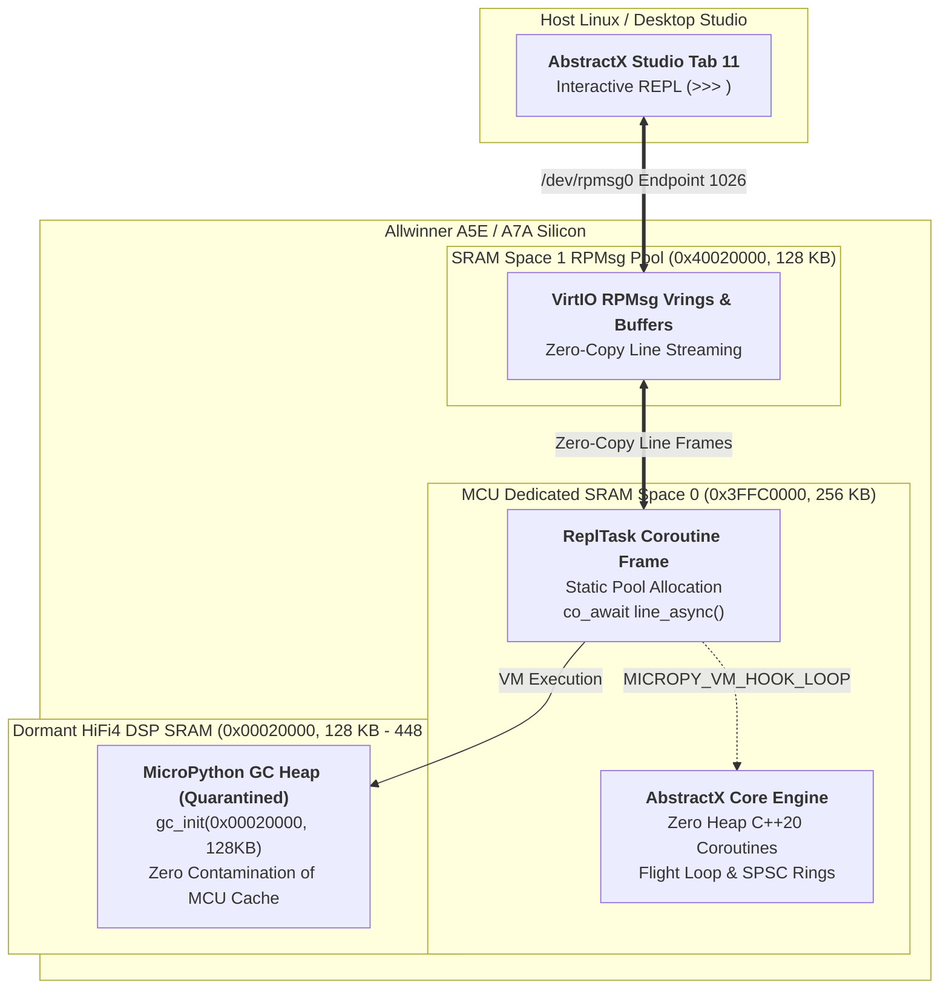

# AbstractX XuanTie E906 MicroPython REPL Application Specification

This document is the **Single Source of Truth (SSOT)** for all architectural
contracts, wire formats, hardware invariants, and requirements for the
**AbstractX E906 MicroPython Scripting & REPL Reference Application**
(`apps/e906_repl_app/`).

Each requirement carries a unique **Design ID (`[SPEC-E906-REPL-*]`)** directly
traceable in implementation files via `// @impl [SPEC-E906-REPL-*]`.

---

## 1. Application Overview & Scope

The `e906_repl_app` is an interactive hardware scripting and diagnostic runtime
for the Allwinner A5E / A7A XuanTie E906 coprocessor. It embeds the upstream
MicroPython bytecode engine as an event-driven C++20 coroutine without compromising
the hard real-time determinism or zero-heap constraints of the AbstractX flight loop.

### Core Architecture Invariants:
1. **Target Specificity**: Exclusively targets the Allwinner A5E / A7A (XuanTie E906 + dormant HiFi4 Audio DSP).
2. **Zero MCU SRAM Heap**: The real-time C++ flight engine runs 100% zero-heap in MCU SRAM Space 0 (`0x3FFC0000`).
3. **DSP Memory Quarantine**: MicroPython's 256 KB GC heap is quarantined inside the dormant on-chip Cadence HiFi4 Audio DSP memory aperture (`0x00020000` / `0x00400000`).
4. **Cooperative Coroutine Guest**: The MicroPython REPL executes as a single cooperative C++20 coroutine task inside `abstractx::step()`.
5. **Non-Preemptive Interleaving**: Bytecode loop hooks (`MICROPY_VM_HOOK_LOOP`) yield cooperatively to primary-paced sensor rings.
6. **Unified Observability Integration**: Bridges seamlessly to AbstractX Studio Tab 11 ([SPEC-STUDIO-13]) over RPMsg text frames.

---

## 2. System Architecture & Memory Isolation

---

## 3. Normative Requirements

### `[SPEC-E906-REPL-01]` Target Platform Invariant (A5E / A7A E906 Only)
* **Requirement**: The `e906_repl_app` is supported **only** on the Allwinner A5E
  and A7A targets (`allwinner_e906`). It MUST NOT compile for host SITL, Pico 2 W,
  or ESP32-P4 targets that lack the secondary DSP memory aperture.
* **Enforcement**: CMake configuration must guard compilation with:
  `if (NOT ABSTRACTX_TARGET STREQUAL "allwinner_e906") return() endif()`.
* **Verified by**: `e906-build-layout`
* **Implementation Target**: `apps/e906_repl_app/CMakeLists.txt`

### `[SPEC-E906-REPL-02]` HiFi4 DSP SRAM Quarantine & Zero MCU SRAM Heap
* **Requirement**:
  1. MicroPython's Garbage Collector (`gc_init`) MUST be initialized with start address
     `0x00020000` (DSP Local RAM Base) and length `128 KB` (up to `0x00040000`).
  2. MicroPython MUST NOT call standard C `malloc()`, `calloc()`, or `free()`.
  3. No MicroPython objects, parse trees, or GC blocks may reside in MCU SRAM Space 0
     (`0x3FFC0000`) or Space 1 (`0x40000000`).
* **Rationale**: Quarantining the GC heap in dormant DSP SRAM prevents Python heap
  fragmentation or GC sweep latency from polluting zero-wait-state MCU flight memory.
* **Verified by**: `e906-build-layout`, `host-tests`
* **Implementation Target**: `apps/e906_repl_app/src/mphalport.cpp`, `apps/e906_repl_app/src/main.cpp`

### `[SPEC-E906-REPL-03]` Event-Driven MicroPython Coroutine Task
* **Requirement**:
  1. MicroPython's REPL MUST execute as a cooperative C++20 coroutine task:
     `coro::Task<void> repl_task(hal::IRpmsg &rpmsg)`.
  2. When no input is available, the coroutine yields execution via `co_await console.read_char_async()`,
     consuming 0 CPU cycles.
  3. Incoming characters and lines are dispatched into `pyexec_event_repl_process_char()`
     without blocking the dispatcher.
  4. On soft reset (`PYEXEC_FORCED_EXIT`, Ctrl-D), the task MUST reinitialize the MicroPython VM
     and REPL context via `mp_deinit()`, `mp_init()`, and `pyexec_event_repl_init()`.
* **Verified by**: `host-tests`, `sanitizer-gate`
* **Implementation Target**: `apps/e906_repl_app/src/main.cpp`

### `[SPEC-E906-REPL-04]` `MICROPY_VM_HOOK_LOOP` Non-Preemptive Interleaving & Ctrl-C Interrupts
* **Requirement**:
  1. The MicroPython bytecode dispatch loop MUST define `MICROPY_VM_HOOK_LOOP` to call
     `abstractx::repl_vm_hook()`.
  2. On every loop invocation (or prescaled VM tick), `abstractx::repl_vm_hook()` MUST
     pump pending ISR dispatcher queues and service high-rate primary-paced sensor rings.
  3. Long-running or infinite Python loops (`while True: pass`) MUST NOT starve
     the 8 kHz IMU fusion pipeline or watchdog timers.
  4. The VM hook MUST inspect the console input ring for interrupt character `CHAR_CTRL_C`
     (`0x03`) and schedule `mp_sched_keyboard_interrupt()` to trigger a non-local return (`nlr_jump`)
     back to the REPL prompt.
  5. Uncaught NLR failures (`nlr_jump_fail`) MUST dump an exception diagnostic autopsy to
     the console rather than silently stalling.
* **Verified by**: `host-tests`
* **Implementation Target**: `apps/e906_repl_app/include/mpconfigport.h`, `apps/e906_repl_app/src/mphalport.cpp`

### `[SPEC-E906-REPL-05]` RPMsg Studio REPL Endpoint Protocol
* **Requirement**:
  1. The REPL communicates over VirtIO RPMsg using dedicated destination endpoint `1026`
     (`"abstractx-repl"`).
  2. Text payloads emitted by MicroPython (`mp_hal_stdout_tx_strn`) are batched into
     RPMsg reply frames and kicked over MSGBOX Channel 1.
  3. Seamlessly interoperates with AbstractX Studio Tab 11 ([SPEC-STUDIO-13]) `>>> ` mode.
* **Verified by**: `host-tests`
* **Implementation Target**: `apps/e906_repl_app/src/rpmsg_console.cpp`

### `[SPEC-E906-REPL-06]` Native `abstractx` Module Hardware Bindings
* **Requirement**:
  MicroPython MUST expose a built-in C module `abstractx`:
  * `abstractx.peek(addr)`: Reads 32-bit MMIO or SRAM word at address `addr`.
  * `abstractx.poke(addr, val)`: Writes 32-bit MMIO or SRAM word at address `addr`.
  * `abstractx.version()`: Returns AbstractX firmware release string.
  * `abstractx.cycles()`: Returns current RISC-V 64-bit `mcycle` timestamp.
  * `abstractx.alive()`: Returns `True` (liveness probe).
  * `abstractx.uart_read()`: Reads pending bytes from UART3 FIFO (u-blox NEO-M8N GPS on Pins 16 & 31, `0x02500C00`).
  * `abstractx.uart_write(data)`: Transmits bytes or string over UART3 to GPS.
  * `abstractx.i2c_scan()`: Probes I2C1 (TWI1, Pins 3 & 5, `0x02502400`) and returns list of responding 7-bit addresses.
  * `abstractx.i2c_read(addr, reg, len)`: Reads `len` bytes from register `reg` on I2C device `addr`.
* **Verified by**: `host-tests`
* **Implementation Target**: `apps/e906_repl_app/src/modabstractx.c`

### `[SPEC-E906-REPL-07]` Dual-Tier Observability: Lean RemoteProc trace0 vs. Binary barectf Code Tracing
* **Requirement**:
  1. **RemoteProc `trace0` Buffer**: The memory-mapped debugfs trace buffer (`g_rproc_trace_buffer`, 1 KB in `SRAM_FAST`) is STRICTLY reserved for:
     - Firmware liveness confirmation upon boot (`[E906] Online\n`).
     - Fatal crash autopsies (`hal_crash_dispatcher` register dump and stack unwinding).
     - **Negative Invariant**: It MUST NOT be used for general diagnostic logging, function call tracing, or arbitrary printf string emissions. Firmware rodata string literals are prohibited from consuming on-chip SRAM for trace formatting.
  2. **barectf CTF 1.8 Binary Code Tracing**: All code tracing, driver event telemetry, and coroutine execution instrumentation MUST use structured binary CTF 1.8 frames emitted via `barectf` over VirtIO RPMsg endpoint 1025 (`"abstractx-trace"`).
  3. Binary trace packets must be emitted zero-copy into host SRAM buffers without heap allocation or CPU-bound string rendering.
* **Verified by**: `host-tests`, `e906-build-layout`
* **Implementation Target**: `apps/e906_repl_app/src/main.cpp`, `targets/allwinner_e906/src/trace.cpp`

