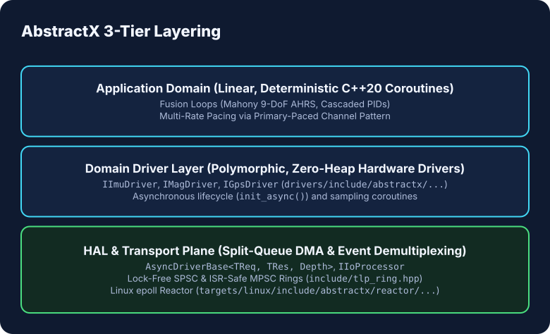

# AbstractX Architecture & Extensibility Handbook

> **Audience**: AI Coding Agents (Copilot, Claude Code, Gemini/Antigravity) & Embedded Systems Engineers  
> **Status**: Authoritative Architectural Standard & Developer Guide  
> **Traceability Reference**: `[SPEC-ARCH-01]`, `[SPEC-HAL-01]`, `[SPEC-TLP-03]`, `[SPEC-STUDIO-06]`

---

## 1. Core Architectural Pillars

AbstractX is designed for polymorphic silicon scaling across bare-metal MCUs (RP2350, ESP32-P4, XuanTie E906), FPGA fabrics (QMTech Zynq-7020, Gowin Tang Nano 20K), and Linux RT hosts with **zero dynamic heap allocation** and **zero application `#ifdef`s**.



---

## 2. Queue Concurrency & Topology Selection Guide (`[SPEC-TLP-03]`)

AbstractX strictly distinguishes between three non-misleading queue topologies:

| Queue Type | Concurrency Contract | Implementation Class | Typical Use Case |
| :--- | :--- | :--- | :--- |
| **Dedicated SPSC Channel** | Strictly **1 Producer : 1 Consumer** | `DedicatedSpscChannel<Cap>` / `SpscRingBuffer<T, Cap>` | 1:1 hardware DMA streams (PIO DMA $\rightarrow$ Core 1, BRAM FIFO, UartRx). **Never share across multiple writers.** |
| **Channel Multiplexer** | **N Private Channels $\rightarrow$ 1 Consumer** | `TlpChannelMultiplexer<N, Cap>` / `SpscChannelArray<T, N, Cap>` | Multi-core MCUs (RP2350 Core 0 vs Core 1, ESP32-P4 HP0 vs HP1). Zero write contention; drained round-robin. |
| **Shared Event Queue** | **N Producers $\rightarrow$ 1 Consumer** | `MpscEventQueue<Cap>` / `MpscRingBuffer<T, Cap>` / `EtlMpscQueue<T, Cap>` | Multiple coroutines and ISRs pushing events/telemetry into a single sink. Protected via `InterruptLock` (`csrrci` / `cpsid i`). |

---

## 3. Recipe 1: Writing a New Hardware Sensor Driver (C++ in `applib/`)

All concrete sensor drivers live in the **Application Library (`applib/include/applib/drivers/`)** and inherit from the standardized abstract base classes defined in [`include/abstractx/sensor/sensor_interface.hpp`](../include/abstractx/sensor/sensor_interface.hpp).

### Template: 6-Axis IMU Driver (`IImuDriver`)
```cpp
#include "abstractx/sensor/sensor_interface.hpp"
#include "abstractx/hal/spi.hpp"

namespace applib::drivers::imu {

using abstractx::sensor::IImuDriver;
using abstractx::sensor::imu::ImuSample;

class Bmi088 : public IImuDriver {
public:
    explicit Bmi088(hal::ISpi& spi) : spi_(spi) {}

    // 1. Asynchronous Lifecycle Initialization
    coro::Task<bool> init_async() override {
        hal::SpiConfig cfg{.frequency_hz = 10'000'000, .mode = hal::SpiMode::Mode0, .use_dma = true};
        if (!spi_.init(cfg)) co_return false;

        // Perform async register checks with 0 blocking delay
        uint8_t chip_id = co_await spi_.read_reg_async(0x00);
        co_return (chip_id == 0x1E);
    }

    // 2. Asynchronous Next Sample Ingestion (Paced by DRDY or DMA)
    coro::Task<ImuSample> next_sample_async() override {
        // Submit split-queue DMA request and suspend coroutine until ISR signals completion
        ImuSample s{};
        // ... clock in burst and populate engineering units ...
        co_return s;
    }

private:
    hal::ISpi& spi_;
};

} // namespace abstractx::drivers::imu
```

---

## 4. Recipe 2: Adding a Target Hardware Bus Driver (HAL)

Hardware peripheral drivers inherit from [`AsyncDriverBase<TRequest, TResult, QueueDepth>`](../include/abstractx/hal/async_driver.hpp).

```cpp
#include "abstractx/hal/async_driver.hpp"

namespace abstractx::hal {

struct MySpiRequest : public AsyncTransactionMeta<MySpiResult> {
    std::span<const uint8_t> tx_data{};
    std::span<uint8_t>       rx_data{};
};

struct MySpiResult {
    IoStatus status{IoStatus::Ok};
    size_t   transferred_bytes{0};
    uint64_t timestamp_us{0};
};

class TargetSpiDriver : public AsyncDriverBase<MySpiRequest, MySpiResult, 16>, public ISpi {
public:
    // Called in main/coroutine domain to launch transfer
    void start_hardware_transfer_from_isr(const MySpiRequest& req) noexcept override {
        // Program hardware DMA registers with req.tx_data.data()
        // Hardware ISR will call push_completion_from_isr(req, result)
    }
};

} // namespace abstractx::hal
```

---

## 5. Recipe 3: Building a Studio Instrument Plugin (Python)

AbstractX Studio plugins inherit from [`AbstractXStudioPlugin`](../tools/visualizer/sdk/plugin.py).

```python
from visualizer.sdk.plugin import AbstractXStudioPlugin
from imgui_bundle import imgui, implot
from typing import Dict, Any, Optional

class CustomGimbalPlugin(AbstractXStudioPlugin):
    """
    Custom 3-Axis Gimbal Telemetry & Tracking Instrument
    """
    def __init__(self):
        super().__init__(name="Gimbal Control", version="1.0")
        self.pitch_deg = 0.0
        self.yaw_deg = 0.0

    def on_tlp_packet(self, tlp_header: Dict[str, Any], payload_dict: Dict[str, Any]) -> None:
        # Decodes 64-byte TLPs matching the gimbal tag
        if tlp_header.get("tag") == 0x12:
            self.pitch_deg = payload_dict.get("pitch_deg", 0.0)
            self.yaw_deg = payload_dict.get("yaw_deg", 0.0)

    def render_ui(self, delta_time: float = 0.0, state: Optional[Any] = None) -> None:
        imgui.text(f"Gimbal Pitch: {self.pitch_deg:.2f}°")
        imgui.text(f"Gimbal Yaw:   {self.yaw_deg:.2f}°")
```

---

## 6. Recipe 4: Using AbstractX Reactor for Linux I/O

For high-throughput, non-blocking Linux host I/O (SITL, companion computers, Radxa Cubie A5E Cortex-A55), use the **AbstractX Reactor** (`targets/linux/include/abstractx/reactor/`):

```cpp
#include "abstractx/reactor/epoll_reactor.hpp"
#include "abstractx/reactor/async_socket.hpp"
#include "abstractx/reactor/async_rpmsg.hpp"
#include "abstractx/reactor/async_uio.hpp"

// Zero-heap Linux event loop
abstractx::reactor::EpollReactor reactor;
reactor.init();

// Non-blocking UDP Coroutine Socket
abstractx::reactor::AsyncUdpSocket sock(reactor);
sock.bind(9000);

auto receiver_task = [&]() -> coro::Task<void> {
    std::array<uint8_t, 512> rx_buf{};
    while (true) {
        ssize_t n = co_await sock.recv_async(rx_buf);
        // Process packet with 0 heap copies
    }
};
```

---

## 7. Mandatory AI Verification Checklist

Before proposing or committing changes touching drivers, HAL, or transports:
1. **Inheritance Check**: Every sensor driver MUST inherit from `IImuDriver`, `IMagDriver`, or `IGpsDriver`.
2. **Zero Synchronous Bus I/O**: NO `delay_ms()` or spinloops inside drivers; all methods MUST return `coro::Task<T>`.
3. **Queue Concurrency Contract**: Shared sinks MUST use `MpscEventQueue` / `EtlMpscQueue`; dedicated 1:1 streams MUST use `DedicatedSpscChannel`.
4. **Verification Gates**:
   * `python3 tools/audit_boundaries.py` $\rightarrow$ 100% Core Framework purity (no concrete drivers in core).
   * `python3 tools/audit_interfaces.py` $\rightarrow$ 100% polymorphic interface compliance.
   * `python3 tools/check_queue_concurrency.py` $\rightarrow$ 0 defects.
   * `ctest --test-dir build_host` $\rightarrow$ 100% passing tests.
