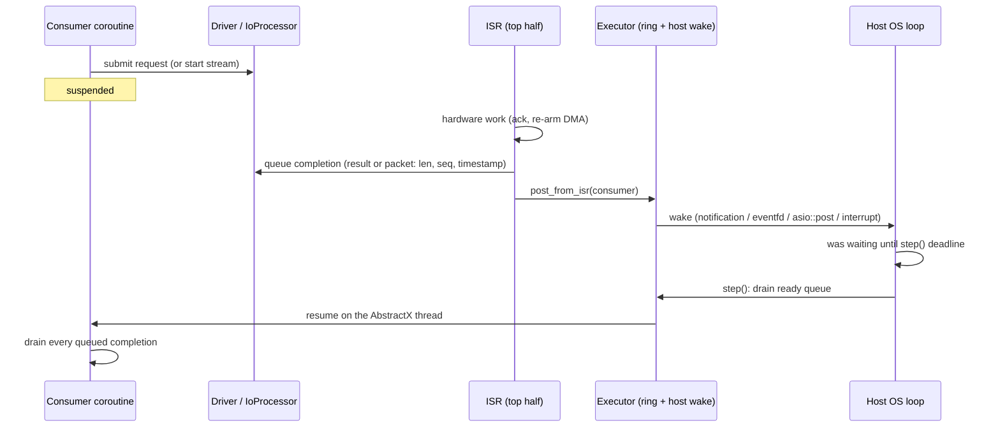
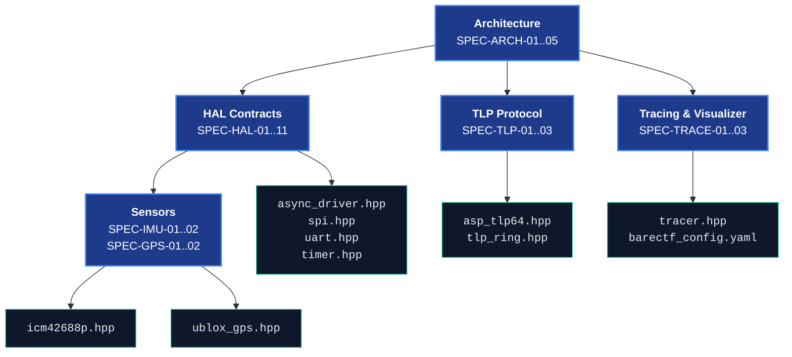

# AbstractX Design Specification & Requirements Matrix

This document is the **Single Source of Truth (SSOT)** for all architectural requirements, TLP packet definitions, HAL driver contracts, and sensor interfaces in AbstractX.

Each requirement carries a unique **Design ID (`[SPEC-*]`)** that is directly referenced by implementation files via `// @impl [SPEC-*]`.

---

## 1. System Architecture Specifications (`SPEC-ARCH`)

### `[SPEC-ARCH-01]` Split-Transaction Asynchronous I/O Pipeline
* **Requirement**: All physical peripheral interactions (SPI, UART, I2C, Timers) must be decoupled from the application thread using a split-transaction request/completion model.
* **Mechanism**: Input Queue (Request) $\rightarrow$ Hardware DMA / ISR $\rightarrow$ Output Queue (Completion) $\rightarrow$ Coroutine Resumption.
* **Verified by**: `host-tests` (`tests/test_sitl_imu.cpp`: awaiter completion routing; `sim/test_smp_lock.cpp`: two threads as cores, per-core nesting, MPSC ring and post paths under the shared lock), `sanitizer-gate`, `thread-sanitizer`
* **Implementation Target**: `include/abstractx/hal/async_driver.hpp`, `include/abstractx/interrupt_lock.hpp`, `include/tlp_ring.hpp`, `include/abstractx/domain_dispatcher.hpp`
* **Completion Correlation**: An awaiter MUST receive the result of its own request. Awaiters set `request.result_slot` to frame-owned storage and the driver writes the completion there; the shared output queue is only for callback/polling users that set no slot. Popping "the next" completion from a shared queue is forbidden.
* **Submit Failure**: When `submit_request()` fails, the awaiter MUST set a `QueueFull` status and return `false` from `await_suspend()`. It MUST NOT call `handle.resume()` inline.
* **Lost Wake-ups**: A failed `Dispatcher::post()`/`push()` means a coroutine will never resume. Every failure MUST be counted in `Dispatcher::dropped_resumes()`, which must stay 0 in a healthy system. `Dispatcher::post()` and `Dispatcher::has_pending_resumes()` MUST always use the `InterruptLock`-guarded queue operations (`queue_.push()`, `!queue_.empty()`) even on single-core bare-metal targets: `InterruptLock` saves and restores interrupt state (`csrrc` / `PRIMASK`), so calling `post()` from an ISR keeps interrupts masked while calling `post()` from non-ISR context masks interrupts against preempting ISRs.
* **Cross-core lock (SMP, 2026-10-28)**: on a bare-metal target where both cores touch the same
  domain queue (Pico 2 W: Core 0 I/O processor and ISRs, Core 1 coroutine engine; ESP32-P4),
  `InterruptLock` masks the local core's interrupts **and** holds one spinlock shared by the cores,
  with the nesting depth and saved interrupt state kept **per core** (indexed by the core id). The
  `_from_isr` paths of `MpscRingBuffer` and `Dispatcher::post()` take the same lock there (an ISR on
  one core and a consumer on the other race exactly like two threads). The target build defines
  `ABSTRACTX_SMP_CORES` (> 1) and `abstractx_core_id()`; single-core targets (E906) keep the plain
  interrupt mask. The algorithm is `SmpInterruptLock<Platform>` (`include/abstractx/interrupt_lock.hpp`)
  so the host can run it with threads as the cores. Rationale: until 2026-10-28 the bare-metal lock
  had one global `depth_` / `saved_flags_` and excluded no other core, and ETL `queue_spsc_isr`
  keeps a shared element counter that both sides write.

### `[SPEC-ARCH-02]` Zero Dynamic Memory Allocation (0 B Heap)
* **Requirement**: No dynamic memory (`malloc`, `free`, `operator new`) is permitted in real-time execution paths.
* **Mechanism**: Coroutine frames draw from static atomic frame pools (`CoroutineStaticPool`), queues use fixed-capacity ETL rings (`etl::queue_spsc_isr`).
* **Verified by**: `host-tests` (`RepeatedAsyncInitDoesNotGrowFramePool`, `sim_test_gps_imu_coro_pool`), `sanitizer-gate` (frame alignment)
* **Implementation Target**: `include/asp_coro.hpp`, `include/abstractx/domain_dispatcher.hpp`
* **Frame Reclamation**: Destroyed coroutine frames MUST return to the static pool (exact-size free list) so steady-state loops reach a fixed pool high-water mark. `coro_pool_used()` reports live bytes; `coro_pool_high_water()` reports bytes ever carved from the pool. Regression: `tests/test_sitl_imu.cpp` `RepeatedAsyncInitDoesNotGrowFramePool`.

### `[SPEC-ARCH-03]` Universal Multi-Target Application Portability
* **Requirement**: Top-level flight control and telemetry logic (`FlightApp` / `inav-abstractx`) must compile unmodified across Linux SBCs, Raspberry Pi Pico 2 W, ESP32-P4, and Desktop SITL.
* **Verified by**: `host-tests` (`tests/test_sitl_fusion.cpp`)
* **Implementation Target**: `examples/gps_imu_flight_node.cpp`, `apps/`

### `[SPEC-ARCH-04]` Heterogeneous Co-Processor Interconnect & Single-Core MPSC (E906 + Linux)
* **Requirement**: Allwinner XuanTie E906 operates as a dedicated I/O coprocessor servicing 8 kHz SPI DMA and GPS UART, delivering timestamped 64B TLPs into shared SRAM Space 0 (`0x3FFC8100`) for Linux `remoteproc` consumers.
* **Concurrency Model**: Single-core preemption. Hardware interrupt handlers (CLIC on the E906: SPI DMA, UART RX, Timer, Mailbox Doorbell) hand coroutine handles to the event loop through the Dispatcher's ISR-safe queue (`IsrSafeCoroutineQueue`, `etl::queue_spsc_isr` with interrupt masking, `include/abstractx/domain_dispatcher.hpp`); several handlers may post because each post masks interrupts on the single core.
* **Correction (2026-10-23)**: this requirement used to name `MpscIsrQueue` in `include/mpsc_isr_queue.hpp`; no code ever used it (repository audit, `docs/design/repo-file-audit.md`), and the header was removed.
* **Implementation Target**: `targets/allwinner_e906/`, `include/abstractx/domain_dispatcher.hpp`, `apps/gps_imu_app/`

### `[SPEC-ARCH-05]` Dual-Core Split on Pico 2 W / RP2350: Wi-Fi Alone on Core 0
* **Requirement** (decided by the project owner 2026-11-03, from board measurements):
  - **Core 0**: only Wi-Fi. CYW43439 init and polling, the join state machine, lwIP and the UDP
    send of telemetry and trace. Nothing from AbstractX runs there.
  - **Core 1**: all of AbstractX. The application's `main()`, coroutines, dispatcher, I/O processor,
    SPI/I2C/UART/GPIO drivers, their DMA and their interrupts (enabled from Core 1, so they fire on
    Core 1).
  - **One crossing**: Core 1 to Core 0 frame rings for telemetry and trace (`[SPEC-PICO-CORE-01]`).
    No bus request or completion crosses cores.
* **Why**: the pico-sdk CYW43 driver waits on every bus DMA (`dma_channel_wait_for_finish_blocking`
  in `cyw43_bus_pio_spi.c`). With Wi-Fi joined it took about 41% of the shared core, and the IMU
  rate fell from 3933 to 1818 updates/s (Release, `-mfloat-abi=softfp`). On its own core that wait
  costs nothing else.
* **Superseded**: the earlier plan (Core 0 = I/O + DMA + Wi-Fi, Core 1 = coroutines, request and
  completion rings plus an SIO FIFO doorbell per bus operation) was never implemented: Core 1 was
  never launched.
* **Mechanism and verification**: `targets/pico2w_rp2350/SPECIFICATION.md` `[SPEC-PICO-CORE-01]`.
* **Implementation Target**: `targets/pico2w_rp2350/src/hal_platform.cpp`, `targets/pico2w_rp2350/include/hal/frame_ring.hpp`

### `[SPEC-ARCH-14]` Accelerators Run the Buses; Linux Sees Results
* **Goal (project owner, 2026-10-30)**: bypass Linux's slow `spidev` / `i2c-dev` path entirely. Every
  sensor and actuator bus is driven by a processor or fabric dedicated to I/O, and the fast loop
  runs where the samples land.
* **Requirement**: Linux is never on a sensor or actuator bus in the data path (no `spidev`, no
  `i2c-dev`, no Linux GPIO interrupts per sample). The bus owner per platform:

  | Platform | I/O accelerator (owns the buses, DMA, the fast loop) | Results to |
  | :--- | :--- | :--- |
  | Pico 2 W (RP2350) | Core 1 drivers + DMA + IRQs, beside the coroutines (`[SPEC-ARCH-05]`) | Core 1 coroutines; Wi-Fi alone on Core 0 |
  | ESP32-P4 | one HP core dedicated to I/O + GDMA | the other core |
  | Cubie A5E | XuanTie E906 (`[SPEC-E906-HAL-05]`) | Linux over RPMsg |
  | Zynq-7000 | pio2 in the PL (all-PIO, `[SPEC-ZYNQ-07]`); an RT A9 core polls the IMU ring | Linux over UIO rings |
  | Tang Nano + external host | fixed-function Wishbone cores from [abstractx-fpga](https://github.com/tcmichals/abstractx-fpga) (2026-11-11, flight `[SPEC-FLIGHT-08]`: pio2 does not fit), host = Pico or E906 over the SPI link | that host |

* **Requirement**: drivers are written for this split: the bus transfer, its DMA and its trigger
  (DRDY edge, timer) run on the I/O side and complete into a ring; the consumer on the other side
  awaits the ring, never a bus. Per-sample work (8 kHz IMU) stays on the I/O side or the core that
  owns the ring; Linux receives fused state, telemetry and trace in blocks at a rate it can
  afford, never per sample. `CoroutineIoEngine` (`include/asp_coro.hpp`) accepts both `SpscTlpRing<>`
  and `MpscTlpRing<>` (the rings used by `IoProcessorSetup` / `IoEngine`) and provides
  `async_await_stream_batch(std::span<Tlp64> out, size_t min_count, Channel)` so a consumer coroutine
  suspends until a block of `min_count` stream TLPs has accumulated rather than waking per sample.
* **Sizing (2026-10-30, estimate, not measured)**: 8 kHz IMU (one sample per frame) + 8 kHz DShot
  + 1 Mbaud serial + trace over the pio2 Dual-SPI link at 10 MHz SCK is about 30 % of the link and
  about 16,000 windows/s, each a DMA started from `INT_n` on the E906 or Pico (E906 measured 2026-10-29:
  DRDY edge to DMA start ~6 us, 15-byte DMA ~14 us at 10 MHz).
* **Exceptions**: desktop SITL (`targets/linux`, simulated buses) and benchmark comparison columns
  (a Linux `spidev` column in `docs/articles/`) are not data paths.
* **Verified by**: `board-bringup` (per platform: the loop rate on the accelerator, Linux CPU), `cocotb-regression` (pio2 link under the traffic mix above, once the link RTL exists)
* **Implementation Target**: `targets/pico2w_rp2350/`, `targets/esp32p4/`, `targets/allwinner_e906/`, `targets/zynq7000/`, `rtl/pio/`

### `[SPEC-ARCH-06]` Unified AbstractX Runtime API & Autonomous Domain Placement
* **Requirement**: Applications must interface with the framework exclusively through the unified `abstractx::` API (`init()`, `spawn()`, `step()`, `step_async()`, `run()`). The runtime must automatically determine target topology and assign `io_processor`, `trace_dispatcher`, and user coroutines to their optimal hardware execution domains (Core 0 vs Core 1 on dual-core MCU, E906 vs Linux on heterogeneous SoCs, or cooperative coroutine loop on SITL), guaranteeing 0 application `#ifdef`s.
* **Idle Policy**: `run()` MAY call `platform_idle_wait()` only when `Dispatcher::has_pending_resumes()` is false. On bare-metal targets `platform_idle_wait()` MUST re-check the Dispatcher with interrupts masked and then sleep (`wfi`) so that an ISR posting between the check and the sleep is never slept through: either `wfi` with interrupts still masked (the core wakes on a pending interrupt), or, where that is not guaranteed (E906, `[SPEC-E906-IRQ-01]`), unmask immediately before `wfi` and have the trap entry return past that `wfi` when it interrupted it. On hosted builds (Linux, Zynq-7000) `platform_idle_wait()` sleeps a bounded time (100 us) and never spins: a `sched_yield()` loop keeps an idle core at 100% (EL-1027-18, 2026-11-05). This is the convenience loop only; a real host waits on `step()`'s deadline and the wake hook (`[SPEC-ARCH-15]`).
* **Event-Driven Step**: `step()` tracks pending runtime work via an atomic `WorkFlags` bitmask (`notify_work()`), skipping spawned-task pool scans unless a task reached `final_suspend` (`kWorkTaskDone`) and reading the hardware timer only when trace/event buffers have pending items or a status report check is due.
* **Spawn Capacity**: `spawn()` returns `false` when every task slot holds a live task; it never drops a task silently.
* **Verified by**: `host-tests` (`sim/test_abstractx_runtime.cpp`: idle policy, spawn capacity; `sim/test_hosted_idle_wait.cpp`: Linux and Zynq idle wait sleeps, CPU time well below wall time)
* **Implementation Target**: `include/abstractx/abstractx.hpp`, `src/runtime.cpp`

### `[SPEC-ARCH-15]` The Host Drives AbstractX; Coroutine Runtimes Never Mix
* **Requirement (framework, not owner, 2026-11-04)**: AbstractX owns no event loop, thread, OS
  timer or wait primitive. The host (Boost.Asio `io_context` on Linux, a FreeRTOS task blocked on
  its queue, the bare-metal `wfi` loop) owns the loop and calls `abstractx::step()` when an event
  arrives or a deadline is reached. Every event source (ISR, DMA completion, Asio completion
  handler, FreeRTOS producer) does the same three things: store its result in the request, post the
  waiting handle to the Dispatcher, and ask the host to wake.
* **Requirement (no mixing)**: AbstractX coroutines (`coro::Task`) and another library's coroutine
  runtime never meet. C++ code in this repository MUST NOT use `asio::awaitable`,
  `asio::use_awaitable`, `asio::co_spawn`, `asio::experimental::coro` or Boost.Cobalt. On Linux,
  Asio appears only as the host pump and as completion handlers inside driver awaiters (the Linux
  equivalent of an ISR); applications see only AbstractX awaiters. Rationale: an application that
  `co_await`s an Asio awaitable is resumed by Asio, not by `step()`, which breaks `[SPEC-ARCH-10]`
  (only the Dispatcher resumes) and cannot build on the MCU targets (0 application `#ifdef`s).
* **Requirement (step tells the host when to call again, 2026-11-04)**: `uint64_t abstractx::step()`
  returns `abstractx::kNow` (0) when a coroutine is ready, otherwise the earliest deadline in
  microseconds of `hal::get_timer_driver().get_time_us()` (a pending sleep, or the next runtime status
  report), or `abstractx::kNever`. The host blocks until that deadline or a wake, never longer and
  never on a fixed polling interval. Callers that ignore the value (the existing `run()` loops) keep
  working.
* **Requirement (timer drivers the host must poll)**: `ITimer::service_due_us()` posts every sleep
  whose deadline has passed (`now >= deadline`, task context) and returns the next pending deadline
  in microseconds. The default returns `kNever`, meaning the driver wakes the loop itself (its own
  interrupt or thread). `step()` calls it once per pass. A late, early or coalesced wake therefore
  never loses a sleep or runs it twice.
* **Requirement (one wake route)**: the host registers `abstractx::set_wake({task_fn, isr_fn})`.
  Every event source that publishes work for AbstractX from another context (an ISR, a DMA
  completion, another task or thread) publishes first (posts the handle, pushes the ring) and then
  calls `abstractx::wake_from_isr()` from interrupt context or `abstractx::wake()` from a task or
  thread. Both are no-ops until a host registers hooks (bare metal: the interrupt itself ends `wfi`).
  The host decides how to wake (task notification, `asio::post`).
* **How it works (2026-11-04)**: AbstractX is called; it never calls a wait.

  | Who | Does | Never does |
  | --- | --- | --- |
  | Host (Boost.Asio `io_context` on Linux, the FreeRTOS task, the bare-metal loop) | waits (Asio timer / handlers, `ulTaskNotifyTake`, `wfi`); calls `step()`; registers `set_wake()` hooks | resumes coroutines itself |
  | `abstractx::step()` | resumes ready coroutines, expires due sleeps (host-polled timers), returns `kNow`, a deadline in us, or `kNever` | blocks, sleeps, polls on an interval |
  | Event source (ISR, DMA, Linux worker thread, I/O engine, timer alarm) | stores its result, posts the coroutine (`Dispatcher::post`), then wakes (`wake()` / `wake_from_isr()`) | resumes a coroutine, calls `step()` |
  | `wake()` / `wake_from_isr()` | calls the host's hook (`asio::post(pump)`, task notification); no-op with no host | waits |

  ```mermaid
  sequenceDiagram
      participant H as Host (Boost.Asio io_context)
      participant A as AbstractX step()
      participant S as Event source (worker thread / ISR)
      H->>A: step()
      A-->>H: next deadline (or kNever)
      H->>H: wait: steady_timer.expires_at(deadline) / idle in io_context
      S->>S: store result, Dispatcher::post(coroutine)
      S->>H: wake() = asio::post(pump)
      H->>A: step(): resumes the coroutine
      A-->>H: next deadline
      Note over H: the deadline expiring calls step() the same way
  ```
* **Completions, streams and executors**: see `[SPEC-ARCH-16]`.
* **Requirement (AbstractX never waits, 2026-11-04)**: AbstractX is an API library. `step()` does the
  ready work and returns; `wake()` / `wake_from_isr()` only call the hooks the host registered (no-ops
  without a host). No AbstractX core or HAL code sleeps, blocks, polls on an interval or owns a wait
  primitive: the host (Boost.Asio on Linux, the FreeRTOS task, the bare-metal loop) does all waiting.
  The built-in `run()` with `platform_idle_wait()` is a convenience host for bare metal and simple
  tests; it is not the Linux host and gets no Linux wait mechanism (planned: move it to `hosts/`).
* **Requirement (every enqueue from another context wakes the host, 2026-11-04)**: on hosted builds
  every `Dispatcher::post()` / `push()` calls `abstractx::wake()` after it enqueues, because any thread
  may be the producer; the Linux I/O engine's `notify_host()` calls it too (results arrive in a ring,
  not a posted handle). On MCUs the interrupt glue of the host calls `wake_from_isr()` (the FreeRTOS
  host does this in its interrupt handler). Before this, completions from Linux worker threads (SPI,
  I2C, GPIO, I/O engine) posted without waking anyone; only the built-in loop's 100 us poll hid it,
  and a host that sleeps until `step()`'s deadline would sleep through them (review T-5).
* **Requirement (periodic schedules, no drift, no burst)**: periodic work computes its next deadline
  with `abstractx::next_period(previous, period, now, overruns)`: `previous + period`; when that is
  already in the past, it skips to the latest slot that is not in the future and adds the skipped
  slots to `overruns`. It never runs once per missed period back to back (FreeRTOS auto-reload
  timers do, `prvReloadTimer`).
* **Requirement (a host never spins silently, 2026-11-04)**: while `step()` returns `kNow` the host
  calls it again without blocking, so a coroutine that never waits (for example one that loops on
  `step_async()`) keeps the host's thread running. Hosts that share a CPU yield on `kNow`: the
  FreeRTOS host calls `taskYIELD()`, so equal-priority tasks run at once; lower-priority tasks still
  wait, as they would behind any FreeRTOS task that never blocks. That is an application rule, not
  hidden: the core counts consecutive `kNow` passes and keeps the longest run
  (`abstractx::longest_ready_run(reset)`), so a coroutine that hogs the CPU shows up as a number.
  A fixed block on `kNow` (for example `vTaskDelay(1)`) is not used: it would add a tick of latency
  to every wake. (Found by a dataAcq integration review, 2026-11-04.)
* **Requirement (FreeRTOS host, one copy)**: FreeRTOS targets (E906 now, ESP32-P4 next) use the
  shared host in `hosts/freertos/` (`abstractx::freertos_host::run()`), not their own loop. It
  registers the wake hooks for the AbstractX task and turns the deadline from `step()` into the wait:
  `WAIT` (default: `ulTaskNotifyTake` timeout), `XTIMER` (one static one-shot software timer) or
  `TICK_HOOK` (opt-in: the application's `vApplicationTickHook` calls `freertos_host::tick_from_isr()`,
  which only compares the tick count with the stored deadline and wakes; it walks no timer list).
  Build option `ABX_FREERTOS_TIMER`; details per target in `[SPEC-E906-RTOS-03]`.
* **Requirement (XTIMER failures are bounded, 2026-11-11)**: in `XTIMER` mode a timer command that
  could not be queued (`xTimerChangePeriod` or `xTimerStop` returns `pdFAIL`, for example a full
  timer command queue) is counted (`timer_cmd_failures()`) and the task's wait for that pass is
  bounded, so the retry on the next pass always happens: after a failed `xTimerChangePeriod` the
  task waits with the deadline as timeout (`WAIT` behaviour for that pass, no wake is lost); after a
  failed `xTimerStop` it waits at most `kCmdRetryTicks` (1 tick) and retries the stop. Only when the
  last command succeeded does the task wait without a timeout (`portMAX_DELAY`).
  `xTimerCreateStatic` with a static buffer cannot return NULL (FreeRTOS `timers.h`), but if it does
  the host never passes the NULL handle to a timer call: `configASSERT` stops a debug build, and a
  build without `configASSERT` counts one failure and runs every pass in `WAIT` mode.
  (Review R2, `docs/reviews/2026-11-11-full-audit.md`: a failed command was counted as "retried on
  the next pass" but the task then waited with `portMAX_DELAY`, so there might be no next pass.)
* **Requirement (Boost.Asio host, 2026-11-06)**: `hosts/asio/` (`abstractx::asio_host`) drives AbstractX
  from an `asio::io_context` with completion handlers only: a *pump* handler calls `step()`; `kNow` posts
  the pump again (so other handlers interleave), a deadline arms one `asio::steady_timer` (same
  `CLOCK_MONOTONIC` as the Linux timer driver) whose handler runs the pump, `kNever` arms nothing. The wake
  hook posts the pump with `asio::post`, at most one pending post (an atomic flag), so a burst of wakes is
  one pump. `attach(io_context&)` lets an application that already runs Asio share its loop; `run_until`
  / `run` / `stop` / `waits` match the POSIX host so the same conformance checks run on it. No Asio
  coroutine (`awaitable`, `co_spawn`) is used ([SPEC-ARCH-15] no mixing; `coro-contract-lint` check 7).
* **Not covered yet**: the ESP32-P4 FreeRTOS loop; Zephyr and ChibiOS hosts (no SDK here). The Linux timer
  is `Polled` since 2026-11-04 (`[SPEC-HAL-05]`): no thread.
* **Verified by**: `coro-contract-lint` (`tools/audit_coro_contracts.py` check 7: no foreign
  coroutine runtime; `tests/test_coro_contracts.py`), `host-tests` (`sim/test_host_drive.cpp`:
  step return values, wake routing from another thread 1000x, `next_period`, longest ready run;
  `sim/test_wake_on_enqueue.cpp`: a host that blocks only on (deadline, wake) receives completions
  posted by Linux worker threads and the I/O engine), `thread-sanitizer`,
  `e906-build-layout` (`e906_freertos_app` in each `ABX_FREERTOS_TIMER` mode), `host-tests`
  (`sim/test_freertos_host_xtimer.cpp`: the real `hosts/freertos` host in `XTIMER` mode against a
  fake FreeRTOS timer API in `sim/fakes/freertos/`: failed change-period / stop / create give a
  bounded wait and a retry, 1000 passes with no failure growth)
* **Implementation Target**: `tools/audit_coro_contracts.py`, `include/abstractx/abstractx.hpp`,
  `src/runtime.cpp`, `include/abstractx/hal/timer.hpp`, `hosts/freertos/`

### `[SPEC-ARCH-16]` Completions, Streams and Executors (Standard RTOS / Linux Practice)
* **Not implemented yet**: requirement 4's in-place write (stream chunks are still copied from the
  DMA buffer into the TLP: `make_stream_tx`); requirement 6 (per-consumer completion queues); the
  E906 `in_isr()` (the debug context check is skipped there); the FreeRTOS / Asio / bare-metal runs
  of 10. Done since: requirement 3 (coroutine completions only through `complete()`), 4 (sequence
  numbers), 7, 8, 9 (per-channel drop counters). Design approved by the project owner
  2026-11-04. Done: requirement 5 (`include/abstractx/executor.hpp`: `post()` / `post_from_isr()` /
  `set_executor()`, the AbstractX ring as default executor, every call site moved, `Dispatcher::post`
  / `push` outside the executor rejected by `tools/audit_coro_contracts.py` check 8; Pico `in_isr()`
  from `IPSR`); the host conformance test and the POSIX host.

Nothing here is new: the
interrupt hand-off is FreeRTOS `...FromISR` / ChibiOS I-class / Zephyr / Linux top half; requests and
completions are Zephyr RTIO / Linux io_uring; DMA streams are serial DMA (V4L2 / ALSA style).

* **Requirement (1, AbstractX never waits)**: as `[SPEC-ARCH-15]`: `step()` does the ready work and
  returns the next deadline; the host's OS loop does all waiting and calls `step()` again on that
  deadline or a wake.
* **Requirement (2, where coroutines run)**: AbstractX coroutines run only on the AbstractX thread (the
  one calling `step()`, or the host thread its executor resumes on). Never from an ISR, never from
  another thread.
* **Requirement (3, what an ISR does)**: an interrupt handler does its hardware work (acknowledge,
  re-arm DMA, start the next queued transfer, stop a channel), queues the completion, calls
  `post_from_isr()`, and returns. No callback, no list walk, no other code runs in interrupt context
  on AbstractX's behalf. A coroutine's completion goes only through `AsyncTransactionMeta::complete()`
  (result into the awaiter's slot, `post_from_isr`). A request's `callback` and the E906 DMA channel and
  timer-node callbacks are the driver's own hardware work (an I/O processor back end turning a bus
  completion into a TLP; a timer node marking a sleep due), never application code. Drivers have no
  shared result queue (`AsyncDriverBase`'s output queue, unused, removed 2026-11-04).
* **Requirement (4, two I/O models, no others)**:
  * **Request / completion** (RTIO / io_uring): SPI transfer, I2C transaction, UART write, sleep.
    The consumer submits a request; exactly one completion is queued back to it.
  * **DMA stream** (serial DMA): UART RX with DMA, SPI auto-DMA on DRDY (the IMU), later ADC / I2S.
    The consumer starts the stream once; each chunk the DMA fills is one packet (TLP) with length,
    sequence number (per channel, incremented for every packet emitted, so a gap shows a loss) and
    hardware timestamp (taken at the trigger edge), written in place into a
    transport buffer (no copy, `[SPEC-ARCH-08]`), and is one completion. The consumer drains every
    queued packet in one pass (batching happens on draining, never by merging completions).
  Every driver, local or behind an IoProcessor, uses one of these two. The schemes in use before
  (request callbacks at completion, the driver output queue, per-driver waiter slots, notify-only
  rings, the E906 timer-ISR list walk) are replaced.
* **Requirement (5, executor)**: every place that makes a coroutine ready calls
  `abstractx::post(handle)` (task, thread or coroutine context) or `abstractx::post_from_isr(handle)`
  (interrupt context). The host chooses where they go with one executor interface; the AbstractX
  static ring (bare metal) is the default. Debug builds check the context with the target's
  `in_isr()` and assert on misuse.

  | Host | `post()` | `post_from_isr()` | Waits with |
  | --- | --- | --- | --- |
  | Bare metal (default) | ring, interrupts masked | ring | `arm_wake(deadline)` + `wfi` / `wfe` |
  | FreeRTOS (E906, ESP32-P4) | ring + `xTaskNotifyGive` | ring + `vTaskNotifyGiveFromISR` + `portYIELD_FROM_ISR` | `ulTaskNotifyTake(timeout)` |
  | Zephyr | `k_fifo_put` / `k_sem_give` | same (ISR-safe) | `k_sem_take` / `k_poll` |
  | Linux, POSIX host | ring + `eventfd_write` | not used (no ISRs) | `ppoll(eventfd, timeout)` |
  | Linux, Boost.Asio host | `asio::post(io_context, ...)` | not used | `io_context.run()` + `steady_timer` |
  | Pico 2 W core 0 to core 1 | as bare metal + `__sev()` | as bare metal + `__sev()` | `wfe` |
* **Requirement (5a, ready-queue size, decided 2026-11-04)**: the default executor's ring holds
  `ABSTRACTX_READY_QUEUE_SIZE` handles, set per application at build time (default 64 on MCUs, 255 on
  hosted builds; at most 255, checked at compile time). A coroutine is in the ring at most once, so an
  application sizes it to at least the number of coroutines that can be ready at the same time. The
  deepest the ring has been (`Dispatcher::high_water()`) is in the runtime status report
  (`queue_high_water`, `[SPEC-TRACE-08]`), next to `dropped_resumes`, so a ring that is too small
  shows before it drops. (Review T-4: a fixed 32 dropped the 33rd wake and that coroutine hung.)
* **Requirement (6, completion queues per consumer)**: a driver writes a completion to the queue of the
  consumer that submitted the request (RTIO / io_uring).
* **Requirement (7, stream overrun)**: when a stream has no free buffer, the new chunk is dropped and
  counted; the interrupt never blocks and no packet is corrupted. The sequence number shows the gap.
* **Requirement (8, cancellation)**: a request can be cancelled (RTIO / io_uring style); the driver
  completes it as `Cancelled` exactly once. Destroying a waiting task cancels its outstanding requests,
  so no completion is ever written to a destroyed frame.
  **Mechanism (decided 2026-11-04: abort, else wait)**: every driver request carries a pointer to a
  state word owned by its awaiter (in the coroutine frame, like `result_slot`): `Pending -> Done`, or
  `Pending -> Abandoned -> Done`. An awaiter destroyed while its request is `Pending` sets
  `Abandoned`, then: a request not started yet is skipped by the driver when it reaches it (no
  transfer, nothing written); a running request is aborted if the driver can (`abort_active_from_isr`);
  otherwise (a Linux `ioctl` in progress) the destructor waits until the driver marks it `Done`,
  bounded by `kCancelWaitUs` (then it traps: a hung transfer is a firmware fault, reported). A
  completion that finds `Abandoned` writes no result and posts no handle; DMA and kernel buffers in
  the frame are therefore never written after the frame is freed. A handle already in the ready ring
  when its task is destroyed is removed from the ring (`Dispatcher::purge`), so `step()` never resumes
  a destroyed frame (this also covers `Event`, timers and every other waker). `when_any` destroys its
  loser (cancelling its requests) instead of detaching it; `with_timeout` therefore cancels the
  operation that lost. (Review 2026-11-04 T-3, Q-5, Q-6, Q-7, Q-9.)
* **Requirement (9, remote consumers and unmapped data)**: an IoProcessor only pushes: it sends each
  completion or stream packet out on its channel, fire-and-forget, like serial. The receiving
  processor delivers only to a consumer explicitly mapped to that channel (endpoint, subscription or
  route). Data for a channel with no mapping, or that arrives before the mapping, is **dropped**;
  nothing is buffered for the programmer. Every drop is counted per channel with its reason (no
  consumer mapped, consumer queue full, no buffer), shown in the runtime status and Studio, and the
  first drop on a channel is traced once. The API that maps a consumer says this in its documentation.
  Implemented (2026-11-04) in `CoroutineIoEngine`: `stream_drops(channel)` = `{no_consumer, batch_full}`;
  not yet in the runtime status report or Studio, and the first-drop trace is not yet emitted.
* **Requirement (10, one conformance test)**: every host and executor passes the same host conformance
  test: an idle host stays asleep (no polling); a post from a thread or ISR wakes it within a bound; a
  timer deadline wakes it on time; a post or wake before the wait is not lost; an always-ready
  coroutine does not starve the system; a full queue or unmapped channel is counted, never silent. On
  the PC: POSIX, Asio and FreeRTOS (its POSIX port); on boards: bare metal (E906, Pico 2 W).



* **Rationale (2026-11-04)**: the review (`docs/reviews/2026-11-04-core-review.md`) and the
  engineering log show six different completion schemes, each with its own wake and its own bugs
  (T-3, T-4, T-5, T-6, Q-2, Q-3, Q-4, Q-5, and the lost-wake stalls of 10-28 to 10-31), and the
  timer / wake model rewritten five times in five days because it was designed one change at a time.
  This requirement fixes the whole model first; implementation follows it.
* **Verified by**: `host-tests` (`sim/test_host_conformance_posix.cpp`: the six conformance checks on the
  POSIX host; `sim/test_host_conformance_asio.cpp`: the same checks on the Boost.Asio host; `sim/test_executor.cpp`: a custom executor receives every post, a refused post is
  reported; `tests/test_coro_contracts.py`: no direct Dispatcher post; planned: per-driver request / stream / cancel / drop tests), `thread-sanitizer`,
  `board-bringup` (planned: E906, Pico 2 W)
* **Implementation Target** (planned): `include/abstractx/`, `src/`, `hosts/`, every target's drivers

### `[SPEC-ARCH-07]` Platform Topology Table & Studio Multi-Window Observability
* **Requirement**: AbstractX runtimes must encode and announce a standardized `PlatformTopologyTable` describing the exact silicon execution topology (e.g. `Linux_Standard_SITL`, `Linux_Host_E906`, `Linux_Host_E906_FPGA`, `RP2350_DualCore_Pico2W`, `ESP32P4_FreeRTOS`), active cores, interconnects, and hardware accelerators. The Observability Studio must render:
  1. **Window 1: Platform Topology & Interconnect Fabric** (Auto-detected silicon graph and SPSC ring saturations).
  2. **Window 2: Dual-Plane Timeline & Source Code Scanner** (Separation of I/O driver context from C++20 coroutines, with interactive source jumping to `__FILE__`: `__LINE__`).
  3. **Window 3: Per-Processor SPU/CPU & OS Process Utilization** (Tracking host Linux CPU% and external daemons, XuanTie E906 active vs WFI cycles, and FPGA logic LUT / DMA bandwidth).
* **Implementation Target**: `include/abstractx/platform_topology.hpp`, `docs/tier2_contracts/observability/ABSTRACTX_PLATFORM_TOPOLOGY_AND_METRICS_SPEC.md`, `tools/visualizer/abstractx_studio.py`
* **Source Compatibility**: Legacy `Linux_Host_E907` and `Linux_Host_E907_FPGA` enum names MUST remain deprecated aliases of the corresponding E906 values; topology display strings MUST use the canonical E906 names.

### `[SPEC-ARCH-08]` Zero-Copy Data Plane (No Memory Copies)
* **Goal**: fast, low-jitter data movement on every target.
* **Requirement**: Data MUST NOT be copied between the code that produces it and the transport that moves it (DMA engine, RPMsg/vring, network stack, shared-memory ring). The producer writes directly into the buffer the transport will send, obtained from the transport (`acquire` → fill in place → `commit`), and the receiver consumes it in place.
* **Architecture-specific**: *how* a target meets this differs per board and processor, and MUST be specified in that target's `SPECIFICATION.md` before it is implemented. Every target spec MUST state, per data path, where the buffer comes from, what `commit` does, and how many copies remain on the device (target: 0). Copies made by a host OS kernel outside AbstractX (e.g. Linux `sendto()`) are allowed and must be stated.
* **Current instances**: trace and telemetry `[SPEC-TRACE-07]` → `[SPEC-E906-IPC-04]` (RPMsg buffers in SRAM), `[SPEC-PICO-TRACE-01]` and `[SPEC-ESP32P4-TRACE-01]` (lwIP `PBUF_POOL` pbufs).
* **Review**: SpecTrace treats an added `memcpy`/copy loop on a data path, or a target spec without its zero-copy mapping, as an invariant violation.
* **Verified by**: `host-tests` (`sim/test_trace_zero_copy.cpp`, `sim/test_e906_rpmsg_endpoints.cpp`: pointer identity)
* **Implementation Target**: per-target transports (`targets/*/`), `include/abstractx/trace/`

### `[SPEC-BUILD-01]` Cross-Toolchain Discovery Works on Every PC
* **Requirement**: the toolchain files in `cmake/toolchains/` MUST pick the compiler in this order:
  (1) a `-D<ARCH>_TOOLCHAIN_PREFIX=` cache value, (2) the `<ARCH>_TOOLCHAIN_PREFIX` environment
  variable, (3) the newest matching directory under `$ENV{HOME}/.tools/` (`xpack-*-gcc-*` globbed,
  not one pinned version), (4) the compiler on `PATH`. They MUST NOT contain an absolute home
  directory (`/home/<user>`), because work happens on more than one PC (AGENTS.md §12).
* **Submodules**: configure MUST stop with a message naming the fix
  (`git submodule update --init <path>`) when a submodule it needs (`third_party/etl`;
  `third_party/micropython` for `e906_repl_app`) is not initialised,
  instead of a missing-header error deep in the build.
* **Rationale (2026-10-31)**: on a fresh PC the host, ASan and TSan builds all failed on
  `etl/memory_model.h`, so 30+ tests were "Not Run" and the sanitizer gate tested nothing.
  All three toolchain files hardcoded `/home/tcmichals/.tools/<exact version>`
  and never read the environment variable the toolchain rule promises.
* **Verified by**: `host-tests` (`tests/test_toolchain_files.py`)
* **Implementation Target**: `third_party/CMakeLists.txt`, `apps/e906_repl_app/CMakeLists.txt`, `cmake/toolchains/arm-none-eabi.cmake`, `cmake/toolchains/riscv-none-elf.cmake`, `cmake/toolchains/xtensa-esp-elf.cmake`

### `[SPEC-BUILD-02]` Cortex-M33 Float Math Uses the FPU
* **Requirement**: `cmake/toolchains/arm-none-eabi.cmake` MUST pass `-mfloat-abi=softfp`
  together with `-march=armv8-m.main+fp+dsp` in the C, C++ and ASM init flags, the same as the
  pico-sdk's own `pico_arm_cortex_m33_gcc.cmake`. Without a float ABI GCC defaults to `soft` and
  emits library calls (`__aeabi_fadd`, `__mulsf3`) for every float operation even though the
  M33 has a single-precision FPU. `softfp` emits FPU instructions and stays link-compatible
  with the SDK's objects and newlib-nano.
* **Rationale (2026-11-03)**: PC sampling over SWD of the Pico 2 W Release `gps_imu_app`
  (Wi-Fi off) put 14.6% of Core 0 samples in `__aeabi_fadd` + `__mulsf3`; the fusion loop
  ran entirely on software float.
* **Verified by**: `host-tests` (`tests/test_toolchain_files.py::test_arm_float_abi`),
  `board-bringup` (PC sampling shows no software float helpers in the fusion path)
* **Implementation Target**: `cmake/toolchains/arm-none-eabi.cmake`

### `[SPEC-BUILD-04]` AbstractX Builds as a Subproject
* **Requirement**: AbstractX added as a CMake subdirectory of another project MUST configure and build `abstractx_core`, the target HAL and
  `applib` without AbstractX's apps, examples, simulations and tests. `ABSTRACTX_BUILD_APPS_AND_TESTS` controls this, and defaults to `ON`
  only when AbstractX is the top-level project, so a standalone build is unchanged. Target and library CMake files name AbstractX's own
  files through `AbstractX_SOURCE_DIR`, never `CMAKE_SOURCE_DIR`.
* **Rationale (2026-11-07)**: an application such as a flight stack links the runtime directly. `CMAKE_SOURCE_DIR` points at the application then, so the Linux target could not find AbstractX's headers.
* **Verified by**: `host-tests`
* **Implementation Target**: `CMakeLists.txt`, `targets/linux/CMakeLists.txt`, `targets/zynq7000/CMakeLists.txt`

### `[SPEC-BUILD-03]` Freestanding Flags Are for Firmware, Not for a Cross-Built Linux Host
* **Requirement**: `-fno-exceptions`, `-fno-rtti`, `-fno-threadsafe-statics` and `-fno-use-cxa-atexit`
  MUST apply to every bare-metal target and MUST NOT apply to `ABSTRACTX_TARGET=host`, whether that
  host is built natively or cross-compiled (a Buildroot AArch64 sysroot). Being a cross-build does
  not make a target freestanding: a Linux host links libstdc++ and its dependencies (CppUTest,
  Boost.Asio) and its tests use exceptions, exactly as in the native build.
* **Rationale (2026-11-06)**: the flags were keyed on `CMAKE_CROSSCOMPILING`. A Buildroot AArch64 build
  of the host target could not compile CppUTest, `sim/test_coro_failures.cpp` or
  `examples/serial_packet_parser_coroutine.cpp`, so 9 tests were never built, and
  `test_host_conformance_asio` failed to link (`boost::throw_exception`).
* **Verified by**: `host-tests` (`tests/test_toolchain_files.py::test_freestanding_flags_scope`)
* **Implementation Target**: `CMakeLists.txt`

### `[SPEC-ARCH-09]` Coroutine Failures Without C++ Exceptions
* **Goal**: small, deterministic firmware. Storing and rethrowing exceptions (`std::exception_ptr`, `std::current_exception`, `std::rethrow_exception`) and type-erased callbacks (`std::function`) pull the C++ unwinder and RTTI support into every image (measured ~15.6 KB of libgcc unwinder on the E906, out of 192 KB SRAM).
* **Requirement**: `Task<T>` MUST NOT store or propagate exceptions. An exception that escapes a coroutine body is a firmware bug: `unhandled_exception()` MUST report it through `abstractx::coro::set_unhandled_exception_hook()` (if set) and then stop with `__builtin_trap()`, so the target's trap handler records it (E906: `[SPEC-E906-CRASH-01]`, trace0). Errors that are expected at run time are returned as values (`Result`, status codes), not thrown.
* **Completion callbacks** (used by `when_all` / `when_any`) MUST be a plain function pointer plus context pointer, not `std::function`.
* **Frame pool exhausted**: when the static frame pool is full, a coroutine factory returns an empty `Task` (`get_return_object_on_allocation_failure`). Awaiting an empty `Task`, reading its result, or passing it to `when_all` / `when_any` MUST report through `abstractx::coro::set_pool_exhausted_hook()` (if set) and then stop with `__builtin_trap()`. It MUST NOT dereference the null handle, and a `Task<void>` MUST NOT silently "complete" without running. Code that can recover checks `task.handle()` before awaiting.
* **Requirement (a refused TLP request is an error, never stale data, 2026-11-04)**: when a
  `CoroutineIoEngine` request cannot be sent (no free tag, or the TX ring is full), the awaiter returns
  an error completion (`TlpType::Completion`, `flags` bit 0 set, `payload[0] = ASP_STATUS_QUEUE_FULL`,
  tag 0), never the response stored for that tag by an earlier transaction. A tag's stored response is
  cleared when the tag is handed out. Tags use the whole range 1..255. (Review 2026-11-04 Q-2, Q-12.)
* **Rationale (2026-10-28)**: a leak in `when_any` filled the pool after ~470 calls; the next `co_await` dereferenced the empty task's null handle (segfault), so the real cause (pool exhaustion) was invisible.
* **Verified by**: `host-tests` (`sim/test_coro_failures.cpp`), `memory-footprint` (no `_Unwind_*` / `__cxa_rethrow` symbols in the E906 and Pico 2 W ELFs)
* **Implementation Target**: `include/asp_coro.hpp`

### `[SPEC-ARCH-11]` Combinators: when_all Joins, when_any Cancels the Loser
* **Requirement (when_all)**: `co_await when_all(t...)` starts every task, resumes the caller exactly
  once after the last one completes, in any completion order, and returns their results as a tuple.
* **Requirement (when_any)**: `co_await when_any(a, b)` resumes the caller exactly once, when the first
  task completes, with that task's result. The other task is **cancelled** (2026-11-04): it is
  destroyed, which cancels every request it has pending (`[SPEC-ARCH-16]` requirement 8: skipped if not
  started, aborted if running, else waited for) and removes it from the ready ring; its frame is free
  when the caller resumes. (Until 2026-11-04 the loser was detached and kept its frame until its
  completion arrived, forever for a loser waiting on something that never happens: review Q-6.)
* **Requirement (never-started tasks)**: a task that never ran (still at its initial suspend) holds
  nothing and nobody will ever resume it, so `Task::detach()` MUST destroy it at once instead of
  detaching it. This covers the `when_any` loser when the first task finishes inside
  `await_suspend` before the second one was started.
* **Requirement (with_timeout)**: `with_timeout(Task<T>&& task, Task<U>&& timeout_task)` (and
  `hal::with_timeout(Task<T>&& task, uint32_t timeout_us)` in `include/abstractx/hal/timer.hpp`)
  races `task` against `timeout_task` using `when_any`, returning the `std::variant<T, U>` (or
  `std::variant<T, TimerResult>`) outcome and cancelling the loser under the same rules: a timeout
  cancels the operation; a finished operation cancels its timer.
* **Rationale (2026-10-28)**: `when_any(ready(), waits())` detached the unstarted `waits()` frame on
  every call; it was never freed and the pool ran out after ~470 calls. The 1000-round test only
  raced two tasks that had both started.
* **Rationale (2026-10-23)**: the loser used to be destroyed with the `when_any` awaiter while it was
  still suspended; its pending completion later resumed the freed frame (segfault in the plain
  build, ASan SEGV), the race/watchdog pattern taught in `examples/generic_protothread_replacements.cpp`.
  Found when the never-built `sim/test_coro_combinators.cpp` was rewritten to really call the combinators.
* **Verified by**: `host-tests` (`sim/test_coro_combinators.cpp`: out-of-order completion, single
  resume, loser completing after the caller moved on, unstarted loser freed, 1000 rounds flat;
  `tests/test_coro_primitives.cpp`: `DetachNeverStartedTaskFreesFrame`), `sanitizer-gate`
* **Implementation Target**: `include/asp_coro.hpp`

### `[SPEC-ARCH-17]` A Client Can Turn Off the Top-Level Task Aliases
* **Requirement**: `include/abstractx/coro.hpp` exports `coro::Task`, `coro::when_all` and
  `coro::when_any` as `abstractx::Task`, `abstractx::when_all` and `abstractx::when_any`. When the
  client defines `ABSTRACTX_NO_TASK_ALIASES` (for example with `target_compile_definitions`), those
  three aliases are not declared; every other export stays. The switch is generic: AbstractX tests
  for no client's own macros or header guards.
* **Requirement**: AbstractX's own headers and sources name these as `coro::Task`, `coro::when_all`
  and `coro::when_any`, never through the top-level alias, so they build the same with the switch on
  or off.
* **Why (2026-11-14)**: a client that already declares its own `abstractx::Task` (an older engine kept
  in its own tree) conflicts with the alias as soon as it includes an AbstractX HAL header. A fix that
  tested the client's include guard inside `coro.hpp` worked only when the client's header came first
  and put that client's name in generic code.
* **Verified by**: `host-tests` (`tests/test_coro_no_task_aliases.cpp`: builds with the switch on next to
  its own `abstractx::Task`, `when_all` and `when_any`, and runs a `coro::Task` through the
  `Dispatcher`), `sanitizer-gate`
* **Implementation Target**: `include/abstractx/coro.hpp`

### `[SPEC-ARCH-12]` Repository Layout: Generic Core, Device Drivers, Applications
* **Requirement**: `include/abstractx/` holds only target- and device-independent framework code
  (coroutines, dispatcher, HAL interfaces, trace). Drivers for specific chips live in `applib/`
  (CMake target `abstractx_applib`, alias `abstractx_drivers`; headers under
  `applib/include/applib/drivers/<kind>/`, AGENTS.md §14); application logic (fusion, control)
  lives in its app under `apps/`. Only targets that use a driver link `abstractx_applib`.
  Hosts that drive AbstractX from an OS or event loop live in `hosts/<os>/` (`[SPEC-ARCH-15]`):
  target-independent glue for one OS, built into the application that uses that OS.
* **Requirement**: `applib/` follows the same freestanding rules as `include/` (AGENTS.md §2).
* **Rationale (2026-10-23)**: the repository audit (`docs/design/repo-file-audit.md`) found the
  u-blox GPS, ICM-42688-P and QMC5883L drivers and the gps_imu_app attitude filter inside the
  generic core, so every user of the framework compiled against specific sensors.
* **Verified by**: `host-tests` (the drivers' users still build and pass: `tests/test_sitl_imu.cpp`,
  `tests/test_sitl_gps.cpp`, `tests/test_sitl_fusion.cpp`, `sim/test_tlp_msg.cpp`,
  `sim/test_gps_imu_coro_pool.cpp`, `examples/gps_imu_flight_node.cpp`), `spec-change-review`
* **Implementation Target**: `applib/CMakeLists.txt`, `CMakeLists.txt`

### `[SPEC-ARCH-10]` Wake Primitives Never Resume Inline
* **Requirement**: `AsyncQueue::try_push` / `try_pop`, `Event::set` and `Semaphore::release` MUST NOT call
  `.resume()`. They hand the waiting handle to `Dispatcher::push()`; the waiter runs on the next
  `Dispatcher::process()` (from `step()`), after the producer has returned.
* **Requirement (Semaphore hand-off)**: when `release()` wakes a waiter, that permit belongs to the
  waiter (the count is not incremented). The woken waiter MUST NOT take another count in
  `await_resume()`; only an acquire that did not suspend decrements the count. (2026-10-28: a
  second `release()` before the waiter ran was swallowed, so two releases woke it once.)
* **Requirement (who may call `.resume()`, 2026-10-29)**: in `include/` and `src/` only these call
  `.resume()`: `Dispatcher::process()` (every wake), and code that *starts* a task that has never
  run (`Task::resume()`, `abstractx::spawn()` / `run()`, `when_all` / `when_any` starting their
  children). Each such line says so with `// resume: <why>`. Every completion path (drivers, rings,
  I/O engines such as `CoroutineIoEngine::poll_completions()`) posts with `Dispatcher::push()` /
  `post()`. Rationale: `CoroutineIoEngine` resumed the awaiting coroutine inside
  `poll_completions()`, and the lint only looked at lines that mention `await_` or `notify_`.
* **Requirement (every suspension has a waker, 2026-10-28)**: every awaiter in the public API
  (`include/abstractx/`, `include/asp_coro.hpp`) that suspends hands its handle to something that
  will post it: the `Dispatcher`, a driver request (`result_slot` + completion), a ring's waiter slot
  or a wait list. An awaiter whose `await_suspend` drops the handle can only be resumed by hand, which
  AGENTS §10.6 forbids. Timed waits use the target timer driver
  (`co_await hal::get_timer_driver().sleep_ms_async(ms)` / `sleep_us_async(us)`, [SPEC-HAL-05]); a
  timer request that cannot be queued completes with `TimerStatus::Error`, never `Ok`. The
  hand-clocked protothread helpers (`delay_us(now)`, `sleep_for(now)`, `wait_until(pred)`, the
  `AsyncDelayAwaiter` that only writes a comparator) are example code in
  `examples/hand_clocked.hpp`, not core API. The unused ETL `TimerService` / `abstractx::sleep_ms`
  (dropped the handle when its 32 slots were full or registration failed, then hung) is removed.
* **Requirement (`AsyncQueue`, 2026-11-04)**: `AsyncQueue<T, N>` is used on the AbstractX thread only
  (coroutines and code they call); another thread or an ISR hands data over with a ring plus
  `post()` (`[SPEC-ARCH-16]`). Any number of coroutines may wait to push or to pop, in FIFO lists. A
  push with a consumer waiting hands the item directly to the first consumer; a pop with a producer
  waiting moves the first producer's item into the queue; a woken waiter therefore never finds the
  queue empty or full again. A waiter whose frame is destroyed leaves its list. `try_push` on a full
  queue returns false and is counted (`rejected()`), never silent. (Review 2026-11-04 Q-4: one waiter
  slot per side lost the second consumer, the push result was ignored, there was no counter, and the
  class was commented "lock-free SPSC" though it is not thread-safe.)
* **Rationale**: on 2026-10-21 the E906 RPMsg RX callback pushed a character into the REPL queue and
  `try_push` resumed the REPL inline, so a MicroPython script ran inside `Rpmsg::poll()`: the vring
  buffer was never returned, host kicks stayed disabled and Ctrl-C could not arrive. AGENTS §3 already
  says `step()` is the sole context that resumes coroutines; these primitives broke it.
* **Verified by**: `host-tests` (`sim/test_async_queue_deferred_resume.cpp`, `tests/test_coro_primitives.cpp`: `SemaphoreHandoffKeepsEveryPermit`, `TimerSubmitFailureIsAnError`), `coro-contract-lint` (`tools/audit_coro_contracts.py`: no public awaiter drops its handle), `e906-board-selftest` (`test_ctrl_c_interrupts_running_script`)
* **Implementation Target**: `include/asp_coro.hpp`, `include/abstractx/hal/timer.hpp`, `include/abstractx/coro.hpp`

### `[SPEC-ARCH-13]` One I/O Processor Engine in Core, Thin Per-Target Bus Back Ends
* **Goal**: one implementation of the I/O processor message loop, fixed and tested once, instead of a
  copy per target.
* **Requirement**:
  1. `abstractx::hal::IoEngine` (`include/abstractx/hal/io_engine.hpp`) implements `IIoProcessor` for
     every target that runs the I/O processor in software (Linux, E906, Pico 2 W, later ESP32-P4). It
     owns the egress TLP decode (`DMA_CFG`, `MEM_RD` / `MEM_WR`, SPI / I2C / GPIO bridge), the
     auto-channel table, the bus lockout ([SPEC-ARCH-01] invariant: `ASP_STATUS_BUS_LOCKED` while a
     channel on that bus is in auto mode), the bridge slot pool, completion TLP framing and host
     notification.
  2. A target supplies only an `IIoBackend`: bus and trigger setup per channel, an asynchronous
     transfer start that reports through the transfer's completion delegate, GPIO and virtual-BAR
     register access, the host doorbell, and an optional event poll / idle wait. A target
     `io_processor.cpp` contains no TLP decoding.
  3. **Bounds**: every length the host supplies is clamped before use. Auto channel: command
     `tx_len <= 8`, `tx + rx <= IoEngine::kAutoXferMax` (64), payload taken from offset `tx` (the
     clamped length). Bridge: SPI `tx, rx <= 36`, I2C `tx <= 32`, `rx <= 36`. GPIO pin `>= 32` is
     answered with an error status, never shifted. The tx and rx buffers of an SPI transfer are the
     same length (tx zero-padded), because SPI clocks both.
     The engine passes the host's chip select / device address through unchanged; a back end that
     cannot select that device refuses `start_transfer()` (the bridge answers an error status, an
     auto channel counts `auto_failed()`) and never runs the transfer with no device selected
     (E906: [SPEC-E906-HAL-03], 2026-11-05).
  4. **Concurrency & Shared Bus Arbitration**: each auto channel owns its tx/rx buffers, a config snapshot,
     and atomic flags (`busy`, `pending`, `in_flight`). A trigger only starts channels whose `trigger_pin`
     matches. An edge while a channel's own read is in flight is counted (`auto_overruns()`) and dropped;
     it never restarts the transfer. "In flight" means `busy` and not `pending`: from the start of the
     transfer until its completion has built the packet and cleared `busy` (2026-11-04: the trigger
     checked `in_flight`, which the completion clears first, so an edge in that window overwrote the
     snapshot, timestamp and command length the completion was still reading; review Q-3). The completion
     reads the snapshot only while it holds `busy`. A transfer that cannot start (bus free) or fails is
     counted in `auto_failed()`; every edge is emitted, counted in `auto_overruns()`, or counted in
     `auto_failed()`, never silently lost. If a channel's trigger arrives while another engine transfer (auto or bridge)
     holds that bus (`is_bus_in_flight()`), the channel remains `busy` and enters `pending` state, preserving its
     edge `timestamp_ns`. A new edge arriving while a channel is already `pending` supersedes it (updates `timestamp_ns`
     to newest edge and counts an overrun). Pending channels on that bus are retried in FIFO order from
     `auto_done()` and `bridge_done()` (after releasing the bus, before `emit()`), on every `on_trigger()`,
     and in `step()`. If nothing of the engine's is in flight on that bus and `start_transfer()` is refused,
     the transfer is dropped without sticking (`busy` cleared). Config writes (`DMA_CFG`, `set_auto_mode`)
     and the trigger's snapshot are taken under `InterruptGuard`. `ASP_DMA_CMD_SETUP` matches the channel by
     `channel_id`, refuses with `ASP_STATUS_DMA_ERROR` while that channel is `busy`, updates its
     config, and calls `backend_.init_channel()` so a changed trigger pin or edge is re-armed in the
     back end. Bridge transfers use a fixed slot pool; a full pool
     answers `ASP_STATUS_QUEUE_FULL`. Each completion is matched to the slot or channel that started it.
     A completed auto read is copied into its TLP, then the channel is released (busy cleared), and only
     then is the TLP published (`emit`, which wakes the consumer): a consumer on another thread or core
     that reacts to the sample must find the channel free for the next edge.
  5. **No blocking**: the engine never waits for a transfer. A back end whose bus only has a
     synchronous primitive may complete inside `start_transfer()`; that gap is listed in the target
     spec, not hidden.
  6. Targets where the engine is in hardware (Zynq-7000 / FPGA X-fabric) keep a pass-through
     `IIoProcessor` (rings to BRAM) and do not use `IoEngine`.
* **Rationale (2026-10-28)**: the Pico, E906 and Linux `io_processor.cpp` were copies of one decoder
  and shared its bugs: a 32-byte tx buffer clocked for up to 64 bytes, a host-controlled `tx_len`
  (up to 255) used as the offset into a 64-byte rx buffer, one shared buffer and `active_auto_ch_`
  for all channels, a new trigger restarting a DMA still in flight, config rewritten while the ISR
  read it, and E906 starting every auto channel on any DRDY edge.
* **Verified by**: `host-tests` (`sim/test_io_engine.cpp`: mock back end, bounds, overrun, lockout,
  slot pool exhaustion, 1000 rounds flat; `sim/test_io_processor.cpp` on the Linux back end),
  `e906-board-selftest` (`tests/board/test_e906_coprocessor_async.py`: live SPI1 DMA, TWI1, UART3 DMA, and Auto-DMA on Cubie A5E),
  `sanitizer-gate`, `thread-sanitizer`, `e906-build-layout`
* **Implementation Target**: `include/abstractx/hal/io_engine.hpp`, `targets/*/src/io_processor.cpp`

### `[SPEC-ARCH-14]` Split-Core Generic E906 I/O Coprocessor & Linux Python Async Testing
* **Goal**: completely decouple hardware bus drivers from sensor protocols on split-core systems, eliminate MicroPython runtime overhead from flight firmware, and enforce 100% non-blocking coroutine testing over VirtIO RPMsg.
* **Requirement**:
  1. **Generic Firmware**: On split-core silicon (`Allwinner Cubie A5E`), the XuanTie E906 firmware (`e906_coprocessor.elf`) contains zero sensor-specific drivers (no IMU registers, compass calibration, or GPS parsing) and zero floating-point math. It executes `IoEngine` + `E906IoBackend`, processing 64-byte TLP requests (`SPI_BRIDGE`, `I2C_BRIDGE`, `ESC_SERIAL`, and `DMA_CFG = 0x11`).
  2. **Zero MicroPython**: MicroPython is eliminated from flight firmware to minimize memory footprint (1.5 MB vs 3.2 MB) and eradicate blocking synchronous REPL delays.
  3. **Linux C++20 Sensor Bridge**: The Linux A55 host (`e906_rpmsg_studio_bridge`) executes the sensor coroutines over `/dev/rpmsg0` (`abstractx-tlp` 1024), performs engineering-unit conversion and 9-DoF Mahony AHRS math, and provides UDP telemetry on `:9870` and dynamic Auto-DMA control on `:9872`.
  4. **Python Asyncio Testing Interface**: Host verification (`tests/board/test_e906_coprocessor_async.py`) uses `AsyncRpmsgLink`, integrating `/dev/rpmsg0` directly into Python's native `asyncio` event loop via `loop.add_reader()`. It strictly bans synchronous blocking sleeps (`time.sleep()`, `sleep_ms()`), using reactive `asyncio.Future` tag resolution and `asyncio.Queue` stream delivery.
* **Verified by**: `e906-board-selftest` (`tests/board/test_e906_coprocessor_async.py`), `e906-build-layout`
* **Implementation Target**: `apps/gps_imu_app/platforms/allwinner_e906/main.cpp`, `apps/gps_imu_app/platforms/linux/e906_rpmsg_studio_bridge.cpp`, `tests/board/test_e906_coprocessor_async.py`

---


## 2. 64-Byte Transaction Layer Packet (TLP) Specifications (`SPEC-TLP`)

### `[SPEC-TLP-01]` 64-Byte Wire Format & CTF 1.8 Standard Encapsulation
* **Requirement**: All inter-core, inter-process, and network messages must strictly match the 64-byte `asp_tlp64_t` layout (`alignas(64)`). All data payloads (telemetry, sensor frames, coroutine lifecycles, and HAL traces) must encapsulate standardized binary **Common Trace Format (CTF 1.8 / barectf)** event structures within the 40-byte TLP payload (`payload[40]`).
* **Wire Fields**: `type` (1B), `flags` (1B), `tag` (1B), `channel` (1B), `target_address` (4B), `length_dw` (2B), `sequence` (2B), `timestamp_ns` (8B), `payload` (40B CTF binary event), and a 4B transport-integrity footer.
* **Byte order (owner decision 2026-11-05: little-endian everywhere)**: wire byte offsets are the
  `asp_tlp64_t` offsets (type 0, flags 1, tag 2, channel 3, `target_address` 4..7, `length_dw` 8..9,
  `sequence` 10..11, `timestamp_ns` 12..19, `payload` 20..59, footer 60..63). Every multi-byte field, every
  32-bit payload word (`MemWrite` data, `CplD` read data: word k at payload bytes 4k..4k+3) and the CRC footer
  is little-endian. In RTL the 512-bit vector holds byte k at bits `[8k+7:8k]` (`rtl/asp_tlp_pkg.sv`), so
  `target_address` is bits `[63:32]` and the 16 DWORDs of a Zynq AXI4-Lite transfer are DW k = bits
  `[32k+31:32k]`, DW0 first. Serial links send byte 0 first, each byte most significant bit first. Software
  (C++ `asp_tlp64_t`, the Python tools with `"<BBBBIHHQ"`) uses the native layout of its little-endian targets
  and never swaps.
* **Payload rule (owner decision 2026-11-06)**: little-endian covers the header and register values (the
  32-bit words of a CONTROL `MemWrite` / `CplD`, which are AXI4-Lite register contents). Sensor and stream
  data is a **byte stream in arrival order, in the sensor's own format** (ICM-42688-P burst big-endian,
  QMC5883L little-endian, ...): no layer swaps it. For the PIO tile this means a FIFO word goes into the
  payload most significant byte first (bits `[31:24]` = byte 4k), so a program that shifts left (MSB-first
  SPI) delivers the sensor bytes in order; the host writes TX FIFO data the same way ([SPEC-TLP-05]). Trusted processor↔FPGA paths over SRAM, AXI, BRAM, or DDR MUST write the footer as zero and do not calculate CRC. External SPI/UART serial profiles MUST use that footer for IEEE 802.3 CRC32 over bytes 0..59.
* **Channel Routing**:
  - `Channel::Telemetry` (`0x02`): CTF Stream 1 (`ImuSamplePayload` 23B, `GpsFixPayload` 35B).
  - `Channel::FlightLog` / `Channel::Debug` (`0x03` / `0x04`): CTF Stream 0 (`CoroEventPayload` 17B), CTF Stream 2 (`HalIoPayload` 16B / `TlpTracePayload` 19B).
* **Verified by**: `host-tests` (`sim/test_tlp_msg.cpp`: payload words and offsets), `cocotb-regression` (`sim/cocotb/test_asp_top_pio_cocotb.py`: TLPs built with `"<BBBBIHHQ"` through Dual-SPI) (was `sim/cocotb/test_asp_tlp_64b_cocotb.py`), `hw-sw-register-parity` (`tools/check_register_parity.py`: TLP layout in the package, C header and Python)
* **Implementation Target**: `include/asp_tlp64.hpp`, `include/asp_tlp64.h`

### `[SPEC-TLP-02]` Memory-Mapped Virtual Addressing & Routing
* **Requirement**: Sensor and actuator requests must target virtual BAR memory regions (`IMU_BASE = 0x40000100`, `GPS_BASE = 0x40000300`), remaining transport-agnostic.
* **Verified by**: `cocotb-regression` (`sim/cocotb/test_asp_sys_regs_cocotb.py`, `sim/cocotb/test_asp_tlp_axil_master_cocotb.py`)
* **Implementation Target**: `include/pcie_bar_map.hpp`

### `[SPEC-TLP-03]` Multi-Producer MPSC and Dedicated SPSC Ring Transport
* **Requirement**: All shared application telemetry rings (`g_telemetry_ring`), I/O processor request rings (`egress_tx_ring`), and completion rings (`ingress_rx_ring`) accessed across multiple coroutines, worker threads, or ISRs MUST use `MpscRingBuffer<T, Capacity>` / `MpscTlpRing<Capacity>` (`include/tlp_ring.hpp`). `MpscRingBuffer` wraps `etl::queue_spsc_isr<T, Capacity, InterruptLock, etl::memory_model::MEMORY_MODEL_SMALL>` so non-ISR `push()` and `pop()` mask interrupts via `InterruptLock` (`csrrci` on RV32 / `cpsid i` on Cortex-M, recursive atomic spinlock on hosted OS), and ISR `push_from_isr()` enqueues safely without racing on `tail_`. Pure lock-free `SpscRingBuffer<T, Capacity>` / `SpscTlpRing<Capacity>` is strictly restricted to dedicated 1:1 hardware DMA streams (e.g. `UartRxRingBase`) and dedicated point-to-point inter-core channels with strictly one writer. Interrupt-to-loop coroutine handle handoff uses the Dispatcher's ISR-safe queue (`etl::queue_spsc_isr` guarded by `InterruptLock`, `[SPEC-ARCH-04]`).
* **Verified by**: `queue-concurrency`, `host-tests` (`sim/test_spsc_channel_array.cpp`), `thread-sanitizer` (`sim/test_baremetal_isr_spsc.cpp`)
* **Implementation Target**: `include/tlp_ring.hpp`, `include/abstractx/hal/io_processor.hpp`, `include/abstractx/domain_dispatcher.hpp`, `apps/gps_imu_app/include/gps_imu_tasks.hpp`

### `[SPEC-TLP-04]` Control TLPs to AXI4-Lite, With Bursts (No Wishbone)
* **Decision (project owner, 2026-11-05)**: there is no Wishbone in AbstractX. Registers are AXI4-Lite,
  data is AXI-Stream; pio2 is AXI-only as well.
* **Scope (project owner, 2026-11-11, flight `[SPEC-FLIGHT-08]`)**: this applies to the pio2 fabric, which
  is used only on the QMTech Zynq-7020. The Tang Nano 9K / 20K and every other non-Zynq FPGA use the
  Wishbone framework in [abstractx-fpga](https://github.com/tcmichals/abstractx-fpga) (64-byte TLP router,
  `asp_wishbone_master`, fixed-function cores), because pio2 does not fit the small parts; their control
  plane is specified there, not here.
* **Requirement**: `asp_tlp_axil_master` turns a CONTROL TLP into AXI4-Lite transactions on consecutive
  word addresses from `target_address`: `MemWrite` (`0x02`) writes `length_dw = N` words (1..9; 0 is
  treated as 1, above 9 is clipped to 9), `MemRead` (`0x01`) reads N words and answers with one `CplD`
  (`0x03`) carrying the same tag, channel, sequence and timestamp, `length_dw = N` and the words in
  payload order. Other types are consumed and dropped. One transaction is outstanding at a time.
* **Requirement (errors)**: an AXI `SLVERR` / `DECERR` on a read stops the burst; the completion carries
  the words read before it, `length_dw` = that count, and `flags[1:0]` = the response (`2` SLVERR,
  `3` DECERR; `0` OK). Writes are posted (no completion, like PCIe); a write error stops the burst and is
  counted in `asp_sys_regs` `CTRL_WR_ERR` (`0x18`, read-only, wraps).
* **Requirement (stream rules)**: the completion is held (valid and data) until accepted, and no new TLP is
  taken meanwhile ([SPEC-TLP-07]).
* **Requirement (one field map)**: TLP field positions in RTL come from `rtl/asp_tlp_pkg.sv` only
  (router, control master, PIO TLP path), so the byte order is defined in one place ([SPEC-TLP-01]).
* **Rationale**: the Wishbone master read only one word per `MemRead` although this requirement asked for
  bursts, had no way to report an error (a missing register answered 0), and needed a Wishbone to
  AXI4-Lite bridge in front of the pio2 tile.
* **Verified by**: `cocotb-regression` (`sim/cocotb/test_asp_tlp_axil_master_cocotb.py`: single and burst
  reads and writes, DECERR / SLVERR mid-burst, random backpressure on all five AXI channels and the
  completion port, exactly one completion per read, 1000 random transactions against a model)
* **Implementation Target**: `include/asp_tlp64.hpp`, `rtl/asp_tlp_axil_master.sv`, `rtl/asp_tlp_pkg.sv`

### `[SPEC-TLP-05]` PIO Tile Integration: AXI4-Lite to the pio2 Tile
* **Requirement**: the PIO tile comes from the `rtl/pio` submodule (pio2), whose register port is
  AXI4-Lite (pio2 `[SPEC-AXI-04]`). `rtl/asp_pio_wrap.sv` is an AXI4-Lite slave (2026-11-05: no Wishbone,
  no `wbm2axilite`): it serves the TLP data path registers itself and passes every other access to the
  tile's AXI4-Lite port, returning the tile's response. The wrapper keeps the TLP ports, `i_sys_timestamp`
  and `TILE_ID`.
* **Requirement (pio2 tile split, 2026-11-05)**: pio2 `main` (`[SPEC-ICN-09]` there) took the TLP
  ingress queue, the egress packetizer, their registers and the timestamp input out of the tile and
  gave it per-SM AXI-Stream FIFO ports. They live in AbstractX (`rtl/pio_tlp/`, `[SPEC-TLP-06]`), and
  `asp_pio_wrap` serves their register offsets itself (`OUT_CFG 0x0C`, `OUT_TIMEOUT 0x90`,
  `IN_CFG 0x94`, `IN_STATUS 0x98`, software trigger `SMx + 0x1C`); every other access goes to the tile.
  In the tile those offsets read 0 and writes do nothing.
* **Requirement**: every board top and the cocotb `asp_top` build read the wrapper, `rtl/pio_tlp/`, the
  Forencich AXI blocks (pio2 `third_party/verilog-axi`, unmodified) and the submodule RTL from one list per build; `git submodule update --init --recursive`
  fetches the submodule. The submodule pin is a commit on pio2's `origin/main`, so a clone resolves it.
* **Verified by**: `cocotb-regression` (`sim-test-tlp64-top`: TLP over Dual-SPI into `asp_top`, through
  the wrapper; `sim/cocotb/test_asp_pio_wrap_cocotb.py`: AXI4-Lite writes and reads to local and tile
  registers with random backpressure), `rtl-lint`, `fpga-build`
* **Implementation Target**: `rtl/asp_pio_wrap.sv`, `rtl/asp_top.sv`

### `[SPEC-TLP-06]` PIO Tile TLP Data Path (from pio2 `[SPEC-PIO-04]`, `[SPEC-PIO-10]`)
* **Goal**: a PIO program gets its data from TLPs and returns its results as TLPs without the CPU
  touching each word: motor frames in, sensor reports and byte streams out. The rules are those pio2
  had in the tile before `[SPEC-ICN-09]`; only the connection to the tile changed (its AXI-Stream
  FIFO ports instead of internal FIFO strobes).
* **Requirement (ingress)**: a TLP on the configured channel carries up to 10 data words and an SM mask;
  word `k` goes to the TX FIFO of the `k`-th selected SM. Words are dealt in groups: with `n` selected
  SMs, group `g` writes words `g*n .. g*n+n-1` to the selected SMs in ascending SM order, **all in one
  clock**, once every SM of the group has TX space (so four motors start together); the last group
  may be partial. A full TX FIFO makes the TLP wait; words are never dropped.
  * On the tile's `s_axis_tx_*` ports this means `TVALID` of the group's lanes rises only in a clock
    where all of them have `TREADY`. That makes `TVALID` depend on `TREADY`, which AXI-Stream does not
    allow in general; here it is safe because the tile's `TREADY` is a function of FIFO state and of
    its own register port only (pio2 `[SPEC-ICN-09]`), never of `TVALID`, so there is no
    combinational loop. This link is internal to `asp_pio_wrap`; no AXI checker is attached to it.
* **Requirement (ingress queue, why)**: the tile copies each accepted TLP into a queue of 32 slots in
  block RAM, one word per clock (ingress is held at most 11 clocks per TLP), and deals from the queue.
  `asp_spi_frontend` holds one TLP and the router has one ingress for every channel, so a tile that
  held ingress until a slow program (ESC serial: 0.5 ms per byte) drained would make control TLPs
  drop. Ingress waits only when the queue is full; the host tracks space through `IN_STATUS`.
* **Requirement (egress)**: a *round* takes one RX word from every SM in the `OUT_CFG` mask in the same
  clock, only when all of them have one (`m_axis_rx_*`: `TREADY` = the mask in that clock); words are
  stored in SM order. The TLP is sent when it holds at least `burst_words` words, when another round
  would not fit in 10 words, or when it holds a word and no round happened for `idle_timeout` clocks.
  Streaming is the same rule with one SM in the mask; gathering (DShot telemetry: mask `0xF`, burst 8)
  uses several.
* **Wire format** (the `asp_router` 512-bit vector, little-endian, byte k at `[8k+7:8k]`, [SPEC-TLP-01]):
  type `[7:0]`, flags `[15:8]`, tag `[23:16]`, channel `[31:24]`, address `[63:32]`, length_dw `[79:64]`,
  sequence `[95:80]`, timestamp `[159:96]`. Payload: FIFO word `k` at payload bytes 4k..4k+3, most
  significant byte first (byte stream in arrival order, [SPEC-TLP-01] payload rule; `asp_tlp_pkg`
  `tlp_stream_word` / `tlp_set_stream_word`), in both directions.
  Ingress: `flags[3:0]` = SM mask, `length_dw` = word count (clipped to 10; 0 or an empty mask writes
  nothing). Egress: type `0x10`, `flags[3:0]` = mask, tag and channel from `OUT_CFG`, address = tile
  base, sequence +1 per TLP, timestamp = `i_sys_timestamp` in the clock the first word left the RX FIFOs.
* **Requirement (trace)**: with `TRACE_EN`, the egress also emits the barectf Stream 5 events from the
  tile's observation port (`o_obs_active`, `o_obs_stalled`, `o_obs_pc`) and an IRQ event for every flag
  that rises on `o_obs_irq` (a flag set while already set gives no event; before the split the tile gave
  the set pulse itself). A write to `SMx + 0x1C` starts a trace event only.
* **Requirement (one owner per FIFO)**: while ingress or egress is enabled for an SM, the host does not
  also use its `TXFn` / `RXFn` registers; the tile keeps register and stream access apart within a clock,
  but the word order between the two is not defined. Two tiles never share an ingress channel.
* **Registers** (offsets from the tile base, served by `asp_pio_wrap`): `0x0C OUT_CFG` = `EN[0]`,
  `MASK[7:4]`, `TAG[15:8]`, `CHANNEL[23:16]`, `BURST_WORDS[27:24]` (1..10; 0 = 10), `TRACE_EN[31]`;
  `0x90 OUT_TIMEOUT` = idle timeout in clocks `[23:0]` (0 = only `burst_words` sends); `0x94 IN_CFG` =
  `EN[0]`, `CHANNEL[15:8]`; `0x98 IN_STATUS` (read) = queued TLPs `[5:0]`, `BUSY[8]`.
* **Verified by**: `cocotb-regression` (`sim/cocotb/test_asp_pio_tlp_path_cocotb.py`, moved from pio2:
  ingress groups, backpressure, egress rounds, burst and idle timeout, through `asp_pio_wrap`;
  `sim-test-tlp64-top`), `rtl-lint`, `rtl-synth-check`
* **Implementation Target**: `rtl/pio_tlp/asp_pio_tlp_ingress.sv`, `rtl/pio_tlp/asp_pio_tlp_shim.sv`,
  `rtl/asp_pio_wrap.sv`

### `[SPEC-TLP-07]` `asp_top` Is All-PIO: Link, Router, Control, System Registers, PIO Tile
* **Scope (project owner, 2026-11-11, flight `[SPEC-FLIGHT-08]`)**: all-PIO is the Zynq-7020 design
  (`top_qmtech_zynq7020.sv` shares `asp_router`, `asp_ctrl_plane`, `asp_pio_wrap` and `asp_pio_pins`).
  pio2 does not fit the small FPGAs, so the Tang Nano 9K / 20K, Tang Primer 20K, CYC1000 and any other
  non-Zynq part use the Wishbone framework in
  [abstractx-fpga](https://github.com/tcmichals/abstractx-fpga) (DShot, IMU auto-DMA, PWM decode, UART,
  NeoPixel and system blocks behind its own TLP router and SPI front end; simulation only so far). The
  SPI-link `asp_top`, `rtl/spi/` and the non-Zynq board tops in `hw/` are superseded by abstractx-fpga and
  are kept, with their tests, until the owner approves their removal. The removal of the dedicated cores
  below is final for this repository only; abstractx-fpga carries its own versions.
* **Decision (project owner, 2026-11-05)**: the dedicated cores are removed from every top:
  `asp_dshot_core`, `asp_pwm_decoder`, `asp_neopixel_core`, `asp_uart_core`, `asp_imu_auto_dma`, and the
  unused `asp_axi_dma` and `asp_ila_trace`. pio2 `[SPEC-PIO-*]` migration rule asks for a PIO program with
  a timing-parity test first; the owner removed them now, so the state is:

  | Function | PIO program (pio2 `src/programs/`) | Status |
  | :--- | :--- | :--- |
  | DShot600 (bidirectional) | `dshot_bidir.pio` | cocotb timing test at 12 / 27 / 50 MHz |
  | ESC serial passthrough | `esc_serial.pio` | cocotb test with a modelled ESC |
  | IMU SPI burst (auto read) | `imu_spi_burst.pio` | pio2 core test |
  | WS2812 NeoPixel, RC PWM capture, general UART | none | **not available** until a program exists |

* **Requirement (blocks)**: `asp_top` = `asp_spi_frontend` (link) -> `asp_router` -> `asp_ctrl_plane`
  (`asp_tlp_axil_master` -> Forencich `axil_crossbar` -> `asp_sys_regs` at `0x40000000`/256 B and the PIO
  tile `asp_pio_wrap` at `0x40000700`/512 B). An access elsewhere gets `DECERR`, which the master
  reports in the completion ([SPEC-TLP-04]); nothing hangs. No Wishbone (2026-11-05).
* **Requirement (routing)**: channel `0x01` (`CONTROL`) goes to the control master; **every other channel
  goes to the PIO tile**, whose `IN_CFG` channel ([SPEC-TLP-06]) takes its own and consumes the rest.
  Egress: control completions first, then the PIO stream. A TLP that is presented (`m_egr_tvalid`)
  stays presented with the same data until accepted; the arbiter chooses again only after a
  handshake (2026-11-05: the old fixed-priority mux switched `tdata` under a held `tvalid` when a
  completion arrived while a stream TLP waited, an AXI-Stream violation that replaced a TLP mid-send).
  The control master sends exactly one completion per MemRead and holds it (valid and data) until
  it is accepted, taking no new request meanwhile (2026-11-05: the former Wishbone master's emit state
  set `tvalid` on every clock, so a completion accepted there was sent again and the next read
  overwrote it).
* **Requirement (pins)**: the board-facing ports of `asp_top` keep their names (board tops and constraint
  files do not change) and are wired to fixed PIO GPIO numbers:

  | GPIO | Port | Dir | Level when the PIO does not drive it (`pindir` = 0) |
  | :--- | :--- | :--- | :--- |
  | 0..3 | `o_motor_pins[0..3]` | out | 0 |
  | 4 | `o_neopixel_pin` | out | 0 |
  | 5 | `o_uart_tx` | out | 1 (UART idle) |
  | 6 | `i_uart_rx` | in | |
  | 7 | `imu_sclk` | out | 0 |
  | 8 | `imu_cs_n` | out | 1 (deselected) |
  | 9 | `imu_mosi` | out | 0 |
  | 10 | `imu_miso` | in | |
  | 11 | `imu_int_i` | in | |
  | 12.. | `i_pwm_pins[0..NUM_PWM_INPUTS-1]` (at most 8) | in | |

  An output port is `o_gpio_out[k]` while `o_gpio_pindir[k]` is 1, else the idle level above. Inputs not
  in the table read 0. Motor pins are output-only at the board ports; bidirectional DShot receive needs
  `inout` pads (EL-1027-20, open). The motor outputs pass the failsafe gate of `[SPEC-TLP-08]` once it exists.
* **Verified by**: `cocotb-regression` (`sim-test-tlp64-top`: control TLPs through `asp_top`;
  `sim/cocotb/test_asp_top_pio_cocotb.py`: a TLP on a PIO channel reaches the tile, a PIO program drives a
  motor pin, idle levels, an unmapped address completes with DECERR), `rtl-lint`, `rtl-synth-check`, `fpga-fit`
* **Implementation Target**: `rtl/asp_top.sv`, `rtl/asp_router.sv`, `rtl/asp_ctrl_plane.sv`, `rtl/asp_pio_pins.sv`

## 3. Hardware Abstraction Layer Specifications (`SPEC-HAL`)

### `[SPEC-HAL-01]` DMA/ISR Split-Queue Driver Base
* **Requirement**: `AsyncDriverBase<TReq, TRes, Depth>` must manage dual ETL `queue_spsc_isr` rings with nesting-aware `InterruptLock` masking.
* **Requirement** (completion delivery, every target): a driver completes a request only through
  `push_completion_from_isr(request, result)`, which writes `request.result_slot` (or the output
  queue) before posting the coroutine handle. Calling `notify_completion` alone loses the result:
  the awaiter then reads a default `Ok` with 0 bytes. A request the hardware or worker refuses is
  completed at once with an error status (`QueueFull`), never dropped. A completion handler
  completes the request that just finished and starts the next one exactly once
  (`set_hardware_idle_from_isr` already pops and starts the next request). When `!hardware_busy_`
  and `input_queue_` is empty, `submit_request()` starts the hardware transfer directly under
  `InterruptGuard` without copying the request into and out of `input_queue_`. `SpiRequest` and
  `I2cRequest` carry only the single inherited `AsyncTransactionMeta::callback` delegate (no
  separate `on_rx_complete` / `on_tx_complete` members) so each queued request copies one delegate.
  Target detail: `[SPEC-LINUX-HAL-01]` (Linux, Zynq), `[SPEC-PICO-HAL-01]` (Pico 2 W).
* **Verified by**: `host-tests` (`sim/test_baremetal_isr_spsc.cpp`, `sim/test_linux_hal_completion.cpp`), `thread-sanitizer`
* **Implementation Target**: `include/abstractx/hal/async_driver.hpp`

### `[SPEC-HAL-02]` Asynchronous SPI / Dual-SPI DMA Interface
* **Requirement**: `AsyncSpiDriver` must support single-channel and dual-channel high-speed SPI transactions with `co_await transfer_async()`.
* **Verified by**: `host-tests` (`tests/test_sitl_imu.cpp`), `sanitizer-gate`
* **Implementation Target**: `include/abstractx/hal/spi.hpp`

### `[SPEC-HAL-03]` Asynchronous UART Streaming & Framing Interface
* **Requirement**: `AsyncUartDriver` must provide interrupt/DMA driven non-blocking RX byte streaming and `co_await write_async()` packet ingestion.
* **Verified by**: `host-tests` (`tests/test_sitl_gps.cpp`), `thread-sanitizer`
* **Implementation Target**: `include/abstractx/hal/uart.hpp`

### `[SPEC-HAL-06]` UART Configuration by Capability: Format, Flow Control, Inter-Byte Gap
* **Goal**: one UART API on every target; a feature is used only where the driver says the hardware
  has it, and is refused (not faked) elsewhere.
* **Requirement**: `UartConfig` carries baud, data bits, stop bits, parity, flow control and
  `tx_gap_us` (idle time the transmitter inserts after every byte's stop bit). Each driver reports
  `UartCapabilities`: maximum baud, FIFO bytes, data/stop bit and parity support, RTS/CTS, receive
  and transmit DMA, the hardware inter-byte gap range and resolution (0 = none) and whether a write
  completes at "transmitter empty" (last stop bit on the pin). `configure()` checks the request
  against the capabilities first (`check_uart_config`) and returns `UartStatus::NotSupported`
  without touching the hardware if anything is outside them. A driver that reports nothing
  supports only 8 data bits, 1 stop bit, no parity, no flow control, no gap at its baud.
* **Requirement**: a capability is reported only when it is verified for that chip (datasheet or
  vendor header read, or measured); unverified features stay unsupported.
* **Known hardware** (2026-10-22):

  | Target | Inter-byte gap | Other | Source |
  |---|---|---|---|
  | T527 UART1-7 (E906) | `TX_DELAY` (+0xCC): 0-255 x 16 UART clocks (0.67 us steps, max 170 us at 24 MHz) | FIFO 128 B (read from `UART_FCC` on the board); 1/2 stop bits, parity, RX/TX DMA, RX DMA timeout | T527 manual V0.94 §8.19; board register read |
  | RP2350 UART (Pico 2 W) | none (PL011 has no delay register; 2 stop bits or a PIO UART instead) | 5-8 data bits, 1-2 stop bits, parity, DMA | Pico SDK `uart.h`, `regs/uart.h` |
  | ESP32-P4 | not verified (Espressif `tx_idle_num` / RS-485 TX delay, from memory) | not verified | none on this PC |
  | Linux (termios) | none | stop bits, parity, RTS/CTS | termios |

* **Verified by**: `host-tests` (`sim/test_uart_config.cpp`)
* **Implementation Target**: `include/abstractx/hal/uart.hpp`

### `[SPEC-HAL-07]` One Status Vocabulary for Every Bus; Cancelled Requests Resume Their Coroutine
* **Goal**: a caller handles a NACK, a timeout or a refusal the same way on SPI, I2C and UART,
  and no request is ever lost with its coroutine suspended forever.
* **Requirement (vocabulary)**: `IoStatus` (`include/abstractx/hal/io_status.hpp`) is the shared
  set of outcomes. Each bus keeps its own `*Status` enum (existing numeric values unchanged, new
  values appended) and provides `constexpr IoStatus to_io_status(<Bus>Status)`. Mapping, with the
  nearest Linux / Zephyr return code for readers coming from those APIs:

  | `IoStatus` | Meaning | SPI | I2C | UART | Linux / Zephyr |
  |---|---|---|---|---|---|
  | `Ok` | done | `Ok` | `Ok` | `Ok` | 0 |
  | `QueueFull` | request queue full or a second reader; nothing was started | `QueueFull` | `QueueFull` | `QueueFull` | `-EBUSY` / `-EAGAIN` |
  | `NotSupported` | well-formed, but outside the driver's capabilities; refused before the hardware | `NotSupported` | `NotSupported` | `NotSupported` | `-ENOTSUP` |
  | `InvalidArgument` | malformed request (empty, mismatched lengths, bad address) | `InvalidArgument` | `InvalidArgument` | `InvalidArgument` | `-EINVAL` |
  | `Cancelled` | cancelled or dropped before it completed | `Cancelled` | `Cancelled` | `Cancelled` | `-ECANCELED` |
  | `Timeout` | no completion within the request's deadline | `Timeout` | `Timeout` | `Timeout` | `-ETIMEDOUT` |
  | `NackAddress` | no device answered its address | - | `NackAddress` | - | `-ENXIO` |
  | `NackData` | device refused a data byte | - | `NackData` | - | `-EREMOTEIO` / `-EIO` |
  | `ArbitrationLost` | another master won the bus | - | `ArbitrationLost` | - | `-EAGAIN` |
  | `BusError` | bus stuck or protocol error | `BusError` | `BusError` | - | `-EIO` |
  | `DmaError` | DMA engine fault | `DmaError` | - | - | `-EIO` |
  | `Crc` | link CRC mismatch | `CrcError` | - | - | `-EBADMSG` |
  | `Overrun` / `Framing` / `Parity` / `Break` | UART line errors | - | - | `OverrunError` / `FramingError` / `ParityError` / `BreakError` | `TIOCGICOUNT` / `UART_RX_STOPPED` reason |
  | `Aborted` | a step callback ended the transaction with `Fail` ([SPEC-HAL-12]) | `Aborted` | `Aborted` | - | `-ECANCELED` (Betaflight `BUS_ABORT`) |

* **Requirement (cancel)**: `AsyncDriverBase::cancel_pending()` completes every queued (not yet
  started) request with its bus's `Cancelled` status through the normal completion path: the
  result goes to the request's `result_slot` and its coroutine is posted to the `Dispatcher`
  (never resumed inline, [SPEC-ARCH-10]). `cancel_active()` asks the driver to abort the request on
  the hardware (`abort_active_from_isr()`); a driver that can stop the transfer completes it with
  `Cancelled` and returns true; the default returns false and the in-flight request completes
  normally, so a DMA never writes into a frame that has already been resumed. `reset_queues()` is
  `cancel_pending()` + `cancel_active()` + clearing unclaimed results; it no longer discards
  requests silently. A coroutine frame that owns a pending request MUST NOT be destroyed before
  that request completes (AGENTS §10.3).
* **Requirement**: the result type of every driver that calls these functions has a `status` whose
  enum has a `Cancelled` value (checked at compile time).
* **Rationale**: the HAL review (2026-10-22) found that `reset_queues()` cleared the queues and left
  every queued coroutine suspended forever, and that each bus had its own partly unused error enum.
* **Verified by**: `host-tests` (`sim/test_hal_cancel.cpp`: queued requests resume with `Cancelled`,
  in-flight request completes or is aborted, 1000 cycles without pool or dropped-resume growth),
  `sanitizer-gate`, `thread-sanitizer`
* **Implementation Target**: `include/abstractx/hal/io_status.hpp`, `include/abstractx/hal/async_driver.hpp`

### `[SPEC-HAL-08]` SPI Devices and Segmented Transactions on One Bus Driver
* **Goal (project owner, 2026-10-22)**: "I do not want to write several drivers": an IMU, a SPI
  flash and the FPGA Dual-SPI link use the same SPI bus driver by describing their transactions.
* **Requirement (device)**: `SpiDevice` describes one chip on the bus: chip select index, mode 0-3,
  maximum clock, CS polarity (`cs_active_high`) and bit order (`lsb_first`). It is static data owned
  by the device driver; the bus driver applies it at the start of each transaction (no bus-wide
  `SpiConfig` is needed per device).
* **Requirement (transaction)**: `co_await bus.transfer_async(const SpiDevice&, std::span<const
  SpiSegment>)` runs one transaction and returns `SpiResult` (status, total bytes). CS is asserted
  before the first segment and released after the last; between segments CS stays asserted unless
  a segment sets `release_cs_after`. A `SpiSegment` has a tx span, an rx span and a lane width
  (`SpiLanes::Single`/`Dual`/`Quad`, Linux `tx_nbits`/`rx_nbits`, Zephyr `SPI_LINES_*`):
  * Single lane: tx only, rx only (tx clocks out `0xFF`), or full duplex with equal lengths.
  * Dual / Quad: half duplex, exactly one of tx or rx.
  * Malformed segments (both spans empty, unequal full-duplex lengths, tx and rx on 2/4 lanes,
    no segments, `max_hz` 0) are refused with `InvalidArgument`.
  The segment array and every buffer it points at live in the awaiting coroutine frame or static
  storage until the transaction completes (AGENTS §10.3).
* **Requirement (capabilities)**: each driver reports `SpiCapabilities`: maximum clock, FIFO bytes,
  chip selects, supported modes, supported lane widths, CS polarity, LSB-first, CS release between
  segments, maximum segments per transaction and DMA. `check_spi_transaction()` runs before
  submission; a well-formed request outside the capabilities (lanes 2/4, a mode, a CS index, CS
  active high, LSB first) completes with `SpiStatus::NotSupported` without suspending and without
  touching the hardware. A driver that reports nothing (`max_segments == 0`, every target driver
  today) refuses every device transaction; the legacy single-buffer API keeps working unchanged.
* **Requirement (device timing and wiring, 2026-10-23)**: `SpiDevice` also carries the fill byte
  clocked out by read-only segments (`fill`, default `0xFF`), CS setup and hold times and the gap
  between words (`cs_setup_ns`, `cs_hold_ns`, `word_gap_ns`, 0 = controller minimum), 3-wire
  operation (`three_wire`: one bidirectional data line, half duplex) and an optional data/command
  pin (`dc_pin`, -1 = none) for displays. Non-zero timings, `three_wire` and `dc_pin` need
  `SpiCapabilities::cs_timing` (and `max_cs_delay_ns`), `three_wire` and `dc_pin`; otherwise
  `NotSupported`. A 3-wire device's segments are half duplex (`InvalidArgument` otherwise).
* **Requirement (segment attributes, 2026-10-23)**: a `SpiSegment` also carries the word size
  (`word_bits`, default 8; Linux `bits_per_word`), a clock for this segment only (`hz`, 0 = the
  device's `max_hz`; Linux `speed_hz`), dummy clock cycles sent before the segment's data
  (`dummy_cycles`, on the segment's lanes; SPI NOR fast read in dual/quad modes; Zephyr/Linux
  `dummy` in the op), and the level the data/command pin takes for the segment (`dc_level`, -1 =
  leave). Words of 9-16 bits occupy 2 bytes and of 17-32 bits 4 bytes, little-endian in the
  buffer; a buffer whose length is not a whole number of words is `InvalidArgument`.
  `SpiCapabilities::word_bits` (bit n-1 set = n-bit words), `per_segment_hz`, `max_dummy_cycles`
  and `dc_pin` gate them; an unsupported value is `NotSupported`. Defaults reproduce the
  2026-10-22 behaviour exactly, so existing requests are unchanged.
* **Requirement (DMA)**: device drivers never choose DMA. The bus driver applies its target rule per
  segment (E906: [SPEC-E906-HAL-01], larger than the FIFO = DMA, else FIFO + one completion
  interrupt). `SpiCapabilities::dma` and `fifo_bytes` are informative only.
* **Requirement (helpers)**: `write_then_read_async(dev, tx, rx, rx_lanes)` (two segments, CS held),
  `read_regs_async(dev, reg, out, read_flag = 0x80)`, `write_regs_async(dev, reg, in,
  write_mask = 0x7F)`, `read_reg_async(dev, reg, out_byte, read_flag = 0x80)`, and
  `write_reg_async(dev, reg, val_byte, write_mask = 0x7F)` return the full `SpiResult`. The command
  byte, single-byte value, and segment array live in the awaiter and are bound to the request in
  `await_suspend` (AGENTS §10.4c).
* **Worked examples** (all host-tested against one fake bus driver):
  * FPGA Dual-SPI TLP link (`docs/tier2_contracts/ASP_SPI_TRANSPORT.md` §3,
    `rtl/spi/asp_spi_frontend.sv`): write = `{0xA1}` on 1 lane, then 64 TLP bytes on 2 lanes;
    read = `{0xA2}` on 1 lane, then 64 bytes in on 2 lanes; 8 + 256 SCLK cycles per TLP.
  * SPI NOR fast read: dual output `{0x3B, A23..A0, dummy}` on 1 lane, then N bytes on 2 lanes;
    quad output `0x6B` with 4 lanes.
  * IMU register burst: `read_regs_async(imu, 0x1D, out)` (Mode 0, 24 MHz).
* **Verified by**: `host-tests` (`sim/test_spi_transactions.cpp`, `sim/test_bus_protocols.cpp`:
  word sizes, timing, 3-wire, D/C pin, dummy cycles accepted or refused by capability), `sanitizer-gate`
* **Implementation Target**: `include/abstractx/hal/spi.hpp`

### `[SPEC-HAL-09]` I2C Message Transfers, Distinct Errors, Timeout and Bus Recovery
* **Requirement (messages)**: `co_await i2c.transfer_async(uint16_t address, std::span<const I2cMsg>
  msgs, uint32_t timeout_us = kI2cDefaultTimeoutUs)` runs a list of messages in one bus transaction,
  like Linux `i2c_transfer` / Zephyr `i2c_transfer`. An `I2cMsg` is a write (tx span) or a read (rx
  span, `I2cFlag::Read`). The first message starts with START; each later message starts with a
  repeated START unless it sets `I2cFlag::NoStart` (continues the previous message, same direction);
  `I2cFlag::Stop` ends a non-last message with STOP; the last message always ends with STOP.
* **Requirement (address)**: the address is `uint16_t`. 7-bit addresses are 0..0x7F;
  `i2c_addr10(a)` (bit 15 set) marks a 10-bit address 0..0x3FF. Any other value is
  `InvalidArgument`.
* **Requirement (result)**: `I2cResult` reports the status, `msgs_done` (messages fully completed)
  and `transferred_bytes`. Errors are distinct: `NackAddress` (address not acknowledged),
  `NackData` (a written byte not acknowledged), `ArbitrationLost`, `Timeout` (no completion within
  `timeout_us`, including a slave stretching SCL), `BusError`. `timeout_us == 0` is
  `InvalidArgument`; every transfer has a deadline.
* **Requirement (capabilities)**: `I2cCapabilities` reports maximum clock, FIFO bytes, maximum
  messages per transfer and bytes per message, 10-bit addressing, `NoStart`, STOP between messages,
  zero-length writes (address probe), bus recovery and DMA. `check_i2c_transfer()` runs before
  submission and refuses with `NotSupported` (well-formed but unsupported) or `InvalidArgument`
  (malformed), without touching the hardware. `max_msgs == 0` (every target today) refuses every
  message transfer.
* **Requirement (helpers)**: `read_regs_async(addr, reg, out)` = write `{reg}` + repeated START +
  read; `write_regs_async(addr, reg, in)` = write `{reg}` + write `in` with `NoStart` when the
  driver supports it, otherwise `{reg, in...}` built in the awaiter (at most
  `kI2cRegWriteMax` = 32 bytes; a control-path copy, not a data path, [SPEC-ARCH-08]). Both (along
  with `read_regs16_async` / `write_regs16_async`) also accept `const I2cDevice&` (applying
  `dev.max_hz`), and `read_reg_async(dev, reg, out_byte)` / `write_reg_async(dev, reg, val_byte)`
  and `probe_async(addr | dev)` return the full `I2cResult`.
* **Requirement (never Ok without a transfer, 2026-11-04)**: a driver reports `Ok` only for messages it
  actually put on the bus. Linux passes the whole message list to one `I2C_RDWR` ioctl (flags mapped:
  `Read` to `I2C_M_RD`, `NoStart` to `I2C_M_NOSTART`, `Stop` to `I2C_M_STOP`, `IgnoreNack` to
  `I2C_M_IGNORE_NAK`, `RecvLen` to `I2C_M_RECV_LEN`, 10-bit to `I2C_M_TEN`; at most 42 messages, the
  kernel limit), maps `errno` to the distinct errors (`ENXIO` / `EREMOTEIO` -> `NackAddress`,
  `ETIMEDOUT` -> `Timeout`, `EAGAIN` -> `ArbitrationLost`, `ENOTTY` / `EOPNOTSUPP` -> `NotSupported`,
  `EINVAL` -> `InvalidArgument`, else `BusError`), and sends a zero-length probe as a zero-length write.
  Rationale: the Linux worker handled only "one message" and "write then read"; `write_regs_async`
  (two writes with `NoStart`), three or more messages and a zero-length probe issued no ioctl and
  returned `Ok` (review 2026-11-04 Q-1).
* **Requirement (recovery)**: `co_await i2c.recover_bus_async()` clocks SCL until the slave releases
  SDA (up to 9 pulses) and sends STOP; `Ok` when SDA is high afterwards, `BusError` otherwise,
  `NotSupported` when the driver cannot drive the pins.
* **Requirement (devices and per-device speed, 2026-10-23)**: `I2cDevice` (address + `max_hz`) is the
  I2C counterpart of `SpiDevice`; `transfer_async(const I2cDevice&, msgs, timeout_us)` runs the
  transfer at the device's clock (0 = the bus clock), so a 100 kHz and a 400 kHz device share a
  bus. A non-zero `max_hz` needs `I2cCapabilities::per_device_hz` and must not exceed `max_hz`
  of the controller; otherwise `NotSupported`.
* **Requirement (protocol flags, 2026-10-23)**: `I2cFlag::IgnoreNack` (Linux `I2C_M_IGNORE_NAK`):
  a NACK on this message is not an error; `I2cFlag::RecvLen` (Linux `I2C_M_RECV_LEN`, SMBus block
  read): on a read message the first byte received is a count N (1..32) and the driver reads N
  more bytes; the rx span must hold 33 bytes; the result's `transferred_bytes` reports 1 + N. A
  count of 0 or above 32 ends the transfer with `BusError` after STOP. Gated by
  `I2cCapabilities::ignore_nack` and `recv_len`.
* **Requirement (16-bit register addresses, 2026-10-23)**: `read_regs16_async(addr, reg16, out)` and
  `write_regs16_async(addr, reg16, in)` send the register address high byte first (EEPROMs,
  many camera and power chips), with the same message layout and limits as the 8-bit helpers.
* **Requirement (SMBus PEC, 2026-10-23)**: `smbus_pec(crc, bytes)` computes the SMBus packet error
  code (CRC-8, polynomial 0x07, initial 0) over the address byte(s) and data, so a device driver
  appends or checks it without driver support.
* **Not covered (2026-10-23)**: I2C target (slave) mode, general-call handling beyond a write to
  address 0, mux channel selection (a device-driver concern, built from these transfers).
* **Verified by**: `host-tests` (`sim/test_i2c_messages.cpp`, `sim/test_bus_protocols.cpp`: per-device
  speed, IgnoreNack/RecvLen gating, 16-bit register layout, PEC against a known vector), `sanitizer-gate`
* **Implementation Target**: `include/abstractx/hal/i2c.hpp`

### `[SPEC-HAL-10]` UART Receive: Driver-Owned Ring, Zero-Copy Spans, Drop and Line-Error Counters
* **Goal**: the HAL form of [SPEC-E906-HAL-02], usable on every target: the receive buffer belongs
  to the driver, the reader looks at it in place.
* **Requirement (ring)**: `UartRxRing<BufBytes, NumBufs>` (default 64 x 4, `include/abstractx/hal/uart_rx.hpp`)
  is the driver's receive storage: `NumBufs` contiguous buffers that a circular DMA chain fills
  (E906) or an RX interrupt fills (targets without receive DMA). The producer (DMA "package end"
  or RX-timeout interrupt) calls `produced_from_isr(n, end_of_frame)` after the hardware wrote
  `n` more bytes; `end_of_frame` is set by the RX timeout so a partial frame is delivered.
* **Requirement (reader)**: `co_await uart.read_async(min_bytes, timeout_us)` resumes when at least
  `min_bytes` are buffered, or when an end of frame delivered at least one byte, or after
  `timeout_us` (`Timeout`, possibly with fewer bytes; 0 = no deadline), or on `cancel_read()`
  (`Cancelled`). It returns a `UartRxView`: up to two spans into the ring (the second after the
  wrap point; no copy), the bytes dropped since the previous view and the line errors seen since
  then, plus split-span helpers `operator[](i)`, `copy_to(dst, offset)`, and `find(byte, start)`.
  `AsyncUartDriver::write_async` also accepts `std::string_view` in addition to `std::span<const uint8_t>`.
  The reader calls `release_rx(n)` when it has parsed `n` bytes; unreleased bytes are offered
  again by the next `read_async`. One reader per port: a second concurrent reader gets
  `QueueFull`. A deadline needs the driver's timer hook; without it a non-zero `timeout_us` is
  refused with `NotSupported`.
* **Requirement (overrun)**: the hardware never stops. Bytes overwritten before the reader looked
  at them are counted as dropped and skipped, never delivered. The buffer being filled by the DMA
  counts as overwritten. If bytes the reader holds are overwritten before `release_rx`, `release_rx`
  returns `OverrunError` and counts them, so the reader discards what it parsed from them.
* **Requirement (counters)**: `rx_stats()` returns dropped bytes and the overrun, framing, parity
  and break counts (`line_error_from_isr`), per port, since start.
* **Requirement (transmit completion)**: `write_async` completes when the bytes have left the pin
  only where `UartCapabilities::tx_done_at_line_idle` is set ([SPEC-HAL-06]); elsewhere it means the
  bytes were accepted by the driver.
* **Requirement (default)**: a driver without a ring (`rx_ring()` returns null, every target driver
  today) answers `read_async` with `NotSupported`.
* **Requirement (line options, 2026-10-23)**: `UartConfig` also selects inverted RX and TX levels
  (`invert_rx`, `invert_tx`: SBUS, some ESC telemetry), single-wire half duplex (`half_duplex`:
  SmartPort, ESC telemetry; the driver turns the line around after each write) and an RS-485
  driver-enable pin (`rs485_de_pin`, -1 = none, `rs485_de_active_high`; asserted from the first
  start bit to the last stop bit). Each is gated by `UartCapabilities::invert`, `half_duplex`,
  `rs485_de`; otherwise `configure()` returns `NotSupported`.
* **Requirement (break, 2026-10-23)**: `co_await uart.send_break_async(us)` holds TX low for `us`
  microseconds, queued in order with writes (LIN, DMX512, some bootloaders). Needs
  `UartCapabilities::send_break` and `us <= max_break_us`; `us == 0` is `InvalidArgument`.
  Refusals never suspend.
* **Requirement (byte handler, 2026-10-23)**: `UartRxRingBase::set_data_hook(fn, ctx)` registers a
  handler the producer calls at interrupt level with the bytes just written (one or two spans),
  before the reader is woken. It is for protocols that must react per byte or per frame inside the
  interrupt (RC receivers: CRSF, SBUS, IBUS). It is bounded, never resumes a coroutine, never
  blocks; the bytes stay in the ring for the reader ("beside, not instead of").
* **Requirement (several ports, 2026-10-23)**: `get_uart_port(index)` / `get_i2c_port(bus)` /
  `get_spi_port(bus)` return the driver for that port/bus, or null when the target has no such
  port; port 0 is `get_uart_driver()` / `get_i2c_driver()` / `get_spi_driver()`, and
  `get_uart_driver(index)` / `get_i2c_driver(bus)` / `get_spi_driver(bus)` fall back to port 0 when
  the requested port is absent. A target lists its ports in its own specification.
* **Not covered (2026-10-23)**: receive-until-delimiter (the reader scans the spans), timestamp of
  the first byte of a frame, 9-bit / multidrop addressing, XON/XOFF, an async drain before a baud
  change.
* **Requirement (wake handshake, 2026-10-28)**: the producer publishes data then looks for a waiter;
  the reader publishes itself as waiter then looks for data (and the same for cancel). Each side is a
  store followed by a load of a different variable, so each side puts a
  `std::atomic_thread_fence(std::memory_order_seq_cst)` between the two. Release/acquire alone lets
  the load pass the store (x86 store buffer, Arm, RISC-V, a second core): both sides miss and the
  reader is never woken. TSan does not report it (no data race, only too weak an order).
* **Requirement (UART write never reports Ok for bytes not sent, 2026-11-04)**: `write_async` reports
  `bytes_transferred` as the bytes the driver actually handed to the hardware or the kernel; a short
  write (Linux non-blocking `write()` accepting fewer bytes, or `EAGAIN`) completes as `QueueFull`
  with the count, never `Ok`; a write error is `NotSupported` (bad fd) or `QueueFull`. Planned: a
  Linux TX worker that writes the whole buffer, like the SPI / I2C workers. (Review 2026-11-04 Q-8.)
* **Verified by**: `host-tests` (`sim/test_uart_rx_ring.cpp`: wrap, partial frame, timeout, cancel,
  overrun, 1000-frame steady state, a producer thread for TSan; `sim/test_wake_handshake.cpp`:
  300,000 lockstep rounds against a producer thread, a lost wake fails on a watchdog; `sim/test_bus_protocols.cpp`: line
  options and break gated by capability, the data hook sees every byte once across a wrap),
  `sanitizer-gate`, `thread-sanitizer`
* **Implementation Target**: `include/abstractx/hal/uart_rx.hpp`, `include/abstractx/hal/uart.hpp`, `include/abstractx/hal/platform.hpp`

### `[SPEC-HAL-12]` Step Callbacks: Decisions Inside a Transaction (Continue, Repeat, Finish, Fail)
* **Goal (project owner, 2026-10-23, design option C in `docs/design/bus-transaction-model.md`)**:
  protocols that decide what to do from bytes received mid-transaction (poll a flash status
  register until ready, SMBus block read whose length is the first byte, skip a payload when a
  FIFO-level byte says 0, stop on a bad frame header) run as one transaction on the existing
  segment / message model, as in Betaflight `busSegment_t` callbacks.
* **Requirement (hook)**: a `SpiSegment` or `I2cMsg` may carry a `BusStepHook` (function, context,
  `max_repeats`). When that step completes, the driver calls the function at interrupt level with
  the step index and the bytes the step received; it returns:
  * `Continue`: run the next step (end normally after the last);
  * `Repeat`: run the same step again, at most `max_repeats` times; one more `Repeat` ends the
    transaction with `Timeout`, so a dead device never holds the bus;
  * `Finish`: end now with `Ok`, the steps done so far counted in the result;
  * `Fail`: end now with `Aborted`; the reason is the hook's to record in its context.
  Every early end leaves the bus idle: STOP on I2C, CS released on SPI. I2C transfers also keep
  their overall `timeout_us`, which covers all repeats.
* **Requirement (changing later steps)**: the hook may shorten the length of a later step through
  its context (it owns the segment / message storage); it may not lengthen it or change its lanes
  or direction. The driver reads each step's descriptor only when it starts that step.
* **Requirement (hook rules)**: bounded time, no blocking, no bus calls, never resumes a coroutine
  (AGENTS §3). A step without a hook behaves as `Continue`.
* **Requirement (shared logic)**: drivers use `BusStepSequencer` (`include/abstractx/hal/bus_step.hpp`)
  to decide the next step, so the four outcomes and the repeat limit behave the same on every
  target. `SpiResult::segments_done` and `I2cResult::msgs_done` report completed steps.
* **Requirement (capability)**: `SpiCapabilities::step_hooks` / `I2cCapabilities::step_hooks`; a
  hooked request to a driver without it is refused with `NotSupported` before the hardware.
  Targets whose transfer is one kernel call (Linux spidev, `I2C_RDWR`) leave it false.
* **Verified by**: `host-tests` (`sim/test_bus_protocols.cpp`: flash busy poll, repeat limit ->
  Timeout, SMBus count shortens the next message, Finish and Fail with bus released, 1000-round
  steady state), `sanitizer-gate`
* **Implementation Target**: `include/abstractx/hal/bus_step.hpp`, `include/abstractx/hal/spi.hpp`, `include/abstractx/hal/i2c.hpp`

### `[SPEC-HAL-13]` Triggered Reads: A Pin or Timer Starts a Prepared Read, Results in a Zero-Copy Ring
* **Goal**: an 8 kHz IMU read on its data-ready pin (or a fixed-rate sensor on a timer) runs from
  the interrupt without a coroutine in between, and the application still reads it with
  `co_await` in the primary-paced pattern (AGENTS §5).
* **Requirement (arming)**: `spi.arm_triggered_read(dev, cmd, rx_lanes, source, ring)` and
  `i2c.arm_triggered_read(device, reg_bytes, source, ring)` prepare one read (command / register
  bytes, then `ring.slot_bytes()` bytes in) and run it on every event of `source`
  (`TriggerSource`: rising, falling or both edges of a pin, or a period in microseconds).
  `disarm_triggered_read()` stops it; a read in flight completes first. Arming is configuration,
  not I/O, and returns at once: `Ok`, `NotSupported` (kind not in the capability's
  `trigger_kinds`, or the driver has no triggers) or `InvalidArgument` (empty slot, CS or address
  out of range, already armed). The command bytes and the ring are static or outlive the
  disarm (AGENTS §10.3).
* **Requirement (ring)**: `TriggerRing<SlotBytes, N>` (`include/abstractx/hal/bus_trigger.hpp`) owns N
  slots. For each event the driver takes a free slot (`acquire_from_isr`), the hardware reads
  straight into it (no copy, [SPEC-ARCH-08]) and the driver publishes it with its status and the
  event timestamp (`commit_from_isr`). When all slots are full the event is skipped and counted in
  `dropped`; the bus is not touched. The consumer `co_await ring.pop()` gets a `TriggerSample`
  (status, span into the slot, timestamp, drops since the last sample) and calls `release()` when
  done. One producer, one consumer; the consumer is resumed through the `Dispatcher`, never from
  the interrupt.
* **Requirement (wake handshake, 2026-10-28)**: as [SPEC-HAL-10]: `commit_from_isr` and `pop()` /
  `cancel()` each put a seq_cst fence between publishing and checking the other side.
* **Verified by**: `host-tests` (`sim/test_bus_protocols.cpp`: arm refusals, samples in order with
  timestamps, overflow counted and the bus untouched, a producer thread for TSan, 1000 samples
  steady state; `sim/test_wake_handshake.cpp`: 300,000 lockstep rounds, no lost wake), `sanitizer-gate`, `thread-sanitizer`
* **Implementation Target**: `include/abstractx/hal/bus_trigger.hpp`, `include/abstractx/hal/spi.hpp`, `include/abstractx/hal/i2c.hpp`

### `[SPEC-HAL-14]` Bus Lock: Several Transactions With No Other Device In Between
* **Goal**: sequences that must not be interleaved with other devices' transactions (flash
  write-enable, program, poll; a sensor's multi-transfer calibration; an I2C mux channel select
  followed by the device access) without a second driver or a global flag.
* **Requirement**: `co_await bus.lock_async()` returns a `BusLockGuard` once no other guard holds
  the bus. While it is held, device transactions (`transfer_async(dev, ...)` and the register
  helpers of [SPEC-HAL-08] / [SPEC-HAL-09]) made with `.under(guard)` run normally; the same
  transactions from anyone else wait, in order, and are submitted when the guard is released
  (destroyed or `release()`d). Waiting lock requests are granted in the same first-come order.
  Requests already submitted before the lock was taken run first.
* **Requirement (cancel)**: `bus.cancel_lock_waiters()` completes waiting transactions with
  `Cancelled` and waiting lock requests with an empty guard, through the `Dispatcher`
  ([SPEC-HAL-07]).
* **Requirement (scope)**: the lock is loop-context state (no interrupt touches it). The deprecated
  single-buffer calls ([SPEC-HAL-11]) do not observe it.
* **Verified by**: `host-tests` (`sim/test_bus_protocols.cpp`: another device's transaction waits until
  release and then runs, FIFO order of waiters, cancel, 1000 cycles steady state), `sanitizer-gate`
* **Implementation Target**: `include/abstractx/hal/bus_lock.hpp`, `include/abstractx/hal/spi.hpp`, `include/abstractx/hal/i2c.hpp`

### `[SPEC-HAL-15]` Per-Target Port Table: Silicon Facts in One Header, Drivers Take a Port
* **Goal**: every processor sets up its UART / I2C / SPI controllers the same way, with no
  register address, interrupt number or pin written in an app or repeated between drivers.
* **Requirement (the table)**: each target has one header, `targets/<target>/include/hal/ports.hpp`,
  with a `constexpr` entry per controller instance: register base, interrupt source, DMA request,
  clock / reset handle and pins (register, mask, function), plus a name. The values are the
  target's own (an RP2350 IRQ number means nothing on an E906), so core holds no numbers.
* **Requirement (drivers)**: one driver per controller type, one file in `targets/<target>/src/`,
  constructed from a port entry ([SPEC-E906-HAL-04] for the E906). Two instances of the same
  controller are two objects, never two copies of the code.
* **Requirement (access)**: apps reach ports only through `get_uart_port(n)` / `get_i2c_port(n)`
  ([SPEC-HAL-10]); each target lists its port numbers in its own specification.
* **Status (2026-11-06)**: E906 (TWI0/TWI1, UART3, SPI1; [SPEC-E906-HAL-04]), Pico 2 W
  ([SPEC-PICO-HAL-04]) and Linux / Zynq ([SPEC-LINUX-HAL-02]) have `ports.hpp` and implement `get_*_port`.
  ESP32-P4 is a stub (no drivers, no ESP-IDF build here) and has neither.
* **Requirement (copies of the facts are checked, EL-1027-27, 2026-11-06)**: agent rule files repeat
  silicon facts so agents need not look them up (`.agents/rules/silicon-api-atlas.md`); every base address,
  interrupt number and DMA request they list for a target with a port table is compared with that target's
  headers (`memory_map.h`, `hal/clic.hpp`, `hal/dma.hpp`) by `tools/check_register_parity.py`, so a stale
  copy fails instead of misleading the next change (EL-1027-12: the atlas named UART2 PB0/PB1 for the
  GPS). C/C++ under `apps/` holds no SoC register address (`0x02000000`-`0x07FFFFFF`, `0xE0xxxxxx` on the
  E906); a line that needs a range (the REPL's peek/poke bounds) says so with `regs-ok: <reason>`.
* **Verified by**: `e906-build-layout`, `hw-sw-register-parity` (`tools/check_register_parity.py`: rule
  facts against the headers, no register addresses in C/C++ under `apps/`)
* **Implementation Target**: `include/abstractx/hal/platform.hpp`, `targets/allwinner_e906/include/hal/ports.hpp`

### `[SPEC-HAL-11]` Deprecated Single-Buffer Bus APIs and Their Replacements
* **Requirement**: the APIs below stay compiling and behave as before, so existing drivers and
  applications keep working; new code uses the replacement, and each is removed once no target or
  app uses it.

  | Deprecated | Why | Replacement |
  |---|---|---|
  | SPI `transfer_dual_async`, `SpiRequest::is_dual_spi` (`tx_data_link_b` / `rx_data_link_b` removed) | means two parallel links; no target implements it; the FPGA link is one link with 2 data lanes | `transfer_async(dev, segments)` with `SpiLanes::Dual` ([SPEC-HAL-08]) |
  | SPI `read_reg_async`, `write_reg_async`, `transfer_reg_async` | return only the byte; `QueueFull` or a failure reads as data 0 | `read_regs_async` / `write_regs_async` returning `SpiResult` |
  | SPI `SpiConfig::use_dma`, `dual_spi`, `SpiRequest::cs_pin`, `auto_cs`, `select()` | unread by targets, or bus-wide where the setting is per device | `SpiDevice`; the bus driver's DMA rule |
  | I2C `transfer_async(uint8_t, tx, rx)`, `I2cRequest::slave_addr`, `use_register`, `register_offset`, `I2cConfig::ten_bit_addr` | 8-bit address makes 10-bit impossible; one write + one read only; no timeout | `transfer_async(uint16_t, msgs, timeout_us)` ([SPEC-HAL-09]) |
  | I2C `read_reg_async` (byte only), `write_reg_async` | status dropped / one byte only | `read_regs_async` / `write_regs_async` returning `I2cResult` |
  | UART `UartRxRequest` | never used by any driver | `read_async` ([SPEC-HAL-10]) |
  | UART `read()`, `read_byte()` polling in coroutines | polls instead of waiting | `read_async`; the sync calls stay for pre-scheduler bring-up only (AGENTS §4) |

* **Verified by**: `host-tests` (the existing users still build and pass: `tests/test_sitl_imu.cpp`,
  `tests/test_sitl_gps.cpp`, `sim/test_gps_imu_coro_pool.cpp`), `spec-change-review`
* **Implementation Target**: `include/abstractx/hal/spi.hpp`, `include/abstractx/hal/i2c.hpp`, `include/abstractx/hal/uart.hpp`

### Bus API status per target (2026-10-22)

No target driver implements [SPEC-HAL-08], [SPEC-HAL-09], [SPEC-HAL-10], [SPEC-HAL-12], [SPEC-HAL-13]
or an `abort_active_from_isr` yet; each reports no capabilities and so refuses the new calls with
`NotSupported`. The bus lock ([SPEC-HAL-14]) works on every target because it lives in the shared
awaiters. Cancel of queued
requests ([SPEC-HAL-07]) works on every target because it lives in the shared driver base.

| Target | SPI transactions | I2C messages / recovery | UART receive ring | Abort in-flight |
|---|---|---|---|---|
| Allwinner E906 | not implemented (needs per-segment FIFO/DMA, dual I/O, CS per device) | not implemented (HAL TWI ISR not wired, review F-7) | not implemented (circular DMA, [SPEC-E906-HAL-02]) | no |
| Pico 2 W | not implemented (dual/quad would need PIO) | not implemented | not implemented | no |
| Linux / Zynq | not implemented (spidev `SPI_IOC_MESSAGE(n)` with `tx_nbits`/`rx_nbits`) | not implemented (`I2C_RDWR`) | not implemented | no |
| ESP32-P4 | not implemented (no HAL SPI instance) | no I2C driver | no UART driver | no |

### `[SPEC-HAL-04]` Inter-Core Mailbox & Doorbell Interface
* **Requirement**: `AsyncMailboxDriver` must handle hardware cross-core doorbells (MSGBox on Allwinner, SIO on RP2350, IPC on ESP32-P4) with `co_await notify_async()`.
* **Implementation Target**: `include/abstractx/hal/mailbox.hpp`

### `[SPEC-HAL-05]` Asynchronous Timer & Alarm Engine
* **Requirement**: coroutine sleeps (`co_await timer.sleep_ms_async(ms)` / `sleep_us_async(us)`) are
  asynchronous: the coroutine suspends and is posted to the Dispatcher when its deadline passes. Coroutines
  never block or busy-spin on timers.
* **Requirement (any number of sleeps at once, 2026-11-04)**: each sleep is an absolute deadline
  (`get_time_us()` at suspension + duration) in one deadline-sorted list owned by `AsyncTimerDriver`
  (the awaiter is the list node, in the coroutine frame: no queue, no capacity limit). Sleeps never wait
  for each other: N concurrent sleeps of D each wake at about D, not D, 2D, ..., ND. The target provides
  one alarm, `arm_alarm(deadline_us)`, for the earliest deadline and returns `Armed` (its alarm calls
  `expire_sleeps(now)`), `Polled` (its alarm only wakes the loop; `service_due_us()`, which `step()` calls,
  expires the due sleeps) or `Unsupported` (the sleep completes at once with `TimerStatus::Error`).
  `expire_sleeps` posts every sleep whose deadline has passed (`now >= deadline`), writes its result
  first, re-arms the alarm for the next deadline and calls `abstractx::wake()` / `wake_from_isr()`
  (`[SPEC-ARCH-15]`). A sleep whose awaiter is destroyed before it expires (its task destroyed) leaves
  the list in the awaiter's destructor.
* **Per target**: E906: the driver's one `hal::Timer` node at the earliest deadline (line-7 interrupt on
  bare metal; `hal::Timer::service_due()` in the AbstractX task under FreeRTOS). Linux: `Polled`, no
  thread and no OS timer: `step()` expires the sleeps and returns the deadline, and the host (Boost.Asio)
  waits for it (`[SPEC-ARCH-15]` AbstractX never waits). Pico 2 W: `Polled`,
  with one SDK alarm whose callback only signals (`__sev()`), so expiry runs in `step()`, never in the
  alarm interrupt. ESP32-P4: `Unsupported` until it has an alarm driver (`[SPEC-ESP32P4-HAL-00]`).
* **Rationale (2026-11-04)**: sleeps went through `AsyncDriverBase<TimerRequest>`, which runs one request
  at a time, and each started counting only when the previous one ended. Three concurrent 10 ms sleeps
  woke at 10, 20 and 30 ms; in `gps_imu_app` the 50 Hz magnetometer sleep waited behind the 1 s monitor
  sleep; a `with_timeout` whose task won kept the timer busy for the whole timeout, and after 16 of them
  every `with_timeout` failed at once (`docs/reviews/2026-11-04-core-review.md` T-1, T-2).
* **Verified by**: `host-tests` (`sim/test_timer_concurrency.cpp`: concurrent sleeps, mixed durations,
  1000-iteration steady state, destroyed sleeper, `with_timeout` won by the task; `tests/test_coro_primitives.cpp`:
  `TimerSubmitFailureIsAnError`; `sim/test_gps_imu_coro_pool.cpp`), `thread-sanitizer`
* **Implementation Target**: `include/abstractx/hal/timer.hpp`, `targets/allwinner_e906/src/platform.cpp`,
  `targets/linux/src/hal_timer.cpp`, `targets/pico2w_rp2350/include/abstractx_pico.hpp`,
  `targets/esp32p4/src/hal_timer.cpp`

---

## 4. Sensor Driver Specifications (`SPEC-IMU`, `SPEC-MAG` & `SPEC-GPS`)

### `[SPEC-IMU-01]` ICM-42688-P 8 kHz SPI DMA Auto-Read & CTF TLP Emission
* **Requirement**: Read 15-byte burst (`Temp[1..2]`, `Accel_XYZ[3..8]`, `Gyro_XYZ[9..14]`) on `DRDY` edge, convert to engineering units, and format into a 23-byte CTF `ImuSamplePayload` encapsulated in `Tlp64::make_ctf(Channel::Telemetry, TLP_TAG_IMU, payload)`.
* **ODR & Scaling**: Gyro $\pm 2000\ \text{dps}$ ($16.4\ \text{LSB/dps}$), Accel $\pm 16g$ ($2048\ \text{LSB/g}$).
  The ODR is a parameter (`GYRO_CONFIG0`/`ACCEL_CONFIG0` bits [3:0]: `0x3` = 8 kHz, `0x6` = 1 kHz), the same value for gyro and accel.
* **DRDY interrupt**: `init_async()` checks WHO_AM_I = `0x47` and fails otherwise, then sets `INT_CONFIG` (`0x14`) = `0x03` (INT1 pulsed, push-pull, active high), `INT_CONFIG0` (`0x63`) = `0x20` (DRDY cleared by the sensor data read), `INT_CONFIG1` (`0x64`) = `0x00` below 4 kHz (100 µs pulse, `INT_ASYNC_RESET` = 0) and `0x60` at 4 kHz and above (`INT_TPULSE_DURATION` = 1: 8 µs pulse, `INT_TDEASSERT_DISABLE` = 1; the datasheet requires both for ODR >= 4 kHz, since a 100 µs pulse plus a 100 µs de-assert is longer than the 125 µs period at 8 kHz) and `INT_SOURCE0` (`0x65`) = `0x08` (UI_DRDY to INT1), and returns false if any write fails.
  `0x20` is chosen so the 15-byte burst read (the auto-DMA) clears DRDY and no status read is needed. Measured 2026-10-29 on the Cubie A5E with these settings at 1 kHz: PI8 was high in 15 of 300 Linux `devmem` samples while the E906 read in a loop, and CLIC line 100 pended again after the next sample. The pulse rate and the default (clear-on-status-read) behaviour are not measured yet. 2026-11-03 Pico 2 W at 8 kHz with `0x00`: GP20 never went high (3000 SWD samples, rising-edge latch never set) while register polling worked; whether `0x60` alone fixes it is recorded in `engineering_log.md`.
* **Verified by**: `host-tests` (`tests/test_sitl_imu.cpp`). The FPGA auto-read core and its test (was `sim/cocotb/test_asp_imu_auto_dma_cocotb.py`) were removed 2026-11-05 ([SPEC-TLP-07]); on the Zynq a PIO program does the auto-read, on the Tang Nano / other FPGAs the IMU auto-DMA core in [abstractx-fpga](https://github.com/tcmichals/abstractx-fpga) (2026-11-11, flight `[SPEC-FLIGHT-08]`).
* **Implementation Target**: `applib/include/applib/drivers/imu/icm42688p.hpp`

### `[SPEC-IMU-02]` ICM-42688-P Coroutine Awaiter
* **Requirement**: `co_await imu.next_sample_async()` suspends the calling task with zero CPU polling until the SPI DMA completes.
* **Verified by**: `host-tests` (`tests/test_sitl_imu.cpp`), `sanitizer-gate`
* **Implementation Target**: `applib/include/applib/drivers/imu/icm42688p.hpp`

### `[SPEC-IMU-03]` Auto-DMA Mode Replaces Polling
* **Requirement**: while the IMU auto channel is in auto mode (`IIoProcessor::is_auto_mode()`),
  the IMU producer takes samples only from the ingress ring (one per DRDY edge) and does not call
  `next_sample_async()`. Polling is the fallback only when auto mode is off.
* **Why**: `next_sample_async()` reads the data registers immediately, without waiting for DRDY.
  Mixed with auto-DMA it competes for the same SPI bus and produces samples that are not aligned
  to the sensor's output data rate (2026-11-03, Pico 2 W).
* **Verified by**: `board-bringup` (IMU rate equals the configured ODR with auto mode on)
* **Implementation Target**: `apps/gps_imu_app/include/gps_imu_tasks.hpp`

### `[SPEC-MAG-01]` 3-Axis Magnetometer Interface & Coroutine Ingestion
* **Requirement**: Calibrated 3-axis magnetic field vector ingestion (`read_sample_async()`), returning `mag::MagSample` in milliGauss with hardware timestamping, adhering to the `IMagDriver` abstract interface with zero dynamic heap allocation.
* **Requirement (2026-11-05)**: `init_async()` returns `false` if any configuration write fails (no
  sample is ever read from a part that was not configured); `UniversalCompass` uses HMC5883L at
  `0x1E` when its ID reads `H43`, else QMC5883L at `0x0D`. A sample packed with `to_tlp` /
  `pack_tlp` is autonomous telemetry ([SPEC-TLP-01]): type `DmaStream` (`0x10`), channel
  `Telemetry`, tag `3`, the same layout for both parts (Studio decodes `type 0x10, tag 3`). The
  drivers had type `0x01` (`MemRead`), which Studio's telemetry path ignores.
* **Verified by**: `host-tests` (`sim/test_mag_drivers.cpp`: fake I2C bus with both parts, a NACK on each
  configuration write, axis order and scale, chip selection, TLP header, 1000 reads flat), `interface-compliance`
* **Implementation Target**: `include/abstractx/sensor/sensor_interface.hpp`, `applib/include/applib/drivers/mag/`

### `[SPEC-GPS-01]` U-Blox UBX-NAV-PVT Binary Parser & CTF TLP Emission
* **Requirement**: Zero-allocation streaming byte parser for UBX Class `0x01`, ID `0x07` (92-byte payload) with Fletcher-8 checksum verification, emitting a 35-byte CTF `GpsFixPayload` inside `Tlp64::make_ctf(Channel::Telemetry, TLP_TAG_GPS, payload)`.
* **Extracted Fields**: `lat_1e7`, `lon_1e7`, `alt_msl_mm`, `ground_speed_mm_s`, `heading_1e5`, `satellites`, `fix_type`, `itow_ms`.
* **Verified by**: `host-tests` (`tests/test_sitl_gps.cpp`), `sanitizer-gate`
* **Implementation Target**: `applib/include/applib/drivers/gps/ublox_gps.hpp`

### `[SPEC-GPS-02]` U-Blox GPS Coroutine Awaiter & TLP Emission
* **Requirement**: `co_await gps.next_fix_async()` yields until a verified 3D fix frame is parsed, emitting `Tlp64` containing the full CTF navigation payload.
* **Verified by**: `host-tests` (`tests/test_sitl_gps.cpp`), `sanitizer-gate`
* **Implementation Target**: `applib/include/applib/drivers/gps/ublox_gps.hpp`

---

## 5. Trace & Visualizer Specifications (`SPEC-TRACE`)

### `[SPEC-TRACE-01]` barectf Common Trace Format (CTF) Event Specification & TLP Carrier
* **Requirement**: System must emit binary CTF event packets conforming to `trace/barectf_config.yaml` (`magic = 0xC1FC1FC1`) capturing Coroutine lifecycles (`coro_state`), IMU bursts (`imu_sample`), GPS fixes (`gps_fix`), HAL driver I/O (`hal_io`), and TLP routing (`tlp_msg`), with individual CTF events directly transportable inside 64-byte `Tlp64` messages.
* **Requirement (packet header, 2026-10-31)**: `CtfPacketHeader` is 40 bytes with natural (8-byte)
  alignment on every target; decoders use `<IB3xIIQQII>`. The header MUST NOT carry an `alignas`
  smaller than its natural alignment (ill-formed C++: GCC ignored `alignas(4)`, clang rejects it).
* **Verified by**: `host-tests` (`sim/test_abstractx_runtime.cpp`), `sanitizer-gate`
* **Implementation Target**: `include/abstractx/trace/tracer.hpp`, `trace/barectf_config.yaml`

### `[SPEC-TRACE-02]` Zero-Allocation Trace Buffer & Ring Engine
* **Requirement**: Tracing operations must incur 0 dynamic memory allocations and execute in $< 200\ \text{ns}$ per event using static circular packet buffers with automatic packet commit and overflow tracking.
* **Verified by**: `host-tests` (`sim/test_trace_zero_copy.cpp`), `sanitizer-gate`
* **Implementation Target**: `include/abstractx/trace/tracer.hpp`

### `[SPEC-TRACE-03]` Multi-Target Visualizer Transport
* **Requirement**: Trace packets must be transportable to the AbstractX Visualizer via:
  - **Pico 2 W / ESP32-P4**: lwIP UDP (Port 9870), one CTF packet per datagram, zero-copy per `[SPEC-TRACE-07]`.
  - **XuanTie E906**: RPMsg buffers in on-chip SRAM, zero-copy per `[SPEC-TRACE-07]` and `[SPEC-E906-IPC-04]`; RemoteProc `trace0` for text logs.
  - **Host SITL**: CTF binary stream file and local loopback UDP.
* **Implementation Target**: `apps/gps_imu_app/src/main.cpp`, `apps/gps_imu_app/platforms/allwinner_e906/main.cpp`

### `[SPEC-TRACE-04]` Configurable Trace Dispatcher Coroutine & Startup Sinks
* **Requirement**: The coroutine engine MUST host a non-blocking `trace_dispatcher_task()` coroutine that flushes buffered CTF events into 64-byte TLPs based on watermark thresholds and periodic timers. The destination sink MUST be established at Dispatcher/Platform startup via `TraceDispatcherConfig` (supporting `None`, `Udp`, `File`, or `SharedSramRing`), never hardcoding the transport.
* **Verified by**: `host-tests` (`sim/test_abstractx_runtime.cpp`: sinks, dispatcher task)
* **Implementation Target**: `include/abstractx/trace/tracer.hpp`, `include/abstractx/domain_dispatcher.hpp`, `include/abstractx/hal/platform.hpp`

### `[SPEC-TRACE-05]` Heterogeneous Coprocessor Trace Pipeline (E906 to Linux)
* **Requirement**: When `io_processor` executes on the Allwinner XuanTie E906, trace packets travel as RPMsg messages whose buffers live in on-chip SRAM and are written in place by the trace engine (`[SPEC-TRACE-07]`, `[SPEC-E906-IPC-04]`); the message box doorbell is the RPMsg kick. On Linux, a non-blocking receiver reads the RPMsg endpoint (`/dev/rpmsgN`) and forwards each packet to the host UDP or file sink.
* **Implementation Target**: `targets/allwinner_e906/src/io_processor.cpp`, `targets/linux/src/io_processor.cpp`, `apps/gps_imu_app/src/main.cpp`

### `[SPEC-TRACE-06]` 1 KB Ping-Pong Buffer Architecture & Profile Configuration
* **Requirement**: The trace engine MUST support a dual-buffer (ping-pong) topology (producer fills buffer A while consumer transmits buffer B) with a standard 1,024-byte (1 KB) packet size. The memory profile MUST be configurable via `enum class BufferProfile` (`PingPong_1K_x2`, `Ring_1K_x4`, `Compact_512B_x2`, `Large_2K_x4`) to support ultra-constrained co-processors (Allwinner E906 / RP2350) and high-throughput SITL logging with 0 dynamic heap allocations.
* **Verified by**: `host-tests` (`sim/test_abstractx_runtime.cpp`, `sim/test_trace_zero_copy.cpp`: ping-pong swap)
* **Implementation Target**: `include/abstractx/trace/tracer.hpp`, `include/abstractx/abstractx.hpp`, `docs/tier2_contracts/observability/HOW_TO_CTF_PING_PONG_TRACING.md`

### `[SPEC-TRACE-07]` Zero-Copy Trace Buffers: the Trace Buffer Is the Transport Buffer
* **Goal**: fast, low-jitter tracing with no memcpy between the trace engine and the transport.
* **Requirement**: The trace engine MUST NOT own a private packet buffer that is later copied into a transport buffer. It borrows each packet buffer from a **trace transport** and writes CTF events directly into it:
  1. `acquire(max_bytes)` → a writable span (the next packet buffer), or empty if none is free. Never blocks.
  2. The engine writes the CTF packet header and events in place.
  3. `commit(span, used_bytes)` → the transport sends exactly that memory (no copy) and takes ownership until the hardware or remote side releases it.
  4. If `acquire` returns empty, events are counted as discarded (`CtfPacketHeader::events_discarded`) and the engine retries `acquire` on the next event or flush. It never blocks and never overwrites a committed buffer.
* **Packet size** is the transport's buffer capacity, reported by the transport (for example 496 B of RPMsg payload on the E906); `BufferProfile` (`[SPEC-TRACE-06]`) applies only to the static-pool transport.
* **Static Pool Elision on Zero-Copy Platforms**: When the platform provides a native zero-copy transport (`hal::platform_trace_transport() != nullptr`, e.g. E906 RPMsg in on-chip SRAM `[SPEC-E906-IPC-04]` or Pico 2 W `PBUF_POOL` `[SPEC-PICO-TRACE-01]`), the trace engine (`g_tracer`) MUST NOT allocate the fallback static pool (`StaticPoolTraceTransport`). The static pool is only allocated when the platform has no transport of its own (`ABSTRACTX_STATIC_TRACE_PACKETS > 0`, default 2 on Linux/SITL).
* **Per-target transport**:

  | Target | Packet buffer comes from | `commit` does | Copies on the device |
  | :--- | :--- | :--- | :--- |
  | XuanTie E906 (Cubie A5E) | a free RPMsg buffer from Linux's RX vring, in on-chip SRAM (`[SPEC-E906-IPC-04]`) | used-ring entry + message box kick | 0 |
  | Pico 2 W (RP2350) | an lwIP `PBUF_POOL` pbuf from the static memp pool (`PBUF_POOL_BUFSIZE` ≥ packet + UDP/IP/link headers, so the payload is one contiguous pbuf) | `pbuf_realloc` to `used_bytes`, `udp_sendto`, `pbuf_free` | 0 |
  | ESP32-P4 | same lwIP `PBUF_POOL` scheme (ESP-IDF lwIP raw API) | same | 0 |
  | Linux / SITL | static pool (`BufferProfile`) | `sendto()` / `write()` | 0 in AbstractX (the kernel copies) |

* **Heap rule**: transports MUST use static pools (RPMsg vring buffers, lwIP `memp` pools); `PBUF_RAM` (lwIP heap) is not allowed (`[SPEC-ARCH-02]`).
* **Context rule**: `acquire`/`commit` run in the cooperative loop that owns the transport (never from an ISR). On the Pico and ESP32-P4 this is the core that owns the lwIP stack.
* **Telemetry records**: `platform_send_telemetry()` callers (e.g. 64-byte TLPs) SHOULD use the same `acquire`/`commit` path so application telemetry is zero-copy too.
* **Refines**: `[SPEC-ARCH-08]`
* **Method**: `Test`
* **Verified by**: `host-tests` (`sim/test_trace_zero_copy.cpp`), `sanitizer-gate` (misaligned buffers)
* **Implementation Target**: `include/abstractx/trace/tracer.hpp`, `include/abstractx/trace/sink.hpp`, per-target transports in `targets/*/`

### `[SPEC-TRACE-08]` Runtime Status by Default: CPU, Coroutines, Drivers, Pools
* **Goal**: every AbstractX build reports what FreeRTOS's run-time stats report (per-task run time and
  CPU %, idle time) plus driver and pool health, without the application asking for it.
* **Requirement (coroutines)**: `Dispatcher::process()` times every `resume()` with the platform
  cycle clock and charges it to the resumed frame: resume count, run cycles and the longest single
  resume. Up to `stats::kMaxTasks` (8) frames are tracked; frames beyond that are charged to an
  `other` slot. `abstractx::spawn(task, name)` names the root frame; a frame with no name is shown by
  address. Accounting runs only in the coroutine domain (no locks, no allocation).
* **Requirement (CPU)**: the platform reports idle time measured around its sleep instruction, minus
  interrupt time taken during the sleep (`stats::add_idle_cycles`). Busy % = 1 - idle / elapsed.
* **Requirement (drivers)**: the platform reports, per interrupt source, a short name, the
  interrupt count, the cycles spent in its handler and an error count (drops, timeouts) that the
  owning driver registers (`platform_runtime_stats()`); up to `stats::kMaxDrivers` (6).
* **Requirement (pools)**: the report carries coroutine frame pool used / high water / capacity,
  `Dispatcher` queue depth / capacity / dropped resumes, trace events discarded and `step()` count.
* **Requirement (wire)**: once per `TraceConfig::status_period_ms` (default 1000, 0 = off) `step()`
  emits one CTF packet with `stream_id = 3` holding one `RuntimeStatsHeader` (event_id `0x20`)
  followed by `n_tasks` `TaskStatsRecord` and `n_drivers` `DriverStatsRecord`, all packed
  little-endian. Counters are cumulative and wrap at 2^32; readers take modulo-2^32 differences
  between packets, so a lost packet loses no time. The whole report fits a 496-byte RPMsg buffer.

  | Record | Bytes | Fields |
  | :--- | :--- | :--- |
  | `RuntimeStatsHeader` | 56 | u8 event_id `0x20`, u8 version 1, u8 n_tasks, u8 n_drivers, u64 timestamp_us, u32 cycle_hz, u32 cycles, u32 idle_cycles, u32 steps, u32 pool_used, u32 pool_high_water, u32 pool_capacity, u32 dropped_resumes, u16 queue_depth, u16 queue_capacity, u32 trace_discarded, u16 queue_high_water, u16 reserved (2026-11-04: was u32 reserved; firmware before that sends 0) |
  | `TaskStatsRecord` | 28 | char name[12], u32 frame_addr, u32 resumes, u32 run_cycles, u32 max_cycles |
  | `DriverStatsRecord` | 24 | char name[8], u16 id, u16 reserved, u32 events, u32 cycles, u32 errors |

* **Requirement (other runtimes)**: the same packet is the contract for an AbstractX build on an
  RTOS (FreeRTOS fills the task records from its task-state snapshot, uxTaskGetSystemState), so Studio shows both alike.
* **Rationale**: on 2026-10-21 Studio's CPU, coroutine and timeline tabs had only ever shown
  generated numbers; the live board sent no status at all, and nothing measured idle time.
* **Verified by**: `host-tests` (`sim/test_runtime_stats.cpp`, `tests/test_runtime_stats_decode.py`), `sanitizer-gate`, `e906-board-selftest` (`tests/board/test_e906_trace.py`)
* **Implementation Target**: `include/abstractx/trace/runtime_stats.hpp`, `include/abstractx/domain_dispatcher.hpp`, `include/abstractx/trace/tracer.hpp`, `src/runtime.cpp`, `tools/visualizer/runtime_stats.py`

### `[SPEC-TRACE-09]` Live Profiler: Sampled Program Counter per Coroutine
* **Goal**: show, per source line and per function, where the target spends CPU time while it runs,
  like `perf` / a sampling debugger, without instrumenting the code.
* **Requirement**: the platform interrupts the core at `TraceConfig::profile_hz` (default 1000, 0 =
  off) and records the interrupted program counter with the owner of the CPU at that moment: the
  frame address of the coroutine being resumed, `1` while idle, `0` for loop code outside any
  resume ([SPEC-TRACE-08] accounting). Recording is ISR-safe, allocation-free and never blocks; a
  full ring drops the sample and counts it.
* **Requirement (wire)**: `status_service()` sends the samples as CTF packets with `stream_id = 4`:
  one `ProfileHeader` (event_id `0x30`) then `n` `ProfileSample`, packed little-endian, at most
  `kMaxSamplesPerPacket` (55) per packet, when a packet is full or 100 ms after the first waiting
  sample.

  | Record | Bytes | Fields |
  | :--- | :--- | :--- |
  | `ProfileHeader` | 16 | u8 event_id `0x30`, u8 version 1, u16 n, u32 sample_hz, u32 dropped (cumulative), u32 reserved |
  | `ProfileSample` | 8 | u32 pc, u32 owner (frame address, 1 = idle, 0 = no coroutine) |

* **Verified by**: `host-tests` (`sim/test_event_trace.cpp`, `tests/test_event_streams_decode.py`), `sanitizer-gate`, `e906-board-selftest` (`tests/board/test_e906_trace.py`)
* **Implementation Target**: `include/abstractx/trace/event_trace.hpp`, `src/runtime.cpp`, `tools/visualizer/event_streams.py`

### `[SPEC-TRACE-10]` Timeline Events: Resume, Interrupt and Idle Spans
* **Goal**: show what ran when (Tracealyzer's timeline): every coroutine resume, interrupt handler
  and idle period as a span on a common cycle clock.
* **Requirement**: when `TraceConfig::timeline` is on (default), the runtime records one span per
  `Dispatcher` resume (id = frame address, from the [SPEC-TRACE-08] resume hook), one per idle
  period and the platform one per interrupt handler (id = interrupt line). Recording is ISR-safe
  (a short interrupt-masked append), allocation-free and never blocks; a full ring drops the span
  and counts it.
* **Requirement (wire)**: `status_service()` sends spans as CTF packets with `stream_id = 5`: one
  `TimelineHeader` (event_id `0x31`) then `n` `TimelineEvent`, at most `kMaxEventsPerPacket` (27)
  per packet, when a packet is full or 50 ms after the first waiting span. `start` holds the low
  32 bits of the cycle counter; readers rebuild 64-bit times from `cycles_now` (starts are never
  more than 2^32 cycles old when sent).

  | Record | Bytes | Fields |
  | :--- | :--- | :--- |
  | `TimelineHeader` | 24 | u8 event_id `0x31`, u8 version 1, u16 n, u32 cycle_hz, u64 cycles_now, u32 dropped (cumulative), u32 reserved |
  | `TimelineEvent` | 16 | u32 start, u32 duration (cycles), u32 id, u8 kind (1 resume, 2 interrupt, 3 idle), u8 pad[3] |

* **Requirement (listener)**: both streams are sent only while `platform_trace_listening()` says a
  host reads the trace transport; otherwise the rings are emptied without counting drops. Consequence (measured 2026-10-23): events from before the first hello after a reader connects
  (up to about a second) are not in the timeline; a measurement must start after the reader is up. Each
  `status_service()` call sends up to 4 packets per stream so a busy target keeps up.
* **Requirement (storage)**: the rings are provided by the platform (`platform_event_buffers()`);
  the default is a 128-span timeline ring and no profiler. The E906 places a 256-sample and a
  512-span ring in SRAM Space 1 ([SPEC-E906-MEM-01]).
* **Verified by**: `host-tests` (`sim/test_event_trace.cpp`, `tests/test_event_streams_decode.py`), `sanitizer-gate`, `e906-board-selftest` (`tests/board/test_e906_trace.py`)
* **Implementation Target**: `include/abstractx/trace/event_trace.hpp`, `include/abstractx/trace/runtime_stats.hpp`, `src/runtime.cpp`, `tools/visualizer/event_streams.py`

### `[SPEC-ILA-01]` Decoupled Hardware ILA Trace Memory Pool & Non-Blocking DMA Reader
* **Requirement**: Hardware and software tracing must operate on a dedicated memory pool completely isolated from the primary 64-byte control TLP plane. The FPGA hardware ILA (`asp_ila_trace.sv`) MUST capture timestamped internal events into an on-chip dual-port Block RAM circular buffer without consuming TLP bus bandwidth. The egress DMA reader MUST stream accumulated ILA trace frames only when the primary control TLP egress channel is idle, or upon receiving an explicit host DMA pull request, guaranteeing 0 head-of-line blocking for flight-critical control packets.
* **Not implemented yet**: `asp_ila_trace` was removed 2026-11-05 ([SPEC-TLP-07]); it was never instantiated, did
  not parse in Yosys and had no test. pio2's trace (event FIFO, `[SPEC-TRC-01]`..`[SPEC-TRC-04]` there) is the
  FPGA trace source now.
* **Verified by**: `rtl-lint`, `rtl-synth-check`
* **Implementation Target**: `rtl/asp_ila_trace.sv` (removed)

---

## 6. Target Silicon Platform Specifications (`SPEC-TARGET`)

### `[SPEC-TARGET-01]` Trenz CYC1000 Intel Cyclone 10 LP Target Platform
* **Requirement**: AbstractX must support the Trenz Electronic CYC1000 board featuring the Intel/Altera Cyclone 10 LP (`10CL025YU256C8G`, 25K LEs, 66 M9K BRAMs). The top-level fabric must support the onboard 12.0 MHz oscillator, an Arduino MKR-compatible SPI slave header for host communication, a dedicated SPI master for an ICM-42688-P IMU, and 4 DShot/PWM motor pins with total fabric utilization $< 2,000$ LEs ($< 8\%$ of device capacity).
* **Implementation Target**: `docs/tier3_targets/hardware/CYC1000_PINOUT.md`

---

## 7. Requirements Traceability Matrix




