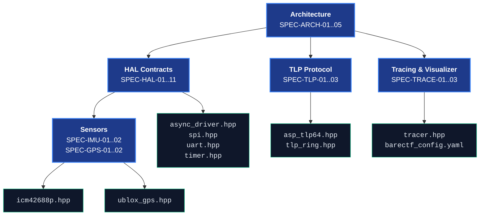

# AbstractX Design Specification & Requirements Matrix

This document is the **Single Source of Truth (SSOT)** for all architectural requirements, TLP packet definitions, HAL driver contracts, and sensor interfaces in AbstractX.

Each requirement carries a unique **Design ID (`[SPEC-*]`)** that is directly referenced by implementation files via `// @impl [SPEC-*]`.

---

## 1. System Architecture Specifications (`SPEC-ARCH`)

### `[SPEC-ARCH-01]` Split-Transaction Asynchronous I/O Pipeline
* **Requirement**: All physical peripheral interactions (SPI, UART, I2C, Timers) must be decoupled from the application thread using a split-transaction request/completion model.
* **Mechanism**: Input Queue (Request) $\rightarrow$ Hardware DMA / ISR $\rightarrow$ Output Queue (Completion) $\rightarrow$ Coroutine Resumption.
* **Verified by**: `host-tests` (`tests/test_sitl_imu.cpp`: awaiter completion routing; `sim/test_smp_lock.cpp`: two threads as cores, per-core nesting, MPSC ring and post paths under the shared lock), `sanitizer-gate`, `thread-sanitizer`
* **Implementation Target**: `include/abstractx/hal/async_driver.hpp`, `include/abstractx/interrupt_lock.hpp`, `include/tlp_ring.hpp`, `include/abstractx/domain_dispatcher.hpp`
* **Completion Correlation**: An awaiter MUST receive the result of its own request. Awaiters set `request.result_slot` to frame-owned storage and the driver writes the completion there; the shared output queue is only for callback/polling users that set no slot. Popping "the next" completion from a shared queue is forbidden.
* **Submit Failure**: When `submit_request()` fails, the awaiter MUST set a `QueueFull` status and return `false` from `await_suspend()`. It MUST NOT call `handle.resume()` inline.
* **Lost Wake-ups**: A failed `Dispatcher::post()`/`push()` means a coroutine will never resume. Every failure MUST be counted in `Dispatcher::dropped_resumes()`, which must stay 0 in a healthy system.
* **Cross-core lock (SMP, 2026-10-28)**: on a bare-metal target where both cores touch the same
  domain queue (Pico 2 W: Core 0 I/O processor and ISRs, Core 1 coroutine engine; ESP32-P4),
  `InterruptLock` masks the local core's interrupts **and** holds one spinlock shared by the cores,
  with the nesting depth and saved interrupt state kept **per core** (indexed by the core id). The
  `_from_isr` paths of `MpscRingBuffer` and `Dispatcher::post()` take the same lock there (an ISR on
  one core and a consumer on the other race exactly like two threads). The target build defines
  `ABSTRACTX_SMP_CORES` (> 1) and `abstractx_core_id()`; single-core targets (E906) keep the plain
  interrupt mask. The algorithm is `SmpInterruptLock<Platform>` (`include/abstractx/interrupt_lock.hpp`)
  so the host can run it with threads as the cores. Rationale: until 2026-10-28 the bare-metal lock
  had one global `depth_` / `saved_flags_` and excluded no other core, and ETL `queue_spsc_isr`
  keeps a shared element counter that both sides write.

### `[SPEC-ARCH-02]` Zero Dynamic Memory Allocation (0 B Heap)
* **Requirement**: No dynamic memory (`malloc`, `free`, `operator new`) is permitted in real-time execution paths.
* **Mechanism**: Coroutine frames draw from static atomic frame pools (`CoroutineStaticPool`), queues use fixed-capacity ETL rings (`etl::queue_spsc_isr`).
* **Verified by**: `host-tests` (`RepeatedAsyncInitDoesNotGrowFramePool`, `sim_test_gps_imu_coro_pool`), `sanitizer-gate` (frame alignment)
* **Implementation Target**: `include/asp_coro.hpp`, `include/abstractx/domain_dispatcher.hpp`
* **Frame Reclamation**: Destroyed coroutine frames MUST return to the static pool (exact-size free list) so steady-state loops reach a fixed pool high-water mark. `coro_pool_used()` reports live bytes; `coro_pool_high_water()` reports bytes ever carved from the pool. Regression: `tests/test_sitl_imu.cpp` `RepeatedAsyncInitDoesNotGrowFramePool`.

### `[SPEC-ARCH-03]` Universal Multi-Target Application Portability
* **Requirement**: Top-level flight control and telemetry logic (`FlightApp` / `inav-abstractx`) must compile unmodified across Linux SBCs, Raspberry Pi Pico 2 W, ESP32-P4, and Desktop SITL.
* **Verified by**: `host-tests` (`tests/test_sitl_fusion.cpp`)
* **Implementation Target**: `examples/gps_imu_flight_node.cpp`, `apps/`

### `[SPEC-ARCH-04]` Heterogeneous Co-Processor Interconnect & Single-Core MPSC (E906 + Linux)
* **Requirement**: Allwinner XuanTie E906 operates as a dedicated I/O coprocessor servicing 8 kHz SPI DMA and GPS UART, delivering timestamped 64B TLPs into shared SRAM Space 0 (`0x3FFC8100`) for Linux `remoteproc` consumers.
* **Concurrency Model**: Single-core preemption. Hardware interrupt handlers (CLIC on the E906: SPI DMA, UART RX, Timer, Mailbox Doorbell) hand coroutine handles to the event loop through the Dispatcher's ISR-safe queue (`IsrSafeCoroutineQueue`, `etl::queue_spsc_isr` with interrupt masking, `include/abstractx/domain_dispatcher.hpp`); several handlers may post because each post masks interrupts on the single core.
* **Correction (2026-10-23)**: this requirement used to name `MpscIsrQueue` in `include/mpsc_isr_queue.hpp`; no code ever used it (repository audit, `docs/design/repo-file-audit.md`), and the header was removed.
* **Implementation Target**: `targets/allwinner_e906/`, `include/abstractx/domain_dispatcher.hpp`, `apps/gps_imu_app/`

### `[SPEC-ARCH-05]` Dual-Core Asymmetric Multiprocessing (Pico 2 W / RP2350)
* **Requirement**: RP2350 separates I/O & wireless networking from flight coroutines across dual Cortex-M33 cores:
  - **Core 0**: Dedicated I/O, DMA, CYW43439 Wi-Fi/networking master, and SIO doorbell bridge.
  - **Core 1**: Dedicated real-time coroutine flight engine running 8 kHz attitude estimation and EKF.
* **Mechanism**: Dual lock-free `SpscTlpRing<64>` and RP2350 hardware SIO FIFOs (`pico/multicore.h`).
* **Implementation Target**: `apps/gps_imu_app/src/main.cpp`, `targets/pico2w_rp2350/`

### `[SPEC-ARCH-14]` Accelerators Run the Buses; Linux Sees Results
* **Goal (project owner, 2026-10-30)**: bypass Linux's slow `spidev` / `i2c-dev` path entirely. Every
  sensor and actuator bus is driven by a processor or fabric dedicated to I/O, and the fast loop
  runs where the samples land.
* **Requirement**: Linux is never on a sensor or actuator bus in the data path (no `spidev`, no
  `i2c-dev`, no Linux GPIO interrupts per sample). The bus owner per platform:

  | Platform | I/O accelerator (owns the buses, DMA, the fast loop) | Results to |
  | :--- | :--- | :--- |
  | Pico 2 W (RP2350) | Core 0 + PIO + DMA (`[SPEC-ARCH-05]`) | Core 1 coroutines, Wi-Fi |
  | ESP32-P4 | one HP core dedicated to I/O + GDMA | the other core |
  | Cubie A5E | XuanTie E906 (`[SPEC-E906-HAL-05]`) | Linux over RPMsg |
  | Zynq-7000 | pio2 in the PL (100% PIO, `[SPEC-ZYNQ-07]`); an RT A9 core polls the IMU ring | Linux over UIO rings |
  | Tang Nano + external host | pio2 in the FPGA, host = Pico or E906 over the SPI link | that host |

* **Requirement**: drivers are written for this split: the bus transfer, its DMA and its trigger
  (DRDY edge, timer) run on the I/O side and complete into a ring; the consumer on the other side
  awaits the ring, never a bus. Per-sample work (8 kHz IMU) stays on the I/O side or the core that
  owns the ring; Linux receives fused state, telemetry and trace in blocks at a rate it can
  afford, never per sample.
* **Sizing (2026-10-30, estimate, not measured)**: 8 kHz IMU (one sample per frame) + 8 kHz DShot
  + 1 Mbaud serial + trace over the pio2 Dual-SPI link at 10 MHz SCK is about 30 % of the link and
  about 16,000 windows/s, each a DMA started from `INT_n` on the E906 or Pico (E906 measured 2026-10-29:
  DRDY edge to DMA start ~6 us, 15-byte DMA ~14 us at 10 MHz).
* **Exceptions**: desktop SITL (`targets/linux`, simulated buses) and benchmark comparison columns
  (a Linux `spidev` column in `docs/articles/`) are not data paths.
* **Verified by**: `board-bringup` (per platform: the loop rate on the accelerator, Linux CPU), `cocotb-regression` (pio2 link under the traffic mix above, once the link RTL exists)
* **Implementation Target**: `targets/pico2w_rp2350/`, `targets/esp32p4/`, `targets/allwinner_e906/`, `targets/zynq7000/`, `rtl/pio/`

### `[SPEC-ARCH-06]` Unified AbstractX Runtime API & Autonomous Domain Placement
* **Requirement**: Applications must interface with the framework exclusively through the unified `abstractx::` API (`init()`, `spawn()`, `step()`, `step_async()`, `run()`). The runtime must automatically determine target topology and assign `io_processor`, `trace_dispatcher`, and user coroutines to their optimal hardware execution domains (Core 0 vs Core 1 on dual-core MCU, E906 vs Linux on heterogeneous SoCs, or cooperative coroutine loop on SITL), guaranteeing 0 application `#ifdef`s.
* **Idle Policy**: `run()` MAY call `platform_idle_wait()` only when `Dispatcher::has_pending_resumes()` is false. On bare-metal targets `platform_idle_wait()` MUST re-check the Dispatcher with interrupts masked and then sleep (`wfi`) so that an ISR posting between the check and the sleep is never slept through: either `wfi` with interrupts still masked (the core wakes on a pending interrupt), or, where that is not guaranteed (E906, `[SPEC-E906-IRQ-01]`), unmask immediately before `wfi` and have the trap entry return past that `wfi` when it interrupted it.
* **Spawn Capacity**: `spawn()` returns `false` when every task slot holds a live task; it never drops a task silently.
* **Verified by**: `host-tests` (`sim/test_abstractx_runtime.cpp`: idle policy, spawn capacity)
* **Implementation Target**: `include/abstractx/abstractx.hpp`, `src/runtime.cpp`

### `[SPEC-ARCH-07]` Platform Topology Table & Studio Multi-Window Observability
* **Requirement**: AbstractX runtimes must encode and announce a standardized `PlatformTopologyTable` describing the exact silicon execution topology (e.g. `Linux_Standard_SITL`, `Linux_Host_E906`, `Linux_Host_E906_FPGA`, `RP2350_DualCore_Pico2W`, `ESP32P4_FreeRTOS`), active cores, interconnects, and hardware accelerators. The Observability Studio must render:
  1. **Window 1: Platform Topology & Interconnect Fabric** (Auto-detected silicon graph and SPSC ring saturations).
  2. **Window 2: Dual-Plane Timeline & Source Code Scanner** (Separation of I/O driver context from C++20 coroutines, with interactive source jumping to `__FILE__`: `__LINE__`).
  3. **Window 3: Per-Processor SPU/CPU & OS Process Utilization** (Tracking host Linux CPU% and external daemons, XuanTie E906 active vs WFI cycles, and FPGA logic LUT / DMA bandwidth).
* **Implementation Target**: `include/abstractx/platform_topology.hpp`, `docs/ABSTRACTX_PLATFORM_TOPOLOGY_AND_METRICS_SPEC.md`, `tools/visualizer/abstractx_studio.py`
* **Source Compatibility**: Legacy `Linux_Host_E907` and `Linux_Host_E907_FPGA` enum names MUST remain deprecated aliases of the corresponding E906 values; topology display strings MUST use the canonical E906 names.

### `[SPEC-ARCH-08]` Zero-Copy Data Plane (No Memory Copies)
* **Goal**: fast, low-jitter data movement on every target.
* **Requirement**: Data MUST NOT be copied between the code that produces it and the transport that moves it (DMA engine, RPMsg/vring, network stack, shared-memory ring). The producer writes directly into the buffer the transport will send, obtained from the transport (`acquire` → fill in place → `commit`), and the receiver consumes it in place.
* **Architecture-specific**: *how* a target meets this differs per board and processor, and MUST be specified in that target's `SPECIFICATION.md` before it is implemented. Every target spec MUST state, per data path, where the buffer comes from, what `commit` does, and how many copies remain on the device (target: 0). Copies made by a host OS kernel outside AbstractX (e.g. Linux `sendto()`) are allowed and must be stated.
* **Current instances**: trace and telemetry `[SPEC-TRACE-07]` → `[SPEC-E906-IPC-04]` (RPMsg buffers in SRAM), `[SPEC-PICO-TRACE-01]` and `[SPEC-ESP32P4-TRACE-01]` (lwIP `PBUF_POOL` pbufs).
* **Review**: SpecTrace treats an added `memcpy`/copy loop on a data path, or a target spec without its zero-copy mapping, as an invariant violation.
* **Verified by**: `host-tests` (`sim/test_trace_zero_copy.cpp`, `sim/test_e906_rpmsg_endpoints.cpp`: pointer identity)
* **Implementation Target**: per-target transports (`targets/*/`), `include/abstractx/trace/`

### `[SPEC-BUILD-01]` Cross-Toolchain Discovery Works on Every PC
* **Requirement**: the toolchain files in `cmake/toolchains/` MUST pick the compiler in this order:
  (1) a `-D<ARCH>_TOOLCHAIN_PREFIX=` cache value, (2) the `<ARCH>_TOOLCHAIN_PREFIX` environment
  variable, (3) the newest matching directory under `$ENV{HOME}/.tools/` (`xpack-*-gcc-*` globbed,
  not one pinned version), (4) the compiler on `PATH`. They MUST NOT contain an absolute home
  directory (`/home/<user>`), because work happens on more than one PC (AGENTS.md §12).
* **Submodules**: configure MUST stop with a message naming the fix
  (`git submodule update --init <path>`) when a submodule it needs (`third_party/etl`;
  `third_party/micropython` for `e906_repl_app`) is not initialised,
  instead of a missing-header error deep in the build.
* **Rationale (2026-10-31)**: on a fresh PC the host, ASan and TSan builds all failed on
  `etl/memory_model.h`, so 30+ tests were "Not Run" and the sanitizer gate tested nothing.
  All three toolchain files hardcoded `/home/tcmichals/.tools/<exact version>`
  and never read the environment variable the toolchain rule promises.
* **Verified by**: `host-tests` (`tests/test_toolchain_files.py`)
* **Implementation Target**: `third_party/CMakeLists.txt`, `apps/e906_repl_app/CMakeLists.txt`, `cmake/toolchains/arm-none-eabi.cmake`, `cmake/toolchains/riscv-none-elf.cmake`, `cmake/toolchains/xtensa-esp-elf.cmake`

### `[SPEC-ARCH-09]` Coroutine Failures Without C++ Exceptions
* **Goal**: small, deterministic firmware. Storing and rethrowing exceptions (`std::exception_ptr`, `std::current_exception`, `std::rethrow_exception`) and type-erased callbacks (`std::function`) pull the C++ unwinder and RTTI support into every image (measured ~15.6 KB of libgcc unwinder on the E906, out of 192 KB SRAM).
* **Requirement**: `Task<T>` MUST NOT store or propagate exceptions. An exception that escapes a coroutine body is a firmware bug: `unhandled_exception()` MUST report it through `abstractx::coro::set_unhandled_exception_hook()` (if set) and then stop with `__builtin_trap()`, so the target's trap handler records it (E906: `[SPEC-E906-CRASH-01]`, trace0). Errors that are expected at run time are returned as values (`Result`, status codes), not thrown.
* **Completion callbacks** (used by `when_all` / `when_any`) MUST be a plain function pointer plus context pointer, not `std::function`.
* **Frame pool exhausted**: when the static frame pool is full, a coroutine factory returns an empty `Task` (`get_return_object_on_allocation_failure`). Awaiting an empty `Task`, reading its result, or passing it to `when_all` / `when_any` MUST report through `abstractx::coro::set_pool_exhausted_hook()` (if set) and then stop with `__builtin_trap()`. It MUST NOT dereference the null handle, and a `Task<void>` MUST NOT silently "complete" without running. Code that can recover checks `task.handle()` before awaiting.
* **Rationale (2026-10-28)**: a leak in `when_any` filled the pool after ~470 calls; the next `co_await` dereferenced the empty task's null handle (segfault), so the real cause (pool exhaustion) was invisible.
* **Verified by**: `host-tests` (`sim/test_coro_failures.cpp`), `memory-footprint` (no `_Unwind_*` / `__cxa_rethrow` symbols in the E906 and Pico 2 W ELFs)
* **Implementation Target**: `include/asp_coro.hpp`

### `[SPEC-ARCH-11]` Combinators: when_all Joins, when_any Detaches the Loser
* **Requirement (when_all)**: `co_await when_all(t...)` starts every task, resumes the caller exactly
  once after the last one completes, in any completion order, and returns their results as a tuple.
* **Requirement (when_any)**: `co_await when_any(a, b)` resumes the caller exactly once, when the first
  task completes, with that task's result. The other task is **detached**: it keeps its frame, runs on
  to its own end when its pending completion arrives (a timer fires, data arrives), and then frees its
  frame itself; its result is discarded and it never resumes the caller. A loser that waits on
  something that never happens keeps its frame (and any request it has pending) until it does: to
  stop it early, cancel its I/O (`[SPEC-HAL-07]`).
* **Requirement (never-started tasks)**: a task that never ran (still at its initial suspend) holds
  nothing and nobody will ever resume it, so `Task::detach()` MUST destroy it at once instead of
  detaching it. This covers the `when_any` loser when the first task finishes inside
  `await_suspend` before the second one was started.
* **Rationale (2026-10-28)**: `when_any(ready(), waits())` detached the unstarted `waits()` frame on
  every call; it was never freed and the pool ran out after ~470 calls. The 1000-round test only
  raced two tasks that had both started.
* **Rationale (2026-10-23)**: the loser used to be destroyed with the `when_any` awaiter while it was
  still suspended; its pending completion later resumed the freed frame (segfault in the plain
  build, ASan SEGV), the race/watchdog pattern taught in `examples/generic_protothread_replacements.cpp`.
  Found when the never-built `sim/test_coro_combinators.cpp` was rewritten to really call the combinators.
* **Verified by**: `host-tests` (`sim/test_coro_combinators.cpp`: out-of-order completion, single
  resume, loser completing after the caller moved on, unstarted loser freed, 1000 rounds flat;
  `tests/test_coro_primitives.cpp`: `DetachNeverStartedTaskFreesFrame`), `sanitizer-gate`
* **Implementation Target**: `include/asp_coro.hpp`

### `[SPEC-ARCH-12]` Repository Layout: Generic Core, Device Drivers, Applications
* **Requirement**: `include/abstractx/` holds only target- and device-independent framework code
  (coroutines, dispatcher, HAL interfaces, trace). Drivers for specific chips live in `drivers/`
  (CMake target `abstractx_drivers`, headers under `drivers/include/abstractx/drivers/<kind>/`, so
  the include path `abstractx/drivers/...` is unchanged); application logic (fusion, control) lives
  in its app under `apps/`. Only targets that use a driver link `abstractx_drivers`.
* **Requirement**: `drivers/` follows the same freestanding rules as `include/` (AGENTS.md §2).
* **Rationale (2026-10-23)**: the repository audit (`docs/design/repo-file-audit.md`) found the
  u-blox GPS, ICM-42688-P and QMC5883L drivers and the gps_imu_app attitude filter inside the
  generic core, so every user of the framework compiled against specific sensors.
* **Verified by**: `host-tests` (the drivers' users still build and pass: `tests/test_sitl_imu.cpp`,
  `tests/test_sitl_gps.cpp`, `tests/test_sitl_fusion.cpp`, `sim/test_tlp_msg.cpp`,
  `sim/test_gps_imu_coro_pool.cpp`, `examples/gps_imu_flight_node.cpp`), `spec-change-review`
* **Implementation Target**: `drivers/CMakeLists.txt`, `CMakeLists.txt`

### `[SPEC-ARCH-10]` Wake Primitives Never Resume Inline
* **Requirement**: `AsyncQueue::try_push` / `try_pop`, `Event::set` and `Semaphore::release` MUST NOT call
  `.resume()`. They hand the waiting handle to `Dispatcher::push()`; the waiter runs on the next
  `Dispatcher::process()` (from `step()`), after the producer has returned.
* **Requirement (Semaphore hand-off)**: when `release()` wakes a waiter, that permit belongs to the
  waiter (the count is not incremented). The woken waiter MUST NOT take another count in
  `await_resume()`; only an acquire that did not suspend decrements the count. (2026-10-28: a
  second `release()` before the waiter ran was swallowed, so two releases woke it once.)
* **Requirement (who may call `.resume()`, 2026-10-29)**: in `include/` and `src/` only these call
  `.resume()`: `Dispatcher::process()` (every wake), and code that *starts* a task that has never
  run (`Task::resume()`, `abstractx::spawn()` / `run()`, `when_all` / `when_any` starting their
  children). Each such line says so with `// resume: <why>`. Every completion path (drivers, rings,
  I/O engines such as `CoroutineIoEngine::poll_completions()`) posts with `Dispatcher::push()` /
  `post()`. Rationale: `CoroutineIoEngine` resumed the awaiting coroutine inside
  `poll_completions()`, and the lint only looked at lines that mention `await_` or `notify_`.
* **Requirement (every suspension has a waker, 2026-10-28)**: every awaiter in the public API
  (`include/abstractx/`, `include/asp_coro.hpp`) that suspends hands its handle to something that
  will post it: the `Dispatcher`, a driver request (`result_slot` + completion), a ring's waiter slot
  or a wait list. An awaiter whose `await_suspend` drops the handle can only be resumed by hand, which
  AGENTS §10.6 forbids. Timed waits use the target timer driver
  (`co_await hal::get_timer_driver().sleep_ms_async(ms)` / `sleep_us_async(us)`, [SPEC-HAL-05]); a
  timer request that cannot be queued completes with `TimerStatus::Error`, never `Ok`. The
  hand-clocked protothread helpers (`delay_us(now)`, `sleep_for(now)`, `wait_until(pred)`, the
  `AsyncDelayAwaiter` that only writes a comparator) are example code in
  `examples/hand_clocked.hpp`, not core API. The unused ETL `TimerService` / `abstractx::sleep_ms`
  (dropped the handle when its 32 slots were full or registration failed, then hung) is removed.
* **Rationale**: on 2026-10-21 the E906 RPMsg RX callback pushed a character into the REPL queue and
  `try_push` resumed the REPL inline, so a MicroPython script ran inside `Rpmsg::poll()`: the vring
  buffer was never returned, host kicks stayed disabled and Ctrl-C could not arrive. AGENTS §3 already
  says `step()` is the sole context that resumes coroutines; these primitives broke it.
* **Verified by**: `host-tests` (`sim/test_async_queue_deferred_resume.cpp`, `tests/test_coro_primitives.cpp`: `SemaphoreHandoffKeepsEveryPermit`, `TimerSubmitFailureIsAnError`), `coro-contract-lint` (`tools/audit_coro_contracts.py`: no public awaiter drops its handle), `e906-board-selftest` (`test_ctrl_c_interrupts_running_script`)
* **Implementation Target**: `include/asp_coro.hpp`, `include/abstractx/hal/timer.hpp`, `include/abstractx/coro.hpp`

### `[SPEC-ARCH-13]` One I/O Processor Engine in Core, Thin Per-Target Bus Back Ends
* **Goal**: one implementation of the I/O processor message loop, fixed and tested once, instead of a
  copy per target.
* **Requirement**:
  1. `abstractx::hal::IoEngine` (`include/abstractx/hal/io_engine.hpp`) implements `IIoProcessor` for
     every target that runs the I/O processor in software (Linux, E906, Pico 2 W, later ESP32-P4). It
     owns the egress TLP decode (`DMA_CFG`, `MEM_RD` / `MEM_WR`, SPI / I2C / GPIO bridge), the
     auto-channel table, the bus lockout ([SPEC-ARCH-01] invariant: `ASP_STATUS_BUS_LOCKED` while a
     channel on that bus is in auto mode), the bridge slot pool, completion TLP framing and host
     notification.
  2. A target supplies only an `IIoBackend`: bus and trigger setup per channel, an asynchronous
     transfer start that reports through the transfer's completion delegate, GPIO and virtual-BAR
     register access, the host doorbell, and an optional event poll / idle wait. A target
     `io_processor.cpp` contains no TLP decoding.
  3. **Bounds**: every length the host supplies is clamped before use. Auto channel: command
     `tx_len <= 8`, `tx + rx <= IoEngine::kAutoXferMax` (64), payload taken from offset `tx` (the
     clamped length). Bridge: SPI `tx, rx <= 36`, I2C `tx <= 32`, `rx <= 36`. GPIO pin `>= 32` is
     answered with an error status, never shifted. The tx and rx buffers of an SPI transfer are the
     same length (tx zero-padded), because SPI clocks both.
  4. **Concurrency**: each auto channel owns its tx/rx buffers, a config snapshot and an atomic busy
     flag. A trigger only starts channels whose `trigger_pin` matches. A trigger while that channel's
     transfer is still in flight is counted (`auto_overruns()`) and dropped; it never restarts the
     transfer or reuses its buffers. Config writes (`DMA_CFG`, `set_auto_mode`) and the trigger's
     snapshot are taken under `InterruptGuard`. Bridge transfers use a fixed slot pool; a full pool
     answers `ASP_STATUS_QUEUE_FULL`. Each completion is matched to the slot or channel that started it.
     A completed auto read is copied into its TLP, then the channel is released (busy cleared), and only
     then is the TLP published (`emit`, which wakes the consumer): a consumer on another thread or core
     that reacts to the sample must find the channel free for the next edge (2026-10-30: publishing
     first made `sim/test_linux_drdy_auto` count the next edge as an overrun under ASan timing).
  5. **No blocking**: the engine never waits for a transfer. A back end whose bus only has a
     synchronous primitive may complete inside `start_transfer()`; that gap is listed in the target
     spec, not hidden.
  6. Targets where the engine is in hardware (Zynq-7000 / FPGA X-fabric) keep a pass-through
     `IIoProcessor` (rings to BRAM) and do not use `IoEngine`.
* **Rationale (2026-10-28)**: the Pico, E906 and Linux `io_processor.cpp` were copies of one decoder
  and shared its bugs: a 32-byte tx buffer clocked for up to 64 bytes, a host-controlled `tx_len`
  (up to 255) used as the offset into a 64-byte rx buffer, one shared buffer and `active_auto_ch_`
  for all channels, a new trigger restarting a DMA still in flight, config rewritten while the ISR
  read it, and E906 starting every auto channel on any DRDY edge.
* **Verified by**: `host-tests` (`sim/test_io_engine.cpp`: mock back end, bounds, overrun, lockout,
  slot pool exhaustion, 1000 rounds flat; `sim/test_io_processor.cpp` on the Linux back end),
  `sanitizer-gate`, `thread-sanitizer`, `e906-build-layout`
* **Implementation Target**: `include/abstractx/hal/io_engine.hpp`, `targets/*/src/io_processor.cpp`

---

## 2. 64-Byte Transaction Layer Packet (TLP) Specifications (`SPEC-TLP`)

### `[SPEC-TLP-01]` 64-Byte Wire Format & CTF 1.8 Standard Encapsulation
* **Requirement**: All inter-core, inter-process, and network messages must strictly match the 64-byte `asp_tlp64_t` layout (`alignas(64)`). All data payloads (telemetry, sensor frames, coroutine lifecycles, and HAL traces) must encapsulate standardized binary **Common Trace Format (CTF 1.8 / barectf)** event structures within the 40-byte TLP payload (`payload[40]`).
* **Wire Fields**: `type` (1B), `flags` (1B), `tag` (1B), `channel` (1B), `target_address` (4B), `length_dw` (2B), `sequence` (2B), `timestamp_ns` (8B), `payload` (40B CTF binary event), and a 4B transport-integrity footer. Trusted processor↔FPGA paths over SRAM, AXI, BRAM, or DDR MUST write the footer as zero and do not calculate CRC. External SPI/UART serial profiles MUST use that footer for IEEE 802.3 CRC32 over bytes 0..59.
* **Channel Routing**:
  - `Channel::Telemetry` (`0x02`): CTF Stream 1 (`ImuSamplePayload` 23B, `GpsFixPayload` 35B).
  - `Channel::FlightLog` / `Channel::Debug` (`0x03` / `0x04`): CTF Stream 0 (`CoroEventPayload` 17B), CTF Stream 2 (`HalIoPayload` 16B / `TlpTracePayload` 19B).
* **Verified by**: `host-tests` (`sim/test_tlp_msg.cpp`), `cocotb-regression` (`sim/cocotb/test_asp_tlp_64b_cocotb.py`)
* **Implementation Target**: `include/asp_tlp64.hpp`, `include/asp_tlp64.h`

### `[SPEC-TLP-02]` Memory-Mapped Virtual Addressing & Routing
* **Requirement**: Sensor and actuator requests must target virtual BAR memory regions (`IMU_BASE = 0x40000100`, `GPS_BASE = 0x40000300`), remaining transport-agnostic.
* **Verified by**: `cocotb-regression` (`sim/cocotb/test_asp_sys_regs_cocotb.py`, `sim/cocotb/test_asp_wishbone_master_cocotb.py`)
* **Implementation Target**: `include/pcie_bar_map.hpp`

### `[SPEC-TLP-03]` Multi-Producer MPSC and Dedicated SPSC Ring Transport
* **Requirement**: All shared application telemetry rings (`g_telemetry_ring`), I/O processor request rings (`egress_tx_ring`), and completion rings (`ingress_rx_ring`) accessed across multiple coroutines, worker threads, or ISRs MUST use `MpscRingBuffer<T, Capacity>` / `MpscTlpRing<Capacity>` (`include/tlp_ring.hpp`). `MpscRingBuffer` wraps `etl::queue_spsc_isr<T, Capacity, InterruptLock, etl::memory_model::MEMORY_MODEL_SMALL>` so non-ISR `push()` and `pop()` mask interrupts via `InterruptLock` (`csrrci` on RV32 / `cpsid i` on Cortex-M, recursive atomic spinlock on hosted OS), and ISR `push_from_isr()` enqueues safely without racing on `tail_`. Pure lock-free `SpscRingBuffer<T, Capacity>` / `SpscTlpRing<Capacity>` is strictly restricted to dedicated 1:1 hardware DMA streams (e.g. `UartRxRingBase`) and dedicated point-to-point inter-core channels with strictly one writer. Interrupt-to-loop coroutine handle handoff uses the Dispatcher's ISR-safe queue (`etl::queue_spsc_isr` guarded by `InterruptLock`, `[SPEC-ARCH-04]`).
* **Verified by**: `queue-concurrency`, `host-tests` (`sim/test_spsc_channel_array.cpp`), `thread-sanitizer` (`sim/test_baremetal_isr_spsc.cpp`)
* **Implementation Target**: `include/tlp_ring.hpp`, `include/abstractx/hal/io_processor.hpp`, `include/abstractx/domain_dispatcher.hpp`, `apps/gps_imu_app/include/gps_imu_tasks.hpp`

### `[SPEC-TLP-04]` Multi-Register Burst Memory Operations
* **Requirement**: The TLP memory interface MUST support packed multi-register burst writes (`MemWrBurst`) and burst reads (`MemRdBurst`) packing up to 9 consecutive 32-bit registers (36 bytes payload) into a single 64-byte TLP with `length_dw = N (1..9)`. The receiving gateway (`asp_wishbone_master.sv`) MUST sequentially write/read consecutive memory-mapped Wishbone addresses starting at `target_address` without issuing separate 64-byte control frames.
* **Verified by**: `cocotb-regression` (`sim/cocotb/test_asp_wishbone_master_cocotb.py`)
* **Implementation Target**: `include/asp_tlp64.hpp`, `rtl/asp_wishbone_master.sv`

---

### `[SPEC-TLP-05]` PIO Tile Integration: AbstractX Wishbone to pio2 AXI4-Lite
* **Requirement**: the PIO tile comes from the `rtl/pio` submodule (pio2), whose register port is
  AXI4-Lite (pio2 `[SPEC-AXI-04]`). AbstractX keeps its Wishbone B4 classic fabric and connects through
  `rtl/asp_pio_wrap.sv`: a classic-to-pipelined step (one request per transaction, re-armed on `ack`),
  ZipCPU's `wbm2axilite` bridge (Apache-2.0, `rtl/pio/third_party/wb2axip`, not copied), and the tile.
  An AXI `SLVERR` / `DECERR` comes back as an `ack` (AbstractX's fabric has no `err`). The wrapper keeps
  the tile's former port list, so `asp_top` and the board tops change only the module name.
* **Requirement**: every board top and the cocotb `asp_top` build read the wrapper, the bridge and the
  submodule RTL; `git submodule update --init --recursive` fetches them.
* **Verified by**: `cocotb-regression` (`sim-test-tlp64-top`: TLP over Dual-SPI into `asp_top`, through
  the wrapper; `sim/cocotb/test_asp_pio_wrap_cocotb.py`: register writes and reads, classic bursts and
  back-to-back accesses through the wrapper), `rtl-lint`, `fpga-build`
* **Implementation Target**: `rtl/asp_pio_wrap.sv`, `rtl/asp_top.sv`

## 3. Hardware Abstraction Layer Specifications (`SPEC-HAL`)

### `[SPEC-HAL-01]` DMA/ISR Split-Queue Driver Base
* **Requirement**: `AsyncDriverBase<TReq, TRes, Depth>` must manage dual ETL `queue_spsc_isr` rings with nesting-aware `InterruptLock` masking.
* **Requirement** (completion delivery, every target): a driver completes a request only through
  `push_completion_from_isr(request, result)`, which writes `request.result_slot` (or the output
  queue) before posting the coroutine handle. Calling `notify_completion` alone loses the result:
  the awaiter then reads a default `Ok` with 0 bytes. A request the hardware or worker refuses is
  completed at once with an error status (`QueueFull`), never dropped. A completion handler
  completes the request that just finished and starts the next one exactly once
  (`set_hardware_idle_from_isr` already pops and starts the next request).
  Target detail: `[SPEC-LINUX-HAL-01]` (Linux, Zynq), `[SPEC-PICO-HAL-01]` (Pico 2 W).
* **Verified by**: `host-tests` (`sim/test_baremetal_isr_spsc.cpp`, `sim/test_linux_hal_completion.cpp`), `thread-sanitizer`
* **Implementation Target**: `include/abstractx/hal/async_driver.hpp`

### `[SPEC-HAL-02]` Asynchronous SPI / Dual-SPI DMA Interface
* **Requirement**: `AsyncSpiDriver` must support single-channel and dual-channel high-speed SPI transactions with `co_await transfer_async()`.
* **Verified by**: `host-tests` (`tests/test_sitl_imu.cpp`), `sanitizer-gate`
* **Implementation Target**: `include/abstractx/hal/spi.hpp`

### `[SPEC-HAL-03]` Asynchronous UART Streaming & Framing Interface
* **Requirement**: `AsyncUartDriver` must provide interrupt/DMA driven non-blocking RX byte streaming and `co_await write_async()` packet ingestion.
* **Verified by**: `host-tests` (`tests/test_sitl_gps.cpp`), `thread-sanitizer`
* **Implementation Target**: `include/abstractx/hal/uart.hpp`

### `[SPEC-HAL-06]` UART Configuration by Capability: Format, Flow Control, Inter-Byte Gap
* **Goal**: one UART API on every target; a feature is used only where the driver says the hardware
  has it, and is refused (not faked) elsewhere.
* **Requirement**: `UartConfig` carries baud, data bits, stop bits, parity, flow control and
  `tx_gap_us` (idle time the transmitter inserts after every byte's stop bit). Each driver reports
  `UartCapabilities`: maximum baud, FIFO bytes, data/stop bit and parity support, RTS/CTS, receive
  and transmit DMA, the hardware inter-byte gap range and resolution (0 = none) and whether a write
  completes at "transmitter empty" (last stop bit on the pin). `configure()` checks the request
  against the capabilities first (`check_uart_config`) and returns `UartStatus::NotSupported`
  without touching the hardware if anything is outside them. A driver that reports nothing
  supports only 8 data bits, 1 stop bit, no parity, no flow control, no gap at its baud.
* **Requirement**: a capability is reported only when it is verified for that chip (datasheet or
  vendor header read, or measured); unverified features stay unsupported.
* **Known hardware** (2026-10-22):

  | Target | Inter-byte gap | Other | Source |
  |---|---|---|---|
  | T527 UART1-7 (E906) | `TX_DELAY` (+0xCC): 0-255 x 16 UART clocks (0.67 us steps, max 170 us at 24 MHz) | FIFO 128 B (read from `UART_FCC` on the board); 1/2 stop bits, parity, RX/TX DMA, RX DMA timeout | T527 manual V0.94 §8.19; board register read |
  | RP2350 UART (Pico 2 W) | none (PL011 has no delay register; 2 stop bits or a PIO UART instead) | 5-8 data bits, 1-2 stop bits, parity, DMA | Pico SDK `uart.h`, `regs/uart.h` |
  | ESP32-P4 | not verified (Espressif `tx_idle_num` / RS-485 TX delay, from memory) | not verified | none on this PC |
  | Linux (termios) | none | stop bits, parity, RTS/CTS | termios |

* **Verified by**: `host-tests` (`sim/test_uart_config.cpp`)
* **Implementation Target**: `include/abstractx/hal/uart.hpp`

### `[SPEC-HAL-07]` One Status Vocabulary for Every Bus; Cancelled Requests Resume Their Coroutine
* **Goal**: a caller handles a NACK, a timeout or a refusal the same way on SPI, I2C and UART,
  and no request is ever lost with its coroutine suspended forever.
* **Requirement (vocabulary)**: `IoStatus` (`include/abstractx/hal/io_status.hpp`) is the shared
  set of outcomes. Each bus keeps its own `*Status` enum (existing numeric values unchanged, new
  values appended) and provides `constexpr IoStatus to_io_status(<Bus>Status)`. Mapping, with the
  nearest Linux / Zephyr return code for readers coming from those APIs:

  | `IoStatus` | Meaning | SPI | I2C | UART | Linux / Zephyr |
  |---|---|---|---|---|---|
  | `Ok` | done | `Ok` | `Ok` | `Ok` | 0 |
  | `QueueFull` | request queue full or a second reader; nothing was started | `QueueFull` | `QueueFull` | `QueueFull` | `-EBUSY` / `-EAGAIN` |
  | `NotSupported` | well-formed, but outside the driver's capabilities; refused before the hardware | `NotSupported` | `NotSupported` | `NotSupported` | `-ENOTSUP` |
  | `InvalidArgument` | malformed request (empty, mismatched lengths, bad address) | `InvalidArgument` | `InvalidArgument` | `InvalidArgument` | `-EINVAL` |
  | `Cancelled` | cancelled or dropped before it completed | `Cancelled` | `Cancelled` | `Cancelled` | `-ECANCELED` |
  | `Timeout` | no completion within the request's deadline | `Timeout` | `Timeout` | `Timeout` | `-ETIMEDOUT` |
  | `NackAddress` | no device answered its address | - | `NackAddress` | - | `-ENXIO` |
  | `NackData` | device refused a data byte | - | `NackData` | - | `-EREMOTEIO` / `-EIO` |
  | `ArbitrationLost` | another master won the bus | - | `ArbitrationLost` | - | `-EAGAIN` |
  | `BusError` | bus stuck or protocol error | `BusError` | `BusError` | - | `-EIO` |
  | `DmaError` | DMA engine fault | `DmaError` | - | - | `-EIO` |
  | `Crc` | link CRC mismatch | `CrcError` | - | - | `-EBADMSG` |
  | `Overrun` / `Framing` / `Parity` / `Break` | UART line errors | - | - | `OverrunError` / `FramingError` / `ParityError` / `BreakError` | `TIOCGICOUNT` / `UART_RX_STOPPED` reason |
  | `Aborted` | a step callback ended the transaction with `Fail` ([SPEC-HAL-12]) | `Aborted` | `Aborted` | - | `-ECANCELED` (Betaflight `BUS_ABORT`) |

* **Requirement (cancel)**: `AsyncDriverBase::cancel_pending()` completes every queued (not yet
  started) request with its bus's `Cancelled` status through the normal completion path: the
  result goes to the request's `result_slot` and its coroutine is posted to the `Dispatcher`
  (never resumed inline, [SPEC-ARCH-10]). `cancel_active()` asks the driver to abort the request on
  the hardware (`abort_active_from_isr()`); a driver that can stop the transfer completes it with
  `Cancelled` and returns true; the default returns false and the in-flight request completes
  normally, so a DMA never writes into a frame that has already been resumed. `reset_queues()` is
  `cancel_pending()` + `cancel_active()` + clearing unclaimed results; it no longer discards
  requests silently. A coroutine frame that owns a pending request MUST NOT be destroyed before
  that request completes (AGENTS §10.3).
* **Requirement**: the result type of every driver that calls these functions has a `status` whose
  enum has a `Cancelled` value (checked at compile time).
* **Rationale**: the HAL review (2026-10-22) found that `reset_queues()` cleared the queues and left
  every queued coroutine suspended forever, and that each bus had its own partly unused error enum.
* **Verified by**: `host-tests` (`sim/test_hal_cancel.cpp`: queued requests resume with `Cancelled`,
  in-flight request completes or is aborted, 1000 cycles without pool or dropped-resume growth),
  `sanitizer-gate`, `thread-sanitizer`
* **Implementation Target**: `include/abstractx/hal/io_status.hpp`, `include/abstractx/hal/async_driver.hpp`

### `[SPEC-HAL-08]` SPI Devices and Segmented Transactions on One Bus Driver
* **Goal (project owner, 2026-10-22)**: "I do not want to write several drivers": an IMU, a SPI
  flash and the FPGA Dual-SPI link use the same SPI bus driver by describing their transactions.
* **Requirement (device)**: `SpiDevice` describes one chip on the bus: chip select index, mode 0-3,
  maximum clock, CS polarity (`cs_active_high`) and bit order (`lsb_first`). It is static data owned
  by the device driver; the bus driver applies it at the start of each transaction (no bus-wide
  `SpiConfig` is needed per device).
* **Requirement (transaction)**: `co_await bus.transfer_async(const SpiDevice&, std::span<const
  SpiSegment>)` runs one transaction and returns `SpiResult` (status, total bytes). CS is asserted
  before the first segment and released after the last; between segments CS stays asserted unless
  a segment sets `release_cs_after`. A `SpiSegment` has a tx span, an rx span and a lane width
  (`SpiLanes::Single`/`Dual`/`Quad`, Linux `tx_nbits`/`rx_nbits`, Zephyr `SPI_LINES_*`):
  * Single lane: tx only, rx only (tx clocks out `0xFF`), or full duplex with equal lengths.
  * Dual / Quad: half duplex, exactly one of tx or rx.
  * Malformed segments (both spans empty, unequal full-duplex lengths, tx and rx on 2/4 lanes,
    no segments, `max_hz` 0) are refused with `InvalidArgument`.
  The segment array and every buffer it points at live in the awaiting coroutine frame or static
  storage until the transaction completes (AGENTS §10.3).
* **Requirement (capabilities)**: each driver reports `SpiCapabilities`: maximum clock, FIFO bytes,
  chip selects, supported modes, supported lane widths, CS polarity, LSB-first, CS release between
  segments, maximum segments per transaction and DMA. `check_spi_transaction()` runs before
  submission; a well-formed request outside the capabilities (lanes 2/4, a mode, a CS index, CS
  active high, LSB first) completes with `SpiStatus::NotSupported` without suspending and without
  touching the hardware. A driver that reports nothing (`max_segments == 0`, every target driver
  today) refuses every device transaction; the legacy single-buffer API keeps working unchanged.
* **Requirement (device timing and wiring, 2026-10-23)**: `SpiDevice` also carries the fill byte
  clocked out by read-only segments (`fill`, default `0xFF`), CS setup and hold times and the gap
  between words (`cs_setup_ns`, `cs_hold_ns`, `word_gap_ns`, 0 = controller minimum), 3-wire
  operation (`three_wire`: one bidirectional data line, half duplex) and an optional data/command
  pin (`dc_pin`, -1 = none) for displays. Non-zero timings, `three_wire` and `dc_pin` need
  `SpiCapabilities::cs_timing` (and `max_cs_delay_ns`), `three_wire` and `dc_pin`; otherwise
  `NotSupported`. A 3-wire device's segments are half duplex (`InvalidArgument` otherwise).
* **Requirement (segment attributes, 2026-10-23)**: a `SpiSegment` also carries the word size
  (`word_bits`, default 8; Linux `bits_per_word`), a clock for this segment only (`hz`, 0 = the
  device's `max_hz`; Linux `speed_hz`), dummy clock cycles sent before the segment's data
  (`dummy_cycles`, on the segment's lanes; SPI NOR fast read in dual/quad modes; Zephyr/Linux
  `dummy` in the op), and the level the data/command pin takes for the segment (`dc_level`, -1 =
  leave). Words of 9-16 bits occupy 2 bytes and of 17-32 bits 4 bytes, little-endian in the
  buffer; a buffer whose length is not a whole number of words is `InvalidArgument`.
  `SpiCapabilities::word_bits` (bit n-1 set = n-bit words), `per_segment_hz`, `max_dummy_cycles`
  and `dc_pin` gate them; an unsupported value is `NotSupported`. Defaults reproduce the
  2026-10-22 behaviour exactly, so existing requests are unchanged.
* **Requirement (DMA)**: device drivers never choose DMA. The bus driver applies its target rule per
  segment (E906: [SPEC-E906-HAL-01], larger than the FIFO = DMA, else FIFO + one completion
  interrupt). `SpiCapabilities::dma` and `fifo_bytes` are informative only.
* **Requirement (helpers)**: `write_then_read_async(dev, tx, rx, rx_lanes)` (two segments, CS held),
  `read_regs_async(dev, reg, out, read_flag = 0x80)` and `write_regs_async(dev, reg, in,
  write_mask = 0x7F)` return the full `SpiResult`. The command byte and segment array live in the
  awaiter and are bound to the request in `await_suspend` (AGENTS §10.4c).
* **Worked examples** (all host-tested against one fake bus driver):
  * FPGA Dual-SPI TLP link (`docs/tier2_contracts/ASP_SPI_TRANSPORT.md` §3,
    `rtl/spi/asp_spi_frontend.sv`): write = `{0xA1}` on 1 lane, then 64 TLP bytes on 2 lanes;
    read = `{0xA2}` on 1 lane, then 64 bytes in on 2 lanes; 8 + 256 SCLK cycles per TLP.
  * SPI NOR fast read: dual output `{0x3B, A23..A0, dummy}` on 1 lane, then N bytes on 2 lanes;
    quad output `0x6B` with 4 lanes.
  * IMU register burst: `read_regs_async(imu, 0x1D, out)` (Mode 0, 24 MHz).
* **Verified by**: `host-tests` (`sim/test_spi_transactions.cpp`, `sim/test_bus_protocols.cpp`:
  word sizes, timing, 3-wire, D/C pin, dummy cycles accepted or refused by capability), `sanitizer-gate`
* **Implementation Target**: `include/abstractx/hal/spi.hpp`

### `[SPEC-HAL-09]` I2C Message Transfers, Distinct Errors, Timeout and Bus Recovery
* **Requirement (messages)**: `co_await i2c.transfer_async(uint16_t address, std::span<const I2cMsg>
  msgs, uint32_t timeout_us = kI2cDefaultTimeoutUs)` runs a list of messages in one bus transaction,
  like Linux `i2c_transfer` / Zephyr `i2c_transfer`. An `I2cMsg` is a write (tx span) or a read (rx
  span, `I2cFlag::Read`). The first message starts with START; each later message starts with a
  repeated START unless it sets `I2cFlag::NoStart` (continues the previous message, same direction);
  `I2cFlag::Stop` ends a non-last message with STOP; the last message always ends with STOP.
* **Requirement (address)**: the address is `uint16_t`. 7-bit addresses are 0..0x7F;
  `i2c_addr10(a)` (bit 15 set) marks a 10-bit address 0..0x3FF. Any other value is
  `InvalidArgument`.
* **Requirement (result)**: `I2cResult` reports the status, `msgs_done` (messages fully completed)
  and `transferred_bytes`. Errors are distinct: `NackAddress` (address not acknowledged),
  `NackData` (a written byte not acknowledged), `ArbitrationLost`, `Timeout` (no completion within
  `timeout_us`, including a slave stretching SCL), `BusError`. `timeout_us == 0` is
  `InvalidArgument`; every transfer has a deadline.
* **Requirement (capabilities)**: `I2cCapabilities` reports maximum clock, FIFO bytes, maximum
  messages per transfer and bytes per message, 10-bit addressing, `NoStart`, STOP between messages,
  zero-length writes (address probe), bus recovery and DMA. `check_i2c_transfer()` runs before
  submission and refuses with `NotSupported` (well-formed but unsupported) or `InvalidArgument`
  (malformed), without touching the hardware. `max_msgs == 0` (every target today) refuses every
  message transfer.
* **Requirement (helpers)**: `read_regs_async(addr, reg, out)` = write `{reg}` + repeated START +
  read; `write_regs_async(addr, reg, in)` = write `{reg}` + write `in` with `NoStart` when the
  driver supports it, otherwise `{reg, in...}` built in the awaiter (at most
  `kI2cRegWriteMax` = 32 bytes; a control-path copy, not a data path, [SPEC-ARCH-08]). Both return
  the full `I2cResult`.
* **Requirement (recovery)**: `co_await i2c.recover_bus_async()` clocks SCL until the slave releases
  SDA (up to 9 pulses) and sends STOP; `Ok` when SDA is high afterwards, `BusError` otherwise,
  `NotSupported` when the driver cannot drive the pins.
* **Requirement (devices and per-device speed, 2026-10-23)**: `I2cDevice` (address + `max_hz`) is the
  I2C counterpart of `SpiDevice`; `transfer_async(const I2cDevice&, msgs, timeout_us)` runs the
  transfer at the device's clock (0 = the bus clock), so a 100 kHz and a 400 kHz device share a
  bus. A non-zero `max_hz` needs `I2cCapabilities::per_device_hz` and must not exceed `max_hz`
  of the controller; otherwise `NotSupported`.
* **Requirement (protocol flags, 2026-10-23)**: `I2cFlag::IgnoreNack` (Linux `I2C_M_IGNORE_NAK`):
  a NACK on this message is not an error; `I2cFlag::RecvLen` (Linux `I2C_M_RECV_LEN`, SMBus block
  read): on a read message the first byte received is a count N (1..32) and the driver reads N
  more bytes; the rx span must hold 33 bytes; the result's `transferred_bytes` reports 1 + N. A
  count of 0 or above 32 ends the transfer with `BusError` after STOP. Gated by
  `I2cCapabilities::ignore_nack` and `recv_len`.
* **Requirement (16-bit register addresses, 2026-10-23)**: `read_regs16_async(addr, reg16, out)` and
  `write_regs16_async(addr, reg16, in)` send the register address high byte first (EEPROMs,
  many camera and power chips), with the same message layout and limits as the 8-bit helpers.
* **Requirement (SMBus PEC, 2026-10-23)**: `smbus_pec(crc, bytes)` computes the SMBus packet error
  code (CRC-8, polynomial 0x07, initial 0) over the address byte(s) and data, so a device driver
  appends or checks it without driver support.
* **Not covered (2026-10-23)**: I2C target (slave) mode, general-call handling beyond a write to
  address 0, mux channel selection (a device-driver concern, built from these transfers).
* **Verified by**: `host-tests` (`sim/test_i2c_messages.cpp`, `sim/test_bus_protocols.cpp`: per-device
  speed, IgnoreNack/RecvLen gating, 16-bit register layout, PEC against a known vector), `sanitizer-gate`
* **Implementation Target**: `include/abstractx/hal/i2c.hpp`

### `[SPEC-HAL-10]` UART Receive: Driver-Owned Ring, Zero-Copy Spans, Drop and Line-Error Counters
* **Goal**: the HAL form of [SPEC-E906-HAL-02], usable on every target: the receive buffer belongs
  to the driver, the reader looks at it in place.
* **Requirement (ring)**: `UartRxRing<BufBytes, NumBufs>` (default 64 x 4, `include/abstractx/hal/uart_rx.hpp`)
  is the driver's receive storage: `NumBufs` contiguous buffers that a circular DMA chain fills
  (E906) or an RX interrupt fills (targets without receive DMA). The producer (DMA "package end"
  or RX-timeout interrupt) calls `produced_from_isr(n, end_of_frame)` after the hardware wrote
  `n` more bytes; `end_of_frame` is set by the RX timeout so a partial frame is delivered.
* **Requirement (reader)**: `co_await uart.read_async(min_bytes, timeout_us)` resumes when at least
  `min_bytes` are buffered, or when an end of frame delivered at least one byte, or after
  `timeout_us` (`Timeout`, possibly with fewer bytes; 0 = no deadline), or on `cancel_read()`
  (`Cancelled`). It returns a `UartRxView`: up to two spans into the ring (the second after the
  wrap point; no copy), the bytes dropped since the previous view and the line errors seen since
  then. The reader calls `release_rx(n)` when it has parsed `n` bytes; unreleased bytes are offered
  again by the next `read_async`. One reader per port: a second concurrent reader gets
  `QueueFull`. A deadline needs the driver's timer hook; without it a non-zero `timeout_us` is
  refused with `NotSupported`.
* **Requirement (overrun)**: the hardware never stops. Bytes overwritten before the reader looked
  at them are counted as dropped and skipped, never delivered. The buffer being filled by the DMA
  counts as overwritten. If bytes the reader holds are overwritten before `release_rx`, `release_rx`
  returns `OverrunError` and counts them, so the reader discards what it parsed from them.
* **Requirement (counters)**: `rx_stats()` returns dropped bytes and the overrun, framing, parity
  and break counts (`line_error_from_isr`), per port, since start.
* **Requirement (transmit completion)**: `write_async` completes when the bytes have left the pin
  only where `UartCapabilities::tx_done_at_line_idle` is set ([SPEC-HAL-06]); elsewhere it means the
  bytes were accepted by the driver.
* **Requirement (default)**: a driver without a ring (`rx_ring()` returns null, every target driver
  today) answers `read_async` with `NotSupported`.
* **Requirement (line options, 2026-10-23)**: `UartConfig` also selects inverted RX and TX levels
  (`invert_rx`, `invert_tx`: SBUS, some ESC telemetry), single-wire half duplex (`half_duplex`:
  SmartPort, ESC telemetry; the driver turns the line around after each write) and an RS-485
  driver-enable pin (`rs485_de_pin`, -1 = none, `rs485_de_active_high`; asserted from the first
  start bit to the last stop bit). Each is gated by `UartCapabilities::invert`, `half_duplex`,
  `rs485_de`; otherwise `configure()` returns `NotSupported`.
* **Requirement (break, 2026-10-23)**: `co_await uart.send_break_async(us)` holds TX low for `us`
  microseconds, queued in order with writes (LIN, DMX512, some bootloaders). Needs
  `UartCapabilities::send_break` and `us <= max_break_us`; `us == 0` is `InvalidArgument`.
  Refusals never suspend.
* **Requirement (byte handler, 2026-10-23)**: `UartRxRingBase::set_data_hook(fn, ctx)` registers a
  handler the producer calls at interrupt level with the bytes just written (one or two spans),
  before the reader is woken. It is for protocols that must react per byte or per frame inside the
  interrupt (RC receivers: CRSF, SBUS, IBUS). It is bounded, never resumes a coroutine, never
  blocks; the bytes stay in the ring for the reader ("beside, not instead of").
* **Requirement (several ports, 2026-10-23)**: `get_uart_port(index)` returns the driver for port
  `index`, or null when the target has no such port; port 0 is `get_uart_driver()`. A target lists
  its ports in its own specification.
* **Not covered (2026-10-23)**: receive-until-delimiter (the reader scans the spans), timestamp of
  the first byte of a frame, 9-bit / multidrop addressing, XON/XOFF, an async drain before a baud
  change.
* **Requirement (wake handshake, 2026-10-28)**: the producer publishes data then looks for a waiter;
  the reader publishes itself as waiter then looks for data (and the same for cancel). Each side is a
  store followed by a load of a different variable, so each side puts a
  `std::atomic_thread_fence(std::memory_order_seq_cst)` between the two. Release/acquire alone lets
  the load pass the store (x86 store buffer, Arm, RISC-V, a second core): both sides miss and the
  reader is never woken. TSan does not report it (no data race, only too weak an order).
* **Verified by**: `host-tests` (`sim/test_uart_rx_ring.cpp`: wrap, partial frame, timeout, cancel,
  overrun, 1000-frame steady state, a producer thread for TSan; `sim/test_wake_handshake.cpp`:
  300,000 lockstep rounds against a producer thread, a lost wake fails on a watchdog; `sim/test_bus_protocols.cpp`: line
  options and break gated by capability, the data hook sees every byte once across a wrap),
  `sanitizer-gate`, `thread-sanitizer`
* **Implementation Target**: `include/abstractx/hal/uart_rx.hpp`, `include/abstractx/hal/uart.hpp`, `include/abstractx/hal/platform.hpp`

### `[SPEC-HAL-12]` Step Callbacks: Decisions Inside a Transaction (Continue, Repeat, Finish, Fail)
* **Goal (project owner, 2026-10-23, design option C in `docs/design/bus-transaction-model.md`)**:
  protocols that decide what to do from bytes received mid-transaction (poll a flash status
  register until ready, SMBus block read whose length is the first byte, skip a payload when a
  FIFO-level byte says 0, stop on a bad frame header) run as one transaction on the existing
  segment / message model, as in Betaflight `busSegment_t` callbacks.
* **Requirement (hook)**: a `SpiSegment` or `I2cMsg` may carry a `BusStepHook` (function, context,
  `max_repeats`). When that step completes, the driver calls the function at interrupt level with
  the step index and the bytes the step received; it returns:
  * `Continue`: run the next step (end normally after the last);
  * `Repeat`: run the same step again, at most `max_repeats` times; one more `Repeat` ends the
    transaction with `Timeout`, so a dead device never holds the bus;
  * `Finish`: end now with `Ok`, the steps done so far counted in the result;
  * `Fail`: end now with `Aborted`; the reason is the hook's to record in its context.
  Every early end leaves the bus idle: STOP on I2C, CS released on SPI. I2C transfers also keep
  their overall `timeout_us`, which covers all repeats.
* **Requirement (changing later steps)**: the hook may shorten the length of a later step through
  its context (it owns the segment / message storage); it may not lengthen it or change its lanes
  or direction. The driver reads each step's descriptor only when it starts that step.
* **Requirement (hook rules)**: bounded time, no blocking, no bus calls, never resumes a coroutine
  (AGENTS §3). A step without a hook behaves as `Continue`.
* **Requirement (shared logic)**: drivers use `BusStepSequencer` (`include/abstractx/hal/bus_step.hpp`)
  to decide the next step, so the four outcomes and the repeat limit behave the same on every
  target. `SpiResult::segments_done` and `I2cResult::msgs_done` report completed steps.
* **Requirement (capability)**: `SpiCapabilities::step_hooks` / `I2cCapabilities::step_hooks`; a
  hooked request to a driver without it is refused with `NotSupported` before the hardware.
  Targets whose transfer is one kernel call (Linux spidev, `I2C_RDWR`) leave it false.
* **Verified by**: `host-tests` (`sim/test_bus_protocols.cpp`: flash busy poll, repeat limit ->
  Timeout, SMBus count shortens the next message, Finish and Fail with bus released, 1000-round
  steady state), `sanitizer-gate`
* **Implementation Target**: `include/abstractx/hal/bus_step.hpp`, `include/abstractx/hal/spi.hpp`, `include/abstractx/hal/i2c.hpp`

### `[SPEC-HAL-13]` Triggered Reads: A Pin or Timer Starts a Prepared Read, Results in a Zero-Copy Ring
* **Goal**: an 8 kHz IMU read on its data-ready pin (or a fixed-rate sensor on a timer) runs from
  the interrupt without a coroutine in between, and the application still reads it with
  `co_await` in the primary-paced pattern (AGENTS §5).
* **Requirement (arming)**: `spi.arm_triggered_read(dev, cmd, rx_lanes, source, ring)` and
  `i2c.arm_triggered_read(device, reg_bytes, source, ring)` prepare one read (command / register
  bytes, then `ring.slot_bytes()` bytes in) and run it on every event of `source`
  (`TriggerSource`: rising, falling or both edges of a pin, or a period in microseconds).
  `disarm_triggered_read()` stops it; a read in flight completes first. Arming is configuration,
  not I/O, and returns at once: `Ok`, `NotSupported` (kind not in the capability's
  `trigger_kinds`, or the driver has no triggers) or `InvalidArgument` (empty slot, CS or address
  out of range, already armed). The command bytes and the ring are static or outlive the
  disarm (AGENTS §10.3).
* **Requirement (ring)**: `TriggerRing<SlotBytes, N>` (`include/abstractx/hal/bus_trigger.hpp`) owns N
  slots. For each event the driver takes a free slot (`acquire_from_isr`), the hardware reads
  straight into it (no copy, [SPEC-ARCH-08]) and the driver publishes it with its status and the
  event timestamp (`commit_from_isr`). When all slots are full the event is skipped and counted in
  `dropped`; the bus is not touched. The consumer `co_await ring.pop()` gets a `TriggerSample`
  (status, span into the slot, timestamp, drops since the last sample) and calls `release()` when
  done. One producer, one consumer; the consumer is resumed through the `Dispatcher`, never from
  the interrupt.
* **Requirement (wake handshake, 2026-10-28)**: as [SPEC-HAL-10]: `commit_from_isr` and `pop()` /
  `cancel()` each put a seq_cst fence between publishing and checking the other side.
* **Verified by**: `host-tests` (`sim/test_bus_protocols.cpp`: arm refusals, samples in order with
  timestamps, overflow counted and the bus untouched, a producer thread for TSan, 1000 samples
  steady state; `sim/test_wake_handshake.cpp`: 300,000 lockstep rounds, no lost wake), `sanitizer-gate`, `thread-sanitizer`
* **Implementation Target**: `include/abstractx/hal/bus_trigger.hpp`, `include/abstractx/hal/spi.hpp`, `include/abstractx/hal/i2c.hpp`

### `[SPEC-HAL-14]` Bus Lock: Several Transactions With No Other Device In Between
* **Goal**: sequences that must not be interleaved with other devices' transactions (flash
  write-enable, program, poll; a sensor's multi-transfer calibration; an I2C mux channel select
  followed by the device access) without a second driver or a global flag.
* **Requirement**: `co_await bus.lock_async()` returns a `BusLockGuard` once no other guard holds
  the bus. While it is held, device transactions (`transfer_async(dev, ...)` and the register
  helpers of [SPEC-HAL-08] / [SPEC-HAL-09]) made with `.under(guard)` run normally; the same
  transactions from anyone else wait, in order, and are submitted when the guard is released
  (destroyed or `release()`d). Waiting lock requests are granted in the same first-come order.
  Requests already submitted before the lock was taken run first.
* **Requirement (cancel)**: `bus.cancel_lock_waiters()` completes waiting transactions with
  `Cancelled` and waiting lock requests with an empty guard, through the `Dispatcher`
  ([SPEC-HAL-07]).
* **Requirement (scope)**: the lock is loop-context state (no interrupt touches it). The deprecated
  single-buffer calls ([SPEC-HAL-11]) do not observe it.
* **Verified by**: `host-tests` (`sim/test_bus_protocols.cpp`: another device's transaction waits until
  release and then runs, FIFO order of waiters, cancel, 1000 cycles steady state), `sanitizer-gate`
* **Implementation Target**: `include/abstractx/hal/bus_lock.hpp`, `include/abstractx/hal/spi.hpp`, `include/abstractx/hal/i2c.hpp`

### `[SPEC-HAL-15]` Per-Target Port Table: Silicon Facts in One Header, Drivers Take a Port
* **Goal**: every processor sets up its UART / I2C / SPI controllers the same way, with no
  register address, interrupt number or pin written in an app or repeated between drivers.
* **Requirement (the table)**: each target has one header, `targets/<target>/include/hal/ports.hpp`,
  with a `constexpr` entry per controller instance: register base, interrupt source, DMA request,
  clock / reset handle and pins (register, mask, function), plus a name. The values are the
  target's own (an RP2350 IRQ number means nothing on an E906), so core holds no numbers.
* **Requirement (drivers)**: one driver per controller type, one file in `targets/<target>/src/`,
  constructed from a port entry ([SPEC-E906-HAL-04] for the E906). Two instances of the same
  controller are two objects, never two copies of the code.
* **Requirement (access)**: apps reach ports only through `get_uart_port(n)` / `get_i2c_port(n)`
  ([SPEC-HAL-10]); each target lists its port numbers in its own specification.
* **Status (2026-10-27)**: E906 TWI0/TWI1 follow this; E906 UART2/UART3 next. Pico 2 W, ESP32-P4,
  Linux and Zynq do not implement `get_*_port` yet and have no `ports.hpp`.
* **Verified by**: `e906-build-layout`, `boundary-enforcement` (no register addresses under `apps/`)
* **Implementation Target**: `include/abstractx/hal/platform.hpp`, `targets/allwinner_e906/include/hal/ports.hpp`

### `[SPEC-HAL-11]` Deprecated Single-Buffer Bus APIs and Their Replacements
* **Requirement**: the APIs below stay compiling and behave as before, so existing drivers and
  applications keep working; new code uses the replacement, and each is removed once no target or
  app uses it.

  | Deprecated | Why | Replacement |
  |---|---|---|
  | SPI `transfer_dual_async`, `SpiRequest::is_dual_spi`, `tx_data_link_b`, `rx_data_link_b` | means two parallel links; no target implements it; the FPGA link is one link with 2 data lanes | `transfer_async(dev, segments)` with `SpiLanes::Dual` ([SPEC-HAL-08]) |
  | SPI `read_reg_async`, `write_reg_async`, `transfer_reg_async` | return only the byte; `QueueFull` or a failure reads as data 0 | `read_regs_async` / `write_regs_async` returning `SpiResult` |
  | SPI `SpiConfig::use_dma`, `dual_spi`, `SpiRequest::cs_pin`, `auto_cs`, `select()` | unread by targets, or bus-wide where the setting is per device | `SpiDevice`; the bus driver's DMA rule |
  | I2C `transfer_async(uint8_t, tx, rx)`, `I2cRequest::slave_addr`, `use_register`, `register_offset`, `I2cConfig::ten_bit_addr` | 8-bit address makes 10-bit impossible; one write + one read only; no timeout | `transfer_async(uint16_t, msgs, timeout_us)` ([SPEC-HAL-09]) |
  | I2C `read_reg_async` (byte only), `write_reg_async` | status dropped / one byte only | `read_regs_async` / `write_regs_async` returning `I2cResult` |
  | UART `UartRxRequest` | never used by any driver | `read_async` ([SPEC-HAL-10]) |
  | UART `read()`, `read_byte()` polling in coroutines | polls instead of waiting | `read_async`; the sync calls stay for pre-scheduler bring-up only (AGENTS §4) |

* **Verified by**: `host-tests` (the existing users still build and pass: `tests/test_sitl_imu.cpp`,
  `tests/test_sitl_gps.cpp`, `sim/test_gps_imu_coro_pool.cpp`), `spec-change-review`
* **Implementation Target**: `include/abstractx/hal/spi.hpp`, `include/abstractx/hal/i2c.hpp`, `include/abstractx/hal/uart.hpp`

### Bus API status per target (2026-10-22)

No target driver implements [SPEC-HAL-08], [SPEC-HAL-09], [SPEC-HAL-10], [SPEC-HAL-12], [SPEC-HAL-13]
or an `abort_active_from_isr` yet; each reports no capabilities and so refuses the new calls with
`NotSupported`. The bus lock ([SPEC-HAL-14]) works on every target because it lives in the shared
awaiters. Cancel of queued
requests ([SPEC-HAL-07]) works on every target because it lives in the shared driver base.

| Target | SPI transactions | I2C messages / recovery | UART receive ring | Abort in-flight |
|---|---|---|---|---|
| Allwinner E906 | not implemented (needs per-segment FIFO/DMA, dual I/O, CS per device) | not implemented (HAL TWI ISR not wired, review F-7) | not implemented (circular DMA, [SPEC-E906-HAL-02]) | no |
| Pico 2 W | not implemented (dual/quad would need PIO) | not implemented | not implemented | no |
| Linux / Zynq | not implemented (spidev `SPI_IOC_MESSAGE(n)` with `tx_nbits`/`rx_nbits`) | not implemented (`I2C_RDWR`) | not implemented | no |
| ESP32-P4 | not implemented (no HAL SPI instance) | no I2C driver | no UART driver | no |

### `[SPEC-HAL-04]` Inter-Core Mailbox & Doorbell Interface
* **Requirement**: `AsyncMailboxDriver` must handle hardware cross-core doorbells (MSGBox on Allwinner, SIO on RP2350, IPC on ESP32-P4) with `co_await notify_async()`.
* **Implementation Target**: `include/abstractx/hal/mailbox.hpp`

### `[SPEC-HAL-05]` Asynchronous Timer & Alarm Engine
* **Requirement**: Timer delays, alarms, and periodic tasks must operate asynchronously through `AsyncTimerDriver` inheriting from `AsyncDriverBase<TimerRequest, TimerResult>`. Coroutines yield to the work queue and are awakened by hardware alarm ISRs, OS timer callbacks, or I/O processor queue completions. Coroutines never block or busy-spin on timers.
* **Mechanism**: Request Queue $\rightarrow$ Hardware Alarm / OS Timer Callback $\rightarrow$ Completion Queue $\rightarrow$ `IsrDispatcher::post(handle)`.
* **Verified by**: `host-tests` (`sim/test_gps_imu_coro_pool.cpp`), `thread-sanitizer`
* **Implementation Target**: `include/abstractx/hal/timer.hpp`

---

## 4. Sensor Driver Specifications (`SPEC-IMU`, `SPEC-MAG` & `SPEC-GPS`)

### `[SPEC-IMU-01]` ICM-42688-P 8 kHz SPI DMA Auto-Read & CTF TLP Emission
* **Requirement**: Read 15-byte burst (`Temp[1..2]`, `Accel_XYZ[3..8]`, `Gyro_XYZ[9..14]`) on `DRDY` edge, convert to engineering units, and format into a 23-byte CTF `ImuSamplePayload` encapsulated in `Tlp64::make_ctf(Channel::Telemetry, TLP_TAG_IMU, payload)`.
* **ODR & Scaling**: Gyro $\pm 2000\ \text{dps}$ ($16.4\ \text{LSB/dps}$), Accel $\pm 16g$ ($2048\ \text{LSB/g}$).
  The ODR is a parameter (`GYRO_CONFIG0`/`ACCEL_CONFIG0` bits [3:0]: `0x3` = 8 kHz, `0x6` = 1 kHz), the same value for gyro and accel.
* **DRDY interrupt**: `init_async()` checks WHO_AM_I = `0x47` and fails otherwise, then sets `INT_CONFIG` (`0x14`) = `0x03` (INT1 pulsed, push-pull, active high), `INT_CONFIG0` (`0x63`) = `0x20` (DRDY cleared by the sensor data read), `INT_CONFIG1` (`0x64`) = `0x00` (100 µs pulse, `INT_ASYNC_RESET` = 0) and `INT_SOURCE0` (`0x65`) = `0x08` (UI_DRDY to INT1), and returns false if any write fails.
  `0x20` is chosen so the 15-byte burst read (the auto-DMA) clears DRDY and no status read is needed. Measured 2026-10-29 on the Cubie A5E with these settings at 1 kHz: PI8 was high in 15 of 300 Linux `devmem` samples while the E906 read in a loop, and CLIC line 100 pended again after the next sample. The pulse rate and the default (clear-on-status-read) behaviour are not measured yet.
* **Verified by**: `host-tests` (`tests/test_sitl_imu.cpp`), `cocotb-regression` (`sim/cocotb/test_asp_imu_auto_dma_cocotb.py`)
* **Implementation Target**: `drivers/include/abstractx/drivers/imu/icm42688p.hpp`

### `[SPEC-IMU-02]` ICM-42688-P Coroutine Awaiter
* **Requirement**: `co_await imu.next_sample_async()` suspends the calling task with zero CPU polling until the SPI DMA completes.
* **Verified by**: `host-tests` (`tests/test_sitl_imu.cpp`), `sanitizer-gate`
* **Implementation Target**: `drivers/include/abstractx/drivers/imu/icm42688p.hpp`

### `[SPEC-MAG-01]` 3-Axis Magnetometer Interface & Coroutine Ingestion
* **Requirement**: Calibrated 3-axis magnetic field vector ingestion (`read_sample_async()`), returning `mag::MagSample` in milliGauss with hardware timestamping, adhering to the `IMagDriver` abstract interface with zero dynamic heap allocation.
* **Verified by**: `host-tests`, `interface-compliance`
* **Implementation Target**: `include/abstractx/sensor/sensor_interface.hpp`, `applib/include/applib/drivers/mag/`

### `[SPEC-GPS-01]` U-Blox UBX-NAV-PVT Binary Parser & CTF TLP Emission
* **Requirement**: Zero-allocation streaming byte parser for UBX Class `0x01`, ID `0x07` (92-byte payload) with Fletcher-8 checksum verification, emitting a 35-byte CTF `GpsFixPayload` inside `Tlp64::make_ctf(Channel::Telemetry, TLP_TAG_GPS, payload)`.
* **Extracted Fields**: `lat_1e7`, `lon_1e7`, `alt_msl_mm`, `ground_speed_mm_s`, `heading_1e5`, `satellites`, `fix_type`, `itow_ms`.
* **Verified by**: `host-tests` (`tests/test_sitl_gps.cpp`), `sanitizer-gate`
* **Implementation Target**: `drivers/include/abstractx/drivers/gps/ublox_gps.hpp`

### `[SPEC-GPS-02]` U-Blox GPS Coroutine Awaiter & TLP Emission
* **Requirement**: `co_await gps.next_fix_async()` yields until a verified 3D fix frame is parsed, emitting `Tlp64` containing the full CTF navigation payload.
* **Verified by**: `host-tests` (`tests/test_sitl_gps.cpp`), `sanitizer-gate`
* **Implementation Target**: `drivers/include/abstractx/drivers/gps/ublox_gps.hpp`

---

## 5. Trace & Visualizer Specifications (`SPEC-TRACE`)

### `[SPEC-TRACE-01]` barectf Common Trace Format (CTF) Event Specification & TLP Carrier
* **Requirement**: System must emit binary CTF event packets conforming to `trace/barectf_config.yaml` (`magic = 0xC1FC1FC1`) capturing Coroutine lifecycles (`coro_state`), IMU bursts (`imu_sample`), GPS fixes (`gps_fix`), HAL driver I/O (`hal_io`), and TLP routing (`tlp_msg`), with individual CTF events directly transportable inside 64-byte `Tlp64` messages.
* **Verified by**: `host-tests` (`sim/test_abstractx_runtime.cpp`), `sanitizer-gate`
* **Implementation Target**: `include/abstractx/trace/tracer.hpp`, `trace/barectf_config.yaml`

### `[SPEC-TRACE-02]` Zero-Allocation Trace Buffer & Ring Engine
* **Requirement**: Tracing operations must incur 0 dynamic memory allocations and execute in $< 200\ \text{ns}$ per event using static circular packet buffers with automatic packet commit and overflow tracking.
* **Verified by**: `host-tests` (`sim/test_trace_zero_copy.cpp`), `sanitizer-gate`
* **Implementation Target**: `include/abstractx/trace/tracer.hpp`

### `[SPEC-TRACE-03]` Multi-Target Visualizer Transport
* **Requirement**: Trace packets must be transportable to the AbstractX Visualizer via:
  - **Pico 2 W / ESP32-P4**: lwIP UDP (Port 9870), one CTF packet per datagram, zero-copy per `[SPEC-TRACE-07]`.
  - **XuanTie E906**: RPMsg buffers in on-chip SRAM, zero-copy per `[SPEC-TRACE-07]` and `[SPEC-E906-IPC-04]`; RemoteProc `trace0` for text logs.
  - **Host SITL**: CTF binary stream file and local loopback UDP.
* **Implementation Target**: `apps/gps_imu_app/src/main.cpp`, `apps/gps_imu_app/platforms/allwinner_e906/main.cpp`

### `[SPEC-TRACE-04]` Configurable Trace Dispatcher Coroutine & Startup Sinks
* **Requirement**: The coroutine engine MUST host a non-blocking `trace_dispatcher_task()` coroutine that flushes buffered CTF events into 64-byte TLPs based on watermark thresholds and periodic timers. The destination sink MUST be established at Dispatcher/Platform startup via `TraceDispatcherConfig` (supporting `None`, `Udp`, `File`, or `SharedSramRing`), never hardcoding the transport.
* **Verified by**: `host-tests` (`sim/test_abstractx_runtime.cpp`: sinks, dispatcher task)
* **Implementation Target**: `include/abstractx/trace/tracer.hpp`, `include/abstractx/domain_dispatcher.hpp`, `include/abstractx/hal/platform.hpp`

### `[SPEC-TRACE-05]` Heterogeneous Coprocessor Trace Pipeline (E906 to Linux)
* **Requirement**: When `io_processor` executes on the Allwinner XuanTie E906, trace packets travel as RPMsg messages whose buffers live in on-chip SRAM and are written in place by the trace engine (`[SPEC-TRACE-07]`, `[SPEC-E906-IPC-04]`); the message box doorbell is the RPMsg kick. On Linux, a non-blocking receiver reads the RPMsg endpoint (`/dev/rpmsgN`) and forwards each packet to the host UDP or file sink.
* **Implementation Target**: `targets/allwinner_e906/src/io_processor.cpp`, `targets/linux/src/io_processor.cpp`, `apps/gps_imu_app/src/main.cpp`

### `[SPEC-TRACE-06]` 1 KB Ping-Pong Buffer Architecture & Profile Configuration
* **Requirement**: The trace engine MUST support a dual-buffer (ping-pong) topology (producer fills buffer A while consumer transmits buffer B) with a standard 1,024-byte (1 KB) packet size. The memory profile MUST be configurable via `enum class BufferProfile` (`PingPong_1K_x2`, `Ring_1K_x4`, `Compact_512B_x2`, `Large_2K_x4`) to support ultra-constrained co-processors (Allwinner E906 / RP2350) and high-throughput SITL logging with 0 dynamic heap allocations.
* **Verified by**: `host-tests` (`sim/test_abstractx_runtime.cpp`, `sim/test_trace_zero_copy.cpp`: ping-pong swap)
* **Implementation Target**: `include/abstractx/trace/tracer.hpp`, `include/abstractx/abstractx.hpp`, `docs/HOW_TO_CTF_PING_PONG_TRACING.md`

### `[SPEC-TRACE-07]` Zero-Copy Trace Buffers: the Trace Buffer Is the Transport Buffer
* **Goal**: fast, low-jitter tracing with no memcpy between the trace engine and the transport.
* **Requirement**: The trace engine MUST NOT own a private packet buffer that is later copied into a transport buffer. It borrows each packet buffer from a **trace transport** and writes CTF events directly into it:
  1. `acquire(max_bytes)` → a writable span (the next packet buffer), or empty if none is free. Never blocks.
  2. The engine writes the CTF packet header and events in place.
  3. `commit(span, used_bytes)` → the transport sends exactly that memory (no copy) and takes ownership until the hardware or remote side releases it.
  4. If `acquire` returns empty, events are counted as discarded (`CtfPacketHeader::events_discarded`) and the engine retries `acquire` on the next event or flush. It never blocks and never overwrites a committed buffer.
* **Packet size** is the transport's buffer capacity, reported by the transport (for example 496 B of RPMsg payload on the E906); `BufferProfile` (`[SPEC-TRACE-06]`) applies only to the static-pool transport.
* **Static Pool Elision on Zero-Copy Platforms**: When the platform provides a native zero-copy transport (`hal::platform_trace_transport() != nullptr`, e.g. E906 RPMsg in on-chip SRAM `[SPEC-E906-IPC-04]` or Pico 2 W `PBUF_POOL` `[SPEC-PICO-TRACE-01]`), the trace engine (`g_tracer`) MUST NOT allocate the fallback static pool (`StaticPoolTraceTransport`). The static pool is only allocated when the platform has no transport of its own (`ABSTRACTX_STATIC_TRACE_PACKETS > 0`, default 2 on Linux/SITL).
* **Per-target transport**:

  | Target | Packet buffer comes from | `commit` does | Copies on the device |
  | :--- | :--- | :--- | :--- |
  | XuanTie E906 (Cubie A5E) | a free RPMsg buffer from Linux's RX vring, in on-chip SRAM (`[SPEC-E906-IPC-04]`) | used-ring entry + message box kick | 0 |
  | Pico 2 W (RP2350) | an lwIP `PBUF_POOL` pbuf from the static memp pool (`PBUF_POOL_BUFSIZE` ≥ packet + UDP/IP/link headers, so the payload is one contiguous pbuf) | `pbuf_realloc` to `used_bytes`, `udp_sendto`, `pbuf_free` | 0 |
  | ESP32-P4 | same lwIP `PBUF_POOL` scheme (ESP-IDF lwIP raw API) | same | 0 |
  | Linux / SITL | static pool (`BufferProfile`) | `sendto()` / `write()` | 0 in AbstractX (the kernel copies) |

* **Heap rule**: transports MUST use static pools (RPMsg vring buffers, lwIP `memp` pools); `PBUF_RAM` (lwIP heap) is not allowed (`[SPEC-ARCH-02]`).
* **Context rule**: `acquire`/`commit` run in the cooperative loop that owns the transport (never from an ISR). On the Pico and ESP32-P4 this is the core that owns the lwIP stack.
* **Telemetry records**: `platform_send_telemetry()` callers (e.g. 64-byte TLPs) SHOULD use the same `acquire`/`commit` path so application telemetry is zero-copy too.
* **Refines**: `[SPEC-ARCH-08]`
* **Method**: `Test`
* **Verified by**: `host-tests` (`sim/test_trace_zero_copy.cpp`), `sanitizer-gate` (misaligned buffers)
* **Implementation Target**: `include/abstractx/trace/tracer.hpp`, `include/abstractx/trace/sink.hpp`, per-target transports in `targets/*/`

### `[SPEC-TRACE-08]` Runtime Status by Default: CPU, Coroutines, Drivers, Pools
* **Goal**: every AbstractX build reports what FreeRTOS's run-time stats report (per-task run time and
  CPU %, idle time) plus driver and pool health, without the application asking for it.
* **Requirement (coroutines)**: `Dispatcher::process()` times every `resume()` with the platform
  cycle clock and charges it to the resumed frame: resume count, run cycles and the longest single
  resume. Up to `stats::kMaxTasks` (8) frames are tracked; frames beyond that are charged to an
  `other` slot. `abstractx::spawn(task, name)` names the root frame; a frame with no name is shown by
  address. Accounting runs only in the coroutine domain (no locks, no allocation).
* **Requirement (CPU)**: the platform reports idle time measured around its sleep instruction, minus
  interrupt time taken during the sleep (`stats::add_idle_cycles`). Busy % = 1 - idle / elapsed.
* **Requirement (drivers)**: the platform reports, per interrupt source, a short name, the
  interrupt count, the cycles spent in its handler and an error count (drops, timeouts) that the
  owning driver registers (`platform_runtime_stats()`); up to `stats::kMaxDrivers` (6).
* **Requirement (pools)**: the report carries coroutine frame pool used / high water / capacity,
  `Dispatcher` queue depth / capacity / dropped resumes, trace events discarded and `step()` count.
* **Requirement (wire)**: once per `TraceConfig::status_period_ms` (default 1000, 0 = off) `step()`
  emits one CTF packet with `stream_id = 3` holding one `RuntimeStatsHeader` (event_id `0x20`)
  followed by `n_tasks` `TaskStatsRecord` and `n_drivers` `DriverStatsRecord`, all packed
  little-endian. Counters are cumulative and wrap at 2^32; readers take modulo-2^32 differences
  between packets, so a lost packet loses no time. The whole report fits a 496-byte RPMsg buffer.

  | Record | Bytes | Fields |
  | :--- | :--- | :--- |
  | `RuntimeStatsHeader` | 56 | u8 event_id `0x20`, u8 version 1, u8 n_tasks, u8 n_drivers, u64 timestamp_us, u32 cycle_hz, u32 cycles, u32 idle_cycles, u32 steps, u32 pool_used, u32 pool_high_water, u32 pool_capacity, u32 dropped_resumes, u16 queue_depth, u16 queue_capacity, u32 trace_discarded, u32 reserved |
  | `TaskStatsRecord` | 28 | char name[12], u32 frame_addr, u32 resumes, u32 run_cycles, u32 max_cycles |
  | `DriverStatsRecord` | 24 | char name[8], u16 id, u16 reserved, u32 events, u32 cycles, u32 errors |

* **Requirement (other runtimes)**: the same packet is the contract for an AbstractX build on an
  RTOS (FreeRTOS fills the task records from its task-state snapshot, uxTaskGetSystemState), so Studio shows both alike.
* **Rationale**: on 2026-10-21 Studio's CPU, coroutine and timeline tabs had only ever shown
  generated numbers; the live board sent no status at all, and nothing measured idle time.
* **Verified by**: `host-tests` (`sim/test_runtime_stats.cpp`, `tests/test_runtime_stats_decode.py`), `sanitizer-gate`, `e906-board-selftest` (`tests/board/test_e906_trace.py`)
* **Implementation Target**: `include/abstractx/trace/runtime_stats.hpp`, `include/abstractx/domain_dispatcher.hpp`, `include/abstractx/trace/tracer.hpp`, `src/runtime.cpp`, `tools/visualizer/runtime_stats.py`

### `[SPEC-TRACE-09]` Live Profiler: Sampled Program Counter per Coroutine
* **Goal**: show, per source line and per function, where the target spends CPU time while it runs,
  like `perf` / a sampling debugger, without instrumenting the code.
* **Requirement**: the platform interrupts the core at `TraceConfig::profile_hz` (default 1000, 0 =
  off) and records the interrupted program counter with the owner of the CPU at that moment: the
  frame address of the coroutine being resumed, `1` while idle, `0` for loop code outside any
  resume ([SPEC-TRACE-08] accounting). Recording is ISR-safe, allocation-free and never blocks; a
  full ring drops the sample and counts it.
* **Requirement (wire)**: `status_service()` sends the samples as CTF packets with `stream_id = 4`:
  one `ProfileHeader` (event_id `0x30`) then `n` `ProfileSample`, packed little-endian, at most
  `kMaxSamplesPerPacket` (55) per packet, when a packet is full or 100 ms after the first waiting
  sample.

  | Record | Bytes | Fields |
  | :--- | :--- | :--- |
  | `ProfileHeader` | 16 | u8 event_id `0x30`, u8 version 1, u16 n, u32 sample_hz, u32 dropped (cumulative), u32 reserved |
  | `ProfileSample` | 8 | u32 pc, u32 owner (frame address, 1 = idle, 0 = no coroutine) |

* **Verified by**: `host-tests` (`sim/test_event_trace.cpp`, `tests/test_event_streams_decode.py`), `sanitizer-gate`, `e906-board-selftest` (`tests/board/test_e906_trace.py`)
* **Implementation Target**: `include/abstractx/trace/event_trace.hpp`, `src/runtime.cpp`, `tools/visualizer/event_streams.py`

### `[SPEC-TRACE-10]` Timeline Events: Resume, Interrupt and Idle Spans
* **Goal**: show what ran when (Tracealyzer's timeline): every coroutine resume, interrupt handler
  and idle period as a span on a common cycle clock.
* **Requirement**: when `TraceConfig::timeline` is on (default), the runtime records one span per
  `Dispatcher` resume (id = frame address, from the [SPEC-TRACE-08] resume hook), one per idle
  period and the platform one per interrupt handler (id = interrupt line). Recording is ISR-safe
  (a short interrupt-masked append), allocation-free and never blocks; a full ring drops the span
  and counts it.
* **Requirement (wire)**: `status_service()` sends spans as CTF packets with `stream_id = 5`: one
  `TimelineHeader` (event_id `0x31`) then `n` `TimelineEvent`, at most `kMaxEventsPerPacket` (27)
  per packet, when a packet is full or 50 ms after the first waiting span. `start` holds the low
  32 bits of the cycle counter; readers rebuild 64-bit times from `cycles_now` (starts are never
  more than 2^32 cycles old when sent).

  | Record | Bytes | Fields |
  | :--- | :--- | :--- |
  | `TimelineHeader` | 24 | u8 event_id `0x31`, u8 version 1, u16 n, u32 cycle_hz, u64 cycles_now, u32 dropped (cumulative), u32 reserved |
  | `TimelineEvent` | 16 | u32 start, u32 duration (cycles), u32 id, u8 kind (1 resume, 2 interrupt, 3 idle), u8 pad[3] |

* **Requirement (listener)**: both streams are sent only while `platform_trace_listening()` says a
  host reads the trace transport; otherwise the rings are emptied without counting drops. Consequence (measured 2026-10-23): events from before the first hello after a reader connects
  (up to about a second) are not in the timeline; a measurement must start after the reader is up. Each
  `status_service()` call sends up to 4 packets per stream so a busy target keeps up.
* **Requirement (storage)**: the rings are provided by the platform (`platform_event_buffers()`);
  the default is a 128-span timeline ring and no profiler. The E906 places a 256-sample and a
  512-span ring in SRAM Space 1 ([SPEC-E906-MEM-01]).
* **Verified by**: `host-tests` (`sim/test_event_trace.cpp`, `tests/test_event_streams_decode.py`), `sanitizer-gate`, `e906-board-selftest` (`tests/board/test_e906_trace.py`)
* **Implementation Target**: `include/abstractx/trace/event_trace.hpp`, `include/abstractx/trace/runtime_stats.hpp`, `src/runtime.cpp`, `tools/visualizer/event_streams.py`

### `[SPEC-ILA-01]` Decoupled Hardware ILA Trace Memory Pool & Non-Blocking DMA Reader
* **Requirement**: Hardware and software tracing must operate on a dedicated memory pool completely isolated from the primary 64-byte control TLP plane. The FPGA hardware ILA (`asp_ila_trace.sv`) MUST capture timestamped internal events into an on-chip dual-port Block RAM circular buffer without consuming TLP bus bandwidth. The egress DMA reader MUST stream accumulated ILA trace frames only when the primary control TLP egress channel is idle, or upon receiving an explicit host DMA pull request, guaranteeing 0 head-of-line blocking for flight-critical control packets.
* **Verified by**: `rtl-lint`, `rtl-synth-check`
* **Implementation Target**: `rtl/asp_ila_trace.sv`

---

## 6. Target Silicon Platform Specifications (`SPEC-TARGET`)

### `[SPEC-TARGET-01]` Trenz CYC1000 Intel Cyclone 10 LP Target Platform
* **Requirement**: AbstractX must support the Trenz Electronic CYC1000 board featuring the Intel/Altera Cyclone 10 LP (`10CL025YU256C8G`, 25K LEs, 66 M9K BRAMs). The top-level fabric must support the onboard 12.0 MHz oscillator, an Arduino MKR-compatible SPI slave header for host communication, a dedicated SPI master for an ICM-42688-P IMU, and 4 DShot/PWM motor pins with total fabric utilization $< 2,000$ LEs ($< 8\%$ of device capacity).
* **Implementation Target**: `docs/tier3_targets/hardware/CYC1000_PINOUT.md`

---

## 7. Requirements Traceability Matrix

