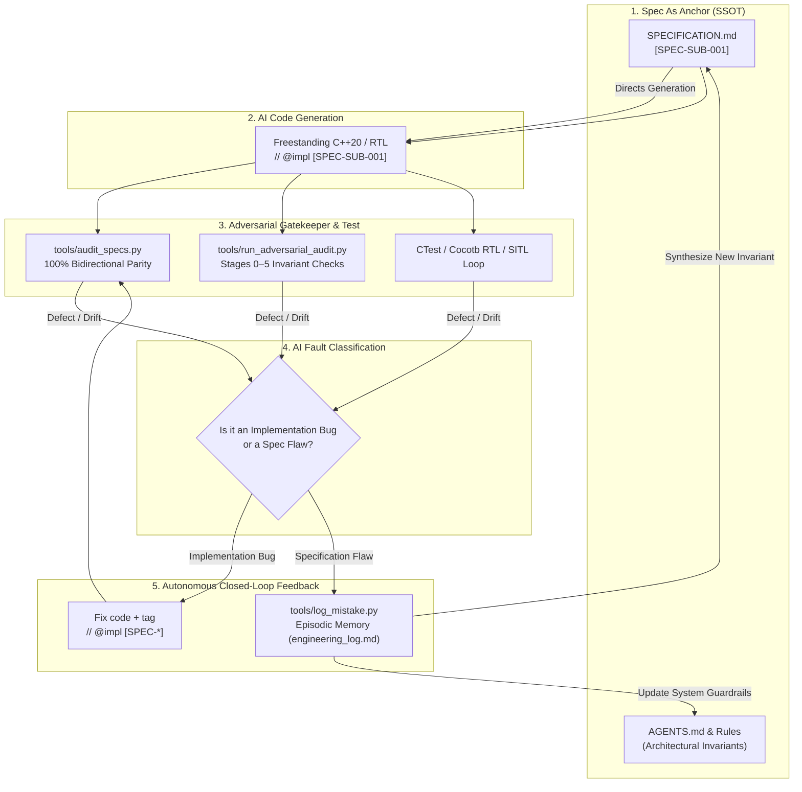
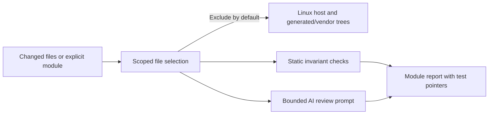
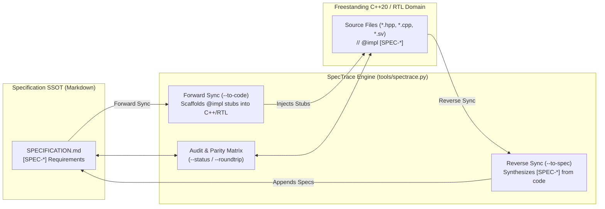

# SpecTrace: Autonomous Closed-Loop Architecture & Invariant Engineering

**SpecTrace** is the engineering-assurance framework governing development in AbstractX. It is inspired by high-assurance aerospace traceability practices, including DO-178C and NASA NPR 7150.2, and combines them with AI-assisted review and executable verification.

### `[SPEC-AUDIT-04]` Assurance Target and Certification Boundary
* AbstractX's target is an internal, evidence-backed engineering assurance
    profile: requirements are explicit and traceable, changes receive scoped
    review, and module verification results are reproducible.
* References to DO-178C Level A or NASA NPR 7150.2 describe the rigor that
    informs this process; they MUST NOT be represented as proof of compliance,
    approval, or certification. A successful SpecTrace audit is a project quality
    gate, not certification evidence by itself.
* AbstractX currently applies its own freestanding C++20 rules and may map
    selected MISRA C++ or CERT C++ guidance into future checks. ETL is an embedded
    C++ library used by the project, not a coding standard, and its use MUST NOT be
    presented as MISRA/CERT conformance. Any conformance claim requires naming the
    exact standard edition and adopted rules, using a suitable analyzer, and
    maintaining a documented deviation/waiver process.
* Any future certification objective MUST be established by the responsible
    system safety/certification authority and separately address applicable
    planning, independence, coverage, configuration management, tool qualification,
    and objective evidence requirements.
* **Verified by**: `host-tests` (`tests/test_adversarial_invariants.py`)

---

## 1. The Core Problem: Why Traditional Rigor (NASA/DO-178C) Stalls

Traditional safety-critical engineering frameworks like **DO-178C**, **NASA Class A Flight Software**, and **ISO 26262 ASIL-D** mandate end-to-end traceability: every line of source code must trace to a low-level requirement, which traces to a high-level architecture requirement.

However, in practice, human-driven traceability suffers from a critical failure mode:
1. **The Static Spec Trap**: Specifications are authored in massive Word docs, IBM DOORS, or Polarion matrices. They are disconnected from the compiler.
2. **The Friction of Change (CCB Bottleneck)**: When developers uncover a silicon erratum, an interrupt race condition, or an architectural flaw during hardware testing, filing a change through a human Configuration Control Board (CCB) takes weeks.
3. **Specification Drift**: Under delivery pressure, engineers patch the code directly. The specification rots, becoming historical fiction rather than the Single Source of Truth (SSOT).

### Conversely: Why Naive AI Coding ("Vibe Coding") Fails

On the opposite extreme, naive AI code generation:
1. Fixates on local fixes in chat without global architectural memory.
2. Hallucinates dynamic heap allocations (`new`, `malloc`, `std::vector`) or blocking calls in freestanding hardirq contexts.
3. Repeats the exact same subtle architectural mistakes across sessions because context windows are ephemeral.

---

## 2. What SpecTrace Does: The Autonomous Closed Loop

**SpecTrace solves what NASA and DO-178C were missing:**
> It uses AI agents not just to write code, but to **audit requirements**, **classify defects**, **detect architectural flaws in the specification itself**, and **autonomously close the feedback loop** by updating the specifications and agent rules before committing code.



---

## 3. The 4 Operational Stages of SpecTrace

### Stage 1: Specification-First Anchoring (`[SPEC-*]`)
No C++ or RTL is written without a preceding Markdown specification.
* Every architectural constraint, register mapping, bus transaction, and coroutine lifecycle is defined in `SPECIFICATION.md` with a unique requirement tag (`[SPEC-<SUBSYSTEM>-<ID>]`).
* Invariants are phrased as formal system contracts (e.g., *"Drivers MUST NOT allocate heap; transactions return `coro::Task<bool>`"*).

### Stage 2: Grand Traceability (`// @impl [SPEC-*]`)
Every single implementation function, hardware abstraction, and state machine carries a comment tag linking it directly to the specification requirement:
```cpp
// @impl [SPEC-ROUTER-001] targets/allwinner_e906/src/rpmsg.cpp
coro::Task<bool> AspRouter::dispatch_tlp_async(const Tlp64& packet) {
    // Zero-heap, asynchronous dispatch into lock-free SPSC ring
    ...
}
```
Validation is completely automated:
```bash
python3 tools/audit_specs.py
```
* Fails if any spec tag exists without implementing code.
* Fails if any code tag references a non-existent spec requirement.

### Stage 2b: Requirements, Skills and Evidence

SpecTrace keeps two kinds of documents apart:

| Kind | Answers | Where | Example |
| :--- | :--- | :--- | :--- |
| **Requirement** | *What* must be true and *why* | `*SPECIFICATION.md`, one `### [SPEC-*]` section each | `[SPEC-E906-MEM-01]` the E906 loads only into the SRAM windows remoteproc accepts |
| **Skill** | *How* something is checked, measured or recorded | `.agents/skills/<name>/SKILL.md` (tool-neutral: Claude Code, Antigravity / Gemini, humans; see `[SPEC-AUDIT-11]`) | `e906-build-layout`, `sanitizer-gate`, `memory-footprint`, `quality-trends` |
| **Evidence** | *That* it was checked, and the result | test output, `tools/visualizer/*.json`, `docs/verification/evidence/` | ctest summary, nextpnr utilisation, board log |

How a requirement is verified is itself a skill. Each requirement names its
skills; each skill says what it verifies, the command, the pass criteria and
where its evidence goes. SpecTrace connects them: requirement → code
(`@impl`) → skills (`Verified by`) → evidence.

### `[SPEC-AUDIT-06]` Every Requirement Names How It Is Verified
* **Requirement**: each `[SPEC-*]` section has a line
  `* **Verified by**: `skill-a`, `skill-b`` naming skills that exist in
  `.agents/skills/`. A requirement with code but no verifying skill is
  *implemented, not verified*.
* **Requirement**: each `[SPEC-*]` section may declare a formal verification method
  `* **Method**: `Test` | `Analysis` | `Inspection` | `Demonstration`` adhering
  to aerospace/automotive standards (DO-178C / ISO 26262). Defaults to `Test`
  if omitted.
* **Requirement**: each `[SPEC-*]` section may declare parent derivation via
  `* **Refines**: `[SPEC-PARENT-TAG]`` (or `* **Parent**:`), creating an explicit
  hierarchical derivation tree from system invariants down to subsystem contracts.
* **Requirement**: a skill file states what it verifies, how to run it, the pass
  criteria and where its evidence is stored. Adding a new kind of check means
  adding a skill, not a one-off command in a commit message.
* **Verified by**: `host-tests` (`tests/test_spectrace_matrix.py`)
* **Implementation Target**: `.agents/skills/`, `tools/spectrace_matrix.py`

### `[SPEC-AUDIT-07]` Traceability Matrix and the Meaning of 100%
* **Requirement**: `python3 tools/spectrace_matrix.py --matrix` gives every
  requirement one verdict:
  `VERIFIED` (code tagged, no `@status Partial`, at least one existing skill),
  `IMPLEMENTED` (code but no verifying skill), `PARTIAL` (an `@impl` tag marked
  `@status Partial`), `SPEC-ONLY` (no code yet), `BROKEN` (names a skill that does
  not exist).
* **Requirement**: "100%" means every requirement is `VERIFIED`. Tag presence alone
  (`audit_specs.py`) is never reported as completion.
  `--require-complete` exits non-zero until then; `--write
  docs/verification/TRACEABILITY_MATRIX.md` publishes the table.
* **Requirement**: `python3 tools/spectrace_matrix.py --graph [SPEC-TAG]` (or
  `python3 tools/spectrace.py --graph [SPEC-TAG]`) generates an interactive
  Mermaid traceability DAG connecting parent requirements (`Refines`), child
  requirements, `@impl` source code locations, `@verifies` test harnesses, and
  evidence ledger verdicts.
* **Verified by**: `host-tests` (`tests/test_spectrace_matrix.py`)
* **Implementation Target**: `tools/spectrace_matrix.py`

### `[SPEC-AUDIT-08]` Change Review Retrieves the Governing Requirements
* **Requirement**: `--changes [--base REF]` maps every changed code hunk to the
  requirement that governs it: the nearest `@impl` tag at or above the hunk, up
  to the next tag. Hunks with no governing tag are reported **UNTRACED**: new
  behaviour needs a requirement before it is accepted.
* **Requirement**: Governed source files include C/C++ (`.hpp`, `.cpp`, `.h`, `.c`),
  Assembly (`.S`), SystemVerilog (`.sv`), Python (`.py`), Linker Scripts (`.ld`),
  Device Tree sources and overlays (`.dts`, `.dtsi`, `.dtso`), and System /
  Schema YAML configurations (`.yaml`, `.yml`). Hardware peripheral contracts,
  memory node allocations, and pinmux configurations declared in device trees and
  system configs MUST carry `@impl [SPEC-*]` anchors and are subject to pre-commit
  change review gating.
* **Requirement**: tests carry `@verifies [SPEC-*]` instead of `@impl`: a changed
  test maps to the requirements it verifies, but a test never counts as an
  implementation in the matrix.
* **Requirement**: a changed requirement section is reported with the code that
  implements it and the skills to re-run.
* **Requirement**: `--prompt` retrieves the full text of every touched
  requirement and bundles it with the diff, so a reviewer (human or AI) checks
  the change against the requirement rather than against memory; this is the
  retrieval step of SpecTrace. `--strict` fails on untraced hunks for CI.
* **Requirement**: `--staged` reviews only the staged changes. The opt-in
  pre-commit hook `tools/git-hooks/pre-commit` runs `--changes --staged --strict`
  and refuses a commit containing untraced code (enable once per clone with
  `git config core.hooksPath tools/git-hooks`).
* **Verified by**: `host-tests` (`tests/test_spectrace_matrix.py`)
* **Implementation Target**: `tools/spectrace_matrix.py`

### `[SPEC-AUDIT-09]` Trac Tools and the Evidence Ledger
* **Requirement**: `python3 tools/trac.py <family>` runs the checks of one family
  (`test`, `size`, `perf`) and, with `--record`, appends one evidence record per
  check to `docs/verification/evidence/<YYYY-MM>/<host>.jsonl` (append-only,
  one file per month and machine so several PCs never conflict on merge).
* **Record**: `time`, `commit`, `dirty`, `host`, `family`, `check`,
  `requirements`, `result` (`pass` / `fail` / `skip`), `metrics`, `delta` (change
  of each metric since the previous record of the same check), `duration_s`,
  `tool`. Same fields as cubie-a5e's `test_sweep_history.json` run records, plus
  requirement links.
* **sizeTrac**: ELF sections per target against `tools/membrowse-targets.json`
  budgets (fail when over budget or when growth exceeds
  `max_allowed_growth_bytes`); FPGA utilisation from the nextpnr log.
* **perfTrac**: routed Fmax per clock from the nextpnr log (fail below the
  constrained frequency).
* **Exit codes**: 0 pass, 1 any check failed, 2 nothing could run.
* **Verified by**: `host-tests` (`tests/test_trac.py`)
* **Implementation Target**: `tools/trac.py`, `tools/trac_lib/`

### `[SPEC-AUDIT-10]` ReqIF Requirements Interchange Format Export
* **Requirement**: `python3 tools/spectrace.py --export-reqif <output.reqif>` (or
  `python3 tools/spectrace_matrix.py --export-reqif <output.reqif>`) exports
  repository specifications, requirement derivation hierarchies (`Refines:` parent links),
  verification methods (`Method:`), and implementation file anchors into an OMG ReqIF
  (XML) standard document.
* **Requirement**: Output conforms to OMG ReqIF 1.0/1.2 standard XML schema with
  `SPEC-OBJECTS`, `SPEC-OBJECT-TYPES`, `SPEC-RELATIONS` (refines hierarchy), and
  `SPECIFICATIONS` hierarchy nodes, enabling bidirectional interchange with
  automotive and aerospace ALM tooling (DOORS, Polarion, Capra, StrictDoc).
* **Verified by**: `host-tests` (`tests/test_spectrace_matrix.py`)
* **Implementation Target**: `tools/spectrace_matrix.py`, `tools/spectrace.py`

### `[SPEC-AUDIT-11]` One Skill Set for Every Agent Tool
* **Requirement**: each skill lives once, at `.agents/skills/<name>/SKILL.md`, in the
  open Agent Skills format: YAML front matter with `name` (equal to the folder name)
  and `description` (what it does and when to use it; agents pick skills by this
  line). Check skills also keep `verifies:`. Optional helper files (`run`, scripts)
  sit in the same folder.
* **Requirement**: every supported agent tool reads that one copy, never a fork of it:
  Antigravity / Gemini read `.agents/skills/` directly; Claude Code reads
  `.claude/skills`, a symlink to `../.agents/skills`; Copilot is pointed there by
  `.github/copilot-instructions.md`. The workflow rules in `.agents/rules/` reach
  Claude Code through `@` imports in `CLAUDE.md`.
* **Requirement**: `python3 tools/spectrace_matrix.py --check-skills` exits 1 when a
  skill is a loose `.md` file, lacks `name`/`description`, has a `name` that differs
  from its folder, when `.claude/skills` does not resolve to `.agents/skills`, or when
  a rule file in `.agents/rules/` is not imported by `CLAUDE.md`.
* **Rationale**: on 2026-10-20 the skills were flat `.agents/skills/<name>.md` files
  with no `description`. Claude Code only discovers `<name>/SKILL.md` under
  `.claude/skills/`, so Claude agents never saw the skills the requirements name
  in `Verified by`, and never saw the `.agents/rules/` detail either.
* **Verified by**: `host-tests` (`tests/test_spectrace_matrix.py`)
* **Implementation Target**: `tools/spectrace_matrix.py`, `.agents/skills/`, `.claude/skills`, `CLAUDE.md`

### `[SPEC-AUDIT-12]` Honest Completion: Tag Presence, Spec Drift and Orphan Tests
* **Requirement**: `tools/audit_specs.py` reports tag coverage as *traceability only*. It never
  prints "verified" or "100% implemented"; completion is the `--matrix` verdict.
* **Requirement**: `python3 tools/spectrace_matrix.py --check-drift` exits 1 when an implemented
  requirement names a function (`` `name(` `` in its text) that occurs in no code file of the
  repository (tests excluded; a binding prefix such as `MP_QSTR_name` or `abstractx_name`
  counts). Lines that forbid a call (MUST NOT, never, no, instead of) and language operators
  (`sizeof`, `alignas`) are not promises and are skipped. Names listed on the requirement's
  `* **Not implemented yet**:` line are exempt, and such a requirement's verdict is `PARTIAL`,
  never `VERIFIED`. The adversarial audit's Stage 0 treats it as open, not as a missing
  `@impl` tag; a requirement without that line and without an `@impl` tag still fails.
* **Requirement**: a requirement that names skills but has no evidence that counts is `STALE`,
  never `VERIFIED` (`SPEC-E906-CACHE-02` showed `VERIFIED` with no `e906-disassembly-check` run).
* **Requirement**: `python3 tools/spectrace_matrix.py --check-tests` exits 1 when a test file is
  not run by ctest: `tests/**/test_*.py` and `tests/test_*.cpp` must appear in
  `tests/CMakeLists.txt`, `sim/cocotb/test_*_cocotb.py` in `sim/CMakeLists.txt`, unless the
  CMakeLists has a line `# not-in-ctest: <path> <reason>`.
* **Rationale**: on 2026-10-20 `audit_specs.py` printed "100% verified" while 38 of 159
  requirements were verified; the spec promised `tlp_poll_into`, `tlp_send_nav`,
  `serial_tlp_*` that never existed; and six test files never ran, one of them already failing.
* **Verified by**: `host-tests` (`tests/test_spectrace_matrix.py`)
* **Implementation Target**: `tools/spectrace_matrix.py`, `tools/audit_specs.py`

### `[SPEC-AUDIT-13]` Checks Run Where the Failure Can Happen
* **Requirement**: every skill declares `runs_on:` in its front matter: `host` (PC, no
  hardware), `rtl-sim` (simulator), `board` (on or against real hardware) or `fpga-build`
  (synthesis / place and route). `--check-skills` fails when it is missing or unknown.
* **Requirement**: a requirement whose implementation files include target firmware or RTL
  (`targets/<mcu>/`, `apps/e906_repl_app/src/`, `rtl/`, `hw/`) and whose skills all run on
  `host` is reported by `--check-placement` as *host-only check of target code*; the
  change review prints the same warning for every touched requirement.
* **Requirement**: a host test never touches hardware unless asked: tests that reach a board
  run only when `ABSTRACTX_BOARD_IP` is set, and skip otherwise.
* **Requirement**: evidence records carry `source` (`host`, `sim`, `board`); a `board` skill's
  evidence without `source: board` does not count.
* **Rationale**: 84 requirements named `host-tests`, including E906 silicon behaviour; a board
  checkout passed on PC-made TLPs; and `tests/test_board_checkout.py` SSHed to a board that
  another session was flashing because it happened to be reachable.
* **Verified by**: `host-tests` (`tests/test_spectrace_matrix.py`)
* **Implementation Target**: `tools/spectrace_matrix.py`, `.agents/skills/`, `tests/test_board_checkout.py`, `tests/CMakeLists.txt`

### `[SPEC-AUDIT-14]` Deterministic Interrupt and Polling Checks
* **Requirement**: `tools/run_adversarial_audit.py` checks AGENTS §3/§4 (ISR/DMA, no polling) by
  rule, not only in the AI-review prompt. On MCU code (`include/`, `apps/`, and
  `targets/{allwinner_e906,pico2w_rp2350,esp32p4}`; `.c`, `.cpp`, `.h`, `.hpp`):
  * `MMIO-SPIN` (Stage 2): a `while` loop whose condition reads a hardware register
    (`HW_*`, `*_REG`, `*_LSR`, `*_STA`, `*_STAT`, `*_CNTR`, `*_SR`, `*_ISR`, `*_STATUS`) and whose
    body consumes nothing: it is empty, or holds only barriers, timeout counters or VM hooks.
    A loop that drains a FIFO (reads a register into data, or pops) is not a spin.
  * `DRIVER-POLL` (Stage 2): a call `obj.poll()` in MCU code; drivers wake coroutines via
    ISR → SPSC ring → doorbell, and the event loop only drains the dispatcher. A call that runs
    only after an interrupt flag was taken is marked `irq-gated` on its line or the line above.
  * `E906-PLIC` (Stage 3): a PLIC identifier in E906 code (`targets/allwinner_e906/`,
    `apps/e906_repl_app/src/`), outside comments. The E906 has a T-Head CLIC at `0xE0800000`.
  * `E906-NO-CLIC-ENABLE` (Stage 3): E906 code defines interrupt handlers but never enables a
    CLIC line (`clic::enable`, `irq::attach`); `mie` is ignored in CLIC mode ([SPEC-E906-IRQ-01]).
    The rule is about the whole target, so before reporting it searches every E906 source on disk
    for an enable, not only the files under review (2026-10-22: a diff touching only
    `platform.cpp` was reported although `timer.cpp` and `rpmsg.cpp` enable their lines).
* **Requirement**: a loop marked `pre-scheduler` on its line or the two lines above is
  tolerated (AGENTS §4 bring-up).
* **Requirement**: known violations that cannot be fixed in the same change are listed in
  `tools/audit_baseline.txt` as `<file> <rule> <snippet>  # <engineering_log entry>`. A listed
  violation is reported as *known*, not hidden; any unlisted violation fails; a listed entry
  that no longer matches also fails, so the list only shrinks.
* **Rationale**: on 2026-10-21 the E906 REPL was found polling UART3, TWI1 and RPMsg and its
  dispatcher targeting a PLIC the core does not have. Stage 2 only matched `usleep(`/`sleep(N)`,
  and the test's source list skipped `.c` files, so `modabstractx.c` was never audited.
* **Verified by**: `host-tests` (`tests/test_adversarial_invariants.py`)
* **Implementation Target**: `tools/run_adversarial_audit.py`, `tools/audit_baseline.txt`

### Stage 3: Adversarial Invariant Auditing
An independent Critic persona evaluates code and specifications across 6 strict stages:
* **Stage 0: Specification SSOT Anti-Drift** (Validates markdown structure, Mermaid diagrams, formal requirement tags).
* **Stage 1: Freestanding C++20 & Hardirq Safety** (Ensures zero heap, no forbidden STL headers, zero ISR resumes).
* **Stage 2: Non-Blocking HAL Coroutines** (Ensures no synchronous delays, yields via `co_await`).
* **Stage 3: Subsystem Contracts** (Primary-Paced Channel pattern, zero modulus prescalers).
* **Stage 4: Hardware Interconnect & 64B TLP Wire Framing** (Static assertion of 64-byte alignment, posted write flushes).
* **Stage 5: Adversarial Gatekeeper** (Deduplication, severity ranking, pass/fail decision).

```bash
python3 tools/run_adversarial_audit.py --all
```

### `[SPEC-AUDIT-15]` Review Layers: Warnings, Static Analysis, Boundaries, Test Claims
* **Requirement**: CI runs every check whose skill is `runs_on: host` or `rtl-sim` and that needs
  no hardware: host tests, ASan/UBSan, **TSan** (`thread-sanitizer`), **RTL lint** (`rtl-lint`),
  `ipc-transport-audit`, `static-analysis` and `boundary-race-review --check`. A step that has never
  been green is marked advisory (`continue-on-error`) with a comment naming the cleanup it waits on.
  The advisory mark is removed once it passes, and it is never added to a step that already passes.
* **Requirement (warnings)**: all first-party C++ (everything after `third_party` in the root
  `CMakeLists.txt`) compiles with `-Wall -Wextra -Wshadow -Wconversion -Wsign-conversion`.
  `ABSTRACTX_WERROR=ON` turns them into errors. It is OFF until the first cleanup is recorded in
  `engineering_log.md`, then ON in CI. The ARM and RISC-V toolchain files carry `-Wall -Wextra`.
* **Requirement (static analysis)**: `tools/run_static_analysis.py` runs `clang-tidy` (checks in
  `.clang-tidy`: `bugprone-*`, `concurrency-*`, `clang-analyzer-*`,
  `cppcoreguidelines-pro-type-member-init`) on the host compile database, limited to first-party
  files. With `--fanalyzer` it also builds the E906 target with GCC `-fanalyzer`. Known findings
  are listed in `tools/static_analysis_baseline.txt`, and the list only shrinks (same rule as
  `[SPEC-AUDIT-14]`).
* **Requirement (test claims)**: `python3 tools/spectrace_matrix.py --check-verifies` exits 1 when a
  file tagged `@verifies [SPEC-X]` names none of the functions or globals that carry an
  `@impl [SPEC-X]` tag. A tag inside a function body counts as that function; a tag at file level
  counts as the names defined on the next lines. Requirements whose `@impl` sites define no names
  are skipped.
* **Requirement (boundaries)**: `tools/boundary_review.py` lists the state shared across execution
  contexts in MCU and transport code: globals written in `*_isr` functions, `volatile` globals, and
  names handed to `IsrDispatcher::post` or `Dispatcher::post`. For each item it requires an
  ownership note on the declaration: `// shared: <owner>, <sync>` (for example
  `// shared: msgbox ISR writes, main reads; std::atomic`). `--check` fails for any listed item
  without one. The agent fills in the note after answering the `boundary-race-review` checklist.
* **Requirement (live assertions, 2026-10-28)**: test code (`sim/`, `tests/`, `examples/`) is built
  with `-UNDEBUG`, so `assert()` checks in Release as well; `sim/test_asserts_live.cpp` fails to compile
  when `NDEBUG` reaches the sim directory and fails at run time when `assert(false)` returns. A test
  that cannot fail is not evidence. Rationale: eleven sim tests (~276 asserts) had their checks
  compiled out in the default host build and still showed as passed.
* **Requirement (wake handshakes, 2026-10-28)**: the inventory above only sees file-scope names, so
  `boundary_review.py` also scans waiter slots, including class members (`std::atomic<void*>` or
  `std::atomic<std::coroutine_handle<>>` named `*waiter*`, `*coroutine*`, `*handle*`). A
  release/relaxed store of a waiter followed by a data check, or of data followed by a waiter
  load / exchange / `wake*()` call, with no `std::atomic_thread_fence(std::memory_order_seq_cst)` in
  between, is reported as `HANDSHAKE` and fails `--check`, unless the line or the one above carries
  `// handshake: <why no fence is needed>`. Rationale: `UartRxRing` and `TriggerRing` lost wakes
  (~1% of `sim_test_uart_rx_ring` runs hung); TSan, the shared-variable inventory and every single
  test run passed.
* **Rationale**: 2026-10-26: the RPMsg review found races (non-atomic ISR handle), memory bugs
  (host address passthrough, double reads) and a test that claimed a requirement it never ran. All
  of it was in code that every gate passed. TSan and RTL lint existed as skills but did not run in
  CI, and no compiler warnings were enabled on host or ARM builds.
* **Verified by**: `host-tests` (`tests/test_spectrace_matrix.py`), `static-analysis`, `boundary-race-review`, `ipc-transport-audit`
* **Implementation Target**: `.github/workflows/spectrace_dashboard.yml`, `CMakeLists.txt`, `cmake/toolchains/arm-none-eabi.cmake`, `.clang-tidy`, `tools/run_static_analysis.py`, `tools/boundary_review.py`, `tools/spectrace_matrix.py`

### `[SPEC-AUDIT-01]` Module-Scoped Audit Inputs
* The default audit scope MUST be the current staged, unstaged, and untracked
    changes; it MUST NOT recursively audit unrelated targets or generated output.
* `--path <module>` MUST audit only the explicitly selected module path and its
    Markdown and production source files. `--related-path <path>` MAY be repeated
    to add associated tests or shared-interface contracts stored elsewhere. Linux
    host sources are excluded from default and `--all` scans; selecting
    `targets/linux` explicitly is the opt-in to audit that target.
* `--base-ref <ref>` MUST add the committed merge-base diff against `<ref>` to
    the working-tree changes. `--all` MUST remain an explicit sweep of maintained
    project modules and MUST prune build, vendor, and generated-output directories.
* Requirement-tag indexing MUST use maintained production source roots and MUST
    not load generated Buildroot/kernel/toolchain trees.
* **Verified by**: `host-tests` (`tests/test_adversarial_invariants.py`)

### `[SPEC-AUDIT-02]` Bounded AI Review Context
* The audit CLI MUST be able to emit an AI-review prompt containing the selected
    module scope, relevant spec/source/test paths, and review instructions for
    severity-ranked, evidence-backed findings. It MUST NOT claim that static
    checks prove correctness or replace module tests and human review.
* AI review MUST stay within the selected module unless cross-module interfaces
    are named as dependencies; unrelated Linux host code MUST NOT be pulled into
    the context by default.
* **Verified by**: `host-tests` (`tests/test_adversarial_invariants.py`)

### `[SPEC-AUDIT-03]` Foldable Audit Tool Sections
* The Python audit tool MUST group its CLI, scope selection, and invariant stages
    with named VS Code-recognized folding regions so maintainers can navigate each
    audit stage independently.
* **Verified by**: `host-tests` (`tests/test_adversarial_invariants.py`)

### `[SPEC-AUDIT-05]` Canonical Cross-Agent Review Command
* Copilot, Antigravity, and terminal users MUST share one repository command for
    the module review workflow: `python3 tools/spectrace.py --review`.
* The command MUST accept the module path, repeatable related test/contract paths,
    an optional Git base ref, and explicit full-sweep/Linux opt-ins. It MUST invoke
    the same scoped invariant auditor and preserve its exit status.
* The command MUST emit the bounded AI-review prompt by default; disabling the
    prompt MUST NOT skip static checks. Agent-specific prompts and rules MUST call
    this same command rather than implementing competing audit logic.
* **Verified by**: `host-tests` (`tests/test_adversarial_invariants.py`)



### Stage 4: Autonomous Closed-Loop Learning Gate
When a test fails, a bug is discovered, or an adversarial audit fails, SpecTrace categorizes the issue:

1. **Category A: Implementation Deviation**
   * *Diagnosis*: The specification was correct, but the AI or developer wrote code violating the spec.
   * *Resolution*: Correct the C++ code, ensure `// @impl` matches, and re-run audits.

2. **Category B: Specification Defect / Missing Invariant**
   * *Diagnosis*: The code obeyed the spec, but the spec failed to anticipate a hardware reality (e.g., DMA FIFO overrun on high-rate bursts, cache coherency between RISC-V and ARM, interrupt race).
   * *Resolution*:
     1. **Log in Episodic Memory**:
        ```bash
        python3 tools/log_mistake.py \
          --title "DMA FIFO overrun on 8kHz IMU burst" \
          --target "asp_router" \
          --spec "docs/DESIGN_SPECIFICATION.md" \
          --tag "SPEC-ROUTER-DMA-002" \
          --append
        ```
     2. **Update the Spec FIRST (`SPECIFICATION.md`)**: Add the missing hardware invariant or dataflow constraint.
     3. **Update Agent Rules (`AGENTS.md` / `.agents/rules/`)**: If the defect represents a class of architectural traps that future AI agents might repeat, add an explicit invariant rule.
     4. **Implement Code**: Implement the solution adhering to the updated spec.
     5. **Verify Zero Drift**: Run `audit_specs.py` and `run_adversarial_audit.py`.

### Stage 5: Full Round-Tripping (Bidirectional Spec <-> Code Synchronization)

What happens when engineers design in Markdown first, or write C++/RTL code first?

In traditional systems engineering, bidirectional synchronization is nonexistent: either code drifts from stale specs, or specs block developers from writing code. SpecTrace solves this with **Full Round-Tripping** orchestrated by `tools/spectrace.py`:



#### 1. Inspect Synchronization Status
Displays the real-time bidirectional matrix comparing requirements in `SPECIFICATION.md` against active code implementations:
```bash
python3 tools/spectrace.py --status
python3 tools/spectrace.py --spec apps/gps_imu_app/SPECIFICATION.md --status
```

#### 2. Forward Synchronization (Spec -> Code)
When new requirements are authored in Markdown, SpecTrace discovers their `* **Implementation Target**:` and automatically injects matching `// @impl [SPEC-*]` tags and function stubs into the target files:
```bash
# Preview code injections:
python3 tools/spectrace.py --to-code --dry-run

# Commit code injections:
python3 tools/spectrace.py --to-code --apply
```

#### 3. Reverse Synchronization (Code -> Spec)
When a programmer writes new C++ methods, device drivers, or register maps first, SpecTrace extracts their contracts, docstrings, and signatures, pushing formal requirement blocks back into `SPECIFICATION.md`:
```bash
# Preview spec additions:
python3 tools/spectrace.py --to-spec --dry-run

# Commit spec additions:
python3 tools/spectrace.py --to-spec --apply
```

#### 4. Full Two-Way Round-Trip Reconciliation
Reconciles both directions atomically in a single pass, ensuring 100% bidirectional parity across specifications and code:
```bash
python3 tools/spectrace.py --roundtrip --apply
```

---

## 4. Why AI Semantic Review Beats Traditional Static Analysis

Traditional code quality tools (Clang-Tidy, Cppcheck, SonarQube, Coverity) analyze **AST syntax and language grammar**. While necessary for catching null pointer dereferences or unused variables, static analysis is **architecturally blind**:

| Capability | Traditional Static Analysis (Linters) | Human Code Review | **SpecTrace AI Adversarial Review** |
| :--- | :--- | :--- | :--- |
| **Architectural Intent** | ❌ Blind to specifications and design patterns | ⚠️ Inconsistent; misses subtle edge cases | ✅ Compares code directly against `SPECIFICATION.md` |
| **Concurrency Invariants** | ❌ Checks syntax; cannot evaluate cooperative coroutine pacing | ⚠️ Hard to trace without dynamic execution | ✅ Audits primary-paced channels, zero spinloops, yield symmetry |
| **Cross-Layer Parity** | ❌ Operates inside a single translation unit | ⚠️ Difficult across heterogeneous CPU/FPGA code | ✅ Validates 64B TLP framing, CTF schemas, and bus flushes |
| **Bidirectional Sync** | ❌ Emits error messages only | ❌ Manual editing required | ✅ Autonomously pushes code back to spec (`--to-spec`) |
| **Episodic Learning** | ❌ Amnesic; flags the same error without learning | ⚠️ Knowledge trapped in reviewers' heads | ✅ Chronicles root causes into `engineering_log.md` |

---

## 5. Architectural Comparison Matrix

| Dimension | NASA / DO-178C Traditional | Traditional Static Analysis | Standard AI ("Vibe Coding") | **SpecTrace (AbstractX)** |
| :--- | :--- | :--- | :--- | :--- |
| **Source of Truth** | Word/DOORS documents (slow) | Language AST / Lint config | Ephemeral chat prompts | Markdown Specifications (`SPECIFICATION.md`) |
| **Semantic Review** | Human peer review committees | Regex / Syntax rules only | Agent reviews own code (echo chamber) | **Multi-Stage Adversarial Critic (`spectrace.py --audit`)** |
| **Traceability** | Manual compliance spreadsheets | Zero specification awareness | Zero traceability | **Automated `[SPEC-*]` $\leftrightarrow$ `// @impl` checks** |
| **Velocity** | Weeks/months per revision | Seconds, but shallow syntax | Seconds, but breaks architecture | **Seconds, with deep architectural verification** |
| **Round-Tripping** | ❌ None (Specs rot) | ❌ None | ❌ None | **✅ Full Two-Way Round-Trip (`spectrace.py --roundtrip`)** |
| **Defect Memory** | Static bug tracker (Jira) | None | Forgotten when context clears | **Episodic Learning (`engineering_log.md`)** |

---

## 6. Continuous SpecTrace Embedded Dashboard & Observability

Just as **Static Memory Footprint Tracking** (`tools/track_memory_footprint.py`) continuously monitors `.text`, `.rodata`, `.data`, and `.bss` allocations commit-by-commit to prevent RAM/Flash bloat, AbstractX applies this exact continuous tracking paradigm to **Specification Parity and Invariant Verification**:

```text
==============================================================================
 AbstractX SpecTrace Embedded Dashboard & Verification Matrix
==============================================================================
 Commit:  4a25c32 (main) - fix: finalize E906 and Zynq integration review
 Timestamp: 2026-10-09T15:45:47+00:00
------------------------------------------------------------------------------
 Specification Parity:    25 / 25 specs (100.0%) [● Stable]
 Adversarial Invariants:  8 / 8 passed [PASS] [● Stable]
 Test Suite Runtime:      235.1 ms (+25.8 ms vs prev)
 Dynamic Heap Budget:     0 B (Verified Freestanding)
------------------------------------------------------------------------------
 Trend Verdict:           STABLE - All invariants and specifications preserved (100% parity).
==============================================================================
```

### Answering: *"Are We Getting Better Over Time?"*
Executed via `python3 tools/track_quality_trends.py`, the embedded dashboard engine:
1. **Aggregates Specification Metrics**: Measures total requirements, implemented count, and drift count commit-over-commit.
2. **Measures Invariant Regressions & Execution Speed**: Runs the adversarial invariant test suite, recording test counts and suite runtime in milliseconds.
3. **Ingests Embedded Static Memory Metrics**: Ensures zero dynamic heap violations ($0\text{ B}$ heap) and SRAM/Flash boundaries across target ELF binaries.
4. **Maintains Historical Time Series**: Emits `tools/visualizer/quality_trends.json` for rendering in AbstractX Studio.
5. **Evaluates Trend Direction**: Automatically flags whether changes `IMPROVED`, remained `STABLE`, or `REGRESSED`.
6. **Maintains Living Git Profile**: Updates `docs/verification/RUNNING_PROFILE.md` with ASCII gauges and Mermaid charts.

---

## 7. Tooling Reference

* `tools/spectrace.py`: Master CLI for full round-trip synchronization, status reporting, and adversarial audits.
* `tools/track_quality_trends.py`: SpecTrace Continuous Quality & Embedded Observability Dashboard.
* `tools/track_memory_footprint.py`: Static RAM/Flash section footprint & zero-heap symbol auditor.
* `tools/sync_code_to_spec.py`: Reverse-sync engine pushing new C++/RTL functions and contracts back into specifications.
* `tools/audit_specs.py`: Bidirectional grand traceability checker.
* `tools/run_adversarial_audit.py`: 6-stage adversarial invariant analyzer.
* `tools/log_mistake.py`: Automated generator and logger for `engineering_log.md`.
* `tools/create_app_spec.py`: Scaffold new applications with compliant `SPECIFICATION.md`.

---

## 8. Architectural Positioning: HW/SW Co-Design & EDA Toolchains

Recent EDA initiatives (such as AMD Vivado AI research and Synopsys.ai Copilot) explore *"RAG-based knowledge bases to assist Agentic AI"* in digital hardware design. Commercial EDA tools excel at deep silicon compilation, technology mapping, timing closure, and hardware DRCs.

SpecTrace complements these EDA engines by addressing the critical **hardware/software systems boundary**:

1. **Deterministic Symbolically-Anchored Knowledge Base (SSOT / MBSE)**:
   Replaces fuzzy text chunking with structured, machine-parseable Markdown specifications (`[SPEC-*]`), memory maps, and register schemas that unify firmware and RTL.
2. **Bi-directional Requirement Traceability (RTM)**:
   Complies with DO-178C and DO-254 standards via `// @impl [SPEC-*]` source tags verified continuously across both C++20 software and SystemVerilog RTL by `tools/audit_specs.py`.
3. **Shift-Left Formal Policy Gating (SL-FPG)**:
   Catches interface drift, 0-heap violations, and 64B wire framing defects in < 250 ms before initiating synthesis or simulation runs.
4. **Reflexive Closed-Loop Learning (Actor-Critic-Chronicler)**:
   Enforces that specifications and episodic memory (`engineering_log.md`) are hardened *first* upon any silicon or interface defect.

*(For detailed architectural breakdown and comparison matrix, see [Deterministic HW/SW Co-Design: Structuring Knowledge Bases for Agentic AI in FPGA & Embedded Systems](./articles/AGENTIC_AI_AND_RAG_COMPARISON.md).)*

