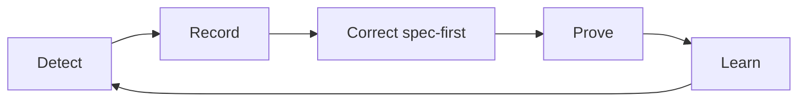

# SpecTrace Guide: Requirements, Skills, Evidence and the Feedback Loop

**Status**: proposal (2026-10-15), for owner review before the renames and new tools
are implemented. The requirements themselves live in [`SPECTRACE.md`](SPECTRACE.md)
(`[SPEC-AUDIT-*]`); this guide explains the model and names every part.

---

AbstractX is three projects: **SpecTrace** (this guide: spec-driven development,
testing, evidence, feedback), the **Framework** (C++20 coroutines, targets, RTL) and
**Studio** (observability GUI). How the tools work day to day is in
[`TOOLING.md`](TOOLING.md).

**Trac families.** Every check and measurement belongs to one family:
**testTrac** (is it correct?), **sizeTrac** (does it fit: memory, FPGA
resources) and **perfTrac** (is it fast and steady enough: Fmax, protocol timing,
latency, jitter). Skill names keep their kind prefix (`check-`, `measure-`, ...);
each skill also states its family.

## 1. What SpecTrace is

SpecTrace keeps an AI-assisted embedded project correct and **getting better over
time**. It has five parts and one loop:

| Part | Answers | Lives in | Name |
| :--- | :--- | :--- | :--- |
| **Requirements** | *What* must be true and *why* | `*SPECIFICATION.md`, one `[SPEC-*]` section each | Requirement store |
| **Skills** | *How* something is checked, measured, reviewed or done | `.agents/skills/<name>/` | Skill registry |
| **Trace links** | *Which* code implements / verifies which requirement | `@impl` / `@verifies` tags, `Verified by:` lines | Trace index |
| **Evidence** | *That* a skill ran, on which commit, with what result | `docs/verification/evidence/ledger.jsonl` | Evidence ledger |
| **Context builder** | *What* a reviewer needs for this change | `spectrace --changes --prompt` | Context builder |

**The feedback loop** connects them: a change or a failure is detected, recorded,
corrected spec-first, proven with a check that would have caught it, and turned
into a rule or skill so it cannot recur (section 6).

### Is this RAG?

Only the context builder is retrieval-augmented generation: for a change it
retrieves the governing requirements, the skills to run, the last evidence and
past lessons, and hands them to a reviewer. RAG alone would only *inform* the
model. What makes SpecTrace work is that every claim is then **checked by a skill
and recorded as evidence**, and failures **change the requirements and skills**.
A closer name for the whole thing is a *spec-grounded, evidence-gated agent loop*:

- retrieval (RAG) → grounds the work in the requirements,
- tools (skills) → do the checking, the same way for every human and AI,
- evaluation (evidence + gates) → decides what counts as done,
- memory (ledger, trends, lessons) → makes the next change better.

**No vector database is needed.** Requirements and code are tagged, so lookup is
exact (by tag, file and line), deterministic and reviewable in git. Semantic
search is only worth adding later for one job: suggesting which requirement should
govern an *untraced* change.

**Why not a traditional ALM tool** (DOORS, Polarion, Jama): they give
requirements traceability but not executable skills, git-native evidence or AI
review context, and they are heavy for a single-owner project. Markdown + git +
JSONL keeps everything diffable, offline and readable by every AI tool.

---

## 2. Requirements (the "what and why")

- One `### [SPEC-<AREA>-<NN>] Title` section per requirement, in the
  `SPECIFICATION.md` nearest the code it governs; top-level rules in
  `docs/DESIGN_SPECIFICATION.md`.
- Each section has: **Requirement** (must-statements), **Why** (the reason, often a
  past bug), **Verified by** (skill names), **Implementation Target** (files).
- Architecture rules state *what*; target specs state *how this board meets it*
  (e.g. `[SPEC-ARCH-08]` no copies → `[SPEC-E906-IPC-04]` RPMsg buffers in SRAM).
- Hardware facts come from the driver, silicon-tested code or vendor sources, and
  say so.

---

## 3. Skills (the "how")

A skill is a named, repeatable procedure. Every skill has a **kind**, which is the
first word of its name:

| Kind | Purpose | Result | Example |
| :--- | :--- | :--- | :--- |
| `check-` | Pass/fail gate for one or more requirements | pass / fail | `check-rtl-sim` |
| `measure-` | Records numbers and compares them with history | metrics + better / worse / same | `measure-memory` |
| `review-` | Structured human or AI review with a checklist | findings | `review-change` |
| `record-` | Writes to the ledger or the engineering log | entry | `record-lesson` |
| `howto-` | Step-by-step procedure for a recurring task | done / not done | `howto-add-target` |

### 3.1 Skill format

```
.agents/skills/<name>/
  SKILL.md   what it verifies or does, when to run it, pass criteria, evidence written
  run        executable entry point (python or sh); optional for review-/howto- skills
```

**Runner contract** (every `check-` and `measure-` skill):

```
.agents/skills/<name>/run [--requirement SPEC-X ...] [--json]
  exit 0 = pass, 1 = fail, 2 = could not run (missing tool, no board)
  --json prints one evidence record (section 4) and appends it to the ledger
```

Prose-only commands are not allowed for `check-` and `measure-` skills: a skill
that is copied by hand gets run differently each time (that is how UBSan errors
stayed hidden until 2026-10-14).

### 3.2 Skill catalogue (current skills renamed, plus new ones)

| Name | Was | Kind | Verifies / measures | Runner |
| :--- | :--- | :--- | :--- | :--- |
| `check-host-tests` | host-tests | check | C++ and Python tests (ctest) | to add |
| `check-asan-ubsan` | sanitizer-gate | check | memory safety, UB (fatal) | to add |
| `check-tsan` | thread-sanitizer | check | data races | to add |
| `check-e906-layout` | e906-build-layout | check | `[SPEC-E906-MEM-01]` load windows | `tools/check_e906_layout.py` |
| `check-e906-disasm` | e906-disassembly-check | check | trap entry, `mhcr`, idle wait in the binary | to add (objdump patterns) |
| `check-rtl-lint` | rtl-lint | check | Verilator `-Wall` | to add |
| `check-rtl-synth` | rtl-synth-check | check | Yosys `check` (multi-drivers) | to add |
| `check-rtl-sim` | cocotb-regression | check | all cocotb targets | `tools/run_cocotb.py` |
| `check-fpga-build` | fpga-build | check | bitstream builds | to add |
| `check-traceability` | spec-change-review (part) | check | no untraced change (`--strict`) | `tools/spectrace_matrix.py` |
| `check-board` | board-bringup | check | on-silicon behaviour (manual steps, recorded) | manual + `record-evidence` |
| `measure-fpga-fit` | fpga-fit | measure | LUT, FF, Fmax per board | to add (parse nextpnr) |
| `measure-memory` | memory-footprint | measure | ELF sections per target vs budget | `tools/track_memory_footprint.py` |
| `measure-tests` | (new) | measure | test count, pass count, runtime per suite | to add |
| `measure-coverage` | (new) | measure | matrix: VERIFIED / total | `spectrace_matrix --matrix --json` |
| `measure-trends` | quality-trends | measure | compares every metric with the previous commit | `tools/track_quality_trends.py` (to adapt) |
| `review-change` | spec-change-review | review | change vs. retrieved requirements | `spectrace_matrix --changes --prompt` |
| `review-spec` | (new) | review | requirement quality: testable, has Why, has Verified by | to add |
| `record-evidence` | (new) | record | append a manual result (board test) to the ledger | to add |
| `record-lesson` | (new) | record | engineering-log entry from a failure, spec-first | template exists (`tools/log_mistake.py`) |
| `howto-add-requirement` | (new) | howto | writing a requirement and its `Verified by` | doc |
| `howto-add-skill` | (new) | howto | adding a skill with a runner | doc |
| `howto-add-target` | (new) | howto | new board / CPU target end to end | doc |

---

## 4. Evidence ledger (the database)

One JSON object per line in `docs/verification/evidence/ledger.jsonl`, appended
by skill runners, committed with the change it proves:

```json
{"time": "2026-10-15T04:30:00Z", "commit": "d376d22", "skill": "measure-fpga-fit",
 "requirements": ["SPEC-TN20K-03"], "result": "pass",
 "metrics": {"board": "tang_nano20k", "lut_pct": 22, "dff_pct": 30, "fmax_mhz": 110.2},
 "host": "pc-1", "tool_versions": {"nextpnr": "himbaechel 0.x"}, "notes": ""}
```

- Append-only; never edited (a correction is a new record).
- Large outputs (logs, waveforms) are not stored; the record holds the numbers
  and, if needed, a path under `docs/verification/evidence/`.
- Manual results (board tests) go in through `record-evidence` with the same schema.

---

## 5. Trace index and verdicts

`spectrace_matrix --matrix` joins requirements, tags, skills and the ledger.
Verdicts (strongest first):

| Verdict | Meaning |
| :--- | :--- |
| `VERIFIED` | every `Verified by` skill passed at a commit after the last change to the requirement or its governed code |
| `STALE` | it passed once, but the requirement text or governed code changed since |
| `FAILING` | the latest run of a `Verified by` skill failed |
| `UNVERIFIED` | code exists, no `Verified by` skill (today's `IMPLEMENTED`) |
| `PARTIAL` | an `@impl` tag is marked `@status Partial` |
| `SPEC-ONLY` | no code yet |
| `BROKEN` | names a skill that does not exist |

**Completion** = `VERIFIED / total`. It goes down when governed code changes and
up only when the skills are re-run and pass: it measures proven state, not
paperwork.

---

## 6. The feedback loop



| Step | Triggers / actions | Skills |
| :--- | :--- | :--- |
| **Detect** | a check fails; a metric gets worse (`measure-trends`); a change is untraced; a requirement turns `STALE`; a board finding | `check-*`, `measure-*`, `check-traceability` |
| **Record** | ledger entry; engineering-log lesson (symptom, root cause) | `record-evidence`, `record-lesson` |
| **Correct** | update the requirement first (what/why), then the code | `howto-add-requirement`, `review-spec` |
| **Prove** | the new or strengthened check **fails on the old code and passes on the new** (both runs recorded) | `check-*` |
| **Learn** | if the lesson is general, add or tighten an AGENTS.md rule or a skill so it is enforced automatically | `howto-add-skill` |

"Are we getting better?" is answered by `measure-trends` from the ledger: tests
(count, pass rate, runtime), coverage (VERIFIED %), memory per target, FPGA fit and
Fmax, and on-board latency/jitter once measured. A metric that worsens beyond its
threshold is a *Detect* event like a failing test.

---

## 6b. The loop covers the tools too: log everything, track whether it works

The feedback loop applies to SpecTrace's own tools, tests and skills, not only to
the product code. A check that silently gives the wrong answer is worse than no
check. This week three did:

| Tool | Wrong answer | How it was caught | Fix |
| :--- | :--- | :--- | :--- |
| `audit_specs.py` | "100% verified" while four runtime bugs were present (tag presence only) | manual review, ASan run | matrix verdicts from evidence |
| ASan/UBSan gate | UBSan printed errors, ctest still passed | a new test happened to misalign | `-fno-sanitize-recover=all` |
| `spectrace_matrix.py` | marked a requirement BROKEN from an example sentence | its own output looked wrong | anchored parser + fixture test |

### Rules

1. **Every run is logged.** Every `check-`/`measure-` runner appends a ledger
   record (section 4) with result, numbers, duration and tool version: builds,
   tests, sanitizers, RTL sims, FPGA fits, memory, board runs. "We ran it" without
   a record did not happen.
2. **Tools are requirements too.** Each tool has a `[SPEC-AUDIT-*]` (or its own
   area) requirement, its own tests (`@verifies`), and a `Verified by` line.
   `tests/test_spectrace_matrix.py` is the pattern.
3. **Tool engineering log.** `engineering_log.md` entries carry a category so tool
   problems are tracked as seriously as product bugs:

   | Category | Meaning |
   | :--- | :--- |
   | `product-bug` | the firmware, RTL or host code was wrong |
   | `tool-bug` | a SpecTrace tool, test or skill gave a wrong answer |
   | `false-alarm` | a check failed but the code was right (the check needs fixing) |
   | `process-gap` | nothing checked it at all (a new skill is needed) |
   | `hardware-fact` | a fact learned from silicon, the driver or the vendor |

4. **Every check must prove it can fail.** When a check is added or changed,
   record one run where it fails on the bad code (or a deliberately broken
   copy) and one where it passes. A check that has never failed is unproven.

### Skill scorecard ("are the checks working?")

Generated from the ledger and the engineering log for every skill:

| Column | Meaning |
| :--- | :--- |
| runs / last run | how often it runs and when it last did |
| pass rate | share of passing runs |
| real catches | failures that found a `product-bug` (it earns its keep) |
| false alarms | failures logged as `false-alarm` (it needs fixing) |
| proven | has a recorded fails-before / passes-after pair |
| duration | median runtime (slow checks get skipped by people) |
| gaps | `process-gap` lessons pointing at this area |

A skill with zero catches over a long period, many false alarms, or no
fails-before proof is itself a *Detect* event in the loop.

### Status report ("what are the results, are we getting better?")

`measure-trends --report` (one page, per commit or weekly) from the ledger:

- **Health**: every gate's latest result (host tests, sanitizers, RTL sim, E906
  layout, FPGA fit, board).
- **Results**: key numbers and their change since the last report: test count and
  pass rate, coverage (VERIFIED %), memory per target, FPGA LUT/Fmax per board,
  board latency and jitter once measured.
- **Loop activity**: lessons recorded by category, requirements that turned
  `STALE` or `FAILING`, untraced changes, checks added and proven.
- **Tool health**: the skill scorecard, worst first.

## 6c. Pruning and the local cache

The tree is pruned periodically (`review-prune`: duplicates, superseded docs,
unused tools and skills, dead tags), each removal logged with its reason. Agents
use a git-ignored cache of compact indexes (`.spectrace/cache/`, rebuilt per
`HEAD`) so they read only the requirements, skills and lessons a change touches.
Details: [`TOOLING.md`](TOOLING.md) §4.

## 7. Gates

| Gate | When | Runs | Blocks on |
| :--- | :--- | :--- | :--- |
| pre-commit (opt-in hook) | every commit | `check-traceability --staged` | untraced code |
| pre-push / CI | every push | skills of requirements touched by the change; `measure-*` | any `FAILING`, a worsened metric without a recorded reason |
| release / milestone | tag | full matrix | anything not `VERIFIED` that the milestone claims |

---

## 8. Roles

- **Owner**: decides requirements and their Why, approves new skills and thresholds.
- **AI agents** (Claude, Gemini, …): implement, run skills, write evidence, draft
  lessons; they never mark a requirement done without ledger evidence.
- **Tools**: are the skills' runners; same behaviour for everyone.

---

## 9. Implementation plan

1. **Rename and restructure skills** (`<kind>-<name>/SKILL.md` + `run`), update
   `Verified by` lines and the matrix parser. Small, mechanical.
2. **Evidence ledger**: schema, `record-evidence`, and `--json` output from
   `run_cocotb.py`, `check_e906_layout.py`, `spectrace_matrix.py`.
3. **Verdicts with evidence**: `STALE` and `FAILING` from the ledger + git history.
4. **Runners** for the prose-only skills (`check-host-tests`, `check-asan-ubsan`,
   `check-tsan`, `check-rtl-lint`, `check-rtl-synth`, `check-e906-disasm`,
   `measure-fpga-fit`, `measure-tests`).
5. **Trends**: `measure-trends` reads the ledger, thresholds per metric, worsening
   = Detect event.
6. **Feedback tooling**: `record-lesson` drafts the log entry with its category
   and flags the requirement; "fails-before / passes-after" proof recorded for
   every bug fix and every new or changed check.
6b. **Scorecard and status report** (section 6b) generated from the ledger and
   the categorised engineering log; existing log entries tagged with categories.
7. **CI** (GitHub Actions): pre-push gate and nightly full matrix + trends.
