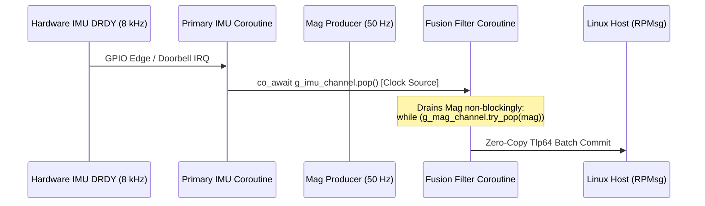

# Jumpstarting Heterogeneous Silicon with AbstractX: From Python `asyncio` to Freestanding C++20

*Rapid Driver Prototyping, Zero-Heap Co-Processors, and Quarantined MicroPython on the Radxa Cubie A5E (Allwinner T527)*

---

## 1. The Heterogeneous Friction: Why Embedded Bring-Up is Painful

When developing firmware for heterogeneous SoCs—such as the **Allwinner T527 / A527 (Radxa Cubie A5E)** pairing an **octa-core ARM64 Cortex-A55** running Linux with an **auxiliary XuanTie E906 RISC-V co-processor**—engineering teams consistently collide with two massive workflow bottlenecks:

```
Traditional Embedded Cycle:
[Edit C Code] -> [Cross-Compile] -> [SCP / Flash] -> [Reset/Crash] -> [Attach JTAG/GDB] -> [Repeat]
```

1. **The Turnaround Latency of Compiled Bare-Metal**:
   Testing register sequences, bus timing quirks (SPI clock polarity, I2C clock stretching, UART baud rounding), or peripheral handshakes in compiled C/C++ requires a complete compile-flash-reboot cycle. A single inverted bit or register offset means another 2–5 minutes lost.
2. **The Paradigm Disconnect Between Host and Coprocessor**:
   The Linux host uses threads, sockets, dynamic memory, and blocking I/O (`poll`, `epoll`). The co-processor runs bare-metal or an RTOS with manual memory pools, preemptive task stacks, and hardware interrupts. Developers are forced to maintain two completely disjoint architectures, making verification and code reuse nearly impossible.

**AbstractX** eliminates both bottlenecks by introducing a **symmetrical coroutine execution model across both silicon domains**:
* **On the Linux Host**: High-level, rapid driver bring-up and verification using **Python `asyncio`**.
* **On the E906 RISC-V Coprocessor**: Hard real-time, deterministic execution using **Freestanding C++20 stackless coroutines (`co_await`)** with **0 bytes of dynamic heap allocation**.
* **Inside the Coprocessor**: An interactive **MicroPython REPL** quarantined in dormant hardware DSP SRAM for live in-silicon hardware probing.

Because Python's `asyncio` and AbstractX's C++20 coroutine engine share the exact same structural semantics (linear async tasks, lock-free queues, non-blocking I/O event loops), **prototyping a driver in Python is a 1-to-1 blueprint for the final freestanding C++20 firmware**.

---

## 2. The AbstractX Architecture at a Glance

The architecture balances hard real-time execution on the XuanTie E906 with full developer observability on Linux and desktop visualizers:

```mermaid
flowchart TD
    subgraph E906 ["XuanTie E906 RISC-V (Bare-Metal Silicon)"]
        CPP_LOOP["abstractx::step() Event Loop<br/>• 0 B Dynamic Heap in SRAM Space 0<br/>• 8 kHz Primary-Paced IMU Ingestion<br/>• C++20 coro::Task&lt;T&gt; Scheduler"]
        
        subgraph DSP_SRAM ["HiFi4 DSP SRAM Aperture (0x00020000)"]
            UPY["MicroPython VM Engine<br/>• Quarantined 128 KB GC Heap<br/>• MICROPY_VM_HOOK_LOOP Interleaving"]
        end
        
        EP1024["RPMSG Ep 1024: abstractx-tlp"]
        EP1025["RPMSG Ep 1025: abstractx-trace"]
        EP1026["RPMSG Ep 1026: abstractx-repl"]
        
        CPP_LOOP <==> DSP_SRAM
        CPP_LOOP --> EP1024 & EP1025 & EP1026
    end

    subgraph Linux ["Cubie A5E Linux (Cortex-A55 ARM64)"]
        KDEV["/dev/rpmsg_ctrl0 & /dev/uio0"]
        
        subgraph PyGateway ["AbstractX Python Gateway (asyncio)"]
            PY_RPMSG["Async RpmsgEndpoint (loop.add_reader)"]
            PY_UIO["Async UioDevice / mmap (0% CPU epoll)"]
            PY_REPL["Async TCP Server :1026 / Local CLI"]
            PY_RELAY["Async UDP Socket Streamer"]
        end
        
        KDEV <==> PY_RPMSG & PY_UIO
        PY_RPMSG & PY_UIO --> PY_RELAY
        PY_RPMSG <==> PY_REPL
    end

    subgraph Studio ["Desktop Workstation (AbstractX Studio)"]
        UI_CANVAS["USER Flight Display (HUD / 3D Attitude)"]
        UI_STUDIO["Studio Workbench<br/>• UDP :9870 CTF Telemetry<br/>• UDP :9871/9872 TLP Bus Inspector<br/>• TCP :1026 MicroPython Floating REPL"]
    end

    EP1024 & EP1025 & EP1026 <==>|VirtIO RPMsg Vrings| KDEV
    PY_RELAY -->|UDP :9870 (CTF 1.8)| UI_STUDIO
    PY_RELAY <==>|UDP :9871/9872 (64B TLP)| UI_STUDIO
    PY_REPL <==>|TCP :1026 (REPL)| UI_STUDIO
```

---

## 3. Stage 1: Jumpstarting Drivers in Python with `asyncio`

Before compiling a single line of C++ for the E906, you can bring up, sequence, and validate the peripheral driver directly on the Linux host using Python `asyncio`.

Because the Linux kernel provides user-space drivers (`uio_pdrv_genirq`, `spidev`, `i2c-dev`, and `rpmsg_char`), Python can map physical memory registers via `mmap` and handle hardware interrupts without writing kernel C code:

```python
# python/abstractx/drivers/icm42688.py
# Stage 1: Rapid peripheral bring-up in Python asyncio
import asyncio
import struct
from abstractx import AsyncQueue

class Icm42688Driver:
    """Event-driven sensor driver prototyped in Python asyncio."""
    REG_WHO_AM_I = 0x75
    REG_PWR_MGMT0 = 0x4E
    REG_ACCEL_DATA_X1 = 0x1F

    def __init__(self, bus, drdy_event: asyncio.Event):
        self.bus = bus
        self.drdy_event = drdy_event

    async def init_async(self) -> bool:
        # 1. Non-blocking WHO_AM_I verification
        who = await self.bus.read_reg_async(self.REG_WHO_AM_I)
        if who != 0x47:
            return False
            
        # 2. Wake gyro and accel (Low-noise mode)
        await self.bus.write_reg_async(self.REG_PWR_MGMT0, 0x0F)
        await asyncio.sleep(0.001)  # 1 ms PLL settle
        return True

    async def run_producer(self, output_channel: AsyncQueue):
        """Asynchronous sensor producer coroutine."""
        while True:
            # Await physical DRDY edge (UIO interrupt, 0% CPU)
            await self.drdy_event.wait()
            self.drdy_event.clear()

            # Burst read 12-byte Accel + Gyro in single non-blocking SPI DMA
            raw_data = await self.bus.read_bytes_async(self.REG_ACCEL_DATA_X1, 12)
            ax, ay, az, gx, gy, gz = struct.unpack(">hhhhhh", raw_data)
            
            # Non-blocking push into primary-paced coroutine channel
            await output_channel.push({
                "accel": (ax, ay, az),
                "gyro":  (gx, gy, gz)
            })
```

### The Power of Python Bring-Up:
* **Interactive REPL Verification**: You can import this driver into an interactive Python shell on the board and run `await dev.init_async()`.
* **Zero Host CPU Burn**: By binding `drdy_event` to the UIO hardware interrupt via `asyncio.get_running_loop().add_reader(uio_fd, ...)`, Linux suspends the task completely in the kernel `epoll` reactor. Idle CPU usage is literally **0.0%**.

---

## 4. Stage 2: In-Silicon Probing with MicroPython on the E906

Once the register map and handshake are proven in Python, how do we run Python *inside* the XuanTie E906 RISC-V co-processor without violating the **freestanding zero-heap rule** required for flight safety?

### The Quarantined DSP SRAM Aperture (`0x00020000`)
On the Allwinner T527 / A527, the E906 execution memory is physically mapped:
* **SRAM Space 0 (`0x3FFC0000`, 256 KB)**: Fast, zero-wait-state flight execution RAM. Firmware resides here. Standard C `malloc()` is **strictly prohibited**.
* **HiFi4 Audio DSP Local RAM (`0x00020000`, 128 KB)**: A dormant SRAM aperture accessible by the system crossbar. If audio DSP firmware is not running, this RAM is completely unused.

AbstractX initializes MicroPython's Garbage Collector (`gc_init`) **exclusively within this dormant DSP RAM window**:

```cpp
// apps/e906_repl_app/src/main.cpp
// @impl [SPEC-E906-REPL-02] apps/e906_repl_app/SPECIFICATION.md
void *dsp_heap_start = reinterpret_cast<void *>(0x00020000);
void *dsp_heap_end   = reinterpret_cast<void *>(0x00020000 + 128 * 1024);

// MicroPython GC allocations live exclusively in DSP SRAM!
// Flight SRAM Space 0 remains 100% zero-heap.
gc_init(dsp_heap_start, dsp_heap_end);
```

### The Non-Blocking REPL Coroutine
The MicroPython REPL executes as a standard C++20 coroutine task awaiting characters from VirtIO RPMsg endpoint 1026 (`"abstractx-repl"`):

```cpp
// apps/e906_repl_app/src/main.cpp
// @impl [SPEC-E906-REPL-03] apps/e906_repl_app/SPECIFICATION.md
static abstractx::coro::Task<void> repl_coroutine(abstractx::RpmsgConsole &console) {
    for (;;) {
        // Suspends until Linux kicks MSGBOX; consumes 0 CPU cycles when idle!
        char ch = co_await console.read_char_async();
        if (ch != 0) {
            int ret = pyexec_event_repl_process_char(ch);
            if (ret & PYEXEC_FORCED_EXIT) { // Soft reset (Ctrl-D)
                mp_deinit();
                char stack_dummy;
                mp_stack_set_top(&stack_dummy);
                mp_stack_set_limit(8192);
                mp_init();
                pyexec_event_repl_init();
            }
            console.flush();
        }
    }
}
```

### Non-Preemptive Interleaving Hook (`MICROPY_VM_HOOK_LOOP`) & NLR Break
To ensure long Python loops or infinite scripts (`while True: pass`) cannot starve the 8 kHz IMU fusion loop, MicroPython is configured with `MICROPY_VM_HOOK_LOOP`. The hook also peeks for `CHAR_CTRL_C` (`0x03`) to schedule a keyboard interrupt, allowing non-local return (`nlr_jump`) unwinding back to the REPL:

```cpp
// apps/e906_repl_app/src/mphalport.cpp
// @impl [SPEC-E906-REPL-04] apps/e906_repl_app/SPECIFICATION.md
void abstractx_repl_vm_hook(void) {
    // 1. Cooperatively pump the coroutine dispatcher during Python execution
    abstractx::Dispatcher::process();

    // 2. Intercept Ctrl-C and schedule immediate NLR exception unwind
    if (abstractx::g_repl_console && mp_interrupt_char != -1) {
        char ch = 0;
        if (abstractx::g_repl_console->try_peek_char(ch) && ch == mp_interrupt_char) {
            abstractx::g_repl_console->try_read_char(ch);
            mp_sched_keyboard_interrupt();
        }
    }
}
```

At the prompt over RPMsg, developers have direct access to native silicon introspection:
```python
>>> import abstractx
>>> hex(abstractx.peek(0x02000000))   # Direct register read
'0x1234abcd'
>>> abstractx.cycles()                # 64-bit hardware mcycle count
184291048
```

---

## 5. Stage 3: Direct 1-to-1 Translation into Freestanding C++20

Because AbstractX's C++20 engine is modeled directly after structured coroutines, migrating your verified Python driver to freestanding, bare-metal C++20 is a direct, line-by-line syntactic translation.

### Side-by-Side Comparison: Python `asyncio` vs. Freestanding C++20

#### Python `asyncio` (Linux Bring-up & Simulation)
```python
# Python asyncio Driver Pattern
class Icm42688Driver:
    async def init_async(self) -> bool:
        who = await self.bus.read_reg_async(0x75)
        if who != 0x47:
            return False
        await self.bus.write_reg_async(0x4E, 0x0F)
        await asyncio.sleep(0.001)
        return True

    async def run_producer(self, output_q: AsyncQueue):
        while True:
            await self.drdy.wait()
            self.drdy.clear()
            raw = await self.bus.read_bytes_async(0x1F, 12)
            await output_q.push(raw)
```

#### Freestanding C++20 (E906 Silicon Flight Firmware)
```cpp
// Freestanding C++20 AbstractX Driver Pattern (0 B Heap!)
class Icm42688Driver {
public:
    coro::Task<bool> init_async() noexcept {
        uint8_t who = co_await m_bus.read_reg_async(0x75);
        if (who != 0x47) {
            co_return false;
        }
        co_await m_bus.write_reg_async(0x4E, 0x0F);
        co_await coro::sleep_for(std::chrono::milliseconds(1));
        co_return true;
    }

    coro::Task<void> run_producer(AsyncQueue<Sample, 16> &output_q) noexcept {
        for (;;) {
            co_await m_drdy.wait();
            Sample raw = co_await m_bus.read_sample_async(0x1F);
            co_await output_q.push(raw);
        }
    }
};
```

### Architectural Parity:
* `await` becomes `co_await`.
* `async def` becomes `coro::Task<T>`.
* `asyncio.sleep()` becomes `co_await coro::sleep_for()`.
* `asyncio.Queue` becomes zero-copy `abstractx::AsyncQueue<T, N>`.
* **Zero dynamic heap allocation (`malloc`/`new`) is used on the C++20 side**. All frames are statically pooled and 64-byte aligned in `.bss`.

---

## 6. The Primary-Paced Channel Pattern (Multi-Rate Sensor Fusion)

In multi-rate avionics and robotics (e.g. 8 kHz IMU, 50 Hz Magnetometer, 10 Hz GPS), legacy firmware typically relies on tick counters and prescalers:
```c
// BANNED: Fragile state machines and clock jitter
if (++counter % 80 == 0) { read_mag(); }
```

AbstractX replaces this with the **Primary-Paced Coroutine Channel Pattern** across both Python and C++20:



1. **Physical Clock Pacing**: The high-rate sensor (IMU DRDY) acts as the physical clock. The fusion loop awaits it:
   ```cpp
   ImuSample imu = co_await g_imu_channel.pop();
   ```
2. **Non-Blocking Auxiliary Ingestion**: Auxiliary lower-rate sensors (Mag, Baro, GPS) stream into dedicated async channels and are drained non-blockingly on each tick:
   ```cpp
   MagSample mag{};
   while (g_mag_channel.try_pop(mag)) {
       fusion.update_mag(mag);
   }
   fusion.update_imu(imu);
   ```
3. **Linear, Deterministic Control Flow**: Control flow is 100% linear, readable, and mathematically free of race conditions.

---

## 7. Connecting to AbstractX Studio: Engineering Workbench vs. Floating Canvas

AbstractX enforces a strict architectural separation between **Observability** and the **User Application**:

1. **USER Flight Canvas (`flight_display.py`)**:
   - Strictly reserved for the application domain (Primary Flight Display, 3D attitude wireframe, GPS map, motor outputs).
   - Zero low-level diagnostics or firmware plumbing bleed.
2. **AbstractX Studio Workbench (`abstractx_studio.py`)**:
   - Unified engineering workbench housing CPU topology gauges, Coroutine Inspectors, and the 64-byte TLP bus packet stream.
   - **`🗖 Pop to Canvas` MicroPython REPL**: The interactive E906 MicroPython REPL docks inside Studio by default, but can be popped out with 1 click into its own independent floating desktop window next to the flight display.

---

## 8. Summary: The Heterogeneous Workflow Matrix

| Phase | Activity | Environment | Tools |
|---|---|---|---|
| **Phase 1** | Register sequencing, protocol validation, bus timing | Linux ARM64 | Python `asyncio`, `/dev/uio0`, `/dev/spidev` |
| **Phase 2** | Live in-silicon register peeking & hardware probing | XuanTie E906 RISC-V | Quarantined MicroPython REPL in DSP SRAM (`0x00020000`) |
| **Phase 3** | Flight implementation (8 kHz fusion, zero heap) | XuanTie E906 RISC-V | Freestanding C++20 (`abstractx::step()`, `coro::Task`) |
| **Phase 4** | Flight telemetry, TLP tracing & live tuning | Desktop / Host | AbstractX Studio (UDP :9870, :9871, TCP :1026) |

By coupling Python's rapid prototyping flexibility with the zero-heap mathematical determinism of freestanding C++20 coroutines, **AbstractX bridges the chasm between Linux agility and bare-metal silicon determinism.**
