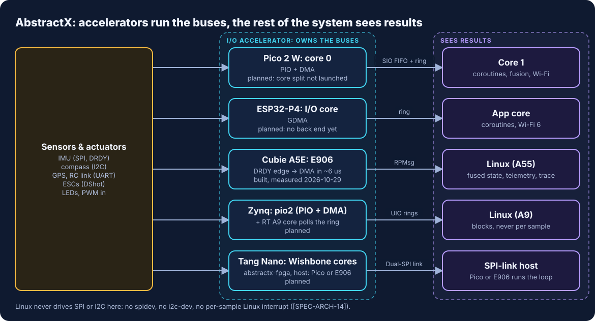

# From a Sensor on a Header to a Production Driver: AbstractX on the Allwinner T527

*Probe it in MicroPython on the I/O core, then write the C++20 coroutine driver that ships. Linux never touches the bus.*

Series index: [`docs/articles/README.md`](./README.md). Status: describes the code at 2026-11-06; numbers are dated and linked where they appear.

---

## 1. The Question, and the Short Answer

**You have a sensor wired to the board. How do you get from "does it answer?" to a production driver, without putting Linux on the sensor bus and without writing the driver twice?**

The board here is the Radxa Cubie A5E. Its Allwinner T527 has two kinds of core:
* eight Cortex-A55 cores running Linux;
* a 200 MHz XuanTie E906 RISC-V core beside them, with 192 KB of fast on-chip SRAM.

AbstractX makes the E906 the I/O core. The short answer has three stages:

1. **Probe**: talk to the sensor from a MicroPython prompt that runs *on the E906* (§3). Edit and retry in seconds, no rebuild, on the real bus.
2. **Write the driver**: a C++20 coroutine driver with the same steps in the same order, no heap, no blocking (§4). It is the production code.
3. **Run and watch it**: the driver runs in the E906 firmware. Linux receives results over shared memory, and AbstractX Studio shows the data and a trace on a desktop (§5, §6).

---

## 2. The Rule Behind It: the I/O Core Runs the Buses, Linux Sees Results

`spidev`, `i2c-dev` and per-sample GPIO interrupts cost Linux a system call and a scheduler wake-up per read. Under load that adds tens to hundreds of microseconds of jitter: a real-time Linux thread's worst-case wake grew from 29 to 122 µs under load on this board (Part 4).

So in AbstractX an I/O core owns every sensor bus ([`[SPEC-ARCH-14]`](../DESIGN_SPECIFICATION.md)). On the E906 it starts each transfer from the sensor's own data-ready edge with DMA, and runs the fast loop. Linux receives fused state, telemetry and trace in blocks, over RPMsg in shared SRAM, with no custom kernel driver.



On the Cubie A5E, the E906 starts the IMU DMA about 6 µs after the data-ready edge, and the consuming coroutine runs about 31 µs after it (10,000 samples at 1 kHz; [Part 6](./sensor-placement-t527/README.md)).

The same split is planned for other boards: the Pico 2 W's second core, an ESP32-P4 core, and PIO on an FPGA. Today only the E906 path is built and measured. The Pico 2 W runs the same coroutine drivers (see [Two Sensors. Two Buses. One Readable Flow.](./gps-compass-straight-line-async/README.md)), but not this split.

---

## 3. Stage 1: Probe the Sensor in MicroPython on the E906

`apps/e906_repl_app` is E906 firmware with a MicroPython prompt. You reach it from Linux over RPMsg endpoint 1026 (`abstractx-repl`), or from Studio's CLI tab. The `abstractx` module gives Python direct access to the E906's buses and registers:
* `i2c_init`, `i2c_read`, `i2c_write`, `i2c_scan`;
* `spi_init`, `spi_xfer`;
* `uart_init`, `uart_read`, `uart_write`;
* `peek`, `poke`, `cycles`, `sleep_ms`, and more.

The full list is in [SPEC-E906-REPL] (`apps/e906_repl_app/SPECIFICATION.md`).

**A real example: the compass that wasn't the expected chip.** The board was expected to carry a QMC5883L compass. Probing it from the prompt showed an HMC5883L at address `0x1E` instead: its ID registers read `b"H43"` (2026-10-21). The two chips have different register maps. The probe code in `apps/e906_repl_app/flight_sensors.py` now checks which one is there:

```python
def init(self):
    abstractx.i2c_init(100000)
    abstractx.sleep_ms(20)
    # The A5E board carries an HMC5883L at 0x1E (ID b"H43", measured 2026-10-21);
    # a QMC5883L answers at 0x0D with a different register map.
    self.hmc = bytes(abstractx.i2c_read(0x1E, 0x0A, 3)) == b"H43"
    if self.hmc:
        abstractx.i2c_write(0x1E, 0x00, b"\x70")  # CRA: 8-sample average, 15 Hz
        abstractx.i2c_write(0x1E, 0x01, b"\x20")  # CRB: +-1.3 Ga
        abstractx.i2c_write(0x1E, 0x02, b"\x00")  # MR: continuous
    ...

def read_sample(self):
    raw = abstractx.i2c_read(0x1E, 0x03, 6)   # X, Z, Y big-endian (all 6 unlock the latch)
```

That is the point of this stage: you learn the device (which chip, register order, byte order, timing) on the real bus, in seconds per try.

**How Python fits on the I/O core without breaking its rules:**
* **Memory.** The firmware itself uses no heap. MicroPython's garbage-collected heap lives in the 128 KB local RAM of the T527's HiFi4 audio DSP (`0x00020000`), which is unused while no DSP firmware runs. The firmware's own code and data stay in the E906's SRAM.
* **Time.** A Python script runs inside the event loop, so a long script could starve the coroutines. MicroPython calls a hook on every backward jump (`MICROPY_VM_HOOK_LOOP`). The hook returns at once unless an interrupt posted work, or on every 64th call. Otherwise it runs the ready coroutines, reads host messages (Ctrl-C) and flushes output (`apps/e906_repl_app/src/mphalport.cpp`).
* **Cost.** MicroPython is not the production path. Each `abstractx.*` call crosses from Python into C, and Python objects are garbage-collected. Part 5 has the measured costs.

Details: [Part 5, Python on Both Processors of the T527](./micropython-on-e906/README.md).

---

## 4. Stage 2: Write the C++20 Coroutine Driver

The production driver lives in `applib/include/applib/drivers/mag/hmc5883l.hpp`. Concrete chip drivers belong in `applib/`, never in the AbstractX core. The steps are the ones found at the prompt:

```cpp
coro::Task<bool> init_async() override {
    ...
    // Verify ID registers ('H', '4', '3')
    std::array<uint8_t, 3> id_buf{};
    hal::I2cResult id_res = co_await i2c_.read_regs_async(dev_, HmcRegs::ID_A, id_buf);
    if (id_res.status != hal::I2cStatus::Ok || id_buf[0] != 'H' || id_buf[1] != '4' || id_buf[2] != '3') {
        co_return false;
    }
    // CRA: 8-average, 75 Hz (0x78)
    if ((co_await i2c_.write_reg_async(dev_, HmcRegs::CONFIG_A, 0x78)).status != hal::I2cStatus::Ok) {
        co_return false;
    }
    ...
}

coro::Task<MagSample> read_sample_async() override {
    std::array<uint8_t, 6> raw_buf{};
    hal::I2cResult res = co_await i2c_.read_regs_async(dev_, HmcRegs::DATA_X_MSB, raw_buf);
    // HMC5883L register order is X, Z, Y
    ...
}
```

The driver reads like the probe script, a straight line of steps. Each `co_await` starts the bus transfer and suspends the coroutine. The I2C interrupt (or DMA) completes it and posts the coroutine back to the event loop, which resumes it. Nothing waits in a loop, and other coroutines run in the meantime.

### What maps, and what does not

If you know Python `asyncio`, the shapes are familiar:

| Python `asyncio` | AbstractX C++20 |
| :--- | :--- |
| `async def f() -> T` | `coro::Task<T> f()` |
| `await x` | `co_await x` |
| `asyncio.sleep(0.02)` | `co_await hal::Timer::sleep_ms_async(20)` |
| `asyncio.Queue` | `AsyncQueue<T, N>` (fixed size `N`) |
| `asyncio.gather`, `asyncio.wait` | `when_all`, `when_any` |
| the event loop | `abstractx::step()`, driven by the host (§5) |

But this is a translation, not a copy:
* **No heap.** Coroutine frames come from a fixed static pool, 64-byte aligned, sized per firmware: 4 KB on the E906 (`include/asp_coro.hpp`). When the pool is full, the coroutine is not created: the caller gets an empty task and must handle it. Tests check the pool's high-water mark does not grow over 1,000 runs.
* **Fixed sizes.** Queues and buffers have sizes known at build time.
* **No exceptions.** Errors are return values (`I2cResult.status`).
* **Interrupts never resume code.** An interrupt or DMA completion only posts the coroutine; `step()` is the only place that resumes one.
* **Bus waits have deadlines**: I2C on the E906 and Pico, UART reads on the E906 and Linux. SPI transfers on the Pico and E906 do not have one yet.

### Several sensors at different rates

A flight or robotics loop reads sensors at different rates: IMU at 1-8 kHz, compass at 50-75 Hz, GPS at 10 Hz. AbstractX does not count ticks for this (`if (++n % 80 == 0)`). Each sensor gets its own producer coroutine and queue. The fusion loop waits on the fastest sensor and takes whatever the slower ones have:

```cpp
ImuSample imu = co_await g_imu_channel.pop();   // paced by the IMU's data-ready edge
MagSample mag{};
while (g_mag_channel.try_pop(mag)) {            // never waits
    fusion.update_mag(mag);
}
fusion.update_imu(imu);
```

---

## 5. Stage 3: Run It

AbstractX owns no loop and no timer ([SPEC-ARCH-15]). The host calls `abstractx::step()`, which runs the ready coroutines and returns when to call it next: now, at a deadline, or never (until an interrupt wakes it). Hosts that exist today:

| Host | Where | How it waits |
| :--- | :--- | :--- |
| Bare metal | E906, Pico 2 W | `wfi` until an interrupt or the deadline |
| FreeRTOS | E906 (`hosts/freertos`) | one task, `ulTaskNotifyTake` with the deadline as timeout |
| POSIX | Linux, PC tests (`hosts/posix`) | `ppoll` on an `eventfd` with the deadline as timeout |
| Boost.Asio | Linux (`hosts/asio`) | an `io_context` handler and one `steady_timer` |

The driver code does not change between hosts. On the PC the same drivers run against simulated buses in the tests. Ports come from each target's `hal/ports.hpp` (`get_i2c_port(n)` and so on), so the application has no target `#ifdef`s.

---

## 6. Watch It: AbstractX Studio

Linux forwards what the E906 sends to a desktop. `tools/e906_rpmsg_bridge.py` relays:
* the CTF 1.8 trace (endpoint 1025) to UDP 9870;
* 64-byte TLP data packets (endpoint 1024) to UDP 9871;
* TLPs from Studio back to the E906 from UDP 9872.

Studio has two kinds of window:
* **The USER window** shows only the application: attitude, heading, GPS, motor outputs.
* **The Studio workbench** shows how the firmware is doing: coroutines, CPU load, the trace timeline, the TLP packet stream, and a CLI tab that runs Python on the E906 while the sensor stream keeps running ([SPEC-E906-REPL-19]). Any tab can be popped out into its own window.

---

## 7. What Is Measured, and What Is Not

**Measured on the Cubie A5E**, with dates and evidence in the linked parts:
* E906 timer wake 9.8 µs late, with Linux idle or loaded (Part 4);
* data-ready edge → DMA ~6 µs, → coroutine ~31 µs (Part 6);
* the compass and GPS from MicroPython (Part 5).

**Not yet:**
* The I/O split on the Pico 2 W, ESP32-P4 and FPGA. The ESP32-P4 is not built; FPGA work is paused.
* Zero heap in the binary. No AbstractX code calls `malloc`, but newlib's `malloc` is still linked into some E906 and Pico images (EL-1027-31).
* Several E906 drivers changed on 2026-11-06 (UART deadlines, async I2C in the I/O engine, SPI1 chip select) and have not been run on the board since.

---

## 8. Where to Go Next

* [Two Sensors. Two Buses. One Readable Flow.](./gps-compass-straight-line-async/README.md): GPS and compass with straight-line coroutines on the Pico 2 W.
* [Part 5: Python on both processors of the T527](./micropython-on-e906/README.md): device tree, remoteproc, RPMsg streams, MicroPython on the E906, Studio.
* [Part 4: Linux vs FreeRTOS vs AbstractX on the T527](./linux-vs-freertos-vs-abstractx/README.md): where time-critical I/O should run, and what it costs to get results to Linux.
* [Part 6: Where should the IMU live on the T527?](./sensor-placement-t527/README.md) (draft).
