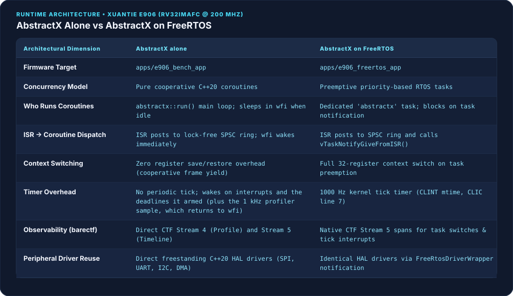
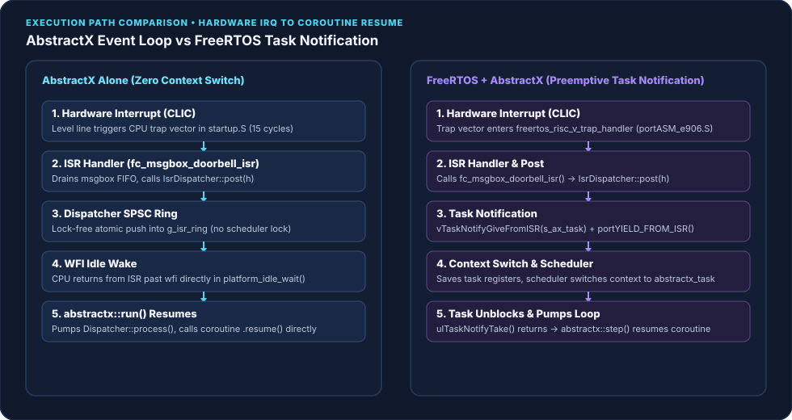
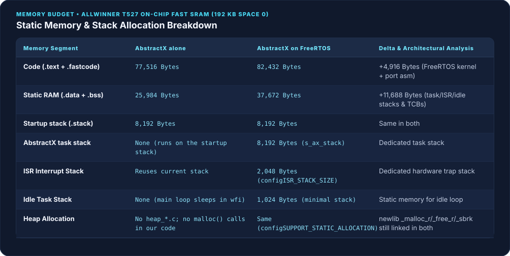
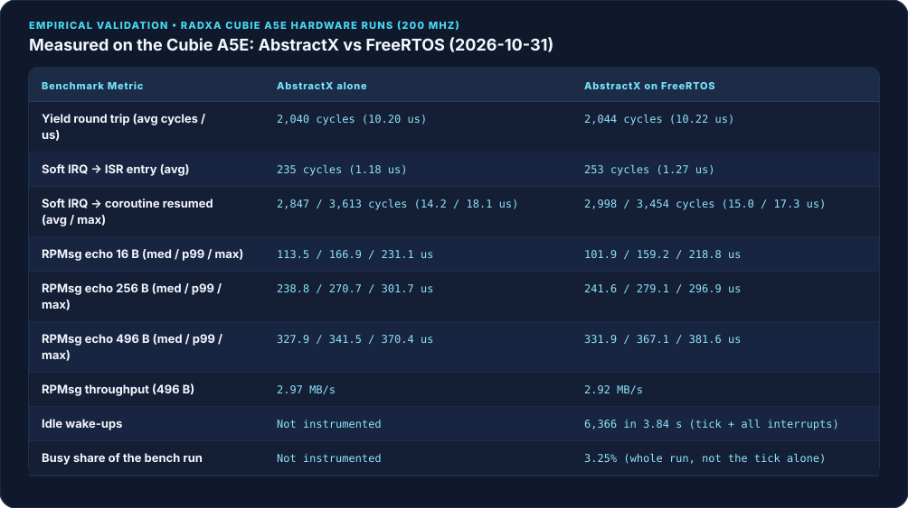
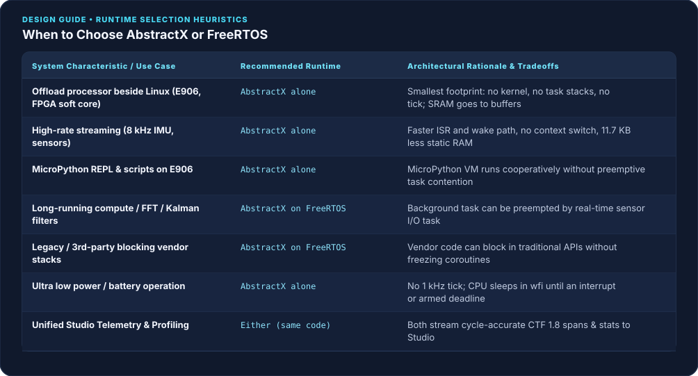

# AbstractX vs FreeRTOS on the XuanTie E906

## Part 4 of *Bringing Up Heterogeneous RISC-V on Allwinner SoCs* (Radxa Cubie A5E)

**Status: measured on hardware, 2026-10-31.** Every number below comes from benchmark runs on the Radxa Cubie A5E (Allwinner T527, XuanTie E906 @ 200 MHz), firmware built from `e159de6`.
Evidence: [`e906_bench_abstractx_stallfix_20261031.json`](../../verification/evidence/e906_bench_abstractx_stallfix_20261031.json) and [`e906_bench_freertos_stallfix_20261031.json`](../../verification/evidence/e906_bench_freertos_stallfix_20261031.json).
Requirements: [`apps/e906_bench/SPECIFICATION.md`](../../../apps/e906_bench/SPECIFICATION.md), [`apps/e906_freertos_app/SPECIFICATION.md`](../../../apps/e906_freertos_app/SPECIFICATION.md).

---

## 1. What This Article Shows

AbstractX is a runtime: freestanding C++20 coroutines, a lock-free ISR-to-coroutine dispatcher, zero-copy VirtIO RPMsg transports and cycle-accurate binary telemetry. It needs no operating system, **and it also runs on top of FreeRTOS**: the same coroutines, awaiters and drivers work inside a FreeRTOS task.

So this is not "pick one framework". It shows how the two setups differ and when to use each:

* **AbstractX on its own**: the whole system is the AbstractX event loop. This is the setup for an **offload processor** like the E906, which sits beside Linux and handles sensors, buses and IPC. You get the smallest footprint (no kernel, no per-task stacks, no tick) and the shortest path from an interrupt to the code that handles it.
* **AbstractX on FreeRTOS**: FreeRTOS owns the core, and AbstractX coroutines run in one of its tasks. Use this when you also need preemption (long compute jobs, blocking third-party code) or already have FreeRTOS tasks. You keep the coroutine model and pay for the kernel.

What the E906 measurements say about the cost of adding FreeRTOS underneath:

| | AbstractX alone | AbstractX on FreeRTOS |
| :--- | ---: | ---: |
| Code (`.text` + `.fastcode`) | 77,516 B | 82,432 B (+4,916) |
| Static RAM (`.data` + `.bss`) | 25,984 B | 37,672 B (+11,688) |
| Interrupt → coroutine resumed (avg) | 2,847 cycles | 2,998 cycles |
| RPMsg echo 496 B, throughput | 2.97 MB/s | 2.92 MB/s |
| Periodic tick | none | 1 kHz |

On the E906's 192 KB of SRAM, 11.7 KB is about 6% of the memory left for buffers, profiler rings and MicroPython. The end-to-end RPMsg echo, which is mostly Linux time, is the same within run-to-run noise.

We compiled **the same benchmark application** (`apps/e906_bench/bench.cpp`) both ways on the Allwinner T527's XuanTie E906 (a 32-bit RV32IMAFC core at 200 MHz with 192 KB of on-chip SRAM):



---

## 2. One Benchmark, Two Runtimes

[`apps/e906_bench/bench.cpp`](../../../apps/e906_bench/bench.cpp) is compiled unchanged into both firmwares:
* **AbstractX alone (`apps/e906_bench_app`)**: no RTOS. `abstractx::run(bench_main())` is the whole system; when no coroutine has a pending resume it sleeps in `wfi` inside `platform_idle_wait()`.
* **AbstractX on FreeRTOS (`apps/e906_freertos_app`)**: FreeRTOS owns the core. The same coroutine code runs inside one high-priority FreeRTOS task (`abstractx_task`) that calls `abstractx::step()`; when the dispatcher has drained, the task blocks in `ulTaskNotifyTake(pdTRUE, portMAX_DELAY)`.

The application code, the drivers and the interrupt dispatch path (`hal::irq::dispatch`, [SPEC-E906-RTOS-04]) are the same in both. The only difference is what runs underneath: AbstractX's event loop, or the FreeRTOS scheduler. That is what makes the comparison fair.

Both serve VirtIO RPMsg endpoint 1030 (`abstractx-bench`). The Linux host on the Cortex-A55 cores runs:
1. **Echo round trip and throughput**: 1,000 messages each of 16, 256 and 496 bytes; min, median, p99 and max (µs).
2. **On-target suite (`R` command)**, timed with RISC-V `mcycle` at 200 MHz:
   * *Yield round trip*: one `co_await yield_to_dispatcher()` (10,000 runs).
   * *Soft-interrupt wake*: machine software interrupt (`msip`, CLIC line 3) raised → ISR entry → waiting coroutine resumed (1,000 runs).
   * *Idle accounting*: sleep cycles and wake-ups (FreeRTOS build only; see §7).

---

## 3. Execution Model & Wake Path Comparison

The key difference is how an interrupt reaches a coroutine:



### AbstractX: SPSC Dispatch, No Context Switch
1. The interrupt fires on the T-Head CLIC (e.g. line 17 for the RPMsg message box).
2. The ISR clears the condition and posts the waiting coroutine's handle into `IsrDispatcher`'s lock-free single-producer single-consumer ring.
3. The ISR returns with `mret`. If the core was asleep in `wfi` in `platform_idle_wait()`, the trap return skips past the `wfi`.
4. `abstractx::run()` drains the dispatcher and calls `coro.resume()`: no task stack, no register save and restore, no scheduler.

### FreeRTOS: SPSC Dispatch + Task Notification
1. The interrupt traps into `freertos_risc_v_trap_handler` in `portASM_e906.S`.
2. The ISR posts the handle to `IsrDispatcher`, then calls `vTaskNotifyGiveFromISR(s_ax_task)` and `portYIELD_FROM_ISR()`.
3. If the `abstractx` task was blocked in `ulTaskNotifyTake()`, the scheduler switches to it: it saves the interrupted context, picks the task and restores the task's stack frame.
4. The task unblocks and calls `abstractx::step()` to resume the coroutine.

---

## 4. Observability: Connecting FreeRTOS to barectf & AbstractX Studio

AbstractX has a CTF 1.8 / barectf binary trace engine ([SPEC-TRACE-09], [SPEC-TRACE-10]) streaming over VirtIO RPMsg endpoint 1025 (`abstractx-trace`).

The FreeRTOS build hooks the kernel in `FreeRTOSConfig.h`:
```c
/* [SPEC-E906-RTOS-07] BareCTF / Studio Timeline Trace Integration */
#define traceTASK_SWITCHED_IN()  abx_trace_task_switched_in()
#define traceTASK_SWITCHED_OUT() abx_trace_task_switched_out()
```

Each task switch records `mcycle` timestamps and pushes a timeline span into CTF Stream 5:

```cpp
// @impl [SPEC-E906-RTOS-07] apps/e906_freertos_app/SPECIFICATION.md
void abx_trace_task_switched_out(void) {
    const uint64_t now = abx_bench_mcycle();
    if (s_task_in_cycles != 0 && now >= s_task_in_cycles) {
        const uint64_t duration = now - s_task_in_cycles;
        TaskHandle_t cur = xTaskGetCurrentTaskHandle();
        const uint32_t taskId = cur ? static_cast<uint32_t>(reinterpret_cast<uintptr_t>(cur)) : 0;
        abstractx::events::span(abstractx::events::kResume, taskId, s_task_in_cycles, duration);
    }
}
```

### What AbstractX Studio shows
* **Timeline tab**: FreeRTOS tasks (the `abstractx` task and the idle task) as timeline lanes next to the hardware ISRs.
* **Kernel tick**: the 1 kHz CLINT tick (CLIC line 7) and the cycles each tick takes from the application.
* **Coroutines inside the task**: coroutines resumed by `abstractx::step()` appear inside the task's execution window.

---

## 5. Driver Architecture: Reusing AbstractX HAL with FreeRTOS Wrappers

AbstractX drivers (SPI, UART, I²C, DMA) are freestanding, event-driven C++20 HAL drivers ([SPEC-HAL-*]). They never block or spin.

FreeRTOS tasks use them through synchronous adapters built on `TaskNotifier` ([SPEC-E906-RTOS-08]) instead of a second set of drivers:


```cpp
// @impl [SPEC-E906-RTOS-08] apps/e906_freertos_app/include/freertos_driver_wrapper.hpp
abstractx::freertos::TaskNotifier notifier;

notifier.prepare();  // Captures xTaskGetCurrentTaskHandle()
hal_driver.start_transfer(request);

// Calling task blocks without busy-waiting:
if (notifier.wait(timeout_ticks)) {
    // Transfer complete (woken by ISR via vTaskNotifyGiveFromISR)
}
```

* **One copy of the silicon logic**: registers, FIFOs, DMA descriptors and CLIC routing stay in `targets/allwinner_e906/`.
* **Blocking without spinning**: a FreeRTOS task waiting for slow I/O gives up the CPU, so lower-priority tasks run or the core sleeps in `wfi`.

---

## 6. Memory Footprint

Both ELFs: xPack GNU RISC-V GCC 15.2.0, Release (`-O2 -g -DNDEBUG`), freestanding C++20, `-fno-exceptions -fno-rtti`, `newlib-nano`. Both pass `tools/check_e906_layout.py` (every load segment inside a remoteproc window) and use 0.00 MB of DRAM (`tools/analyze_elf_size.sh`). Sizes from `riscv-none-elf-size -A`, 2026-10-31:



* **Code**: FreeRTOS adds **4,916 bytes** (`.text` + `.fastcode`: 77,516 → 82,432 B): the scheduler (`tasks.c`, `list.c`, `queue.c`), the RISC-V port and its trap entry.
* **Static RAM**: FreeRTOS adds **11,688 bytes** (`.data` + `.bss`: 25,984 → 37,672 B). With `configSUPPORT_STATIC_ALLOCATION = 1` and no heap, the TCBs and stacks are static: 8 KB `abstractx` task stack, 2 KB ISR stack, 1 KB idle stack, 72 B per TCB (`riscv-none-elf-nm`). Both builds also have the same 8 KB startup stack.
* **Heap**: neither build compiles a FreeRTOS `heap_*.c`, and no AbstractX code calls `malloc()`. newlib's `_malloc_r`, `_free_r` and `_sbrk` are still linked into both ELFs (`riscv-none-elf-nm`, 2026-10-31), so "zero heap" is a property of our code, not yet of the binary.

---

## 7. Hardware Benchmarks

Run on the Cubie A5E over VirtIO RPMsg endpoint 1030, 2026-10-31, both firmwares built from the same commit:



### Findings
1. **Yield round trip: equal.** `co_await yield_to_dispatcher()` averages **2,040 cycles (10.20 µs)** on AbstractX and **2,044 cycles (10.22 µs)** under FreeRTOS. A yield never leaves the coroutine loop, so the scheduler underneath does not matter.
2. **Interrupt to coroutine: AbstractX is faster.**
   * ISR entry: **235** cycles vs **253** (1.18 vs 1.27 µs).
   * Interrupt raised → waiting coroutine resumed: **2,847** cycles vs **2,998** on average (14.2 vs 15.0 µs). FreeRTOS's worst case is lower in this run (3,454 vs 3,613 cycles).
   * Earlier drafts of this article had FreeRTOS ahead (12.7 vs 16.3 µs). That comparison was wrong: the FreeRTOS app called the bench ISRs directly and skipped the per-line timing that AbstractX's interrupt path does. Since [SPEC-E906-RTOS-04] both go through `hal::irq::dispatch`. AbstractX's interrupt entry also no longer saves the FP registers ([SPEC-E906-CRASH-01]); that took its ISR entry from 361 to ~230 cycles.
3. **RPMsg echo: within noise.**
   * Medians: 16 B **113.5 vs 101.9 µs**, 256 B **238.8 vs 241.6 µs**, 496 B **327.9 vs 331.9 µs**. Most of a round trip is Linux (rpmsg_char, syscalls, Python), not the E906; the 16 B median moved by ~10 µs between runs on both runtimes the same day (101 vs 111 µs in the earlier run), so these numbers do not separate them.
   * Worst case: **231 / 302 / 370 µs** on AbstractX, **219 / 297 / 382 µs** on FreeRTOS. No message lost or corrupted on either.
   * Throughput at 496 B: **2.97 MB/s** vs **2.92 MB/s**.
4. **The ~1 s stall is fixed.** Earlier runs had AbstractX echoes taking up to 999 ms, which made its throughput look 15x worse than FreeRTOS's. There were two bugs, both in AbstractX code:
   * *A lost RPMsg wakeup* ([SPEC-E906-IRQ-04]): the RX path told Linux to stop sending kicks and turned them back on only after it had checked for messages, so a message posted in between got no kick and no check.
   * *The core went back to sleep with work waiting* ([SPEC-E906-IRQ-06]): the 1 kHz profiler sample has a rule to return to `wfi` so it does not wake the idle loop. When the sample fell due while the message-box ISR was running, it was taken right after that ISR, and the rule sent the already-woken core back to sleep. The queued work waited for the next 1 s status tick.
   With both fixed: 0 echoes over 5 ms in 9,000 (3,000 each at 16, 256 and 496 B). Details: `engineering_log.md`, 2026-10-31.
5. **Idle and the tick** (what was and was not measured):
   * **AbstractX**: the bench firmware does not count idle time (`"idle": "not-instrumented"`), so there is no measured idle load or wake count. By design it has no periodic tick: it sleeps in `wfi` until an interrupt or a deadline it armed. The 1 kHz profiler sample returns straight to `wfi`.
   * **FreeRTOS**: the idle hook woke **6,366 times** in 768.7 M cycles (3.84 s), and the core was outside the idle hook for **3.25 %** of that window. That is the busy share of the whole benchmark run (yield loop, soft-IRQ test, RPMsg traffic) plus the 1 kHz tick, **not** the cost of the tick alone, and the wake count includes every interrupt. An idle-only window is still to be measured.

---

## 8. When to Use Each



The application code is the same either way, so this choice can change later without rewriting drivers or coroutines.

### AbstractX alone: offload processors and event-driven I/O
* **Offloading from Linux** (the E906 next to the A55 cores, an FPGA soft core, a small MCU on a sensor board): the processor's job is to move data between buses and the host. Every byte of SRAM not spent on a kernel and task stacks goes to DMA buffers and rings.
* **Event-driven work**: sensor fusion (IMU, compass, GNSS), telemetry and state estimation where all I/O is non-blocking.
* **Interrupt-to-code latency**: no context switch between the ISR and the code that handles the event.
* **Power**: no periodic tick waking the core.

### AbstractX on FreeRTOS: when you need preemption
* **Long compute jobs** (FFT, planners, matrix inversions) that real-time I/O has to interrupt. Coroutines are cooperative: a coroutine that runs for 5 ms delays every other coroutine by 5 ms. Under FreeRTOS the compute job goes in a lower-priority task and the coroutine task preempts it.
* **Third-party code that blocks**: libraries that expect `read()`, `write()` or `sleep()` run in their own task through the `TaskNotifier` wrappers (§5), without stalling the coroutines.
* **An existing FreeRTOS system**: adopt AbstractX coroutines inside one task and leave the other tasks as they are. On the E906 that costs ~150 cycles per wake and 11.7 KB of RAM.

---

## 9. Reproduce

On a Radxa Cubie A5E:

```bash
# 1. Cross-compile both firmwares
cmake -S . -B build_e906 -DABSTRACTX_TARGET=e906 \
      -DCMAKE_TOOLCHAIN_FILE=cmake/toolchains/riscv-none-elf.cmake -DCMAKE_BUILD_TYPE=Release
cmake --build build_e906 --target e906_bench_app e906_freertos_app -j

# 2. Copy the bench tools to the board
ssh root@192.168.3.3 mkdir -p /root/abstractx_board_bench
scp -O apps/e906_repl_app/tests/board/bench_e906_runtime.py tools/e906_rpmsg_bridge.py tools/abstractx_wire.py \
    root@192.168.3.3:/root/abstractx_board_bench/

# 3. For each firmware: load it, then run the bench from Linux
for app in e906_bench_app e906_freertos_app; do
  scp -O build_e906/apps/$app/$app root@192.168.3.3:/lib/firmware/$app.elf
  ssh root@192.168.3.3 "R=/sys/class/remoteproc/remoteproc0; echo stop > \$R/state; \
      echo $app.elf > \$R/firmware; echo start > \$R/state; sleep 2; \
      python3 /root/abstractx_board_bench/bench_e906_runtime.py --json /tmp/$app.json"
done
```
