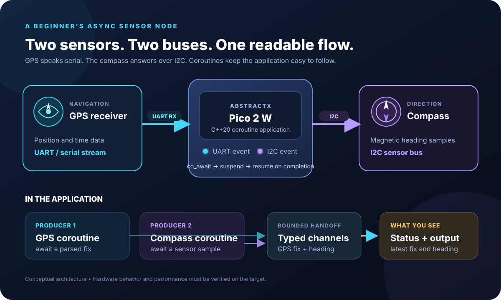
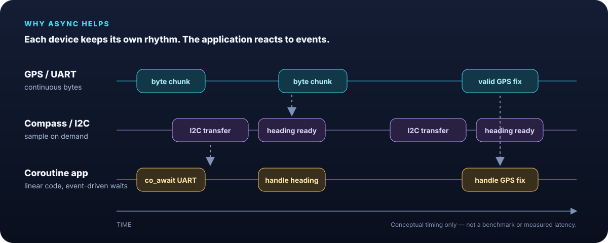
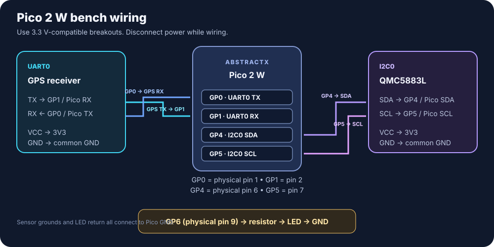

# Two Sensors. Two Buses. One Readable Flow.

## Build a GPS + compass sensor node with straight-line async on Pico 2 W

Your GPS is streaming bytes over UART. Your compass is answering reads over
I²C. They run at different rates—but your application does not need to become
a tangle of polling loops, callback chains, or hand-maintained states.

This project shows **straight-line async**: write the steps in the order a
person understands them, then let `co_await` suspend each operation until its
hardware event arrives. While one device is waiting, the other can keep making
progress. The payoff is code that stays easy to follow while the I/O is
asynchronous underneath.

The demo is deliberately small: GPS, compass, a status indicator, and a
readable output path. It is a hands-on way to see the AbstractX ideas that
matter in a real sensor node—independent bus activity, bounded data handoff,
and the requirements/audits that keep the implementation honest.

This article uses that sensor node to explain AbstractX's approach to
cooperative C++20 coroutines. The central idea is **straight-line async**:
application code reads top-to-bottom, while each `co_await` yields until a
hardware or timer event makes progress possible. GPS reception and compass
sampling can proceed independently without making the application bounce among
hand-maintained states and callbacks.

The article also places Protothreads and Pigweed in context: it describes an
engineering progression and different design choices, not a contest or a claim
that state machines are inherently wrong.

> **The one-line takeaway:** Write it linearly. Let events make it move.



*One application, two independent sensor paths, and a bounded handoff to the logic that uses each sample.*

> **Scope:** This is an architectural walkthrough, not a ready-to-flash
> standalone sample. The repository's [`gps_imu_app`](https://github.com/tcmichals/AbstractX/blob/main/apps/gps_imu_app/)
> already contains GPS/UART and magnetometer/I²C producer examples, but it is a
> larger reference application that also requires an SPI IMU and associated
> wiring. A minimal Pico 2 W GPS + I²C + LED app, its USB-console setup, and
> end-to-end hardware validation are follow-up work. See the
> [Pico 2 W target guide](https://github.com/tcmichals/AbstractX/blob/main/targets/pico2w_rp2350/HOWTO.md) for current
> target setup, and check its prerequisites before attempting a build.

## The example node

The interesting part is not just connecting two sensors. It is what happens
when they do not finish together:

```text
GPS UART:     bytes arrive ──> parse fix ───────────> publish GPS sample
Compass I²C:       start read ───────> sample ready ─> publish heading
App logic:    handle whichever sample is ready; never wait by spinning
```

Each coroutine describes one device's work. `co_await` marks a real suspension
point; it does not create a thread or make a blocking driver magically
asynchronous. The target driver must start the transfer and report completion
through its interrupt/DMA event path.



*Conceptual timing only—not a latency measurement or benchmark.*

Use a Pico 2 W, a UART GPS receiver, a QMC5883L magnetometer, and an external
LED with a current-limiting resistor. An external LED avoids confusion with
the Pico 2 W's wireless-controller-driven onboard LED.

- **GPS TX → Pico RX**: UART0, GP1 (physical pin 2)
- **GPS RX ← Pico TX**: UART0, GP0 (physical pin 1)
- **QMC5883L SDA**: I²C0, GP4 (physical pin 6)
- **QMC5883L SCL**: I²C0, GP5 (physical pin 7)
- **GPS and compass power**: Pico 3V3(OUT), physical pin 36; use 3.3 V-compatible boards
- **Common ground**: connect both sensors and the LED return to Pico GND
- **External LED**: GPIO GP6 (physical pin 9), through a suitable resistor

The GPS UART and human-readable console are separate channels. Keep GPS on
UART0; configure a USB CDC console explicitly for logs in a runnable sample.
Do not put debug text on the GPS UART. Confirm the GPS module's voltage
requirements and the sensor breakout's I²C pull-ups before connecting power.



*The diagram shows GPIO numbers; use the pin list above to find physical header pins. All devices must share ground.*

The QMC5883L driver is in
[`include/abstractx/drivers/mag/qmc5883l.hpp`](https://github.com/tcmichals/AbstractX/blob/main/include/abstractx/drivers/mag/qmc5883l.hpp),
and the GPS parser/driver is in
[`include/abstractx/drivers/gps/ublox_gps.hpp`](https://github.com/tcmichals/AbstractX/blob/main/include/abstractx/drivers/gps/ublox_gps.hpp).
The Pico target's peripheral pin assignments are documented in its
[hardware specification](https://github.com/tcmichals/AbstractX/blob/main/targets/pico2w_rp2350/SPECIFICATION.md).

## Protothreads: a useful previous generation

Protothreads made cooperative concurrency practical on small systems with
severe memory limits. They represent a task's continuation with compact,
explicit state, rather than allocating a full stack per task. This makes them
valuable on constrained platforms and an important part of AbstractX's
development history.

That compactness comes with a programming model to learn: a Protothread
typically advances through explicit yield points and continuation macros.
Local automatic variables cannot in general be treated as persistent task
state across a yield; state that must survive has to be stored deliberately.
As control flow grows, developers need to track both the task's logical state
and where execution will continue.

For example, the repository's
[`protothreads_walkthrough_async_serial.cpp`](https://github.com/tcmichals/AbstractX/blob/main/examples/protothreads_walkthrough_async_serial.cpp)
shows an interactive serial flow built around explicit asynchronous
continuations. It is useful historical context—not a bad approach, just a
different generation and tradeoff.

## The C++20 coroutine step

C++20 coroutines let the compiler represent suspension points directly in
ordinary-looking control flow. The `co_await` operator marks where a routine
can yield; the awaited operation determines what event makes it ready again.
This makes sequencing and local state easier to read than a hand-maintained
continuation, while retaining cooperative execution.

That is the point of **straight-line async**: asynchronous behavior does not
require application logic to be written as a sequence of scattered callback
transitions. The coroutine says what happens next in order; the event-driven
driver suspends and later makes it runnable again. This depends on a genuinely
non-blocking driver—putting `co_await` around a blocking transfer would not make
the I/O asynchronous.

In AbstractX, the intent is to pair that language feature with an event-driven
HAL, fixed-capacity data handoff, and an application runtime. The coroutine
syntax is not the differentiator by itself: other embedded frameworks,
including [Pigweed](https://github.com/pigweed-project/pigweed), also support
C++20 coroutine-based work. Pigweed is a broader embedded development
ecosystem; this article is not a feature-by-feature comparison. AbstractX's
focus here is its particular combination of HAL awaitables, cooperating
peripheral tasks, and bounded sensor-data flow.

The repository's GPS producer currently follows this shape:

```cpp
Task<void> gps_producer_task(UbloxGps& gps) {
    while (true) {
        GpsFix fix = co_await gps.next_fix_async();
        if (fix.valid) {
            g_gps_channel.try_push(fix);
        }
    }
}
```

The magnetometer producer runs independently, waiting between samples without
holding up GPS processing:

```cpp
Task<void> mag_producer_task(Qmc5883l& mag, hal::ITimer& timer) {
    while (true) {
        co_await timer.sleep_ms_async(20);
        MagSample sample = co_await mag.read_sample_async();
        if (sample.valid) {
            g_mag_channel.try_push(sample);
        }
    }
}
```

These examples are adapted from
[`apps/gps_imu_app/src/main.cpp`](https://github.com/tcmichals/AbstractX/blob/main/apps/gps_imu_app/src/main.cpp). They
show the producer shape; they are not a complete, standalone app. In
particular, bounded queue capacity forces an application to choose what to do
when a queue is full. Production code should check each `try_push()` result
and define an explicit drop, retry, or backpressure policy.

The LED is an output, not another sensor. A small status routine can wait for
the next GPS fix, update the latest application state, and set GP6 accordingly.
The GPIO operation itself is a short direct hardware action; it does not need
to be made asynchronous merely to use coroutines elsewhere. A separate
USB-serial console routine can report meaningful state without sharing the
GPS's UART.

The expected dataflow is:

```text
GPS UART ──await parsed fix──> GPS producer ──> bounded GPS channel ──┐
                                                                      ├─> status logic ──> LED
QMC5883L I²C ─await sample──> I²C producer ──> bounded sensor channel ┘
                                                                         └─> USB CDC diagnostics
```

Each producer advances at the rate of its own device. Status logic can combine
the most recent fix and sensor sample without a blocking read of one device
holding up the other. A real application still needs to define freshness,
invalid-data, queue-overflow, and reconnect behavior.

## What improves—and what does not

The benefit is primarily in application structure:

- **Readable suspension points:** `co_await` makes the place where a routine
  yields visible in normal C++ control flow.
- **Independent peripheral progress:** GPS input and I²C sampling can wait on
  their respective events rather than being advanced by a shared polling
  counter.
- **Typed handoff:** a bounded queue can pass a `GpsFix` or sensor sample to
  another routine without turning the application into a shared collection of
  mutable globals.
- **Explicit memory policy:** fixed-capacity queues bound their storage, but
  the application must still decide how to handle overflow.
- **A path to a larger dataflow:** the same pattern can later add an IMU,
  filtering, telemetry, or another target without making the first example a
  flight controller.

Coroutines do not automatically make I/O non-blocking, guarantee real-time
deadlines, remove every race, or eliminate heap allocation. Those properties
depend on the coroutine/task implementation, the awaited driver operation,
the scheduler, and the queue policy. They should be measured and verified on
the target; this article makes no latency or performance claim.

## Same idea, bigger system

This small walkthrough uses the Pico 2 W. On the Allwinner A5E, PREEMPT_RT
Linux is a strong host foundation; AbstractX builds on it by assigning
sensor-facing real-time I/O to the E906 coprocessor, with an FPGA fabric as an
additional option for hardware routing and offload.


The point is not “Linux versus AbstractX”: Linux stays in the system. The
interesting story is how the host, coprocessor, and optional fabric cooperate.
A full A5E walkthrough belongs in its own article, but the same GPS + compass
pair already runs on the A5E's E906 under MicroPython, and the next section
shows what that looks like from Studio, including the CPU and interrupt cost
measured on the board.

## Why MicroPython, and why AbstractX underneath it

**Why MicroPython on the E906.** Bringing up sensors on a coprocessor is
mostly finding out what the hardware actually does. With MicroPython you
change a script or type a line at the prompt instead of rebuilding and
reloading firmware for each experiment. A concrete case: the A5E test board's
compass turned out to be an HMC5883L, not the expected QMC5883L, which was
found by reading its ID registers from Python. The `abstractx` module gives the
script direct access to `peek` / `poke`, UART3, I²C1 and the TLP channel
([`[SPEC-E906-REPL-06]`](https://github.com/tcmichals/AbstractX/blob/main/apps/e906_repl_app/SPECIFICATION.md)).
The cost is real and measured: the interpreter uses about 90 % of the E906
for a 10 Hz compass + GPS loop (see §4 below). MicroPython is the tool for
exploring and testing; the long-term real-time path is C++20 coroutines like the
producers shown earlier.

**Why AbstractX is the core.** MicroPython is not the firmware; it is a guest
running as one coroutine (`repl_rx`) inside the AbstractX event loop
([`[SPEC-E906-REPL-03]`](https://github.com/tcmichals/AbstractX/blob/main/apps/e906_repl_app/SPECIFICATION.md)).
Everything underneath it belongs to AbstractX:

- **Interrupts and drivers.** The UART3 interrupt handler fills a receive ring
  and the TWI1 handler runs the I²C transaction state machine. A blocking
  Python call such as `i2c_read` or `sleep_ms` sleeps in `wfi` until an
  interrupt completes it; it never spins on a register.
- **Scheduling.** The MicroPython bytecode loop calls back into AbstractX
  (`MICROPY_VM_HOOK_LOOP`), which drains pending interrupt work and keeps the
  status reports going while a script runs, so a long Python loop does not
  stop the rest of the system.
- **Memory.** The firmware runs without a heap in the E906's on-chip SRAM. The
  MicroPython garbage-collected heap is kept separately in the otherwise unused
  HiFi4 DSP RAM, so Python allocation and garbage collection cannot fragment
  or overwrite firmware memory
  ([`[SPEC-E906-REPL-02]`](https://github.com/tcmichals/AbstractX/blob/main/apps/e906_repl_app/SPECIFICATION.md)).
- **Links to Linux.** Three separate RPMsg channels: REPL text, 64-byte TLP
  data and binary CTF trace. They are never mixed on one channel.
- **Measurement.** The CPU, coroutine and interrupt figures below come from
  the AbstractX dispatcher and interrupt layer, not from the script. That is
  why the cost of MicroPython itself can be measured.

When a loop moves from Python to C++, the drivers, RPMsg channels, status
report and Studio views stay the same. The script is the experiment;
AbstractX is the part that stays.

## Observability in AbstractX Studio: The User Domain Navigation & Compass Plugin

A robust sensor node needs more than silent raw registers; developers and
operators need live, deterministic observability. AbstractX separates this
cleanly across the silicon boundary:

### 1. Heterogeneous Division of Labor
On the A5E the sensor side currently runs as a MicroPython script on the E906,
not as C++ coroutines:

* **E906 coprocessor**: the AbstractX firmware hosts MicroPython inside its
  `repl_rx` coroutine. The script
  [`raw_sensor_streamer.py`](https://github.com/tcmichals/AbstractX/blob/main/apps/e906_repl_app/raw_sensor_streamer.py)
  reads the 6 compass data registers over TWI1 (I²C1) and drains the GPS bytes
  that the UART3 interrupt handler has buffered, every 100 ms. It does no NMEA
  or UBX parsing and no floating-point math; it hex-encodes the raw bytes into a
  `!RAW:` text line and sends it over RPMsg. Both buses are interrupt-driven:
  a blocking MicroPython call sleeps in `wfi` until the ISR completes it rather
  than spinning on a status register
  ([`[SPEC-E906-REPL-16]`](https://github.com/tcmichals/AbstractX/blob/main/apps/e906_repl_app/SPECIFICATION.md)).
* **Linux on the A5E**: `board_studio_bridge.py` reads those lines, builds
  64-byte TLPs and sends them to Studio on UDP port 9870. Building the frames on
  Linux is a known gap: the requirement is for the script to build its own
  frames so Linux only forwards them (`[SPEC-E906-REPL-17]`, not implemented yet).
* **AbstractX Studio user plugin (`flight_plugin.py`)**: runs on the
  development workstation. It decodes the compass bytes and the NMEA/UBX
  stream, computes heading and track, and draws the instrument canvas.

### 2. GPS and Compass Configuration
The GPS setup borrows from the flight-proven drivers in `tcmichals/inav`
(`src/drivers/gps/`). At start-up the E906 script:

1. Opens UART3 at 9600 baud, sends `UBX-CFG-PRT` to move the u-blox port to
   **115,200 baud**, then switches its own UART to match.
2. Turns off the `$GxGSV` and `$GxGSA` sentences (`UBX-CFG-MSG`) and sets
   **10 Hz navigation fixes** (`UBX-CFG-RATE`, 100 ms period).
3. Starts the compass in continuous mode over 400 kHz I²C. The A5E test board
   carries an HMC5883L at address `0x1E` (identified by its ID registers); a
   QMC5883L at `0x0D` is configured for 200 Hz continuous output
   (`REG_CONTROL_1 = 0x1D`). The raw bytes are tagged with the chip so the
   host decodes them correctly.

On the host, the plugin's binary UBX decoder handles 84/92-byte `UBX-NAV-PVT`
packets with the Fletcher-16 checksum, extracting position, NED velocities and
Course Over Ground (COG).

### 3. Vector-Rendered Compass Rose & HSI Instrument

```text
                     [ 042° NE ]  <-- Digital Heading Placard
                         ▲ Fixed Lubber Line
                   /     |     \
                 /  NW   |   NE  \
                |        |        |
        [270° W]---------+---------[090° E]  <-- Rotating 360° Compass Rose
                |        |        |
                 \  SW   |   SE  /
                   \     |     /
                         ▼
                     [ 180° S ]
              ◆ Magenta Bug: GPS Ground Track (COG)
              --- Wind Drift Crab Angle: delta = COG - psi
```

The user domain canvas renders a vector **Horizontal Situation Indicator (HSI)**:
* **Rotating 360° Compass Rose**: Anti-aliased dial face rotating smoothly with
  magnetic heading ψ, with 10° ticks, 30° major labels, and cardinal points.
* **Fixed Reticle & Top Lubber Line**: Aircraft nose reference marker.
* **Magenta GPS Track Bug (COG)**: Displays true course over ground. Under crosswinds,
  the separation between the top lubber line and the track bug immediately reveals
  the aerodynamic crab angle (δ = COG − ψ).
* **Live Sensor Placards**: Digital heading, cardinal direction, ground speed
  (knots & m/s), MSL altitude (m & ft), raw magnetic field components (X, Y, Z)
  in µT, and GPS fix status.

The contract is formally codified in [`USER_PLUGIN_SPECIFICATION.md`](https://github.com/tcmichals/AbstractX/blob/main/tools/visualizer/USER_PLUGIN_SPECIFICATION.md)
(`[SPEC-USER-PLUGIN-01]` through `[SPEC-USER-PLUGIN-07]`).

### 4. What the E906 Spends Its Time On
The instruments show the sensor data; the engineering question is what reading
it costs. Because every coroutine resume goes through one call site
(`Dispatcher::process()`), the runtime can keep RTOS-style run-time statistics
without the application asking for them. By default the E906 firmware sends a
runtime status report once a second as CTF stream 3
([`[SPEC-TRACE-08]`](https://github.com/tcmichals/AbstractX/blob/main/docs/DESIGN_SPECIFICATION.md)): busy %, per-coroutine CPU %,
resumes per second and longest single resume, per-interrupt-line interrupt rate
and handler time, and the health of the coroutine frame pool and dispatcher
queue. Idle time is measured around the `wfi` instruction, minus interrupt time
taken during the sleep.

Measured on the Cubie A5E on 2026-10-21/22, with the MicroPython compass + GPS
loop running:

```text
Source                                   Interrupts/s   Time per IRQ          CPU
TWI1 compass (I2C 400 kHz, 6-byte reads) ~2,200-2,600   1.43 us               0.31-0.36 %
UART3 GPS at 115,200 baud                30             38.9 us (byte-wise    0.117 %
                                                        FIFO reads)
Timer                                    1-50           0.66 us               < 0.01 %
repl_rx coroutine running the script     -              -                     ~90 %
Idle board, no script                    -              -                     0.01 % busy
```

Two things stand out. First, the MicroPython interpreter, not the drivers, is
where the time goes: the script's coroutine accounts for about 90 % and the
interrupt handlers for well under 1 %. Second, the UART handler is the most
expensive single interrupt because it reads the receive FIFO one byte at a time.
Moving UART3 to DMA would therefore mainly shorten interrupt latency and
jitter for everything else; it would not noticeably reduce CPU load.

Studio's **CPU** tab shows the same report live: a busy % history whose Y axis
scales to the data (so 0.01 % and 90 % are both readable), with a 60 s or
5 min window, and tables of tasks, drivers and pools underneath
([`[SPEC-STUDIO-15]`](https://github.com/tcmichals/AbstractX/blob/main/tools/visualizer/SPECIFICATION.md)).

### 5. A Python Prompt Beside the Stream
Studio's **CLI** tab runs Python on the E906's MicroPython while the sensor
stream keeps running
([`[SPEC-STUDIO-13]`](https://github.com/tcmichals/AbstractX/blob/main/tools/visualizer/SPECIFICATION.md),
[`[SPEC-E906-REPL-19]`](https://github.com/tcmichals/AbstractX/blob/main/apps/e906_repl_app/SPECIFICATION.md)), so
you can, for example, call `abstractx.peek()` on a register without stopping
the compass and GPS readings:

```text
Studio CLI ──ssh──> board_studio_bridge.py stdin:  CLI <id> <hex>
                    └─> streamer script on E906:     EXEC <id> <hex>
                        └─> output back:             !CLI:<id>:BEGIN ... !CLI:<id>:END:OK | END:ERR:<repr>
```

The command is hex-encoded so no control byte (such as Ctrl-C) can appear in
it, and it runs in a namespace that persists between commands, with
`abstractx` already imported. An exception is reported and the stream carries
on. A round trip takes about 55 ms, because the script checks for commands
between its 100 ms sensor reads. One constraint worth knowing: the board's
MicroPython is built at the minimum ROM level, so `bytes.decode` and
`bytes.fromhex` do not exist; the script uses `int(.., 16)` and
`str(b, "ascii")` instead.

The same link carries the heartbeat: Studio's bridge sends `PING` at least once
a second, and the script stops on its own after 3 s without one, so a crashed
or closed Studio does not leave the E906 streaming to nobody
([`[SPEC-E906-REPL-14]`](https://github.com/tcmichals/AbstractX/blob/main/apps/e906_repl_app/SPECIFICATION.md)).

### 6. Only Tabs That Have Data
Studio's tabs were audited against its specification on 2026-10-22, and the
rule now is that a tab appears only where something can feed it
([`[SPEC-STUDIO-16]`](https://github.com/tcmichals/AbstractX/blob/main/tools/visualizer/SPECIFICATION.md)). The
Coroutine Inspector and Flow Integrity tabs have no live source on this board,
so they appear only in `--sim` mode or with an FPGA. The TLP Bus Debugger and
System Event Log are docked windows and are not duplicated as tabs. The source
tab browses the real repository files rather than canned snippets.

Two further views are built and pass host tests but are **still being brought
up on the board**, so treat them as not yet working on hardware:

* a 1 kHz program-counter sampling profiler, shown per source line in Studio's
  source view (CTF stream 4, `[SPEC-TRACE-09]`, `[SPEC-STUDIO-11]`);
* a timeline of coroutine resumes, interrupt handlers and idle periods as
  swimlanes (CTF stream 5, `[SPEC-TRACE-10]`, `[SPEC-STUDIO-17]`).


## A balanced comparison

- **Protothreads** contribute a compact cooperative model suited to constrained
  systems, with explicit continuation points. The example should make visible
  how state and resumption are represented and managed.
- **C++20 coroutines** contribute language-supported suspension and resumption
  expressed with `co_await`. The example should make visible how peripheral
  awaits and normal control flow read together.
- **AbstractX** contributes its HAL, runtime, and bounded sensor handoff around
  cooperative tasks. The example should make visible how independent device
  activity is connected into one application.
- **Pigweed** is a broader embedded development framework that also includes
  coroutine facilities: a relevant peer with different scope and design
  priorities, not a foil.

The point is not that the older approach is wrong or that the newer syntax
wins every comparison. Protothreads help explain the design constraints
AbstractX grew from; C++20 coroutines offer a more direct way to express the
next application model. AbstractX's value has to be demonstrated in the
peripheral contracts, dataflow, resource behavior, portability, and working
hardware—not inferred from syntax alone.

## Build, run, and debug

The focused GPS + compass walkthrough is **not yet a standalone firmware
target**. The existing `gps_imu_app` is a larger reference application: it also
initializes an SPI IMU and its hardware run therefore needs the additional IMU
connections listed in the
[Pico 2 W deployment guide](https://github.com/tcmichals/AbstractX/blob/main/apps/gps_imu_app/platforms/pico2w/HOWTO.md).
The commands below build and exercise that reference; they do not claim that
the GPS + compass-only node is ready to flash.

### Build the desktop reference

From the repository root, configure and compile the host target:

```bash
cmake --preset host
cmake --build build_host --target gps_imu_app -j$(nproc)
```

The host build of `gps_imu_app` was verified for this article. It checks that
the reference application compiles; it does not validate physical sensor
wiring or Pico peripheral timing.

### View telemetry in AbstractX Studio over UDP

Open two terminals. Start Studio first so it is listening on UDP port 9870:

```bash
python3 tools/visualizer/abstractx_studio.py --port 9870
```

Then run the host reference app:

```bash
./build_host/apps/gps_imu_app/gps_imu_app
```

On Linux, the reference app's telemetry destination defaults to
`127.0.0.1:9870`; Studio and the app must run on the same computer for this
default route. If Studio stays at **Waiting on UDP**, confirm both processes
are running, allow local UDP traffic through the firewall, and verify that no
other process is bound to port 9870. The Pico target sends telemetry as UDP
broadcast on port 9870, so run Studio on the same Wi-Fi network and allow the
broadcast through the host firewall. Do not assume the desktop loopback
address is reachable from the board.

To capture Studio views for the article, save original screenshots under
`assets/` and label whether each shows host simulation or physical hardware.
Screenshots make the telemetry visible; they are not timing evidence.

### Flash and debug the Pico reference

For the larger Pico `gps_imu_app`, use the Debug preset and the repository's
RP2350 SWD setup:

```bash
cmake --preset pico2w-debug -DWIFI_SSID="your-2.4GHz-network" -DWIFI_PASSWORD="your-password"
cmake --build build_pico2w_debug --target gps_imu_app -j$(nproc)
```

Connect an RP2350-compatible SWD probe, then use the repository's VS Code
**Pico 2 W: SWD Debug (Cortex-Debug)** launch configuration and press `F5`.
Set breakpoints in
[`apps/gps_imu_app/src/main.cpp`](https://github.com/tcmichals/AbstractX/blob/main/apps/gps_imu_app/src/main.cpp),
especially in the GPS producer, magnetometer producer, and fusion task. Inspect
whether each awaited operation completes before stepping past its
`co_await`. The full flashing, probe wiring, Wi-Fi setup, and troubleshooting
steps are in the [Pico deployment and debugging guide](https://github.com/tcmichals/AbstractX/blob/main/apps/gps_imu_app/platforms/pico2w/HOWTO.md).

## Where to go next

- [GPS and IMU reference application](https://github.com/tcmichals/AbstractX/blob/main/apps/gps_imu_app/README.md)
- [GPS and IMU application specification](https://github.com/tcmichals/AbstractX/blob/main/apps/gps_imu_app/SPECIFICATION.md)
- [Pico 2 W development guide](https://github.com/tcmichals/AbstractX/blob/main/targets/pico2w_rp2350/HOWTO.md)
- [Pico 2 W target specification](https://github.com/tcmichals/AbstractX/blob/main/targets/pico2w_rp2350/SPECIFICATION.md)
- [AbstractX's system invariants](https://github.com/tcmichals/AbstractX/blob/main/docs/tier1_vision/SYSTEM_INVARIANTS.md)
- [E906 MicroPython application specification](https://github.com/tcmichals/AbstractX/blob/main/apps/e906_repl_app/SPECIFICATION.md)
- [AbstractX Studio specification](https://github.com/tcmichals/AbstractX/blob/main/tools/visualizer/SPECIFICATION.md)
