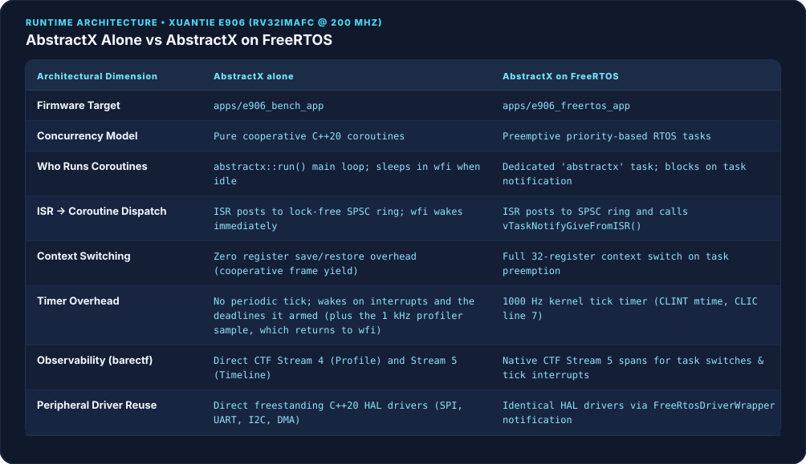
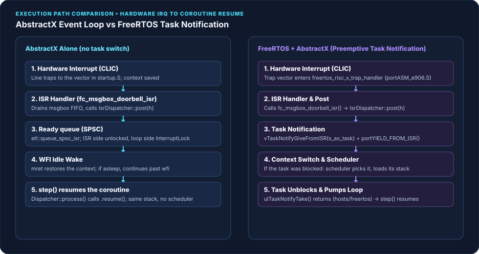
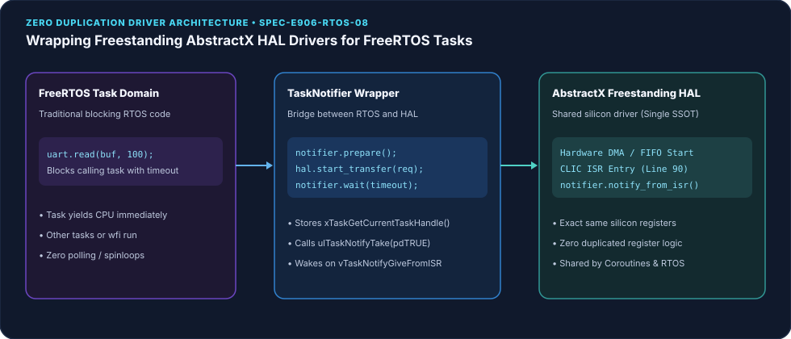
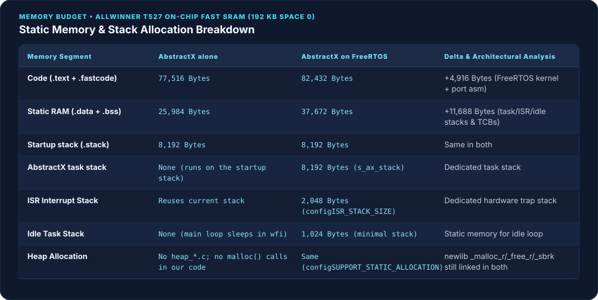
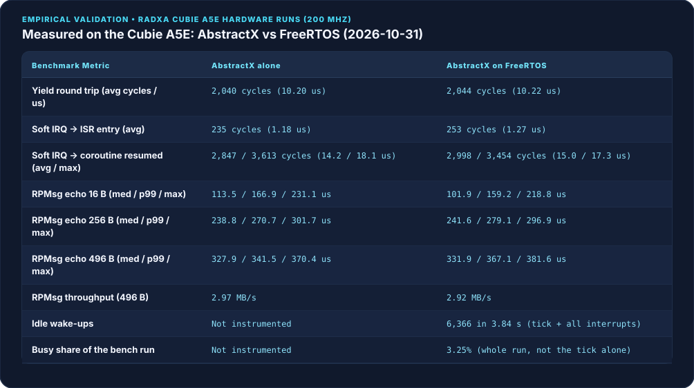
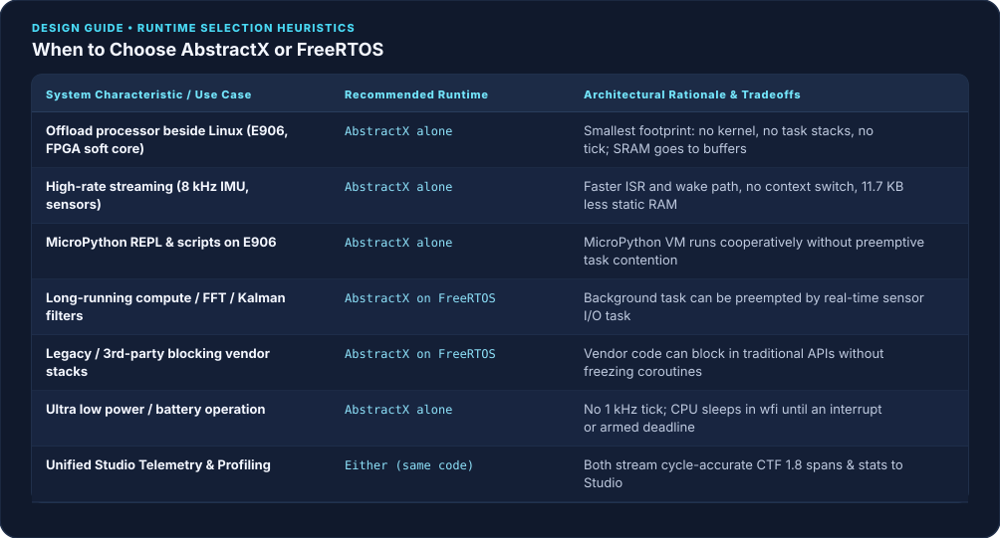

# Linux vs FreeRTOS vs AbstractX on the Allwinner T527

## Part 4 of *Bringing Up Heterogeneous RISC-V on Allwinner SoCs* (Radxa Cubie A5E)

**Status: measured on hardware, 2026-10-31; partly out of date (reviewed 2026-11-06).** The latency and echo numbers come from benchmark runs on the Radxa Cubie A5E (Allwinner T527, XuanTie E906 @ 200 MHz), firmware built from `e159de6`. The `C` cyclic rows for AbstractX on FreeRTOS were measured later the same day, with the firmware of `d4c2b8f`.

**What changed since, and is not re-measured** (no board on 2026-11-06):
* The FreeRTOS firmware now runs AbstractX through the shared FreeRTOS host (`hosts/freertos`, [SPEC-ARCH-15]): the task waits until the deadline `step()` returns, with timer mode `WAIT` by default. The FreeRTOS cyclic rows in §7 were measured under the older tick-hook model (§7, item 6).
* The interrupt, UART, SPI, I²C and RPMsg code on the E906 changed in later commits, so every latency and echo number here is for the 2026-10-31 firmware. They need a re-run before they describe today's code.
* Memory sizes in §6 are re-measured from today's builds; the summary table below keeps the sizes of the firmware that was benchmarked.
Evidence: [`linux_cyclictest_20261031.json`](../../verification/evidence/linux_cyclictest_20261031.json), [`e906_bench_abstractx_stallfix_20261031.json`](../../verification/evidence/e906_bench_abstractx_stallfix_20261031.json) and [`e906_bench_freertos_stallfix_20261031.json`](../../verification/evidence/e906_bench_freertos_stallfix_20261031.json).
Requirements: [`apps/e906_bench/SPECIFICATION.md`](../../../apps/e906_bench/SPECIFICATION.md), [`apps/e906_freertos_app/SPECIFICATION.md`](../../../apps/e906_freertos_app/SPECIFICATION.md).

---

## 1. What This Article Shows

The Allwinner T527 on the Cubie A5E gives you two very different places to run code: eight Cortex-A55 cores running Linux, and a 200 MHz XuanTie E906 RISC-V core beside them. This article compares three ways to use them, measured on the same board:

* **Linux (PREEMPT_RT) on the A55 cores**: the full operating system, with real-time scheduling.
* **AbstractX alone on the E906**: the whole system is the AbstractX event loop. No kernel, no per-task stacks, no tick.
* **AbstractX on FreeRTOS on the E906**: FreeRTOS owns the core, and the same AbstractX coroutines and drivers run inside one of its tasks. FreeRTOS owns the timer, so AbstractX coroutine sleeps have the resolution of its 1 kHz tick (1 ms); found and fixed while measuring this article ([SPEC-E906-RTOS-03]).

The goal is not a winner. It is to show how the three differ and when to use each. AbstractX runs on its own or on top of FreeRTOS with the same code, and the E906 sits beside Linux, so a real system usually uses Linux *and* one of the E906 setups.

| | Linux (A55) | AbstractX alone (E906) | AbstractX on FreeRTOS (E906) |
| :--- | ---: | ---: | ---: |
| RAM in use | ~64 MB at idle (65,680 KB of 4 GB) | 25,984 B static (`e159de6`; today 23,992 B, §6) | 37,672 B static (`e159de6`; today 37,880 B) |
| Code / image | 29 MB kernel + 353 MB root fs | 77,516 B (`e159de6`; today 141,498 B) | 82,432 B (`e159de6`; today 148,070 B) |
| Event → handler code, avg / max, Linux idle | 18 / 29 µs (timer → RT thread) | 14.2 / 18.1 µs (IRQ → coroutine) | 15.0 / 17.3 µs (IRQ → coroutine) |
| Same, Linux under `stress-ng` load | 29 / **122 µs** | 14.4 / **18.5 µs** | 15.4 / **17.8 µs** |
| Periodic tick | yes (kernel) | none | 1 kHz |
| Preemption | yes | no (cooperative) | yes |

What this says: Linux has orders of magnitude more compute and memory, but its worst-case response grows with load (4x here). The E906 is unaffected by Linux load under either runtime. Between the two E906 setups, AbstractX alone is ~150 cycles faster per wake and was 11.7 KB smaller in RAM (13.9 KB with today's builds, §6); FreeRTOS adds preemption. The Linux row measures a timer wake and the E906 rows a software interrupt, so compare their scale, not single microseconds (§7).

We compiled **the same benchmark application** (`apps/e906_bench/bench.cpp`) both ways on the Allwinner T527's XuanTie E906 (a 32-bit RV32IMAFC core at 200 MHz with 192 KB of on-chip SRAM):



---

## 2. What Was Measured

[`apps/e906_bench/bench.cpp`](../../../apps/e906_bench/bench.cpp) is compiled unchanged into both firmwares:
* **AbstractX alone (`apps/e906_bench_app`)**: no RTOS. `abstractx::run(bench_main())` is the whole system; when no coroutine has a pending resume it sleeps in `wfi` inside `platform_idle_wait()`.
* **AbstractX on FreeRTOS (`apps/e906_freertos_app`)**: FreeRTOS owns the core. The same coroutine code runs inside one high-priority FreeRTOS task (`abstractx_task`). In the firmware measured here that task called `abstractx::step()` and, once the dispatcher had drained, blocked in `ulTaskNotifyTake(pdTRUE, portMAX_DELAY)`; coroutine sleeps were woken from `vApplicationTickHook`. Today the task calls `abstractx::freertos_host::run()` (`hosts/freertos`, [SPEC-ARCH-15]): it calls `step()`, and blocks in `ulTaskNotifyTake(pdTRUE, timeout)` where the timeout is the deadline `step()` returned, rounded up to whole ticks (`portMAX_DELAY` only when nothing is pending). The timer mode is a build option, `ABX_FREERTOS_TIMER`: `WAIT` (default; no tick hook, no software timers), `XTIMER` (one FreeRTOS one-shot software timer) or `TICK_HOOK` (the old model).

The application code, the drivers and the interrupt dispatch path (`hal::irq::dispatch`, [SPEC-E906-RTOS-04]) are the same in both. The only difference is what runs underneath: AbstractX's event loop, or the FreeRTOS scheduler. That is what makes the comparison fair.

* **Linux (`cyclictest`, rt-tests 2.80)**: kernel 7.1.0 PREEMPT_RT on the A55 cores. One SCHED_FIFO 95 thread pinned to CPU 2 wakes every 1 ms for 60,000 cycles (`cyclictest -m -p 95 -i 1000 -l 60000 -t1 -a 2`), idle and with `stress-ng --cpu 8 --vm 2 --vm-bytes 256M --sock 2`.

Both E906 firmwares serve VirtIO RPMsg endpoint 1030 (`abstractx-bench`). The Linux host on the Cortex-A55 cores runs:
1. **Echo round trip and throughput**: 1,000 messages each of 16, 256 and 496 bytes; min, median, p99 and max (µs).
2. **On-target suite (`R` command)**, timed with RISC-V `mcycle` at 200 MHz:
   * *Yield round trip*: one `co_await yield_to_dispatcher()` (10,000 runs).
   * *Soft-interrupt wake*: machine software interrupt (`msip`, CLIC line 3) raised → ISR entry → waiting coroutine resumed (1,000 runs).
   * *Idle accounting*: sleep cycles and wake-ups (FreeRTOS build only; see §7).

---

## 3. Execution Model & Wake Path Comparison

The key difference is how an interrupt reaches a coroutine:



### AbstractX: SPSC Dispatch, No Context Switch
1. The interrupt fires on the T-Head CLIC (e.g. line 17 for the RPMsg message box).
2. The ISR clears the condition and posts the waiting coroutine's handle into `IsrDispatcher`'s lock-free single-producer single-consumer ring.
3. The ISR returns with `mret`. If the core was asleep in `wfi` in `platform_idle_wait()`, the trap return skips past the `wfi`.
4. `abstractx::run()` drains the dispatcher and calls `coro.resume()`: no task stack, no register save and restore, no scheduler.

### FreeRTOS: SPSC Dispatch + Task Notification
1. The interrupt traps into `freertos_risc_v_trap_handler` in `portASM_e906.S`.
2. The ISR posts the handle to `IsrDispatcher` and wakes the AbstractX task: `vTaskNotifyGiveFromISR` on that task, then `portYIELD_FROM_ISR()` (today through the host's `wake_from_isr()` hook).
3. If the `abstractx` task was blocked in `ulTaskNotifyTake()`, the scheduler switches to it: it saves the interrupted context, picks the task and restores the task's stack frame.
4. The task unblocks and calls `abstractx::step()` to resume the coroutine.

---

## 4. Observability: Connecting FreeRTOS to barectf & AbstractX Studio

AbstractX has a CTF 1.8 / barectf binary trace engine ([SPEC-TRACE-09], [SPEC-TRACE-10]) streaming over VirtIO RPMsg endpoint 1025 (`abstractx-trace`).

The FreeRTOS build hooks the kernel in `FreeRTOSConfig.h`:
```c
/* [SPEC-E906-RTOS-07] BareCTF / Studio Timeline Trace Integration */
#define traceTASK_SWITCHED_IN()  abx_trace_task_switched_in()
#define traceTASK_SWITCHED_OUT() abx_trace_task_switched_out()
```

Each task switch records `mcycle` timestamps and pushes a timeline span into CTF Stream 5:

```cpp
// @impl [SPEC-E906-RTOS-07] apps/e906_freertos_app/SPECIFICATION.md
void abx_trace_task_switched_out(void) {
    const uint64_t now = abx_bench_mcycle();
    if (s_task_in_cycles != 0 && now >= s_task_in_cycles) {
        const uint64_t duration = now - s_task_in_cycles;
        TaskHandle_t cur = xTaskGetCurrentTaskHandle();
        const uint32_t taskId = cur ? static_cast<uint32_t>(reinterpret_cast<uintptr_t>(cur)) : 0;
        abstractx::events::span(abstractx::events::kResume, taskId, s_task_in_cycles, duration);
    }
}
```

### What AbstractX Studio shows
* **Timeline tab**: FreeRTOS tasks (the `abstractx` task and the idle task) as timeline lanes next to the hardware ISRs.
* **Kernel tick**: the 1 kHz CLINT tick (CLIC line 7) and the cycles each tick takes from the application.
* **Coroutines inside the task**: coroutines resumed by `abstractx::step()` appear inside the task's execution window.

---

## 5. Driver Architecture: Reusing AbstractX HAL with FreeRTOS Wrappers

AbstractX drivers (SPI, UART, I²C, DMA) are freestanding, event-driven C++20 HAL drivers ([SPEC-HAL-*]). They never block or spin.

FreeRTOS tasks use them through synchronous adapters built on `TaskNotifier` ([SPEC-E906-RTOS-08]) instead of a second set of drivers:



```cpp
// @impl [SPEC-E906-RTOS-08] apps/e906_freertos_app/include/freertos_driver_wrapper.hpp
abstractx::freertos::TaskNotifier notifier;

notifier.prepare();  // Captures xTaskGetCurrentTaskHandle()
hal_driver.start_transfer(request);

// Calling task blocks without busy-waiting:
if (notifier.wait(timeout_ticks)) {
    // Transfer complete (woken by ISR via vTaskNotifyGiveFromISR)
}
```

* **One copy of the silicon logic**: registers, FIFOs, DMA descriptors and CLIC routing stay in `targets/allwinner_e906/`.
* **Blocking without spinning**: a FreeRTOS task waiting for slow I/O gives up the CPU, so lower-priority tasks run or the core sleeps in `wfi`.

---

## 6. Memory Footprint

Both ELFs: xPack GNU RISC-V GCC 15.2.0, Release (`-O2 -g -DNDEBUG`), freestanding C++20, `-fno-exceptions -fno-rtti`, `newlib-nano`. Both pass `tools/check_e906_layout.py` (every load segment inside a remoteproc window) and use 0.00 MB of DRAM (`tools/analyze_elf_size.sh`). Sizes from `riscv-none-elf-size -A`:

| Built from | | AbstractX alone | AbstractX on FreeRTOS | FreeRTOS adds |
| :--- | :--- | ---: | ---: | ---: |
| `e159de6` (benchmarked, 2026-10-31) | code (`.text` + `.fastcode`) | 77,516 B | 82,432 B | 4,916 B |
| | static RAM (`.data` + `.bss`) | 25,984 B | 37,672 B | 11,688 B |
| `e560d50` (built 2026-11-06, not benchmarked) | code (`.text` + `.fastcode`) | 141,498 B | 148,070 B | 6,572 B |
| | static RAM (`.data` + `.bss`) | 23,992 B | 37,880 B | 13,888 B |
| | `SRAM_FAST` used of 192 KB | 170.3 KB (88.7 %) | 190.3 KB (**99.1 %**) | |

The figure below shows the `e159de6` sizes.



* **Code**: FreeRTOS adds the scheduler (`tasks.c`, `list.c`, `queue.c`), the RISC-V port, its trap entry and the FreeRTOS host. Both images roughly doubled since `e159de6` because the shared bench grew (the IMU DRDY test `run_imu`, the cyclic tests `C` and `F`, and the ICM-42688-P driver it pulls in), not because either runtime did.
* **Static RAM**: with `configSUPPORT_STATIC_ALLOCATION = 1` and no heap, the TCBs and stacks are static. Today: 8 KB `abstractx` task stack, 2 KB stack for the native cyclic task (`F`), 2 KB ISR stack, 1 KB idle stack, 72 B per TCB (`riscv-none-elf-nm`, 2026-11-06). Both builds also have the same 8 KB startup stack.
* **Headroom**: the FreeRTOS build has 1.7 KB of `SRAM_FAST` left. The next feature added to the shared bench will not fit in it unless something moves to SRAM Space 1 (`.text_cold`) or the bench is split.
* **Heap**: neither build compiles a FreeRTOS `heap_*.c`, and no AbstractX code calls `malloc()`. newlib's `_malloc_r`, `_free_r` and `_sbrk` are still linked into both ELFs (`riscv-none-elf-nm`, 2026-11-06; EL-1027-31), so "zero heap" is a property of our code, not yet of the binary.

---

## 7. Hardware Benchmarks

Run on the Cubie A5E over VirtIO RPMsg endpoint 1030, 2026-10-31, both firmwares built from the same commit (`e159de6`; the FreeRTOS `C` rows in item 6 from `d4c2b8f`). None of these were re-run on today's code:



### Findings
1. **Yield round trip: equal.** `co_await yield_to_dispatcher()` averages **2,040 cycles (10.20 µs)** on AbstractX and **2,044 cycles (10.22 µs)** under FreeRTOS. A yield never leaves the coroutine loop, so the scheduler underneath does not matter.
2. **Interrupt to coroutine: AbstractX is faster.**
   * ISR entry: **235** cycles vs **253** (1.18 vs 1.27 µs).
   * Interrupt raised → waiting coroutine resumed: **2,847** cycles vs **2,998** on average (14.2 vs 15.0 µs). FreeRTOS's worst case is lower in this run (3,454 vs 3,613 cycles).
   * Earlier drafts of this article had FreeRTOS ahead (12.7 vs 16.3 µs). That comparison was wrong: the FreeRTOS app called the bench ISRs directly and skipped the per-line timing that AbstractX's interrupt path does. Since [SPEC-E906-RTOS-04] both go through `hal::irq::dispatch`. AbstractX's interrupt entry also no longer saves the FP registers ([SPEC-E906-CRASH-01]); that took its ISR entry from 361 to ~230 cycles.
3. **RPMsg echo: within noise.**
   * Medians: 16 B **113.5 vs 101.9 µs**, 256 B **238.8 vs 241.6 µs**, 496 B **327.9 vs 331.9 µs**. Most of a round trip is Linux (rpmsg_char, syscalls, Python), not the E906; the 16 B median moved by ~10 µs between runs on both runtimes the same day (101 vs 111 µs in the earlier run), so these numbers do not separate them.
   * Worst case: **231 / 302 / 370 µs** on AbstractX, **219 / 297 / 382 µs** on FreeRTOS. No message lost or corrupted on either.
   * Throughput at 496 B: **2.97 MB/s** vs **2.92 MB/s**.
4. **The ~1 s stall is fixed.** Earlier runs had AbstractX echoes taking up to 999 ms, which made its throughput look 15x worse than FreeRTOS's. There were two bugs, both in AbstractX code:
   * *A lost RPMsg wakeup* ([SPEC-E906-IRQ-04]): the RX path told Linux to stop sending kicks and turned them back on only after it had checked for messages, so a message posted in between got no kick and no check.
   * *The core went back to sleep with work waiting* ([SPEC-E906-IRQ-06]): the 1 kHz profiler sample has a rule to return to `wfi` so it does not wake the idle loop. When the sample fell due while the message-box ISR was running, it was taken right after that ISR, and the rule sent the already-woken core back to sleep. The queued work waited for the next 1 s status tick.
   With both fixed: 0 echoes over 5 ms in 9,000 (3,000 each at 16, 256 and 496 B). Details: `engineering_log.md`, 2026-10-31.
5. **Idle and the tick** (what was and was not measured):
   * **AbstractX**: the bench firmware does not count idle time (`"idle": "not-instrumented"`), so there is no measured idle load or wake count. By design it has no periodic tick: it sleeps in `wfi` until an interrupt or a deadline it armed. The 1 kHz profiler sample returns straight to `wfi`.
   * **FreeRTOS**: the idle hook woke **6,366 times** in 768.7 M cycles (3.84 s), and the core was outside the idle hook for **3.25 %** of that window. That is the busy share of the whole benchmark run (yield loop, soft-IRQ test, RPMsg traffic) plus the 1 kHz tick, **not** the cost of the tick alone, and the wake count includes every interrupt. An idle-only window is still to be measured.

6. **Why offload at all: Linux vs the E906 under load.** On the same board, `cyclictest` on a PREEMPT_RT A55 core (SCHED_FIFO 95, 1 kHz, pinned to CPU 2, 60,000 wakes) against the E906 bench, both with and without `stress-ng --cpu 8 --vm 2 --vm-bytes 256M --sock 2` on the A55 cores:

   | Event → handler code runs | Linux idle | Linux loaded |
   | :--- | ---: | ---: |
   | Linux, timer → SCHED_FIFO thread (avg / max) | 18 / 29 µs | 29 / **122 µs** |
   | E906 AbstractX, interrupt → coroutine (avg / max) | 14.2 / 18.1 µs | 14.4 / **18.5 µs** |
   | E906 AbstractX on FreeRTOS, interrupt → coroutine (avg / max) | 15.0 / 17.3 µs | 15.4 / **17.8 µs** |
   | E906 RPMsg echo 496 B through Linux (median / max) | 328 / 370 µs | 362 µs / 8.6 ms |

   **Same event as `cyclictest`** ([SPEC-E906-BENCH-06], `C` and `F`): a coroutine or task sleeps to an absolute 1 ms deadline 60,000 times and records how late it woke, matching what `cyclictest` does for a Linux thread:

   | Timer deadline → code runs (avg / max) | Linux idle | Linux loaded |
   | :--- | ---: | ---: |
   | Linux PREEMPT_RT, `cyclictest` | 18 / 29 µs | 29 / **122 µs** |
   | E906 AbstractX alone (coroutine `sleep_ticks_async`, `C`) | 9.8 / 10.8 µs | 9.8 / **10.1 µs** |
   | E906 AbstractX on FreeRTOS (coroutine, old tick-hook model, `d4c2b8f`, `C`) | 815 / 816 µs | 913 / **914 µs** |
   | E906 AbstractX on FreeRTOS (coroutine, today's host, `WAIT` mode, `C`) | *not measured* | *not measured* |
   | E906 FreeRTOS native task (`vTaskDelayUntil`, `F`) | *not measured* | *not measured* |

   On the same event, AbstractX's wake on the E906 never varied by more than ~1.2 µs in 120,000 deadlines (none missed), whether Linux was idle or loaded. Its ~9.6 µs floor is the timer interrupt plus dispatch plus resume at 200 MHz.

   **Why AbstractX on FreeRTOS reported ~815 / 913 µs**: on the E906 there is only one hardware `mtimecmp` comparator, and under FreeRTOS the kernel owns it for its 1 kHz tick ([SPEC-E906-RTOS-03]). In the measured firmware, AbstractX sleeps were checked in `vApplicationTickHook`, so a sleep ended on the first tick after its deadline. The `C` deadlines are a 1 ms grid set when the run starts, and the ticks are another 1 ms grid on the same 24 MHz clock, so every wake is late by the same phase difference between the two grids: 815 µs in one run, 913 µs in the other, with under 0.5 µs of variation over 60,000 deadlines. It is the 1 ms resolution, not jitter. The p99 fields in the evidence read 500 because the lateness is past the 0-499 µs histogram.

   Today's default (`WAIT`) rounds the wait up to whole ticks in the AbstractX task instead of using the tick hook, so the same kind of fixed phase lateness is expected, but it has not been measured. Neither has `F`, the native FreeRTOS task on `vTaskDelayUntil`, which is the fair baseline for this row. Sub-millisecond sleeps under FreeRTOS would need a separate hardware timer (T527 htimers 9–14); that is planned, not started.

   The A55 cores are far faster per instruction, but under load their worst case grew 4x; the E906's did not move under either runtime, because Linux load does not reach it. Between the two E906 runtimes the gap is the one from items 2 and 6 above (~150-190 cycles average in AbstractX's favour; worst cases within 1 µs of each other). Anything that crosses into Linux (the echo) slows down with Linux. So time-critical I/O belongs on the E906, and only results should cross to Linux. The two rows measure different events (a timer wake on Linux, a software interrupt on the E906), so compare their scale, not single cycles. Evidence: [`linux_cyclictest_20261031.json`](../../verification/evidence/linux_cyclictest_20261031.json), [`e906_bench_abstractx_linuxload_20261031.json`](../../verification/evidence/e906_bench_abstractx_linuxload_20261031.json), [`e906_bench_freertos_linuxload_20261031.json`](../../verification/evidence/e906_bench_freertos_linuxload_20261031.json), [`e906_cyclic_e906_bench_app_idle_20261031.json`](../../verification/evidence/e906_cyclic_e906_bench_app_idle_20261031.json), [`e906_cyclic_e906_bench_app_load_20261031.json`](../../verification/evidence/e906_cyclic_e906_bench_app_load_20261031.json), [`e906_cyclic_e906_freertos_app_idle_20261031.json`](../../verification/evidence/e906_cyclic_e906_freertos_app_idle_20261031.json), [`e906_cyclic_e906_freertos_app_load_20261031.json`](../../verification/evidence/e906_cyclic_e906_freertos_app_load_20261031.json).

---

## 8. When to Use Each



### Linux on the A55 cores: compute, networking, storage, UI
* Anything that needs megabytes: vision, planners, logging to storage, Wi-Fi and Ethernet stacks, web and GUI, Python and the full package ecosystem.
* Soft real time: PREEMPT_RT kept a 1 kHz thread under 30 µs at idle and under 125 µs under heavy load here. That is fine for control loops in the 100 Hz - 1 kHz range that can tolerate an occasional 0.1 ms delay.
* Not for hard deadlines under load: its worst case depends on what else Linux is doing.

The E906 setups below are for the I/O and timing work Linux should not own. The application code is the same in both, so this choice can change later without rewriting drivers or coroutines.

### AbstractX alone: offload processors and event-driven I/O
* **Offloading from Linux** (the E906 next to the A55 cores, an FPGA soft core, a small MCU on a sensor board): the processor's job is to move data between buses and the host. Every byte of SRAM not spent on a kernel and task stacks goes to DMA buffers and rings.
* **Event-driven work**: sensor fusion (IMU, compass, GNSS), telemetry and state estimation where all I/O is non-blocking.
* **Interrupt-to-code latency**: no context switch between the ISR and the code that handles the event.
* **Power**: no periodic tick waking the core.

### AbstractX on FreeRTOS: when you need preemption
* **Long compute jobs** (FFT, planners, matrix inversions) that real-time I/O has to interrupt. Coroutines are cooperative: a coroutine that runs for 5 ms delays every other coroutine by 5 ms. Under FreeRTOS the compute job goes in a lower-priority task and the coroutine task preempts it.
* **Third-party code that blocks**: libraries that expect `read()`, `write()` or `sleep()` run in their own task through the `TaskNotifier` wrappers (§5), without stalling the coroutines.
* **An existing FreeRTOS system**: adopt AbstractX coroutines inside one task and leave the other tasks as they are. On the E906 that costs ~150 cycles per wake and 11.7 KB of RAM.

---

## 9. Reproduce

On a Radxa Cubie A5E:

```bash
# 1. Cross-compile both firmwares (FreeRTOS timer mode: -DABX_FREERTOS_TIMER=WAIT|XTIMER|TICK_HOOK, default WAIT)
cmake -S . -B build_e906 -DABSTRACTX_TARGET=e906 \
      -DCMAKE_TOOLCHAIN_FILE=cmake/toolchains/riscv-none-elf.cmake -DCMAKE_BUILD_TYPE=Release
cmake --build build_e906 --target e906_bench_app e906_freertos_app -j

# 2. Copy the bench tools to the board
ssh root@$ABSTRACTX_BOARD_IP mkdir -p /root/abstractx_board_bench
scp -O apps/e906_repl_app/tests/board/bench_e906_runtime.py tools/e906_rpmsg_bridge.py tools/abstractx_wire.py \
    root@$ABSTRACTX_BOARD_IP:/root/abstractx_board_bench/

# 3. For each firmware: load it, then run the bench from Linux
for app in e906_bench_app e906_freertos_app; do
  scp -O build_e906/apps/$app/$app root@$ABSTRACTX_BOARD_IP:/lib/firmware/$app.elf
  ssh root@$ABSTRACTX_BOARD_IP "R=/sys/class/remoteproc/remoteproc0; echo stop > \$R/state; \
      echo $app.elf > \$R/firmware; echo start > \$R/state; sleep 2; \
      python3 /root/abstractx_board_bench/bench_e906_runtime.py --json /tmp/$app.json; \
      python3 /root/abstractx_board_bench/bench_e906_runtime.py --cyclic 60000 --json /tmp/${app}_cyclic.json"
done
# Native FreeRTOS task baseline (e906_freertos_app only):
#   bench_e906_runtime.py --native-cyclic 60000 --json /tmp/freertos_native_cyclic.json
# Set the board clock first (date -s ...): the 2026-10-31 evidence carries 1970 timestamps.

# 4. Linux on the A55 cores (cyclictest and stress-ng are in the Buildroot image since cubie-a5e 024f02e)
ssh root@$ABSTRACTX_BOARD_IP 'cyclictest -m -p 95 -i 1000 -l 60000 -t1 -a 2 -q'
ssh root@$ABSTRACTX_BOARD_IP 'stress-ng --cpu 8 --vm 2 --vm-bytes 256M --sock 2 --timeout 75s -q & sleep 5; cyclictest -m -p 95 -i 1000 -l 60000 -t1 -a 2 -q; wait'
# For the E906 rows under load, run step 3 while the same stress-ng command runs.
```

There is no one-command runner for this bench yet; `tools/run_e906_board_suite.py` runs the board self-tests, not these benchmarks.
