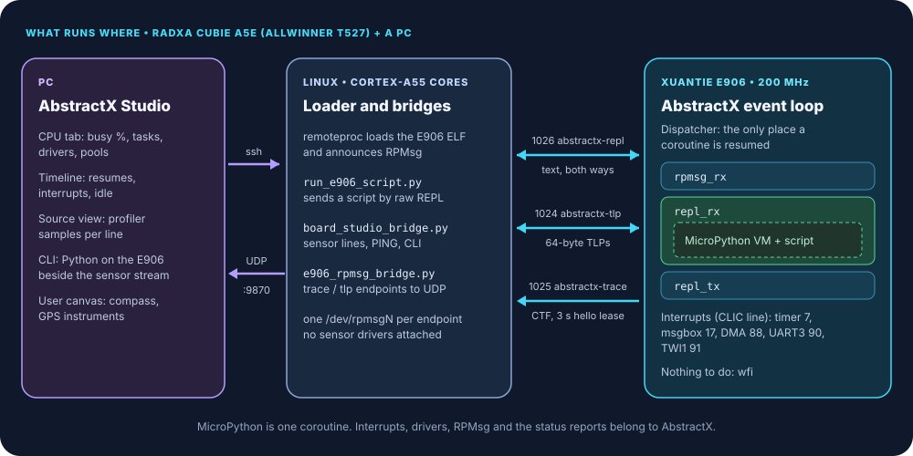
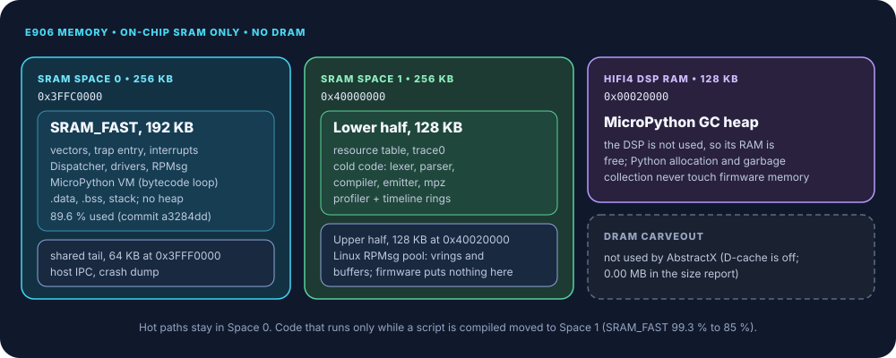

# MicroPython on the E906, With AbstractX Underneath

## Scripting a real-time coprocessor on the Radxa Cubie A5E, with Linux beside it and Studio on the PC

The Allwinner T527 on the Radxa Cubie A5E has Cortex-A55 cores that run Linux
and a XuanTie E906 RISC-V core that Linux does not use. AbstractX runs on that
E906 as bare-metal firmware, and that firmware hosts a MicroPython prompt. You
can type `abstractx.i2c_read(0x1E, 0x0A, 3)` and get an answer from a compass
on the 40-pin header without rebuilding anything, while Linux carries on and
Studio on your PC shows what the E906 is doing with its time.

This article describes that setup: what runs where, how a script reaches the
hardware, where everything sits in memory, how to get a prompt, what Studio
shows, what was measured on the board, and what does not work yet.

> **The one-line takeaway:** the script is the experiment; AbstractX is the part that stays.



*The three columns are three separate machines as far as software is concerned: a PC, Linux on the A55 cores, and the E906.*

> **Scope:** everything here runs on a Cubie A5E with the E906 device-tree
> overlay, a u-blox GPS on UART3 and an HMC5883L compass on I²C1 (TWI1). The
> numbers are from that board between 2026-10-21 and 2026-10-23. Requirements
> live in the specifications linked in each section; this article explains
> them, and the specifications decide.

## What runs where

| Where | What | Job |
| :--- | :--- | :--- |
| PC | AbstractX Studio ([`abstractx_studio.py`](https://github.com/tcmichals/AbstractX/blob/main/tools/visualizer/abstractx_studio.py)) | Starts the board bridges over ssh, listens on UDP port 9870, shows runtime status, profiler, timeline, the CLI and the user instruments |
| Linux on the A55 cores | remoteproc, RPMsg, three small Python tools | Loads the E906 ELF, gives each RPMsg endpoint a `/dev/rpmsgN` node, forwards data to the PC. No sensor driver is attached to UART3 or TWI1 |
| E906 | AbstractX firmware ([`apps/e906_repl_app`](https://github.com/tcmichals/AbstractX/blob/main/apps/e906_repl_app/)) | Interrupts, drivers, the event loop, RPMsg, runtime status and trace |
| E906, inside the event loop | MicroPython | One coroutine, `repl_rx`, that runs whatever script you send it |

The last row is the important one. MicroPython is not the firmware. The
firmware's main loop is `abstractx::step()`, and the AbstractX `Dispatcher`
inside it is the only place a coroutine is resumed. The app names three
coroutines when it spawns them: `rpmsg_rx`, `repl_rx` and `repl_tx`
([`[SPEC-E906-REPL-18]`](https://github.com/tcmichals/AbstractX/blob/main/apps/e906_repl_app/SPECIFICATION.md)).
A MicroPython script runs inside `repl_rx`, so its CPU time shows up under that
name in the runtime status report
([`[SPEC-E906-REPL-03]`](https://github.com/tcmichals/AbstractX/blob/main/apps/e906_repl_app/SPECIFICATION.md)).

Linux and the E906 share the 40-pin header and the peripheral blocks, so
ownership is decided by device-tree overlay. The E906 profile binds UART3, I²C1
and SPI1 to `generic-uio`: Linux ungates their clocks, releases reset and sets
the pin mux, but attaches no driver, so the E906 has the registers to itself.
The [E906 app README](https://github.com/tcmichals/AbstractX/blob/main/apps/e906_repl_app/README.md)
(§2 and §6) covers the overlays and how to switch between the Linux and E906
profiles.

## Why MicroPython, and why AbstractX underneath it

**Why MicroPython.** Bringing up sensors on a coprocessor is mostly finding out
what the hardware actually does. With MicroPython you change a script or type a
line at the prompt instead of rebuilding and reloading firmware for each
experiment. A concrete case: the A5E test board's compass turned out to be an
HMC5883L at `0x1E`, not the expected QMC5883L at `0x0D`. Reading its ID
registers from the prompt showed it (`H43`); before that, every script read
the HMC5883L's configuration registers as if they were data and the heading
never moved (engineering log, 2026-10-21).

The cost is real and was measured: the compass + GPS streaming script keeps
`repl_rx` at about 90 % of the E906. MicroPython is the tool for exploring and
testing. The long-term real-time path is C++20 coroutines against the same
drivers, as in
[Straight-Line Async: GPS + Compass with C++20 Coroutines](https://github.com/tcmichals/AbstractX/blob/main/docs/articles/gps-compass-straight-line-async/README.md).

**Why AbstractX underneath.** Everything a script relies on belongs to
AbstractX:

- **Interrupts and drivers.** The UART3 handler fills a receive ring; the TWI1
  handler runs the I²C transaction state machine. A blocking Python call sleeps
  in `wfi` until an interrupt completes it; it never spins on a register.
- **Scheduling.** The MicroPython bytecode loop calls back into AbstractX
  (`MICROPY_VM_HOOK_LOOP`), which handles pending interrupt work and keeps the
  status reports going while a script runs, so a long Python loop does not stop
  the rest of the system
  ([`[SPEC-E906-REPL-04]`](https://github.com/tcmichals/AbstractX/blob/main/apps/e906_repl_app/SPECIFICATION.md)).
- **Memory.** The firmware has no heap. The MicroPython heap lives in a
  separate RAM, so Python allocation and garbage collection cannot touch
  firmware memory (see [Memory layout](#memory-layout)).
- **Links to Linux.** Three RPMsg channels, never mixed (next section).
- **Measurement.** CPU, coroutine and interrupt figures come from the
  dispatcher and the interrupt layer, not from the script. That is why the cost
  of MicroPython itself can be measured.

When a loop moves from Python to C++, the drivers, RPMsg channels, status
report and Studio views stay the same.

## Three RPMsg channels

Linux and the E906 talk over VirtIO RPMsg. Kicks in both directions go through
the T527 message box, which reaches the E906 as an interrupt on CLIC line 17;
the E906 reads the vrings only after that doorbell, never by polling
([`[SPEC-E906-IRQ-04]`](https://github.com/tcmichals/AbstractX/blob/main/targets/allwinner_e906/SPECIFICATION.md)).
There are three endpoints, each with one wire format
([`[SPEC-E906-REPL-08]`](https://github.com/tcmichals/AbstractX/blob/main/apps/e906_repl_app/SPECIFICATION.md),
[`[SPEC-E906-IPC-04]`](https://github.com/tcmichals/AbstractX/blob/main/targets/allwinner_e906/SPECIFICATION.md)):

| Endpoint | Name | Carries | Direction |
| :--- | :--- | :--- | :--- |
| 1026 | `abstractx-repl` | MicroPython text: prompt, raw REPL, script output, `PING`, `STOP`, CLI commands | both |
| 1024 | `abstractx-tlp` | 64-byte TLPs, up to 7 per RPMsg message (448 of 496 payload bytes) | both |
| 1025 | `abstractx-trace` | CTF packets: runtime status, profiler samples, timeline spans | E906 to Linux |

RPMsg buffers are 512 bytes (16-byte header, 496-byte payload), and Linux
allocates them in the upper half of SRAM Space 1. The trace engine writes CTF
packets straight into those buffers, so sending is a ring update and a message
box kick, with no copy on the E906.

**The trace hello lease.** An RPMsg endpoint learns its Linux peer's address
from the first message Linux sends it, and Linux sends nothing when a reader
closes. The trace endpoint therefore sends only while a host keeps renewing a
lease: every message the host sends to endpoint 1025 (a 4-byte hello) renews it
for 3 s, and the readers (`e906_rpmsg_bridge.py trace`, the board tests) send
one when they open the endpoint and then once a second. With no lease, the
firmware empties its profiler and timeline rings without counting drops and
sends nothing
([`[SPEC-E906-IPC-05]`](https://github.com/tcmichals/AbstractX/blob/main/targets/allwinner_e906/SPECIFICATION.md)).
The reason this exists is in [What went wrong](#what-went-wrong).

The REPL channel has a similar rule in the other direction: while a streaming
script runs, Studio's bridge sends `PING` at least once a second, and the
script stops itself after 3 s without one, so a crashed or closed Studio does
not leave the E906 sending to nobody
([`[SPEC-E906-REPL-14]`](https://github.com/tcmichals/AbstractX/blob/main/apps/e906_repl_app/SPECIFICATION.md)).

> **Today's gap:** the sensor stream still travels as `!RAW:` text lines on the
> REPL channel, and `board_studio_bridge.py` on Linux builds the TLPs that
> Studio draws. The requirement is that the script builds its own TLPs with
> `abstractx.tlp_send()` and Linux only forwards them
> ([`[SPEC-E906-REPL-17]`](https://github.com/tcmichals/AbstractX/blob/main/apps/e906_repl_app/SPECIFICATION.md),
> not implemented yet). TLPs sent from a script do reach Linux on endpoint
> 1024, but Studio does not display them yet.

## Talking to hardware: the `abstractx` module

Scripts reach the hardware through a built-in C module, `abstractx`
([`[SPEC-E906-REPL-06]`](https://github.com/tcmichals/AbstractX/blob/main/apps/e906_repl_app/SPECIFICATION.md),
[`modabstractx.c`](https://github.com/tcmichals/AbstractX/blob/main/apps/e906_repl_app/src/modabstractx.c)):

| Function | What it does |
| :--- | :--- |
| `peek(addr)`, `poke(addr, val)`, `peek_hex(addr)` | 32-bit register or memory access |
| `uart_init([baud])`, `uart_read([n])`, `uart_write(data)`, `uart_status()` | UART3 (GPS). `uart_read` takes bytes from the ring the interrupt handler fills; it does not touch the UART |
| `i2c_init([hz])`, `i2c_scan()`, `i2c_read(addr, reg, n)`, `i2c_write(addr, reg, data)` | TWI1 (compass). Returns empty / 0 on NACK or a 20 ms timeout |
| `sleep_ms(ms)`, `ticks_ms()`, `cycles()` | Sleep in `wfi`; millisecond and `mcycle` counters |
| `console_read([n])` | Bytes from the REPL channel while a script runs (heartbeat, CLI) |
| `tlp_send(buf)`, `tlp_dropped()` | Send a 64-byte TLP on endpoint 1024; count of TLPs that found no buffer |
| `trace(task_id[, state[, msg]])` | Emit a CTF coroutine event on the trace endpoint |
| `irq_stats()` | `{line: count}` for every interrupt line that fired, plus `mtvec`, spurious count, doorbells, UART RX drops and I²C timeouts |
| `dma_bench(n[, port])` | Copy `n` bytes from SRAM Space 0 to Space 1 by DMA and by `memcpy`; returns `(ok, dma_cycles, cpu_cycles)` |

A short probe, using only those calls:

```python
import abstractx

abstractx.i2c_init(400000)
print(abstractx.i2c_scan())                          # e.g. [30] for 0x1E
print(bytes(abstractx.i2c_read(0x1E, 0x0A, 3)))      # HMC5883L ID: b'H43'
print(abstractx.i2c_read(0x1E, 0x03, 6))             # X, Z, Y, big-endian

abstractx.uart_init(9600)        # the u-blox powers up at 9600 baud
abstractx.sleep_ms(500)          # wfi; UART3 interrupts fill the ring meanwhile
print(abstractx.uart_read(512))  # NMEA bytes taken from the ring

print(abstractx.irq_stats())     # which interrupt lines fired, and how often
print(abstractx.dma_bench(1024)) # (ok, dma_cycles, cpu_cycles) at 200 MHz
```

**How the waits work.** Every driver behind the module is interrupt-driven
([`[SPEC-E906-REPL-16]`](https://github.com/tcmichals/AbstractX/blob/main/apps/e906_repl_app/SPECIFICATION.md)):

- **UART3** is on CLIC line 90. On receive the handler reads the FIFO level once
  (`UART_RFL`) and then that many bytes, into a ring. On transmit it refills the
  128-byte FIFO from a ring. `uart_write` sleeps only while the transmit ring
  is full.
- **TWI1** is on CLIC line 91. Each bus step (START, address, register, repeated
  START, data, STOP) is one interrupt that advances a state machine.
  `i2c_read` starts the transaction and sleeps in `wfi` until the handler
  finishes it or a 20 ms timer aborts it with a STOP.
- **Every blocking call** (`sleep_ms`, console input, UART and I²C waits) sleeps
  in `wfi` with the masked-check pattern, then runs the VM hook on each wake,
  so status reports and RPMsg keep moving while Python waits.

UART3 and TWI1 are main-domain peripherals. Their interrupts reach the E906's
CLIC only through the S_INTC group router, which folds eight GIC sources onto
one CLIC line; each handler therefore checks its own peripheral's status
register
([`[SPEC-E906-IRQ-02]`](https://github.com/tcmichals/AbstractX/blob/main/targets/allwinner_e906/SPECIFICATION.md)).
A line that fires with no handler is disabled and counted rather than hanging
the core
([`[SPEC-E906-IRQ-01]`](https://github.com/tcmichals/AbstractX/blob/main/targets/allwinner_e906/SPECIFICATION.md)).

One constraint to know when writing scripts: the board's MicroPython is built
at the minimum ROM level with a few features added back (slicing, `%`
formatting, single-precision float, long integers). `bytes.decode` and
`bytes.fromhex` do not exist; use `str(b, "ascii")` and `int(h, 16)`
([`[SPEC-E906-REPL-19]`](https://github.com/tcmichals/AbstractX/blob/main/apps/e906_repl_app/SPECIFICATION.md)).
There is no filesystem either: `open()` is not defined, and scripts arrive over
RPMsg and are compiled in memory
([`[SPEC-E906-REPL-12]`](https://github.com/tcmichals/AbstractX/blob/main/apps/e906_repl_app/SPECIFICATION.md)).

## Memory layout



The T527's E906 has no tightly coupled memory. It has two 256 KB on-chip SRAM
windows that remoteproc can load, and AbstractX puts nothing in DRAM
([`[SPEC-E906-MEM-01]`](https://github.com/tcmichals/AbstractX/blob/main/targets/allwinner_e906/SPECIFICATION.md)):

| Region | E906 address | Linux address | Holds |
| :--- | :--- | :--- | :--- |
| SRAM Space 0, `SRAM_FAST` | `0x3FFC0000` | `0x07280000` | 192 KB: vectors, interrupts, `Dispatcher`, drivers, RPMsg, the MicroPython VM, data, stack |
| SRAM Space 0, shared tail | `0x3FFF0000` | `0x072B0000` | 64 KB: host IPC and crash dump |
| SRAM Space 1, lower half | `0x40000000` | `0x072C0000` | 128 KB: resource table, `trace0`, cold code (`.text_cold`), profiler and timeline rings (`.sram_c`) |
| SRAM Space 1, upper half | `0x40020000` | `0x072E0000` | 128 KB: Linux's RPMsg vrings and buffers; the firmware places nothing here |
| HiFi4 DSP RAM | `0x00020000` | - | 128 KB: the MicroPython garbage-collected heap |

**The heap is in the DSP's RAM.** The HiFi4 DSP is not used on this board, so
its local RAM is free. `gc_init()` is given that range, MicroPython never calls
`malloc`, and no Python object lives in either SRAM window
([`[SPEC-E906-REPL-02]`](https://github.com/tcmichals/AbstractX/blob/main/apps/e906_repl_app/SPECIFICATION.md)).
By design, a script that runs out of memory fails inside MicroPython's own
heap; it cannot grow into firmware memory.

**Cold code moved to Space 1.** On 2026-10-22 `SRAM_FAST` was 99.3 % full
(1.3 KB free), too full for the profiler. The code that runs only while a
script is being compiled (lexer, parser, compiler, bytecode emitter, number
parsing, `mpz`) was linked into `.text_cold` in the lower half of Space 1: the
same kind of on-chip SRAM, loaded by remoteproc like the resource table.
Interrupts, the `Dispatcher`, the VM and RPMsg stay in `SRAM_FAST`. That took
`SRAM_FAST` from 99.3 % to 85 %. With the profiler, timeline and DMA code
added since, the size report for commit `a3284dd` reads:

```text
SRAM_FAST      0x3FFC0000     192.0 KB       172.1 KB        19.9 KB       89.6%
SRAM_A3_2      0x40000000     128.0 KB        39.6 KB        88.4 KB       31.0%
DRAM           0x48100000      1.00 MB        0.00 MB        1.00 MB        0.0%
```

`SRAM_A3_2` is the linker's name for the lower half of Space 1. Every E906
build runs
[`check_e906_layout.py`](https://github.com/tcmichals/AbstractX/blob/main/tools/check_e906_layout.py),
which fails the build if a loadable segment lands outside the windows above.

## Getting a prompt and running scripts

Build the firmware on the PC and load it on the board with remoteproc (full
steps in the [app README](https://github.com/tcmichals/AbstractX/blob/main/apps/e906_repl_app/README.md), §7):

```bash
# PC
cmake -S . -B build_e906 -DABSTRACTX_TARGET=allwinner_e906
cmake --build build_e906 --target e906_repl_app

# Board
echo stop > /sys/class/remoteproc/remoteproc0/state
cp e906_repl_app.elf /lib/firmware/
echo e906_repl_app.elf > /sys/class/remoteproc/remoteproc0/firmware
echo start > /sys/class/remoteproc/remoteproc0/state
```

**Interactive prompt.** The REPL is the `/dev/rpmsgN` node whose name is
`abstractx-repl`. It is not always `rpmsg0`, because the TLP and trace endpoints
get nodes too:

```bash
grep -l abstractx-repl /sys/class/rpmsg/rpmsg*/name   # find the node
microcom -p /dev/rpmsgN
>>> import abstractx
>>> hex(abstractx.peek(0x02500C7C))
```

From the PC, `apps/e906_repl_app/linux/e906_workbench.py` does the same over
ssh, including one-shot commands (`-c "..."`) and single register reads
(`--peek 0x02502400`).

**Running a script.**
[`run_e906_script.py`](https://github.com/tcmichals/AbstractX/blob/main/apps/e906_repl_app/run_e906_script.py)
runs on the board. It finds (or creates) the `abstractx-repl` endpoint, enters
raw REPL mode, sends the script in chunks, and prints its output:

```bash
# On the board, in /root
python3 run_e906_script.py my_probe.py 30    # stop after 30 s
python3 run_e906_script.py my_probe.py 0     # 0 = run until stopped
```

Ctrl-C reaches the script as a `KeyboardInterrupt`: the firmware takes the
Ctrl-C byte out of the input as it arrives, while a script runs, and the VM hook
raises the exception. Ctrl-D at the prompt is a soft reset, specified to tear down and
reinitialise the VM and its heap without touching the running coroutines
([`[SPEC-E906-REPL-03]`](https://github.com/tcmichals/AbstractX/blob/main/apps/e906_repl_app/SPECIFICATION.md)).

**Python beside the sensor stream.** Studio's **CLI** tab sends Python to the
E906 while the sensor stream keeps running
([`[SPEC-STUDIO-13]`](https://github.com/tcmichals/AbstractX/blob/main/tools/visualizer/SPECIFICATION.md),
[`[SPEC-E906-REPL-19]`](https://github.com/tcmichals/AbstractX/blob/main/apps/e906_repl_app/SPECIFICATION.md)):

```text
Studio CLI ──ssh──> board_studio_bridge.py stdin:  CLI <id> <hex>
                    └─> streamer script on E906:     EXEC <id> <hex>
                        └─> output back:             !CLI:<id>:BEGIN ... !CLI:<id>:END:OK | END:ERR:<repr>
```

The command is hex-encoded so no control byte (such as Ctrl-C) can appear in
it. It runs in a namespace that is kept between commands, with `abstractx`
already imported; it is tried as an expression first (its `repr` is printed)
and as statements if that is a syntax error. An exception is reported and the
stream carries on. A round trip takes about 55 ms, because the streamer checks
for commands between its 100 ms sensor reads. In AbstractX mode the same tab
also has `ps` / `tasks` and `drivers` (tables from the latest status report),
`peek` / `poke`, and `ping` (round-trip time).

To connect Studio: copy the Linux-side scripts to `/root` on the board once,
then `python3 tools/visualizer/abstractx_studio.py --auto-connect` on the PC
(app README §8). Studio starts both the sensor bridge and
`e906_rpmsg_bridge.py trace` over ssh, and both exit when their ssh session
closes.

## Observability: status, profiler, timeline

Because every coroutine resume goes through `Dispatcher::process()`, the
runtime can account for CPU time the way an RTOS does, without the application
asking. Three CTF streams leave the E906 on the trace endpoint, all decoded in
Studio by Python mirrors of the C++ structures that are tested against bytes
the C++ code produced.

**Runtime status, once a second (stream 3)**
([`[SPEC-TRACE-08]`](https://github.com/tcmichals/AbstractX/blob/main/docs/DESIGN_SPECIFICATION.md),
[`[SPEC-E906-IRQ-05]`](https://github.com/tcmichals/AbstractX/blob/main/targets/allwinner_e906/SPECIFICATION.md)).
Each report carries busy %, per-coroutine resumes, run cycles and longest
single resume, per-interrupt-line counts, handler cycles and driver error
counters (`uart3` RX bytes dropped, `twi1` timeouts), and the health of the
coroutine frame pool and dispatcher queue. Idle time is measured with `mcycle`
around the `wfi` in the idle loop, minus interrupt time taken during the sleep.
The idle loop arms a timer wake for the next report, so one goes out every
second even when nothing else happens, and the VM hook does the same while a
script runs
([`[SPEC-E906-REPL-18]`](https://github.com/tcmichals/AbstractX/blob/main/apps/e906_repl_app/SPECIFICATION.md)).
Counters are cumulative, so a lost packet loses no time. Studio's **CPU** tab
draws the busy % history with an auto-scaled axis, so 0.01 % and 90 % are both
readable
([`[SPEC-STUDIO-15]`](https://github.com/tcmichals/AbstractX/blob/main/tools/visualizer/SPECIFICATION.md)).

**Live profiler, 1 kHz (stream 4)**
([`[SPEC-TRACE-09]`](https://github.com/tcmichals/AbstractX/blob/main/docs/DESIGN_SPECIFICATION.md),
[`[SPEC-E906-IRQ-06]`](https://github.com/tcmichals/AbstractX/blob/main/targets/allwinner_e906/SPECIFICATION.md)).
The core timer, which already serves coroutine sleeps and the idle wake, also
fires at the sample rate. Each sample records the interrupted program counter
(`mepc`) and the owner of the CPU at that moment: the coroutine's frame
address, idle, or loop code outside any resume. A sample that interrupted the
idle `wfi` returns to the `wfi` instead of past it, so profiling does not wake
the idle loop and does not show up as busy time. Studio symbolises the PCs with
the firmware ELF, checks that the ELF is the one the board runs, and shows CPU
time per source line and per function in the **Source** view
([`[SPEC-STUDIO-11]`](https://github.com/tcmichals/AbstractX/blob/main/tools/visualizer/SPECIFICATION.md)).
Lines that name a coroutine or driver (`spawn(task, "repl_rx")`,
`describe(line, "uart3")`) also show that object's live numbers.

**Timeline (stream 5)**
([`[SPEC-TRACE-10]`](https://github.com/tcmichals/AbstractX/blob/main/docs/DESIGN_SPECIFICATION.md),
[`[SPEC-STUDIO-17]`](https://github.com/tcmichals/AbstractX/blob/main/tools/visualizer/SPECIFICATION.md)).
One span per coroutine resume, per interrupt handler and per idle period, on
the shared cycle clock. Studio draws them as swimlanes: one lane per coroutine,
one per interrupt line, one for idle. The per-interrupt costs in the next
section were measured from these spans
([`measure_isr.py`](https://github.com/tcmichals/AbstractX/blob/main/tests/board/measure_isr.py)).

The profiler (256 samples) and timeline (512 spans) rings live in Space 1
(`.sram_c`). Under load, the first version sent one packet per stream per
service call and lost samples and spans; it now sends up to four, and the
board test window showed 0 drops.

## Measured on the board

All on the Cubie A5E, E906 at 200 MHz (`mcycle`), 2026-10-21 to 2026-10-23.
The commands and raw output are in the engineering log entries and commit
messages for those dates.

| What | Result |
| :--- | :--- |
| Idle board, no script | 0.01 % busy; 0.34-0.40 % with the 1 kHz profiler on |
| Idle-loop wakes with the profiler on | ~1 per second (was ~1,050 per second before the `wfi + 4` fix) |
| MicroPython compass + GPS streaming script | `repl_rx` ~90 % of the CPU |
| TWI1 (compass), per interrupt | 1.40-1.43 µs |
| TWI1, tight compass read loop | ~16,500 interrupts/s (~9 per 6-byte read), 2.3 % CPU |
| UART3 GPS at 115,200 baud, before the FIFO fix | 29 interrupts/s, median and max 50 µs per interrupt |
| UART3 after (128-byte FIFO, one level read) | median 31.4 µs, max 31.8 µs, 0.071 % CPU |
| One UART register read from the E906 | ~0.29 µs (derived from the fix: 64 fewer `LSR` reads saved 18.6 µs) |
| Studio CLI round trip | ~55 ms |
| Profiler and timeline under load | 0 dropped after the 4-packet drain |
| `SRAM_FAST` | 99.3 % before cold code moved to Space 1, 85 % after, 89.6 % now |
| Board self-test (`tests/board/run_board_tests.py`) | 31 passed, 0 failed, 2 skipped |

Two readings stand out. The interpreter, not the drivers, is where the time
goes: `repl_rx` takes about 90 % while the TWI1 and UART3 handlers together
take well under 1 % in the streaming script (TWI1 0.31-0.36 % in the
2026-10-21 report). And the UART fix shows how expensive byte-at-a-time register
access is from this core: one read costs roughly 58 cycles, so a design that
touches the UART once per byte cannot scale to high baud rates. That leads to
DMA.

## DMA on the E906

The T527 has one main DMA controller at `0x03002000` with 16 channels, and
Linux's `sun6i-dma` driver normally owns all of them. AbstractX shares it
([`[SPEC-E906-HAL-01]`](https://github.com/tcmichals/AbstractX/blob/main/targets/allwinner_e906/SPECIFICATION.md)):

- **Channels.** The E906 overlay sets `dma-channels = <8>`, so Linux uses
  channels 0-7 and the E906 owns 8-15. The E906 never touches the controller's
  clock gate or reset; Linux owns those.
- **Interrupt routing.** Two registers decide which CPU sees each channel's
  interrupt: `DMAC_IRQ_CPU_EN_REG` (+0x34) and `DMAC_IRQ_MCU_EN_REG` (+0x38).
  Both reset to `0xFFFF` (read on the board) and Linux never writes them. Before
  enabling any channel interrupt, the E906 sets the MCU register to `0xFF00` and
  clears bits 8-15 of the CPU register (`0x00FF`). Otherwise Linux's handler,
  which reads only the status register for its 8 channels, would see an
  interrupt it cannot clear. Channels 8-15 reach the E906 on CLIC line 88.
- **Physical addresses.** The DMA controller sees physical addresses, not E906
  addresses. Space 0 and Space 1 share one offset (PA = DA - `0x38D40000`), and
  every descriptor field is converted. The first driver passed E906 addresses
  and never routed the interrupt.
- **A known hazard.** If `sun6i-dma` is removed or fails to probe, Linux writes
  0 to both enable registers, which also disables the E906's channel
  interrupts. The E906 must detect a lost enable (status set, no interrupt)
  rather than assume it.

**The rule.** A transfer larger than the peripheral's hardware FIFO uses DMA; a
transfer that fits uses the FIFO and one completion interrupt. One driver per
bus applies the rule per transfer, so device drivers never choose. FIFO sizes
from the T527 manual: SPI 64 B per direction, UART1-7 128 B (UART3's 128 B was
also read from `UART_FCC` on the board), UART0 and S_UART 64 B.

**What DMA costs.** `abstractx.dma_bench()` copies SRAM Space 0 to Space 1 and
waits for the line-88 completion interrupt, against `memcpy` of the same bytes:

| Bytes | DMA (start to completion seen by the waiting code) | `memcpy` |
| ---: | ---: | ---: |
| 4 | 4.4 µs | 0.45 µs |
| 64 | 4.8 µs | 3.9 µs |
| 256 | 7.0 µs | 14.4 µs |
| 1024 | 10.8 µs | 56.6 µs |

DMA has a fixed cost of about 4.4 µs and then moves data much faster than the
CPU; the crossover lies between 64 and 256 bytes for memory copies. For a
peripheral the comparison is not with `memcpy` but with byte-at-a-time
register reads at ~0.29 µs each, which is why the rule is tied to the FIFO
size.

**UART receive will always be DMA (designed, not yet implemented).** A UART
receive stream is always larger than the FIFO, so the decision is that every
UART receive uses circular DMA at every baud rate
([`[SPEC-E906-HAL-02]`](https://github.com/tcmichals/AbstractX/blob/main/targets/allwinner_e906/SPECIFICATION.md)).
The design: four buffers in Space 1, 64 B each by default, linked as a circular
descriptor chain on one E906 channel with the UART's RX DRQ as source. Each
buffer's "package end" interrupt hands it to the reader; at the end of a frame
the UART's DMA receive timeout moves the bytes left in the FIFO, and the
RX-timeout interrupt reads the DMA's current destination to hand over the
partly filled buffer. Laps over an unreleased buffer are counted as drops,
never delivered as data. The reader is a coroutine that gets spans into the
ring without a copy; MicroPython's `uart_read` copies from the same spans.
Transmit stays FIFO for messages up to 128 B and DMA above, with the UART's own
`TX_DELAY` register for an inter-byte gap
([`[SPEC-HAL-06]`](https://github.com/tcmichals/AbstractX/blob/main/docs/DESIGN_SPECIFICATION.md)).
None of the UART ring exists in code yet: today UART3 still receives by
interrupt, as described above.

## What went wrong

> **Two mistakes worth knowing about**
>
> **The console flood.** The first profiler firmware sent about 20 trace
> packets a second. The trace endpoint kept sending to the host address it had
> learned from an earlier hello after that reader had closed, because Linux
> sends nothing when a reader closes. Linux logged
> `virtio_rpmsg_bus: msg received with no recipient` for every packet on the
> serial console, the console became unusable and the board was rebooted
> twice. The status report had the same flaw at one packet a second, which is
> why nobody had noticed. Fix: the 3 s hello lease, and a board test that
> checks the kernel log stays quiet after the reader closes
> ([`[SPEC-E906-IPC-05]`](https://github.com/tcmichals/AbstractX/blob/main/targets/allwinner_e906/SPECIFICATION.md)).
>
> **`mepc = wfi + 4`.** A profiler sample that interrupts the idle `wfi` should
> return to the `wfi`. The first fix compared `mepc` with the address of the
> `wfi` instruction, but this E906 reports the instruction after it (measured:
> `mepc = 0x3FFD4AA2` with the `wfi` at `0x3FFD4A9E`). The check never matched
> and the idle loop still woke about 1,050 times a second. The firmware now
> accepts both addresses, and idle-loop wakes dropped to about one a second
> ([`[SPEC-E906-IRQ-06]`](https://github.com/tcmichals/AbstractX/blob/main/targets/allwinner_e906/SPECIFICATION.md)).

Neither problem was visible to host tests. Both were found on the board and are
recorded in the [engineering log](https://github.com/tcmichals/AbstractX/blob/main/engineering_log.md)
(2026-10-22).

## Limits and what is not verified

- **UART speed.** `APB1_CLK_REG` reads 0 on the board: APB1 runs from the
  24 MHz oscillator, so UART1-7 top out at 1.5 Mbit/s. Faster serial needs
  Linux to change the clock of the whole APB1 bus.
- **MicroPython is expensive.** The streaming script keeps `repl_rx` at about
  90 % of the E906. The interpreter is for bring-up and experiments; real-time
  loops belong in C++ coroutines.
- **UART receive DMA is designed, not implemented.** UART3 receives by
  interrupt today. The DMA ring and its board test do not exist yet.
- **SPI DMA.** The SPI driver still passes E906 addresses to the DMA controller
  (noted in commit `a3284dd`); only memory-to-memory DMA works today.
- **Script-built telemetry.** `[SPEC-E906-REPL-17]` is not implemented: Linux
  still builds the sensor TLPs, and TLPs sent with `tlp_send()` are not shown in
  Studio.
- **Studio's profiler and timeline views.** The streams arrive on the board with
  0 drops, and the decoders and views are tested on the host; the per-line
  source view and the swimlanes have not been checked on screen against the
  live board.
- **Not measured:** UART behaviour at high baud rates, overrun behaviour while
  interrupts are masked, how a lost DMA interrupt enable is detected in
  practice, and where inside the interpreter `repl_rx`'s 90 % goes.

## Where to go next

- [E906 MicroPython application README](https://github.com/tcmichals/AbstractX/blob/main/apps/e906_repl_app/README.md): wiring, overlays, build, Studio connection, self-test
- [E906 MicroPython application specification](https://github.com/tcmichals/AbstractX/blob/main/apps/e906_repl_app/SPECIFICATION.md) (`[SPEC-E906-REPL-*]`)
- [E906 target specification](https://github.com/tcmichals/AbstractX/blob/main/targets/allwinner_e906/SPECIFICATION.md): memory, interrupts, RPMsg, DMA
- [Design specification](https://github.com/tcmichals/AbstractX/blob/main/docs/DESIGN_SPECIFICATION.md): runtime status, profiler and timeline wire formats, UART configuration
- [AbstractX Studio specification](https://github.com/tcmichals/AbstractX/blob/main/tools/visualizer/SPECIFICATION.md)
- [Straight-Line Async: GPS + Compass with C++20 Coroutines](https://github.com/tcmichals/AbstractX/blob/main/docs/articles/gps-compass-straight-line-async/README.md)
- [Bare Metal + AbstractX vs FreeRTOS + AbstractX on the XuanTie E906](https://github.com/tcmichals/AbstractX/blob/main/docs/articles/BAREMETAL_VS_FREERTOS_E906.md)
