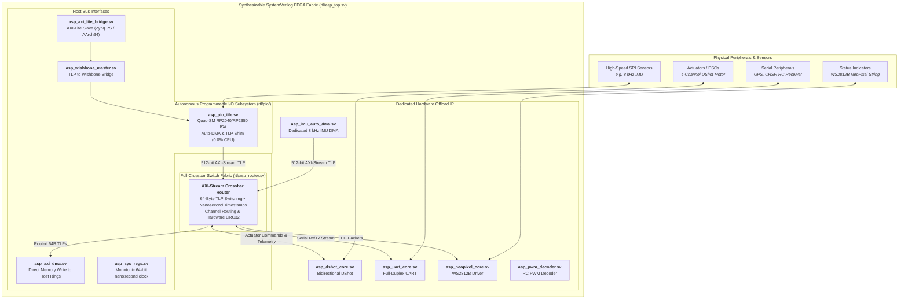

# AbstractX Synthesizable SystemVerilog FPGA Fabric — Architecture Guide

> **SSOT Notice**: This documentation is automatically generated from authoritative specifications (`docs/DESIGN_SPECIFICATION.md`, `rtl/pio/docs/SPECIFICATION.md` (pio2 submodule)) and verified against SystemVerilog RTL source code by SpecTrace. Do not edit manually.

## 1. Executive Architectural Overview

In AbstractX, **the FPGA is really just all hardware drivers**. Rather than burning CPU cycles executing software driver routines or polling hardware registers, autonomous synthesizable SystemVerilog cores act as pure hardware drivers connected to a high-speed, non-blocking **PCIe-style crossbar switch fabric**.

All transactions in the FPGA fabric flow as standardized **64-Byte Transaction Layer Packets (TLPs)** over a 512-bit wide AXI-Stream bus with credit flow control (`tvalid`/`tready`) and hardware nanosecond timestamping.

## 2. Fabric Architecture Diagram

## 3. Peripheral Subsystem & Address Map

The FPGA fabric integrates peripherals on standard Wishbone B4 and AXI-Lite buses (Base `0x40000000`):

| Base Address | Subsystem Core | SystemVerilog File | Description |
| :--- | :--- | :--- | :--- |
| `0x40000000` | **System Registers** | [`asp_sys_regs.sv`](asp_sys_regs.sv) | 64-bit nanosecond timebase, hardware ID, uptime counter |
| `0x40000100` | **IMU Auto-DMA** | [`imu/asp_imu_auto_dma.sv`](imu/asp_imu_auto_dma.sv) | Dedicated ICM-42688-P Auto-DMA SPI master |
| `0x40000200` | **DShot Motor Core** | [`motor/asp_dshot_core.sv`](motor/asp_dshot_core.sv) | 4-channel bidirectional DShot motor output with eRPM telemetry |
| `0x40000300` | **PWM Decoder** | [`pwm/asp_pwm_decoder.sv`](pwm/asp_pwm_decoder.sv) | 8-channel RC PWM pulse-width decoder |
| `0x40000500` | **UART Core** | [`serial/asp_uart_core.sv`](serial/asp_uart_core.sv) | High-speed full-duplex UART transceiver (CRSF / GPS) |
| `0x40000600` | **NeoPixel Core** | [`led/asp_neopixel_core.sv`](led/asp_neopixel_core.sv) | WS2812B single-wire RGB LED string driver |
| `0x40000700` | **Autonomous PIO Tile** | [`pio/asp_pio_tile.sv`](pio/asp_pio_tile.sv) | Quad-SM programmable I/O tile with RP2040 ISA (45% LUT savings) |

## 4. Key Subsystem Guides
* [**Autonomous Programmable I/O (PIO) Guide**](pio/README.md): Detailed specifications, register map, RP2040 ISA opcodes, and supervisor-worker patterns.
* [**64-Byte TLP Wire Format & Bus Specification**](../docs/DESIGN_SPECIFICATION.md#spec-tlp-01): Standard framing, split transaction completions, and CTF 1.8 schemas.
* [**Hardware ILA Trace Engine**](asp_ila_trace.sv): Real-time nanosecond trace capture into ring buffers.

## 5. Verification & Regression Gateways
All RTL modules undergo multi-layer verification:
1. **Cocotb Regression Suite**: Run `make` under `sim/cocotb/` with Verilator / Icarus.
2. **Verilator Linting**: Zero-warning enforcement (`verilator --lint-only -Wall rtl/*.sv`).
3. **FPGA Synthesis**: Verified on Gowin GW2A-18 (Tang Nano 20K) and Xilinx Zynq-7020 (QMTech).
