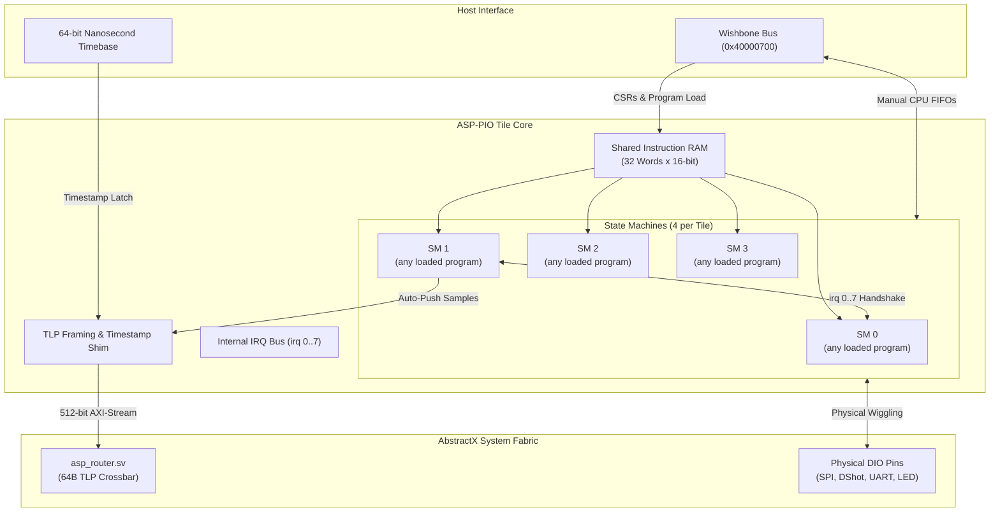

# AbstractX Autonomous Programmable I/O (PIO) Engine — Developer Guide

> **SSOT Notice**: This documentation is automatically generated from the authoritative specification [`SPECIFICATION.md`](SPECIFICATION.md) and verified against SystemVerilog RTL source code by SpecTrace. Do not edit manually.

## 1. Executive Architectural Overview

The **AbstractX Programmable I/O (ASP-PIO) Tile** is a synthesizable, autonomous quad-core micro-sequencer subsystem designed for FPGA-based real-time flight controllers, robotics, and industrial peripherals. Inspired by the Raspberry Pi RP2040 and RP2350 PIO architectures, ASP-PIO provides determinism and speed that CPU interrupts cannot match.

### Key Value Propositions
* **0.0% CPU Utilization for High-Rate Sensors**: Executes autonomous 8 kHz SPI burst readout of IMUs (e.g. ICM-42688-P) on physical DRDY pin assertions, packaging sensor data directly into 64-byte TLPs without waking the host CPU.
* **45% FPGA Logic Reduction**: Replaces multiple dedicated, hardwired IP blocks (IMU Auto-DMA, DShot motor driver, RC PWM decoder, and UART cores) with a single, highly flexible Quad-SM PIO Tile consuming only **~940 LUTs / ~700 FFs**.
* **100% RP2040/RP2350 ISA Compatibility**: Compile assembly programs using the official Raspberry Pi `pioasm` compiler (`pioasm -v 0` or `-v 1`).
* **Nanosecond Hardware Timebase Latching**: Integrated TLP packetizer shim latches the 64-bit monotonic system timebase at the exact cycle of physical DRDY assertion, eliminating software scheduling jitter.
* **Native barectf CTF 1.8 Observability**: Streams hardware execution states and cycle timings into Stream 5, allowing cycle-accurate hardware state machine visualization in AbstractX Studio.

## 2. Subsystem Architecture & Dataflow

### Diagram 1: Quad-SM PIO Tile & TLP Crossbar Interconnect


## 3. Hardware Interface & Port Specifications

Top-level module: [`asp_pio_tile`](file:///rtl/pio/asp_pio_tile.sv)

| Signal Name | Direction | Width | Description |
| :--- | :--- | :--- | :--- |
| `clk` | `input` | `1 bit` | Fabric clock (typically 50–100 MHz) |
| `rst_n` | `input` | `1 bit` | Asynchronous active-low system reset |
| `i_sys_timestamp` | `input` | `64 bits` | Monotonic 64-bit nanosecond hardware timebase |
| `i_gpio` | `input` | `32 bits` | Physical DIO pin inputs (sensors, DRDY, UART RX, RC PWM) |
| `o_gpio_out` | `output` | `32 bits` | Physical DIO pin output levels (SPI SCLK/MOSI, DShot, UART TX) |
| `o_gpio_pindir` | `output` | `32 bits` | Physical DIO pin output directions (1 = Output, 0 = Input) |
| `wb_cyc_i` | `input` | `1 bit` | Wishbone B4 cycle strobe |
| `wb_stb_i` | `input` | `1 bit` | Wishbone B4 transaction strobe |
| `wb_we_i` | `input` | `1 bit` | Wishbone B4 write enable (1 = Write, 0 = Read) |
| `wb_adr_i` | `input` | `32 bits` | Wishbone address bus (`0x40000700` base) |
| `wb_dat_i` | `input` | `32 bits` | Wishbone write data bus |
| `wb_dat_o` | `output` | `32 bits` | Wishbone read data bus |
| `wb_ack_o` | `output` | `1 bit` | Wishbone slave acknowledge handshake |
| `m_tlp_tdata` | `output` | `512 bits` | Egress 64-Byte TLP datagram bus into `asp_router.sv` |
| `m_tlp_tvalid` | `output` | `1 bit` | TLP stream valid flag |
| `m_tlp_tready` | `input` | `1 bit` | TLP router backpressure ready flag |
| `o_pio_irq` | `output` | `1 bit` | Hardware tile interrupt request to host CPU (`irq[3:0]`) |

## 4. Wishbone B4 Memory Map & Register Architecture

Base Address: `0x40000700` (Wishbone Pipelined Slave B4)

| Offset | Name | Access | Reset Value | Description |
| :--- | :--- | :--- | :--- | :--- |
| `0x000` | **`CTRL`** | `R/W` | `0x00000000` | State Machine Enable [3:0], Restart [7:4], Div Restart [11:8] |
| `0x004` | **`IRQ`** | `R/W1C` | `0x00000000` | Internal 8-bit IRQ Bus Status & Clear (Bits 3:0 route to `o_pio_irq`) |
| `0x008` | **`FSTAT`** | `RO` | `0x0F000000` | FIFO Status: RX Empty [31:28], TX Full [27:24] |
| `0x00C` | **`TLP_CFG`** | `R/W` | `0x00000000` | TLP Auto-DMA Config: Enable [0], Tag [15:8], Channel [23:16], Stream SM [25:24], Burst Words [28:26], Trace Enable [31] |
| `0x010..0x08C` | **`IRAM[0..31]`** | `R/W` | `0x00000000` | Shared Instruction Memory (32 Words x 16-bit) for SM0..SM3 |
| `0x100 + 0x20*N` | **`SM[N]_CLKDIV`** | `R/W` | `0x00000000` | SM N Clock Divider (RP2040 layout): Int [31:16], Frac [15:8] (0 or 1.0 = full fabric clock) |
| `0x104 + 0x20*N` | **`SM[N]_EXECCTRL`** | `R/W` | `0x0001F000` | Execution Control (RP2040 layout): Status N [3:0], Status Sel [4], Wrap Bottom [11:7], Wrap Top [16:12], JMP Pin [28:24], Side Pindir [29], Side En [30] |
| `0x108 + 0x20*N` | **`SM[N]_SHIFTCTRL`** | `R/W` | `0x00000000` | Shift Control: Autopull [17], Autopush [16], In Dir [18], Out Dir [19], Push Thresh [24:20], Pull Thresh [29:25] |
| `0x10C + 0x20*N` | **`SM[N]_PINCTRL`** | `R/W` | `0x00000000` | Pin Mapping (RP2040 layout): Out Base [4:0], Set Base [9:5], Sideset Base [14:10], In Base [19:15], Out Count [25:20], Set Count [28:26], Sideset Count [31:29] (includes the enable bit when Side En) |
| `0x110 + 0x20*N` | **`SM[N]_TXF`** | `WO` | `-` | SM N TX FIFO Data Write (4 Words deep) |
| `0x114 + 0x20*N` | **`SM[N]_RXF`** | `RO` | `-` | SM N RX FIFO Data Read (4 Words deep) |
| `0x118 + 0x20*N` | **`SM[N]_STATUS / SM[N]_INSTR`** | `R / W` | `0x00000000` | Read: PC [4:0], Stalled [5], Active [6]. Write: execute this instruction immediately, even while disabled (RP2040 SMx_INSTR) |
| `0x11C + 0x20*N` | **`SM[N]_TRIGGER`** | `WO` | `-` | Software Trigger Pulse (Forces SM out of `WAIT 1 PIN`) |

## 5. Instruction Set Architecture (ISA) & Compiler Guide

Each state machine implements the complete 16-bit RP2040 PIO instruction set. Every instruction executes in a single clock cycle and supports up to 5 delay cycles and up to 5 side-set pin assertions:

| Opcode | Binary | Mnemonic Syntax | Description |
| :--- | :--- | :--- | :--- |
| **`JMP`** | `3'b000` | `JMP <args> [side N] [delay]` | Conditional and unconditional branch (`!X`, `X--`, `!Y`, `Y--`, `X!=Y`, `PIN`, `!OSRE`) |
| **`WAIT`** | `3'b001` | `WAIT <args> [side N] [delay]` | Cycle-accurate synchronization on GPIO input, internal IRQ flag, or pin level |
| **`IN`** | `3'b010` | `IN <args> [side N] [delay]` | Shift 1..32 bits from Source (`PINS`, `X`, `Y`, `ZERO`, `ISR`, `OSR`) into Input Shift Register (ISR) |
| **`OUT`** | `3'b011` | `OUT <args> [side N] [delay]` | Shift 1..32 bits from Output Shift Register (OSR) to Destination (`PINS`, `X`, `Y`, `PINDIRS`, `PC`, `ISR`, `EXEC`) |
| **`PUSH`** | `3'b100` | `PUSH <args> [side N] [delay]` | Push ISR into 4-word RX FIFO (supports non-blocking and blocking if full) |
| **`PULL`** | `3'b100` | `PULL <args> [side N] [delay]` | Pull 32-bit word from TX FIFO into OSR (supports non-blocking and blocking if empty) |
| **`MOV`** | `3'b101` | `MOV <args> [side N] [delay]` | Copy 32-bit data between registers (`X`, `Y`, `PINS`, `STATUS`, `ISR`, `OSR`, `EXEC`) with optional bit invert/reverse |
| **`IRQ`** | `3'b110` | `IRQ <args> [side N] [delay]` | Set (`set`), clear (`clear`), or block (`wait`) on internal 8-bit IRQ bus |
| **`SET`** | `3'b111` | `SET <args> [side N] [delay]` | Direct immediate 5-bit write to Destination (`PINS`, `PINDIRS`, `X`, `Y`) |

### Compiling with Official `pioasm`
Programs can be authored in standard `.pio` assembly format and compiled directly using the Raspberry Pi SDK compiler:
```bash
~/.tools/pico-sdk/tools/pioasm/build/pioasm -v 0 my_sensor.pio my_sensor.hex
```

## 6. Supervisor-Worker Coordination Pattern

ASP-PIO implements a hardware **Supervisor-Worker Pattern** using an internal 8-bit IRQ bus (`irq[7:0]`):
1. **SM 1 (Supervisor)** blocks on the physical sensor interrupt line (`WAIT 1 PIN 0`).
2. When DRDY asserts, SM 1 pulses an internal IRQ flag (`IRQ SET 0`) to trigger SM 0 (SPI Worker).
3. **SM 0 (Worker)** unblocks (`WAIT 1 IRQ 0`), pulses the SPI clock (`SCLK`), clocks out command bytes, and reads back 14 bytes of accelerometer and gyroscope data into its RX FIFO.
4. When complete, SM 0 signals `IRQ SET 1` and SM 1 completes the handshake.
5. The integrated **TLP Shim** pops the 14-byte sample, latches the 64-bit nanosecond timestamp, and pushes a 64-byte `Tlp64` packet onto the 512-bit AXI-Stream fabric in **1 single clock cycle**.

## 7. Verification & Cocotb Regression Suite

The PIO subsystem is verified using Cocotb and Verilator (`sim/cocotb/test_asp_pio_cocotb.py`):
```bash
cd sim/cocotb
make -f Makefile TESTCASE=test_asp_pio_cocotb
```

### Test Suite Coverage
* `test_wishbone_iram_and_registers`: Verifies 32-word IRAM access, clock divider, and EXECCTRL registers.
* `test_sm_gpio_set_and_jmp`: Verifies JMP conditions (`!X`, `X--`), SET instructions, and delay cycles.
* `test_tx_fifo_pull_and_out`: Verifies PULL/OUT dataflow and dynamic EXEC instruction injection.
* `test_supervisor_worker_irq_chaining`: Verifies supervisor/worker synchronization via the internal IRQ bus.
* `test_tlp_packetizer_and_trace_stream`: Verifies autonomous 64-byte TLP generation and Stream 5 timeline tracing.

## 8. SpecTrace Normative Requirements Matrix

| Requirement ID | Title | Verification Skill | Implementation Target |
| :--- | :--- | :--- | :--- |
| `SPEC-PIO-01` | **Quad-State Machine Tile Architecture** | ``cocotb-regression`, `rtl-lint`` | ``rtl/pio/asp_pio_tile.sv`, `rtl/pio/asp_pio_sm.sv`` |
| `SPEC-PIO-00` | **Configurable Fabric: No Protocol Logic in the FPGA** | ``rtl-lint`, `cocotb-regression`` | ``rtl/asp_top.sv`, `rtl/pio/asp_pio_tile.sv`` |
| `SPEC-PIO-02` | **Standard RP2040 16-Bit Instruction Set Compatibility** | ``cocotb-regression` (`sim/cocotb/test_asp_pio_conformance_cocotb.py`: each rule` | ``rtl/pio/asp_pio_sm.sv`` |
| `SPEC-PIO-03` | **Internal IRQ Bus & Supervisor/Worker State Machine Chaining** | ``cocotb-regression`` | ``rtl/pio/asp_pio_tile.sv`, `rtl/pio/asp_pio_sm.sv`` |
| `SPEC-PIO-04` | **Integrated 64-Byte TLP Framing & Nanosecond Timestamping** | ``cocotb-regression`, `sanitizer-gate`` | ``rtl/pio/asp_pio_tlp_shim.sv`, `rtl/pio/asp_pio_tile.sv`` |
| `SPEC-PIO-05` | **Wishbone B4 Slave Bus Interface & Register Map** | ``cocotb-regression`` | ``rtl/pio/asp_pio_tile.sv`` |
| `SPEC-PIO-06` | **Multi-Rate Primary-Paced IMU Auto-DMA Sequence** | ``cocotb-regression`, `board-bringup`` | ``rtl/pio/asp_pio_tlp_shim.sv`, `rtl/pio/asp_pio_tile.sv`` |
| `SPEC-PIO-07` | **barectf CTF 1.8 Hardware Observability & Timeline Integration** | ``cocotb-regression`, `host-tests`` | ``rtl/pio/asp_pio_tlp_shim.sv`, `rtl/pio/asp_pio_tile.sv`` |
| `SPEC-PIO-09` | **Generic Bidirectional Pins** | ``rtl-lint`, `cocotb-regression`, `fpga-fit`` | ``rtl/asp_top.sv`, board tops under `hw/`, `hw/<board>/pins.toml`, `tools/pin_map.py`` |
| `SPEC-PIO-10` | **Generic Per-Tile TLP Data Path** | ``cocotb-regression`` | ``rtl/pio/asp_pio_tile.sv`, `rtl/pio/asp_pio_tlp_shim.sv`` |
| `SPEC-PIO-11` | **Program Library and Loading** | ``cocotb-regression` (tests load the checked-in images), the `--check` tool` | ``rtl/pio/programs/`, `tools/pio_programs.py`` |
| `SPEC-PIO-12` | **Motor Outputs: Bidirectional DShot600 as a PIO Program** | ``cocotb-regression` (timing parity with the `asp_dshot_core` test at 12, 27 and` | ``rtl/pio/programs/dshot_bidir.pio`` |
| `SPEC-PIO-13` | **ESC 4-Way Passthrough as a PIO Program** | ``cocotb-regression` (byte TX/RX at 19200 against a modelled ESC, guard time,` | ``rtl/pio/programs/esc_serial.pio`` |
