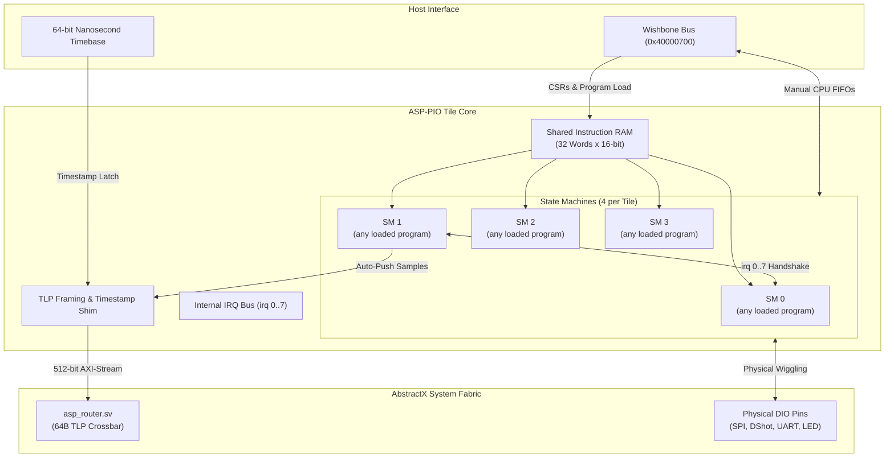

# AbstractX Programmable I/O (PIO) Engine Specification

```
Document:    rtl/pio/SPECIFICATION.md
Status:      Active / SSOT
Governs:     rtl/pio/asp_pio_tile.sv, rtl/pio/asp_pio_sm.sv, rtl/pio/asp_pio_tlp_shim.sv, rtl/pio/programs/, sim/cocotb/test_asp_pio_cocotb.py, sim/cocotb/test_asp_pio_conformance_cocotb.py
Last Update: 2026-10-27
```

---

## 1. Overview & Architecture

The AbstractX Programmable I/O (**ASP-PIO**) engine is a high-speed, synthesizable SystemVerilog hardware subsystem designed to offload physical pin serialization, sensor protocol handshakes, and actuator timing from the main CPUs (AArch64 host, XuanTie E906, and Cortex-M33).

It implements the proven **RP2040 16-bit PIO Instruction Set Architecture (ISA)** augmented with **AbstractX 64-Byte TLP Stream Integration** and **Supervisor-Worker State Machine Chaining**.



---

## 2. Formal Requirements

### `[SPEC-PIO-01]` Quad-State Machine Tile Architecture
* **Requirement**: The PIO block MUST instantiate four (4) independent, concurrent State Machines (SM0..SM3) sharing a 32-word x 16-bit dual-port instruction memory. Each state machine operates on an independent fractional 16-bit clock divider (`div_int[15:0]`, `div_frac[7:0]`), supporting execution speeds from the full fabric clock (e.g. 100 MHz) down to sub-kHz rates.
* **Implementation Target**: `rtl/pio/asp_pio_tile.sv`, `rtl/pio/asp_pio_sm.sv`
* **Verified by**: `cocotb-regression`, `rtl-lint`

### `[SPEC-PIO-00]` Configurable Fabric: No Protocol Logic in the FPGA
* **Decision (project owner, 2026-10-27)**: the FPGA is configured by loading PIO code, never by
  changing RTL. Every pin function (DShot in any variant, bidirectional DShot, PWM/OneShot, the ESC
  4-way passthrough UART, SPI/IMU, LED, RC input) is a PIO program plus its configuration (clock
  divider, pin mapping, shift control), loaded by the host at run time over CONTROL TLPs. Choosing
  another protocol or rate needs no new bitstream.
* **Requirement**: RTL provides only generic resources: PIO tiles ([SPEC-PIO-01]), generic
  bidirectional pins ([SPEC-PIO-09]), a generic per-tile TLP data path ([SPEC-PIO-10]) and program
  loading ([SPEC-PIO-11]). No module may encode a protocol (bit timing, framing, command words,
  telemetry decode). Protocol knowledge lives in `rtl/pio/programs/*.pio` and host software.
* **Requirement (migration)**: the dedicated cores `asp_dshot_core`, `asp_uart_core`,
  `asp_neopixel_core`, `asp_pwm_decoder` and `asp_imu_auto_dma` are removed once a PIO program
  passes a cocotb timing-parity test against the behaviour it replaces. First: motors and ESC
  passthrough ([SPEC-PIO-12], [SPEC-PIO-13]).
* **Verified by**: `rtl-lint`, `cocotb-regression`
* **Implementation Target**: `rtl/asp_top.sv`, `rtl/pio/asp_pio_tile.sv`

### `[SPEC-PIO-02]` Standard RP2040 16-Bit Instruction Set Compatibility
* **Requirement**: Each state machine MUST implement the exact 16-bit RP2040 instruction encoding, supporting all 9 core operations:
  1. `JMP` (`000`): Conditional branch (`!X`, `X--`, `!Y`, `Y--`, `X!=Y`, `PIN`, `!OSRE`).
  2. `WAIT` (`001`): Cycle-exact stall on GPIO pin, mapped pin, or internal IRQ flag.
  3. `IN` (`010`): Shift 1 to 32 bits from source (pins, X, Y, null, ISR, OSR) into ISR.
  4. `OUT` (`011`): Shift 1 to 32 bits from OSR to destination (pins, X, Y, null, pindirs, PC, ISR, exec).
  5. `PUSH` / `PULL` (`100`): Move words between ISR/OSR and 4-word deep RX/TX FIFOs.
  6. `MOV` (`101`): Move/invert/bit-reverse data between X, Y, pins, ISR, OSR, and status.
  7. `IRQ` (`110`): Set, clear, and wait on internal IRQ flags.
  8. `SET` (`111`): Direct immediate 5-bit write to pins, pindirs, X, or Y.
* All instructions MUST support concurrent 5-bit delay and side-set pin driving.
* **Requirement (conformance, 2026-10-27)**: programs assembled by the Raspberry Pi `pioasm` run
  unchanged, with RP2040 datasheet semantics (§3.4, §3.5.4, §3.7). In particular:
  1. A blocking `pull`, `push`, `wait`, `irq wait`, an autopush with a full RX FIFO, or an `out`
     with autopull on an empty TX FIFO stalls: the PC does not advance, the delay does not start,
     and the instruction re-executes until it can complete. Side-set is asserted while stalled.
  2. `pull noblock` on an empty TX FIFO copies X into OSR; `push noblock` on a full RX FIFO does
     nothing. `pull ifempty` / `push iffull` act only at the threshold.
  3. Autopush pushes the ISR after the shift; autopull refills OSR when the shift count reaches
     the threshold, and an `out` on an empty OSR with an empty FIFO stalls.
  4. `mov isr, x` clears the ISR shift count; `mov osr, x` sets the OSR count to 0 (full);
     `mov x, status` gives all-ones when the selected FIFO level is below `STATUS_N`, else zero.
  5. `PINCTRL.SIDESET_COUNT` includes the enable bit when `EXECCTRL.SIDE_EN` is set, as in the Pico
     SDK and in the `sideset.size` field of `pioasm -o json`.
  6. `irq wait` sets the flag and waits until it is cleared; `irq rel` maps index `i` to
     `{i[2], (i[1:0] + sm) % 4}`.
  7. `SM_RESTART` clears the ISR/OSR shift counts, delay and stall, and returns the PC to
     `wrap_bottom`; pin output/direction ownership is released (pins return to input).
* **Verified by**: `cocotb-regression` (`sim/cocotb/test_asp_pio_conformance_cocotb.py`: each rule
  above with `pioasm` output; first failing case on 2026-10-27: `pull block` advanced the PC)
* **Implementation Target**: `rtl/pio/asp_pio_sm.sv`

### `[SPEC-PIO-03]` Internal IRQ Bus & Supervisor/Worker State Machine Chaining
* **Requirement**: The tile MUST provide an internal 8-bit IRQ flag register (`irq[7:0]`). State machines can set flags (`irq set N`), clear flags (`irq clear N`), and block until cleared (`irq wait N` / `wait 1 irq N`).
* **Supervisor Pattern**: High-level sequencer state machines (e.g. IMU Auto-DMA) trigger low-level bus transceivers (e.g. SPI Worker) via internal IRQs without invoking the main CPU or generating interrupt storms.
* **Implementation Target**: `rtl/pio/asp_pio_tile.sv`, `rtl/pio/asp_pio_sm.sv`
* **Verified by**: `cocotb-regression`

### `[SPEC-PIO-04]` Integrated 64-Byte TLP Framing & Nanosecond Timestamping
* **Requirement**: The PIO tile MUST integrate an autonomous TLP packetizer shim. When a designated state machine pushes a completed sensor burst (e.g. 14 bytes) into its RX FIFO:
  1. The shim latches the 64-bit monotonic system timestamp (`i_sys_timestamp`) sampled at the exact cycle of the triggering event.
  2. The shim frames the payload into a standard 64-byte `Tlp64` datagram (`Type=0x10`, Target Address, Sequence ID, Timestamp, Sensor Payload).
  3. The shim drives `m_tlp_tdata[511:0]` and `m_tlp_tvalid` into `asp_router.sv` via AXI-Stream with zero CPU intervention.
* **Implementation Target**: `rtl/pio/asp_pio_tlp_shim.sv`, `rtl/pio/asp_pio_tile.sv`
* **Verified by**: `cocotb-regression`, `sanitizer-gate`

### `[SPEC-PIO-05]` Wishbone B4 Slave Bus Interface & Register Map
* **Requirement**: The PIO tile MUST expose a standard Wishbone B4 pipelined slave interface at base address `0x40000700`:
  * `0x00`: Tile Control & Status (`ENABLE[3:0]`, `RESTART[3:0]`).
  * `0x04`: Internal IRQ Status & Clear.
  * `0x10 .. 0x8C`: Instruction Memory (32 words x 32-bit, lower 16 bits active).
  * `0x100 + 0x20 * N`: SM `N` Clock Divider, RP2040 `CLKDIV` layout (`INT[31:16]`, `FRAC[15:8]`).
  * `0x104 + 0x20 * N`: SM `N` `EXECCTRL`, RP2040 layout (`STATUS_N[3:0]`, `STATUS_SEL[4]`, wrap, `JMP_PIN`, `SIDE_PINDIR`, `SIDE_EN`).
  * `0x108 + 0x20 * N`: SM `N` `SHIFTCTRL`, RP2040 layout (autopush, autopull, in/out dir, thresholds).
  * `0x10C + 0x20 * N`: SM `N` `PINCTRL`, RP2040 layout (`OUT_BASE[4:0]`, `SET_BASE[9:5]`, `SIDESET_BASE[14:10]`, `IN_BASE[19:15]`, `OUT_COUNT[25:20]`, `SET_COUNT[28:26]`, `SIDESET_COUNT[31:29]`).
  * `0x110 + 0x20 * N`: SM `N` TX FIFO (write).
  * `0x114 + 0x20 * N`: SM `N` RX FIFO (read).
  * `0x118 + 0x20 * N`: read SM `N` status (`PC[4:0]`, stalled, active); write = `SMx_INSTR`: the
    instruction runs on the next clock, also while the SM is disabled (used to set pin directions
    and jump to a program's start, as `pio_sm_exec` does).
* Software MUST be able to execute manual SPI or UART byte transfers through SM0 TX/RX FIFOs when autonomous sequencing is idle.
* **Implementation Target**: `rtl/pio/asp_pio_tile.sv`
* **Open check** (2026-10-26): a register-map parity check between this table, the RTL decode and the
  software offsets was planned (`tools/check_register_parity.py`, skill `hw-sw-register-parity`), but
  neither was ever committed. Naming the missing skill made this requirement BROKEN and failed CI. It
  comes back here once the skill exists in `.agents/skills/`.
* **Verified by**: `cocotb-regression`

### `[SPEC-PIO-06]` Multi-Rate Primary-Paced IMU Auto-DMA Sequence
* **Requirement**: The PIO tile MUST autonomously ingest high-rate IMU sensors (ICM-42688-P / BMI270) at up to 8 kHz:
  1. Stall on external physical DRDY pin.
  2. Latch nanosecond timestamp.
  3. Command SPI worker to execute multi-register burst (Status $\rightarrow$ Accel $\rightarrow$ Gyro $\rightarrow$ Clear IRQ).
  4. Stream 64B TLP to host ring buffer.
* Total CPU utilization during continuous 8 kHz streaming MUST remain **0.0%**.
* **Implementation Target**: `rtl/pio/asp_pio_tlp_shim.sv`, `rtl/pio/asp_pio_tile.sv`
* **Verified by**: `cocotb-regression`, `board-bringup`

### `[SPEC-PIO-07]` barectf CTF 1.8 Hardware Observability & Timeline Integration
* **Requirement**: The PIO tile MUST support autonomous binary event tracing compatible with the dynamic barectf CTF 1.8 schema (`trace/barectf_config.yaml`, Stream 5 Timeline Spans). When trace generation is enabled via Wishbone control register:
  1. The hardware packetizer formats compact binary trace spans for SM execution states (Trigger event, Burst active, Stall/Wait, and FIFO Overrun).
  2. Each event embeds `tile_id`, `sm_id`, `event_type`, `pc[4:0]`, and duration in clock cycles, timestamped by the 64-bit nanosecond monotonic clock.
  3. The events flow into the observability plane to display cycle-accurate hardware execution blocks alongside software coroutine lifecycles in the AbstractX Studio Timeline.
* **Implementation Target**: `rtl/pio/asp_pio_tlp_shim.sv`, `rtl/pio/asp_pio_tile.sv`
* **Verified by**: `cocotb-regression`, `host-tests`

### `[SPEC-PIO-09]` Generic Bidirectional Pins
* **Requirement**: every pad a tile may use is bidirectional at the board top: output value from
  `o_gpio_out`, output enable from `o_gpio_pindir`, and the pad level fed back into `i_gpio`
  through a 2-flop synchronizer. A pad is an input (high-Z) after reset and after `SM_RESTART`.
  Pull-ups and drive strength come from the board constraints.
* **Requirement (pin map, the only board-specific part)**: each board has one pin map,
  `hw/<board>/pins.toml`, listing for every PIO pad: tile, tile pin number, package pin, I/O
  standard, pull, and a role name (`motor1`..`motor4`, `imu_sclk`, `led`, ...). It is the single
  source for (a) the board constraints (`.cst` / `.xdc`, generated), (b) the board top's generic
  `io_pio` ports, and (c) the host's role -> (tile, pin) table, so software asks for `motor3` and
  sets the program's pin base from the table. Programs use pin bases relative to `PINCTRL`, never
  absolute pins; no pin number is written in host code or in a program.
  `tools/pin_map.py --check` fails when a generated file differs from the pin map.
* **Why**: bidirectional DShot and the ESC passthrough both turn the same motor wire around;
  `asp_top` had motor pins as outputs driven by `asp_dshot_core` and the tile pins unconnected.
* **Verified by**: `rtl-lint`, `cocotb-regression`, `fpga-fit`
* **Implementation Target**: `rtl/asp_top.sv`, board tops under `hw/`, `hw/<board>/pins.toml`, `tools/pin_map.py`

### `[SPEC-PIO-10]` Generic Per-Tile TLP Data Path
* **Requirement (ingress)**: a TLP on the tile's configured channel carries up to 10 data words and
  a state-machine mask; the tile writes word `k` to the TX FIFO of the `k`-th selected state
  machine in the same clock cycle (so several outputs, e.g. four motors, start together). If a
  selected TX FIFO is full the whole TLP waits (backpressure); words are never dropped.
* **Requirement (egress)**: for a configured state-machine mask the tile either gathers one RX
  word from every selected state machine into one TLP (fixed-size reports), or streams the RX
  words of one state machine, sending a TLP when `burst_words` are collected or when no word
  arrived for `idle_timeout` clocks (byte streams). Each TLP carries the timestamp of its first word.
* **Requirement**: the tile knows nothing about what the words mean; channel, mask, mode, burst
  size and timeout are registers.
* **Verified by**: `cocotb-regression`
* **Implementation Target**: `rtl/pio/asp_pio_tile.sv`, `rtl/pio/asp_pio_tlp_shim.sv`

### `[SPEC-PIO-11]` Program Library and Loading
* **Requirement**: programs live as `.pio` sources in `rtl/pio/programs/`, assembled by the Raspberry
  Pi `pioasm` (Pico SDK 2.1.1); the generated instruction words are checked in next to the source,
  and `tools/pio_programs.py --check` fails when a checked-in image differs from `pioasm` output.
* **Requirement**: the host loads a program by stopping the affected state machines, writing the
  instruction RAM and the SM configuration, restarting and enabling them. A program swap on a tile
  that drives actuators is allowed only while disarmed ([SPEC-PIO-13]).
* **Verified by**: `cocotb-regression` (tests load the checked-in images), the `--check` tool
* **Implementation Target**: `rtl/pio/programs/`, `tools/pio_programs.py`

### `[SPEC-PIO-12]` Motor Outputs: Bidirectional DShot600 as a PIO Program
* **Requirement**: 4 motor outputs, one state machine each, on one tile running one shared
  program (`rtl/pio/programs/dshot_bidir.pio`). Default DShot600 bidirectional: inverted frame
  (idle high), 16-bit word with inverted CRC, then the pin turns to input and the state machine
  captures the 21-bit GCR eRPM reply (5/4 of the bit rate) and pushes the raw samples; GCR and
  checksum decoding happen on the host. Other variants (one-way DShot150/300/600, PWM/OneShot) are
  other programs in the library, selected by the host.
* **Requirement (timing at every board clock, [SPEC-FPGA-CLK-01])**: DShot600 bit 1.667 us,
  T1H 1.25 us, T0H 0.625 us (one-way polarity; inverted for bidirectional), within 2 % using the
  fractional divider; a frame on all 4 motors starts in the same cycle ([SPEC-PIO-10]).
* **Verified by**: `cocotb-regression` (timing parity with the `asp_dshot_core` test at 12, 27 and
  50 MHz; eRPM capture of a modelled ESC reply), `board-bringup`
* **Implementation Target**: `rtl/pio/programs/dshot_bidir.pio`

### `[SPEC-PIO-13]` ESC 4-Way Passthrough as a PIO Program
* **Requirement**: BLHeli_S / Bluejay / AM32 configuration and flashing through the motor wire.
  The FPGA is a one-wire byte pipe; the 4-way protocol runs in the host / configurator
  (`python-imgui-esc-configurator` `MSP/fourway.py`). Bytes travel on channel 0x05 (ESC_SERIAL).
* **Requirement (program `rtl/pio/programs/esc_serial.pio`)**: half-duplex 8N1, default 19200 baud
  (divider from the board clock): transmit drives the line, then after a one-bit guard time releases
  it (input) and receives; received bytes stream to the host with the idle-timeout egress
  ([SPEC-PIO-10]); bytes on the line while transmitting are not reported.
* **Requirement (host, not RTL)**: enter only while disarmed; stop the motor state machines; drive
  the selected wire low for the bootloader break; load `esc_serial` on that motor's state machine;
  every other motor wire stays input; leave by reloading the motor program; leave automatically
  after 5 s without passthrough traffic; refuse motor commands while in passthrough.
* **Reference behaviour**: `rt-fc-offloader/rtl/io/wb_esc_uart.sv` and `wb_serial_dshot_mux.sv`
  (hardware-tested with `python/hw/test_hw_esc_passthrough.py`): guard time = one bit, break by
  forcing the line low, tristate between modes, 5 s watchdog.
* **Verified by**: `cocotb-regression` (byte TX/RX at 19200 against a modelled ESC, guard time,
  no echo), `board-bringup` (read ESC version through the configurator)
* **Implementation Target**: `rtl/pio/programs/esc_serial.pio`

