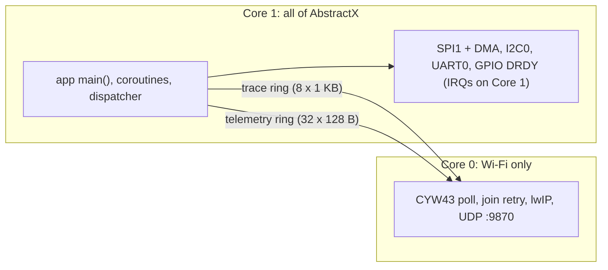

# Raspberry Pi Pico 2 W (RP2350) Development, SWD Debugging & GUI Guide

This guide provides a comprehensive, practical walkthrough for setting up, building, flashing, debugging with SWD in VS Code, and running the AbstractX live telemetry GUIs for the **Raspberry Pi Pico 2 W (RP2350)** target.

---

## 1. Architectural Role: Core 1 = AbstractX, Core 0 = Wi-Fi Only

Requirement: `[SPEC-ARCH-05]` (`docs/DESIGN_SPECIFICATION.md`) and `[SPEC-PICO-CORE-01]` (`SPECIFICATION.md`).



* **Boot**: the target links with `-Wl,--wrap=main`. Core 0 starts in `__wrap_main`, starts Core 1
  on the application's `main()`, then runs the Wi-Fi loop. Applications are unchanged.
* **Why**: the SDK CYW43 driver waits on every bus DMA. Sharing one core with Wi-Fi joined, the IMU
  ran at 1818 updates/s; with the split it runs at 2878/s (Release, 2026-11-03).
* **Debugging**: OpenOCD `reset run` leaves Core 1 in the boot ROM on this firmware. Reset with
  `reset halt` and then `resume` (or `monitor reset halt` + `continue` in GDB).

---

## 2. Hardware Connections & SWD Pinout

### 2.1 SWD Debug Header (3-Pin JST-SH / Pads)
The Raspberry Pi Pico 2 W provides a dedicated 3-pin SWD debug port located between the RP2350 SoC and the antenna:

| SWD Pin | Signal | Connects to Debug Probe |
| :--- | :--- | :--- |
| **Pin 1** (Square pad / Left) | `SWCLK` | Probe **SWCLK** (Orange / D-) |
| **Pin 2** (Center pad) | `GND` | Probe **GND** (Black) |
| **Pin 3** (Right pad) | `SWDIO` | Probe **SWDIO** (Yellow / D+) |

### 2.2 UART1 Serial Console (Telemetry & Boot Logs)
For real-time text output and boot logging, wire UART0 to your debug probe's serial interface:

| Pico 2 W Pin | GPIO | Function | Connects to Probe |
| :--- | :--- | :--- | :--- |
| **Pin 11** | `GP8` | `UART1_TX` (Pico TX) | Probe **RX** (Debugprobe GP5) |
| **Pin 12** | `GP9` | `UART1_RX` (Pico RX) | Probe **TX** (Debugprobe GP4) |
| **Pin 13** | `GND` | Ground | Probe **GND** |

The console is UART1; UART0 (GP0/GP1) is the GPS bus ([SPEC-PICO-HAL-03]).

> [!NOTE]
> Serial settings: **115200 baud, 8 data bits, 1 stop bit, no parity (8N1)**.

### 2.3 Sensor Wiring Matrix (ICM-42688-P, Mag, GPS)

| Peripheral | Signal | Pico 2 W GPIO | Physical Pin | Description |
| :--- | :--- | :--- | :--- | :--- |
| **SPI1** | `SPI1_SCK` | **GP10** | Pin 14 | SPI Clock (up to 24 MHz) |
| | `SPI1_TX` (MOSI) | **GP11** | Pin 15 | Master Out Slave In |
| | `SPI1_RX` (MISO) | **GP12** | Pin 16 | Master In Slave Out |
| | `SPI1_CS_N` | **GP13** | Pin 17 | Active-Low Hardware Chip Select |
| **IMU DRDY** | `IMU_DRDY` | **GP20** / **Pin 3** | Pin 26 / 3 | Rising-edge interrupt for Auto-DMA |
| **I2C0** | `I2C0_SDA` | **GP4** | Pin 6 | I2C Data (QMC5883L / BMP388) |
| | `I2C0_SCL` | **GP5** | Pin 7 | I2C Clock (400 kHz Fast Mode) |
| **UART0 (GPS)** | `UART0_TX` | **GP0** | Pin 1 | Transmit to GPS module |
| | `UART0_RX` | **GP1** | Pin 2 | Receive UBX frames from GPS |
| **Power** | `3V3(OUT)` | — | Pin 36 | 3.3 V Clean Sensor Rail |
| | `GND` | — | Pin 38 | System Ground |

---

## 3. Toolchain & Environment Setup

### 3.1 Required Tools

1. **ARM GNU Embedded Toolchain**:
   Requires GCC 13+ with ARMv8-M Mainline (Cortex-M33) support.
   In this environment:
   ```bash
   export PATH="/home/tcmichals/.tools/xpack-arm-none-eabi-gcc-15.2.1-1.1/bin:$PATH"
   ```
2. **Raspberry Pi Pico SDK**:
   Pico SDK 2.x is required for RP2350 support:
   ```bash
   export PICO_SDK_PATH="/home/tcmichals/.tools/pico/pico-sdk"
   ```
3. **OpenOCD**:
   An OpenOCD build with RP2350 and CMSIS-DAP / Picoprobe support:
   ```bash
   # Binary location
   /home/tcmichals/.tools/oss-cad-suite/bin/openocd
   # Script search path
   /home/tcmichals/.tools/oss-cad-suite/share/openocd/scripts
   ```

Add these to your shell profile (`~/.bashrc`):
```bash
export PICO_SDK_PATH="/home/tcmichals/.tools/pico/pico-sdk"
export PATH="/home/tcmichals/.tools/xpack-arm-none-eabi-gcc-15.2.1-1.1/bin:$PATH"
```

---

## 4. How to Compile for Debug

Compiling in **Debug mode** (`CMAKE_BUILD_TYPE=Debug`) is crucial for C++20 coroutine inspection:
* Emits full DWARF-5 debug symbols (`-g3`).
* Retains coroutine frame pointers so GDB can backtrace suspended coroutines across `co_await`.
* Prevents dead-stripping of non-blocking driver callbacks.

### 4.1 Quick Build via CMake Presets (Recommended)

AbstractX includes pre-configured CMake presets in [`CMakePresets.json`](file:///home/tcmichals/ssdData/projects/home/AbstractX/CMakePresets.json):

```bash
# 1. Configure the Debug build directory (build_pico2w_debug)
cmake --preset pico2w-debug

# 2. Build the target
cmake --build build_pico2w_debug -j$(nproc)
```

To configure with your local Wi-Fi credentials for live UDP telemetry:
```bash
cmake --preset pico2w-debug -DWIFI_SSID="MyFlightRouter" -DWIFI_PASSWORD="SecretPassword"
cmake --build build_pico2w_debug -j$(nproc)
```

### 4.2 Manual CMake Invocation

You can also configure manually into `build_pico2w`:

```bash
cmake -B build_pico2w \
  -DCMAKE_BUILD_TYPE=Debug \
  -DABSTRACTX_TARGET=pico2w \
  -DPICO_PLATFORM=rp2350-arm-s \
  -DPICO_BOARD=pico2_w \
  -DCMAKE_TOOLCHAIN_FILE=cmake/toolchains/arm-none-eabi.cmake \
  -DWIFI_SSID="MyFlightRouter" \
  -DWIFI_PASSWORD="SecretPassword"

cmake --build build_pico2w -j$(nproc)
```

### 4.3 Build Artifacts Generated

After building, the following artifacts are placed in `build_pico2w_debug/apps/gps_imu_app/`:
* `gps_imu_app.elf`: Executable and Linkable Format with full debug symbols (used by GDB and OpenOCD).
* `gps_imu_app.uf2`: Drag-and-drop flash binary for USB BOOTSEL mode.
* `gps_imu_app.bin`: Raw flat binary for direct memory flashing.
* `gps_imu_app.hex`: Intel HEX format.
* `gps_imu_app.dis`: Full assembly disassembly for checking coroutine code generation.

---

## 5. VS Code Configuration & SWD Debugging

### 5.1 Required Extensions
Install the following extensions in VS Code:
1. **Cortex-Debug** (`marus25.cortex-debug`): Provides native ARM Cortex-M multi-core debugging, register viewing, and SVD support.
2. **C/C++** (`ms-vscode.cpptools`): IntelliSense and code navigation.
3. **CMake Tools** (`ms-vscode.cmake-tools`): Preset and build integration.

### 5.2 Pre-Configured Files

The repository includes ready-to-use configuration files in `.vscode/`:

#### `.vscode/launch.json`
Select **"Pico 2 W: SWD Debug (Cortex-Debug)"** from the Run & Debug view (`Ctrl+Shift+D`):
```json
{
    "name": "Pico 2 W: SWD Debug (Cortex-Debug)",
    "type": "cortex-debug",
    "request": "launch",
    "servertype": "openocd",
    "cwd": "${workspaceFolder}",
    "executable": "${workspaceFolder}/build_pico2w_debug/apps/gps_imu_app/gps_imu_app.elf",
    "serverpath": "/home/tcmichals/.tools/oss-cad-suite/bin/openocd",
    "armToolchainPath": "/home/tcmichals/.tools/xpack-arm-none-eabi-gcc-15.2.1-1.1/bin",
    "gdbPath": "/home/tcmichals/.tools/xpack-arm-none-eabi-gcc-15.2.1-1.1/bin/arm-none-eabi-gdb",
    "searchDir": [
        "/home/tcmichals/.tools/oss-cad-suite/share/openocd/scripts"
    ],
    "configFiles": [
        "interface/cmsis-dap.cfg",
        "target/rp2350.cfg"
    ],
    "openOCDPreConfigLaunchCommands": [
        "adapter speed 5000"
    ],
    "runToEntryPoint": "main",
    "preLaunchTask": "Build Pico 2 W Firmware (Debug)"
}
```

#### `.vscode/tasks.json`
Available build and flash tasks (`Terminal` -> `Run Task...`):
* `Build Pico 2 W Firmware (Debug)`: Recompiles the debug firmware.
* `Flash Pico 2 W via OpenOCD SWD`: Flashes `gps_imu_app.elf` over SWD without touching the BOOTSEL button.
* `Start OpenOCD (RP2350)`: Starts the OpenOCD GDB server daemon on port 3333.
* `Run AbstractX Studio GUI`: Launches the live Dear ImGui telemetry studio.
* `Run Flight Display GUI`: Launches the 3D Quadcopter attitude visualizer.

### 5.3 Starting a Debug Session

1. Connect your Raspberry Pi Debug Probe to your workstation and wire the 3 SWD pins to the Pico 2 W.
2. In VS Code, press **`F5`** (or click the green Run arrow under Run & Debug).
3. VS Code executes `Build Pico 2 W Firmware (Debug)`, launches OpenOCD, resets the RP2350, programs flash, and breaks at `main()`.
4. **Stepping through Coroutines**:
   - Set a breakpoint inside `apps/gps_imu_app/src/main.cpp` inside `imu_task()` or `fusion_task()`.
   - When hitting `co_await`, press `F10` (Step Over) or `F5` (Continue).
   - In the **Call Stack** panel, you will see both **Thread #1 (Core 0)** and **Thread #2 (Core 1)**.
   - Core 0 runs the `PicoIoProcessor` loop while Core 1 executes the coroutines.

---

## 6. Flashing Alternatives

### Method 1: Automated SWD Flash (No Buttons Pressed)
With the debug probe connected, run:
```bash
/home/tcmichals/.tools/oss-cad-suite/bin/openocd \
  -s /home/tcmichals/.tools/oss-cad-suite/share/openocd/scripts \
  -f interface/cmsis-dap.cfg \
  -f target/rp2350.cfg \
  -c "adapter speed 5000" \
  -c "program build_pico2w_debug/apps/gps_imu_app/gps_imu_app.elf verify reset exit"
```
Or simply run the VS Code task: **Terminal -> Run Task -> "Flash Pico 2 W via OpenOCD SWD"**.

### Method 2: Drag-and-Drop UF2 via USB (BOOTSEL)
1. Hold down the white **BOOTSEL** button on the Pico 2 W.
2. Plug the USB cable into your computer (or tap the RUN button while holding BOOTSEL).
3. Release BOOTSEL. A USB mass storage drive named `RPI-RP2` will mount.
4. Copy `build_pico2w_debug/apps/gps_imu_app/gps_imu_app.uf2` to the drive:
   ```bash
   cp build_pico2w_debug/apps/gps_imu_app/gps_imu_app.uf2 /media/$USER/RPI-RP2/
   ```
5. The board will automatically reboot and start running.

---

## 7. How to Run the AbstractX GUIs

The Pico 2 W broadcasts 64-byte binary telemetry TLPs (CTF 1.8 schema) over UDP to port **9870**. AbstractX provides two real-time visualization applications:

### 7.1 Installing Python Dependencies

```bash
pip install -r tools/visualizer/requirements.txt
```
*(Installs `imgui-bundle`, `numpy`, and `matplotlib`)*

### 7.2 Option 1: AbstractX Studio (`abstractx_studio.py`)

High-performance Dear ImGui dashboard featuring:
* Microsecond-accurate **Coroutine Gantt Execution Timelines**.
* **8 kHz ICM-42688-P Oscilloscope** displaying real-time Accelerometer and Gyroscope waveforms.
* **Lock-Free SPSC TLP Ring Saturation Gauges** (`g_tx_ring`, `g_rx_ring`, `g_telemetry_ring`).
* **Platform Topology & Interconnect Map** showing dual-core RP2350 statistics.

**To Run**:
```bash
python3 tools/visualizer/abstractx_studio.py --port 9870
```

**Simulation Mode** (Test the UI without hardware):
```bash
python3 tools/visualizer/abstractx_studio.py --sim
```

### 7.3 Option 2: Flight Display & 3D Attitude Visualizer (`flight_display.py`)

Aviation Primary Flight Display (PFD) and 3D wireframe attitude visualizer featuring:
* **Artificial Horizon & Pitch Ladder** driven by the on-chip Mahony/EKF AHRS filter.
* **Real-time 3D Quadcopter Perspective Projection**.
* **Vertical Altimeter Tape** & Airspeed indicators.
* **Quad-X Motor Mixer Gauges** (M1–M4 DShot outputs).
* **Multi-Rate Sensor Ingestion Meters** (IMU 8 kHz, Mag 50 Hz, GPS 10 Hz).

**To Run**:
```bash
python3 apps/gps_imu_app/tools/flight_display.py --port 9870
```

**Simulation Mode** (Test the UI without hardware):
```bash
python3 apps/gps_imu_app/tools/flight_display.py --sim
```

---

## 8. Troubleshooting & Common Issues

| Issue | Cause | Solution |
| :--- | :--- | :--- |
| `Error: open failed (interface/cmsis-dap.cfg)` | Debug probe not detected or udev permissions missing | Check `lsusb`. Ensure udev rules allow non-root access: `sudo usermod -a -G plugdev $USER` |
| `Target not halted` in OpenOCD | High adapter clock speed or long ribbon cables | Lower the adapter speed in `launch.json`: change `adapter speed 5000` to `adapter speed 1000` |
| Coroutine variables show as `<optimized out>` | Binary compiled with `-O2` / `-O3` | Rebuild using `cmake --preset pico2w-debug` which enforces `-g3 -O0` / `-Og` |
| Wi-Fi fails to connect / CYW43 error | Missing SSID credentials or insufficient power | Verify `-DWIFI_SSID` build definition. Ensure Pico 2 W receives clean 5V (CYW43 draws up to 300 mA during RF transmit) |
| Core 1 coroutines stop advancing | SIO Doorbell interrupt not enabled | Verify that Core 0 rings the doorbell via `sio_hw->fifo_wr = 1` whenever an event TLP is pushed to `g_rx_ring` |

---

## 9. Next Steps & References

* Target Hardware Specification: [`targets/pico2w_rp2350/SPECIFICATION.md`](file:///home/tcmichals/ssdData/projects/home/AbstractX/targets/pico2w_rp2350/SPECIFICATION.md)
* Unified Sensor Benchmark Application: [`apps/gps_imu_app/SPECIFICATION.md`](file:///home/tcmichals/ssdData/projects/home/AbstractX/apps/gps_imu_app/SPECIFICATION.md)
* Architecture Invariants: [`AGENTS.md`](file:///home/tcmichals/ssdData/projects/home/AbstractX/AGENTS.md)
