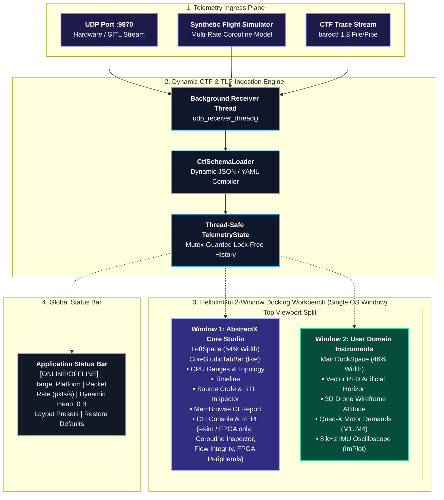

# AbstractX Visualizer Studio Specification (`tools/visualizer`)

This document is the **authoritative architectural design specification** for the **AbstractX Visualizer Studio (`tools/visualizer/`)**. It specifies the multi-window HelloImGui docking workbench, the separation between the **AbstractX Core Studio** and **User Domain Instruments**, the 64-byte TLP bus inspection and header decoding pipelines, the dynamic CTF 1.8 schema engine, the core-and-plugin extensibility SDK, and the MemBrowse zero-heap continuous memory observability model.

---

## 1. Studio Overview & Objectives

The AbstractX Visualizer Studio is a real-time hardware-software co-design observability workbench built in Python using **`imgui-bundle`** (`Dear ImGui` + `ImPlot` + `HelloImGui`). It provides:
1. **Architectural Decoupling**: A clean, physical separation between the low-level **AbstractX Core Studio** (Silicon CPU cores, timeline, SPSC rings, memory budgets, flow integrity, RTL inspection) and high-level **User Domain Instruments** (PFD, 3D attitude wireframe, motor demands, real-time sensor graphs).
2. **Multi-Viewport Docking** (`enable_viewports = True` by default, `--no-viewports` for a single OS window): any window can be popped out into its own OS window (e.g. on a second monitor), with a prominent **Pop In (Dock to Studio)** button to return.
3. **Hardware-Level TLP Bus Inspection**: Dedicated live stream table and byte-level breakdown of 64-byte Transaction Layer Packets (`asp_tlp64_t`), including 20-byte wire header extraction and color-coded hex inspection.
4. **Telemetry Ingestion**: AbstractX's own CTF streams (runtime status, profile samples, timeline events) are decoded by the Python mirrors of their `[SPEC-TRACE-*]` layouts; application sensor TLPs are decoded by the application's sensor contract ([SPEC-STUDIO-07]).
5. **Real-Time System Event Logging**: Filterable, low-latency scrolling console capturing driver lifecycle transitions, coroutine yields, hardware mailbox doorbells, and TLP router events.
6. **Continuous Zero-Heap Auditing**: Static budget tracking (`MemBrowse`) verifying zero dynamic heap usage ($0\text{ B}$) against device physical SRAM and Flash memory maps.
7. **Live Profiling**: per-line and per-function CPU time from target PC samples, shown in the source view ([SPEC-STUDIO-11]); a timeline of coroutine resumes, interrupts and idle ([SPEC-STUDIO-17]).
8. **FPGA Diagnostics (with an FPGA only)**: Head-of-Line blocking matrix, transit delay, pacing eye, FPGA peripherals ([SPEC-STUDIO-12]).



---

## 2. Multi-Window Docking Architecture & Canvas Separation Rules

The visualizer enforces a strict architectural boundary between the **AbstractX Studio Workbench** and the **USER Domain Canvas**, configured via `hello_imgui.RunnerParams`:

### 2.1 Firm Architectural Rules: USER Window vs. AbstractX Studio
1. **Rule 1: USER Window is Strictly a Single Floating Canvas**
   - The USER window contains exclusively high-level application instruments (vector PFD artificial horizon, 3D attitude quadcopter wireframe, motor demands, altitude, speed, GPS track, and IMU scope).
   - Low-level firmware diagnostics (TLP packet hex sniffers, system event logs, MemBrowse memory gates, coroutine state machines) are strictly forbidden from bleeding into the USER window.
   - Decoupled by default: floats on top of the workbench so developers and pilots can drag it, resize it, layer it over Studio, or park it on a second monitor.
2. **Rule 2: AbstractX Studio is the Engineering Workbench Foundation**
   - AbstractX Studio occupies the main desktop workspace, housing all low-level hardware, C++20 coroutine, FPGA switch fabric, and transport diagnostics.
   - Tab-first by default: diagnostic tools are `CoreStudioTabBar` tabs; the TLP Bus Debugger and System Event Log are always-docked windows instead ([SPEC-STUDIO-02]).
3. **Rule 3: Movable Canvas Windows ("Pop to Canvas")**
   - Every `CoreStudioTabBar` tab has a `🗖 Pop to Canvas` button that moves it into a floating window. Docked windows (TLP, Log, User) are moved by dragging their title bar instead.
4. **Rule 4: One Copy of Each Surface ([SPEC-STUDIO-16])**
   - A popped-out tab shows a placeholder with `🗗 Pop In`; no surface is ever drawn twice, and no layout preset opens a second copy of a tab in its own window.


```
+===================================================================================================+
| ABSTRACTX STUDIO WORKBENCH | Platform: Radxa Cubie A5E (ARM64+E906) | Stream: 8.2 kHz | 0 B Heap |
+===================================================================================================+
| [WINDOW 1: ABSTRACTX CORE STUDIO]         | [WINDOW 2: USER DOMAIN INSTRUMENTS]                   |
| (LeftSpace: 54% Width)                    | (MainDockSpace: 46% Width, 64% Height)                |
| [CoreStudioTabBar]:                        | ├─ Primary Flight Display (PFD) Artificial Horizon    |
| ├─ [CPU Gauges & Topology]                | │  Pitch ladder (+/-30°), Roll arc (-60°..+60°)       |
| │  busy %, tasks, drivers, pools          | ├─ 3D Quadcopter Perspective Attitude Wireframe       |
| ├─ [Timeline]                             | │  Tait-Bryan Euler orientation (Roll, Pitch, Yaw)    |
| │  resumes | ISRs | idle swimlanes        | ├─ Quad-X Motor Mixer Demands (M1..M4)                |
| ├─ [Source Code & RTL Inspector]          | └─ 8 kHz IMU Oscilloscope (ImPlot Real-Time Waves)    |
| │  live per-line CPU (PC samples)         +-------------------------------------------------------+
| ├─ [MemBrowse CI Report]                  | [WINDOW 3: TLP BUS DEBUGGER] | [WINDOW 4: EVENT LOG]  |
| ├─ [CLI Console & REPL]                   | (BottomSpace: 23% Width)     | (BottomRight: 23% W)   |
| └─ --sim / FPGA only: Coroutine Inspector,| ├─ 64B Stream Table          | ├─ Level Filters       |
|    Flow Integrity, FPGA Peripherals       | ├─ 20B Header Decode         | ├─ Live Trace Logs     |
|                                           | └─ Color Hex Dump            | └─ Substring Search    |
+-------------------------------------------+------------------------------+------------------------+
| Status: [ONLINE] | Radxa Cubie A5E | Packets: 124,592 | Rate: 8,240 pkts/s | Dynamic Heap: 0 B    |
| Layout: [Studio Workbench] [Balanced] [Flight Focus] [Core Studio] [Source] [FPGA] [🔄 Restore]  |
+===================================================================================================+
```

---

## 3. Window Functional Specifications

### 3.1 Window 1: AbstractX Core Studio (`LeftSpace`)
The Core Studio window holds the `CoreStudioTabBar`. Which tabs appear depends on what can feed
them ([SPEC-STUDIO-16]); the TLP Bus Debugger and System Event Log are docked windows, not tabs
([SPEC-STUDIO-02]).

| Tab / window | Live source | Shown | Requirement |
|---|---|---|---|
| CPU Gauges & Topology | runtime status reports (CTF stream 3) | always (`--sim`: demo cores/chart/topology) | [SPEC-STUDIO-15] |
| Timeline | timeline events (CTF stream 5) | always (`--sim`: demo trace) | [SPEC-STUDIO-17] |
| Source Code & RTL Inspector | repository files + PC samples (CTF stream 4) | always | [SPEC-STUDIO-11] |
| MemBrowse CI Report | `memory_metrics.json` | always | [SPEC-STUDIO-10] |
| CLI Console & REPL | board MicroPython via the sensor bridge | always | [SPEC-STUDIO-13] |
| Coroutine Inspector | none on any target yet (lifecycle macros compile to nothing) | `--sim` only | [SPEC-STUDIO-02] |
| Flow Integrity & Pacing Eye, anomaly drill-down | FPGA router statistics | `--sim` or FPGA | [SPEC-STUDIO-12] |
| FPGA Peripherals | FPGA registers | FPGA | [SPEC-STUDIO-12] |
| TLP Bus Debugger (docked) | TLP datagrams | always | [SPEC-STUDIO-04] |
| System Event Log (docked) | Studio, bridge and status events | always | [SPEC-STUDIO-05] |

### 3.2 Window 2: User Domain Instruments (`MainDockSpace`)
A high-framerate (120 FPS) canvas hosting domain-specific user instruments, decoupled from core framework execution. An instrument whose input the target does not send (on the Cubie A5E: IMU, motors, attitude) says so instead of drawing zeros:
1. **Vector Primary Flight Display (PFD)**: Anti-aliased Sky/Earth tilt polygons, pitch ladder (±10°/±20°/±30°), central reticle crosshairs, and roll angle pointer.
2. **3D Quadcopter Perspective Wireframe**: Full 3D perspective via Tait-Bryan rotation ($\mathbf{R} = \mathbf{R}_z(\psi) \mathbf{R}_y(\theta) \mathbf{R}_x(\phi)$), color-coded airframe and motor disc indicators.
3. **Quad-X Motor Mixer Demands**: Four real-time bar indicators ($M_1$..$M_4$), centered around 500 µs hover baseline.
4. **8 kHz IMU Oscilloscope (`ImPlot`)**: High-throughput scrolling gyroscope ($\Omega_x, \Omega_y, \Omega_z$ in °/s) and accelerometer ($A_x, A_y, A_z$ in $g$) waveforms.
5. **Vector Compass Rose & HSI Navigation Dial**: Rotating 360° heading dial, cardinal markers, top-referenced lubber line, GPS Ground Track (COG) bug, and wind drift angle overlay. Fully specified in [`USER_PLUGIN_SPECIFICATION.md`](USER_PLUGIN_SPECIFICATION.md).


### 3.3 Dynamic Multi-Window Management & Focus Layout Presets
1. **Dynamic Layout Presets** (status bar chips):
   - `Studio Workbench`: Standard dual-pane overview with Core Studio and User Domain side-by-side.
   - `Balanced`: Core Studio + User Instruments at default split ratio.
   - `Flight Focus`: User Domain Instruments maximized to 100%.
   - `Core Studio`: AbstractX Core Studio maximized to 100%.
   - `Source Code`: Core Studio with the Source Code & RTL tab selected, User Instruments, TLP and Log hidden (the same tab, not a second window).
   - `FPGA Hardware` (FPGA only): Core Studio with the FPGA Peripherals tab selected.
2. **Window Pop-Out / Pop-In**:
   - `[🗖 Pop Out Window]` button tears off a dockable window via `decouple_window()`.
   - `[🗗 Pop In (Dock to Studio)]` floating banner returns the window via `restore_default_layout()`.
   - High-contrast electric-blue border (`ImVec4(0.25, 0.65, 0.95, 0.9)`, 2.0 px) on all floating viewports.
3. **Restore Defaults**: `[🔄 Restore Default Layout]` button available in toolbar and status bar; sets `runner_params.docking_params.layout_reset = True` to cleanly re-dock all windows.
4. **Window size presets** live in the status bar only.

---

## 4. Anomaly Root-Cause Inspector (Drill-Down Modal)

When a timing overrun or HoL contention event is detected (FPGA router statistics, or `--sim`), the `_render_anomaly_drill_down_modal()` function opens an interactive diagnostic modal:
1. **Failure Classification**: `HoL_Blocking`, `Timing_Overrun`, or `Sequence_Jump`.
2. **Causality Dependency Chain**: Hardware trigger → crossbar routing → lock-free SPSC ring → coroutine receiver.
3. **Root Cause Diagnosis**: Human-readable explanation of the stall or overrun.
4. **One-Click Source Jump**: Buttons to jump directly to the originating C++ line (sets `source_view_mode = "CPP"`, `requested_studio_tab = "source"`) or the FPGA SystemVerilog RTL line (sets `source_view_mode = "RTL"`).

---

## 5. Core-and-Plugin SDK Contract (`tools/visualizer/sdk/plugin.py`)

AbstractX Studio decouples domain-specific instruments through the `AbstractXStudioPlugin` base class.

```python
class AbstractXStudioPlugin(ABC):
    def __init__(self, name: str, version: str = "1.0"): ...
    def on_init(self, context: Dict[str, Any]) -> None: ...
    def on_tlp_packet(self, tlp_header: Dict[str, Any], payload_dict: Dict[str, Any]) -> None: ...
    @abstractmethod
    def render_ui(self, delta_time: float = 0.0, state: Optional[Any] = None) -> None: ...
    def render_menu_items(self) -> None: ...
```

### SDK Invariants:
1. **Thread Separation**: `on_tlp_packet` is invoked asynchronously from the ingestion thread. All state mutations must be synchronized via `TelemetryState.lock`.
2. **Zero Framework Pollution**: Plugins render inside their designated dock space without manipulating parent window flags, menu setups, or low-level GLFW contexts.
3. **Dynamic Discovery**: Domain instruments can be loaded dynamically or registered at startup without modifying core studio source files.

---

## 6. Dynamic CTF 1.8 / barectf Schema Decoding

The visualizer strictly prohibits hardcoded byte offsets for telemetry event payloads. All payload parsing is governed by `CtfSchemaLoader` (`tools/visualizer/ctf_schema_loader.py`):
1. **Schema Ingestion**: Ingests JSON (`trace_schema.json`) or barectf YAML metadata.
2. **Format Compilation**: Dynamically builds Python `struct.unpack` format strings (e.g., `<Bffff` or `<BhhhIhHHHHI`) mapping data types (`uint8`, `int16`, `float32`, `uint32`, etc.).
3. **Engineering Unit Scaling**: Automatically scales raw integers into engineering units (e.g., centidegrees to degrees via `0.01`, millimeters to meters via `0.001`).

---

## 7. Standalone Synthetic Flight Simulation Engine

To enable developer iteration and CI test execution without physical silicon:
1. **Synthetic Producer**: Background generator runs when `--sim` is supplied.
2. **Multi-Rate Modeling**:
   - 8 kHz IMU accelerometer and gyroscope noise streams.
   - 50 Hz Magnetometer earth reference vectors.
   - 10 Hz GPS orbital coordinates, ground speed, and satellite fix metadata.
   - 100 Hz Fused AHRS attitude angles (sinusoidal pitch/roll motions) and motor throttle reactions.
3. **TLP 64-Byte Wire Encoding**: Packs valid headers, payloads, and calculates IEEE 802.3 CRC32 trailers.

---

## 8. Continuous Memory Observability with MemBrowse

AbstractX mandates **Freestanding C++20 with Zero Heap** ($0\text{ B}$ dynamic memory during execution):
1. **Continuous Budget Tracking**: `tools/track_memory_membrowse.py` extracts `.text`, `.rodata`, `.data`, and `.bss` metrics from target ELF binaries.
2. **Silicon Target Boundaries**: Section totals are evaluated against hardware SRAM and Flash boundaries defined in `tools/membrowse-targets.json`.
3. **Visualizer Status Verification**: The workbench displays an explicit `Dynamic Heap: 0 B` badge in the status bar and renders static allocation progress gauges in the Core Studio MemBrowse tab.

---

## 9. Normative Specification Requirements Matrix

Every requirement below is verified in code with an `@impl` tag:

### `[SPEC-STUDIO-01]` Full-Screen Multi-Window Docking Layout & Dynamic Management
The visualizer MUST initialize a Dear ImGui full-screen docking workbench using `hello_imgui` (`DefaultImGuiWindowType.provide_full_screen_dock_space`), supporting multi-viewport docking (`enable_viewports = True` by default; `--no-viewports` keeps everything in one OS window), multi-window docking splits (`LeftSpace`, `MainDockSpace`, `BottomSpace`, `BottomRightSpace`), clean initialization condition (`layout_condition = hello_imgui.DockingLayoutCondition.application_start`), dynamic focus layout presets (`balanced`, `user_focus`, `core_focus`, `source_focus`, `fpga_focus`, `studio_workbench`; presets select tabs and never open a second copy of one), window pop-out via `decouple_window()`, pop-in via `dock_window()` (resolving parent split nodes to central leaf nodes, re-splitting pruned `LeftSpace` independently without disturbing other floating windows, and committing via `dock_builder_finish`), and layout reset via `restore_default_layout()`.

Multi-viewport mode (the default) MUST make a popped-out window a real OS window:
* `io.config_viewports_no_auto_merge = True` is set in `callbacks.post_init`. ImGui's default (`False`) merges any floating window that overlaps the main window back into it, so a pop-out opened inside the Studio window never became its own OS window.
* `io.config_viewports_no_decoration = False`, so popped-out windows get a native title bar and resize borders and can be freely moved across monitors natively by the OS window manager without launching external subprocesses.
* The size presets and sliders on a floating window resize only that window (`imgui.set_window_size` / `imgui.internal.set_window_size`). They MUST NOT call `hello_imgui.change_window_size()`, which resizes the main Studio window. Sizing bars wrap across multiple rows to keep content width <= 800 px so sizing presets are not clamped by content width. Popped-out tool canvas windows (`_render_floating_canvas_windows`) provide this same sizing bar (`_render_window_sizing_bar`) with presets, sliders, and a Pop In button that returns the tool to its Studio tab.
* Popped-out windows (both User Domain Instruments and AbstractX Core Studio) display a 1-click 'Pop In (Dock to Studio)' button when undocked that immediately re-docks the window into its split independently.
* The bottom status bar provides a bidirectional toggle: 'Pop Out Flight Canvas' when docked and 'Pop In Flight Canvas' when undocked.
* Standalone flight display launchers (`flight_display.py`) delegate directly to Studio with `--tab flight` pre-configured, guaranteeing unified docking, viewports, and zero duplicated process state.
* `--demo` is an alias of `--sim`.
* **Verified by**: `host-tests` (`tests/test_visualizer_sdk.py`)
* **Tested on screen**: Ubuntu 24.04.5 LTS: X11 (2026-10-23) and Wayland (2026-10-24) pop-out to a separate OS window, size presets, and Pop In work. Not tested: Windows, second monitor.

### `[SPEC-STUDIO-02]` AbstractX Core Studio Unified Engineering Workbench
The visualizer MUST provide a dedicated Core Studio window implementing a `CoreStudioTabBar` with integrated diagnostic tabs: Coroutine Inspector, CPU Gauges & Topology, Flow Integrity & Pacing Eye, Simple Trace Viewer, Dual-Plane Timeline, Source Code & RTL Inspector, FPGA Peripherals, MemBrowse CI Report and CLI Console. All tabs share the same `TelemetryState` and respond correctly to `requested_studio_tab` jump requests. The TLP Bus Debugger ([SPEC-STUDIO-04]) and System Event Log ([SPEC-STUDIO-05]) are docked windows and MUST NOT also appear as tabs or pop-out copies: each surface is drawn once. A jump request for `tlp` or `log` shows and focuses the docked window.
* **Verified by**: `host-tests` (`tests/test_visualizer_sdk.py`)

### `[SPEC-STUDIO-03]` User Domain Instruments Decoupled Canvas
The visualizer MUST provide a dedicated primary canvas (`MainDockSpace`) hosting domain-specific user instruments (Vector Primary Flight Display artificial horizon, 3D attitude wireframe, quad-X motor demands, 8 kHz IMU real-time oscilloscope) decoupled from core framework execution.

### `[SPEC-STUDIO-04]` 64-Byte TLP Bus Debugger & Header Inspector Window
The visualizer MUST provide a dedicated TLP Bus Debugger dockable window (`BottomSpace`) displaying a live 64-byte packet stream table (Seq, Tag, Channel, Timestamp, CRC status), byte-by-byte header breakdown (20B header, 40B payload, 4B trailer), color-coded raw hex dump and pause/clear stream controls. The CRC column shows `ok`, `BAD` or `-`: Studio computes the IEEE 802.3 CRC32 of bytes 0..59 and compares it with the little-endian trailer; a frame whose trailer is zero was sent without a CRC and shows `-`, never `ok`. It is concurrently visible alongside Core Studio and User Domain Instruments on the workbench.

### `[SPEC-STUDIO-05]` Real-Time System Event Log & Trace Filter Window
The visualizer MUST provide a dedicated System Event Log dockable window (`BottomRightSpace`), displaying timestamped events from drivers, coroutines, and the TLP switch fabric, supporting level filtering (`ALL` plus one button per level that has actually been logged, so no entry is reachable only through `ALL`), substring text search, auto-scrolling and copying the filtered lines to the clipboard. It is concurrently visible alongside Core Studio, User Domain Instruments, and TLP Bus Debugger.

### `[SPEC-STUDIO-06]` Core-and-Plugin Extensibility SDK
The visualizer MUST decouple domain instruments from core framework logic using the `AbstractXStudioPlugin` base class, defining standard lifecycle hooks (`on_init`, `on_tlp_packet`, `render_ui`, `render_menu_items`) without requiring direct OpenGL/windowing boilerplate.

### `[SPEC-STUDIO-07]` Dynamic CTF 1.8 / barectf Schema Decoding
The visualizer MUST be able to load CTF 1.8 / barectf YAML and JSON schemas (`trace_schema.json`) into typed Python structures with engineering scales and units (`ctf_schema_loader.py`).
* **Decision (2026-10-22)**: live decoding does not go through the schema. AbstractX's own CTF streams are decoded by `runtime_stats.py` / `profile_stream.py` / `timeline_stream.py`, which mirror the C++ wire structs and are tested against bytes the C++ code produced; application sensor TLPs are decoded with the application's sensor contract (`apps/*/sensor_contract.py`). A layout lives in exactly one place per side, and a test pins the two sides together. (Earlier text claimed schema-driven decoding; the receiver never did it.)

### `[SPEC-STUDIO-08]` Multi-Rate Telemetry Ingestion & Thread Safety
The visualizer MUST ingest 64-byte `asp_tlp64_t` frames and CTF packets asynchronously via a dedicated background receiver thread over UDP (port 9870), synchronizing state with the UI thread through `TelemetryState.lock`.

### `[SPEC-STUDIO-09]` Standalone Synthetic Flight Simulation Engine
The visualizer MUST support a standalone `--sim` mode generating realistic multi-rate synthetic telemetry (8 kHz IMU, 50 Hz Magnetometer, 10 Hz GPS, and 100 Hz AHRS state packets) for full offline visual testing without connected hardware. Synthetic data exists only in this mode ([SPEC-STUDIO-14]).

### `[SPEC-STUDIO-14]` Live by Default: No Demo Data Unless `--sim`
* **Requirement**: without `--sim`, Studio shows only data it received or loaded from a real
  file (profile JSON, CTF schema, `memory_metrics.json`). `TelemetryState()` starts empty:
  no coroutine frames or topology, no trace events, no I/O driver events, no CPU / ring / latency
  history, GPS at 0 with 0 satellites and no fix, no MemBrowse targets beyond
  `memory_metrics.json`, no simulated CLI registers and no canned log lines.
* **Requirement**: every synthetic value is created by `TelemetryState.enable_sim()`, called only
  for `--sim`. While it is on, the status bar shows a `SIMULATED DATA (--sim)` badge.
* **Requirement**: a panel with no live source (CPU gauges, timeline, flow integrity, FPGA
  peripherals, coroutine inspector and trace with no packets yet) shows a
  "no live data" placeholder naming what would feed it, instead of placeholder numbers.
* **Requirement**: CLI commands that need the target (`peek`, `poke`, `ping`, `tasks`, MicroPython
  mode) report that Studio has no REPL link to the target, instead of answering from simulated
  state. Heap / MemBrowse badges claim PASS only when metrics were loaded.
* **Rationale**: on 2026-10-20 the live workbench showed seeded San Francisco GPS with 18
  satellites, CPU loads, coroutines, trace events and a local `eval()` "MicroPython REPL", so
  missing board data (no trace, compass and GPS not updating) looked like a working system.
* **Verified by**: `host-tests` (`tests/test_visualizer_sdk.py`)
* **Implementation Target**: `tools/visualizer/abstractx_studio.py`

### `[SPEC-STUDIO-15]` Live Runtime Status: CPU, Coroutines, Drivers, Pools
* **Requirement**: a UDP datagram that starts with the CTF magic is a CTF packet, never a set of
  TLPs. Stream 3 packets are decoded by `tools/visualizer/runtime_stats.py` ([SPEC-TRACE-08]).
* **Requirement**: with live status the CPU tab shows, from differences between consecutive
  reports: target busy %, a busy % history, `step()` rate, a task table (name, resumes/s, CPU %,
  longest resume in µs), a driver table (name, interrupts/s, ISR CPU %, errors) and the pools
  (frame pool used / high water / capacity, dispatcher queue, dropped resumes, trace discarded).
  Fields the target did not send (host CPU) say "not measured".
* **Requirement**: the busy % history scales its Y axis to the data by default (an idle target at
  0.01 % and a loaded one at 90 % are both readable); an "Auto scale" checkbox switches to a fixed
  0-100 % axis. The X window is selectable (60 s / 5 min). The plot takes the height left over
  after the tables below it, with a 220 px minimum.
* **Requirement**: the gauge labels and the clock / `step()` line below them never overlap (the
  gauge row reserves the full height of the dial plus both label lines).
* **Verified by**: `host-tests` (`tests/test_runtime_stats_decode.py`, `tests/test_visualizer_sdk.py`), `e906-board-selftest` (`tests/board/test_e906_trace.py`)
* **Implementation Target**: `tools/visualizer/runtime_stats.py`, `tools/visualizer/abstractx_studio.py`

### `[SPEC-STUDIO-10]` MemBrowse Zero-Heap Static Budget Verification & CI Report
The visualizer MUST ingest static section metrics (`.text`, `.rodata`, `.data`, `.bss`) from `memory_metrics.json` generated by continuous integration (`.github/workflows/membrowse.yml` and `tools/track_memory_membrowse.py`). It MUST display a multi-target comparison matrix, detailed RAM/Flash budget bars, zero-heap invariant verification badges (`0 B` dynamic heap), and provide a 1-click interactive action to execute local MemBrowse CI analysis and reload metrics.

### `[SPEC-STUDIO-11]` Source Code & RTL Browser with Live Annotations
* **Requirement**: the Source Code & RTL tab browses the real files in the repository (C/C++/asm
  under `apps/`, `targets/`, `include/`, `src/`; SystemVerilog under `rtl/` in `RTL` mode, which
  is offered only with an FPGA), with a file-name filter, a text search that jumps to the next
  match, line numbers and a selectable current line. Nothing in it is canned or simulated.
* **Requirement**: a line that names a coroutine or driver from the live status report
  ([SPEC-STUDIO-15]) as a string literal (`spawn(task, "repl_rx")`, `describe(line, "uart3")`)
  shows that object's live numbers next to it (task CPU % and resumes/s; driver IRQ/s and
  µs per IRQ), so a figure in the CPU tab leads straight to the code that owns it.
* **Requirement (profile labels, 2026-10-23)**: a PC sample ([SPEC-TRACE-09]) is credited to the
  outermost function that contains the address (the symbol the code lives in, as `perf` does),
  with that function's source line, not to a function inlined at that address. The symbolizer
  resolves the whole inline chain (`addr2line -i`) and keeps its last entry.
* **Rationale**: a sample taken in the idle `wfi` records the next instruction (the core saves
  `wfi + 4`); on the E906 that address is code inlined from `now_cycles()`, so idle time (92 % of
  samples) was listed under `now_cycles()` instead of `platform_idle_wait()`.
* **Verified by**: `host-tests` (`tests/test_visualizer_sdk.py`, `tests/test_live_profile.py`:
  inline chains resolve to the outermost function; against the real E906 ELF when it is built)
* **Implementation Target**: `tools/visualizer/abstractx_studio.py`, `tools/visualizer/live_profile.py`

### `[SPEC-STUDIO-12]` Real-Time Flow-Integrity, Pacing Eye Diagram & HoL Contention Matrix
The visualizer MUST provide a Flow Integrity & Pacing Eye tab (within `CoreStudioTabBar`, shown only with an FPGA or in `--sim`, [SPEC-STUDIO-16]) rendering:
- **HoL Blocking Matrix**: Per-channel (Ch 0..4) AXI-Stream stall time, ring fill %, STALLED/NOMINAL status, and coral-red highlighting for stalls ≥ 10 µs.
- **Transit Delay Plot**: $\Delta t_{\text{transit}} = t_{\text{pop}} - t_{\text{latch}}$ (µs) with saturation threshold line at 10 µs and monotonic sequence drop counters.
- **Pacing Eye Diagram**: Inter-arrival intervals folded modulo 125.0 µs (8 kHz primary epoch), exposing jitter and drift.
- **Anomaly Root-Cause Inspector Modal**: One-click drill-down from any contention/overrun event to the causality chain and direct jump to C++ or RTL source.

### `[SPEC-STUDIO-13]` Interactive CLI Console Connected to the Board's MicroPython
* **Requirement**: the CLI tab runs commands on the real target. In MicroPython mode a line is
  sent to the board's MicroPython through the sensor bridge ([SPEC-E906-REPL-19]) and its output
  and exceptions are shown, while the sensor stream keeps running. Without a running bridge
  the CLI says so; it never evaluates locally.
* **Requirement**: AbstractX mode commands: `help`, `clear`; `ps` / `tasks` print the coroutine
  table from the latest runtime status report ([SPEC-STUDIO-15]); `drivers` the driver table;
  `peek <addr>` / `poke <addr> <val>` run `abstractx.peek` / `abstractx.poke` on the board;
  `ping` measures the CLI round trip. Anything else is sent as MicroPython.
* **Requirement**: `--sim` keeps its demo answers, and only `--sim` has them ([SPEC-STUDIO-14]).
* **Verified by**: `host-tests` (`tests/test_visualizer_sdk.py`, `tests/test_board_suite_local.py`), `e906-board-selftest` (`tests/board/test_e906_trace.py`)
* **Implementation Target**: `tools/visualizer/abstractx_studio.py`, `tools/visualizer/flight_plugin.py`, `tools/board_studio_bridge.py`, `apps/e906_repl_app/raw_sensor_streamer.py`

### `[SPEC-STUDIO-16]` Tool Availability and One Copy per Surface
* **Requirement**: each tool is declared once (key, tab label, canvas title, render function,
  availability). Tabs, pop-out canvas windows and layout presets are all generated from that one
  list, so a tool cannot be drawn twice or appear where its availability rule says no.
* **Requirement**: availability: Coroutine Inspector only in `--sim`; Flow Integrity and the anomaly
  drill-down in `--sim` or with an FPGA; FPGA Peripherals with an FPGA; every other tab always.
* **Rationale**: on 2026-10-22 the live workbench showed the TLP debugger and event log twice,
  a second source window from the "Source Code" preset, and tabs that could never have data on
  the target; each had its own hand-written tab, canvas and preset code.
* **Verified by**: `host-tests` (`tests/test_visualizer_sdk.py`)
* **Implementation Target**: `tools/visualizer/abstractx_studio.py`

### `[SPEC-STUDIO-17]` Timeline: Coroutine Resumes, Interrupts and Idle
* **Requirement**: one Timeline tab replaces the Simple Trace Viewer and the Dual-Plane Timeline.
  Live, it draws the target's timeline events ([SPEC-TRACE-10]) as swimlanes: one lane per
  coroutine (resume spans), one per interrupt line (ISR spans) and one for idle, on a shared time
  axis with pause, zoom and a window length; hovering a span shows its duration, and a table
  below lists the most recent events. `--sim` shows the demo trace.
* **Verified by**: `host-tests` (`tests/test_visualizer_sdk.py`)
* **Implementation Target**: `tools/visualizer/abstractx_studio.py`, `tools/visualizer/timeline_stream.py`
